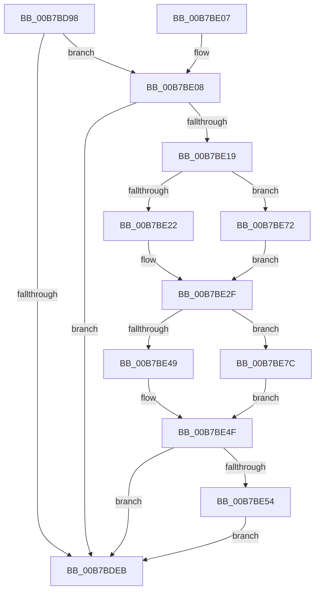

# ExUpdateSystemTimeFromCmos

- RVA: `0x00B7BD98`–`0x00B7BE84` (길이 `236` bytes)
- VA: `0x0000000140B7BD98`
- 실행 섹션: `PAGELK`
- PDB 이름 있음: `예`; PDB Function 태그: `아니요`
- unwind 정보 RVA: `0x000BB308`
- 디코드: `63`개 명령, `236/236` bytes 표시
- 미해석 바이트: `0` (있으면 어셈블리에 `.byte`로 보존)

> 이 문서는 커널 이미지의 기계어와 PDB 기호를 분석해 생성했습니다. 4번과 5번은 함수 원형과 자료형을 바이너리 사용 방식에서 추정한 C 해석이며 원본 소스 복구 결과는 아닙니다.

## 1. Dependencies

- 직접 호출 지점: **5**; 고유 호출 대상: **5**
- 직접 호출자로 확인된 함수: **3**
- RIP 상대 이미지 참조: **3**

### Outgoing calls
- `0x00B7BDE2` → [HalQueryRealTimeClock](../../text/42/HalQueryRealTimeClock_function_0042D810.md) (function, `0x0042D810`)
- `0x00B7BDF2` → [_security_check_cookie](../../text/6A/_security_check_cookie_function_006AC640.md) (function, `0x006AC640`)
- `0x00B7BE10` → [RtlTimeFieldsToTime](../../text/42/RtlTimeFieldsToTime_function_0042E6B0.md) (function, `0x0042E6B0`)
- `0x00B7BE2A` → [ExLocalTimeToSystemTime](../../text/49/ExLocalTimeToSystemTime_function_00494BC0.md) (function, `0x00494BC0`)
- `0x00B7BE68` → [ExpSetSystemTime](ExpSetSystemTime_function_00B7C838.md) (function, `0x00B7C838`)

### Direct callers
- [ExpTimeRefreshWork](ExpTimeRefreshWork_function_00B72A80.md) at `0x00B72A96`
- [PopTransitionSystemPowerStateEx](PopTransitionSystemPowerStateEx_function_00B7E8C0.md) at `0x00B7EECA`
- [PopTransitionSystemPowerStateEx](PopTransitionSystemPowerStateEx_function_00B7E8C0.md) at `0x00B7F63F`
- [KdpTimeSlipWork](../../pagekd/B8/KdpTimeSlipWork_function_00B88650.md) at `0x00B88663`

### Static image references
- `0x00B7BDAA` → RVA `0x00E0A740` (`.data`; read)
- `0x00B7BDD2` → RVA `0x00E0EB90` (`.data`; read)
- `0x00B7BE19` → RVA `0x00E68570` (`.data`; read)

## 2. Other-region calls and transfers

- 다른 실행 섹션으로 향하는 call: **4**
  - `0x00B7BDE2` → [HalQueryRealTimeClock](../../text/42/HalQueryRealTimeClock_function_0042D810.md) (`PAGELK` → `.text`)
  - `0x00B7BDF2` → [_security_check_cookie](../../text/6A/_security_check_cookie_function_006AC640.md) (`PAGELK` → `.text`)
  - `0x00B7BE10` → [RtlTimeFieldsToTime](../../text/42/RtlTimeFieldsToTime_function_0042E6B0.md) (`PAGELK` → `.text`)
  - `0x00B7BE2A` → [ExLocalTimeToSystemTime](../../text/49/ExLocalTimeToSystemTime_function_00494BC0.md) (`PAGELK` → `.text`)
- 별도 외부 분기/꼬리 이동을 확인하지 못했습니다.

## 3. Assembly (complete function range)

```asm
00B7BD98  48 89 5C 24 08                  mov qword ptr [rsp + 8], rbx
00B7BD9D  48 89 7C 24 10                  mov qword ptr [rsp + 0x10], rdi
00B7BDA2  55                              push rbp
00B7BDA3  48 8B EC                        mov rbp, rsp
00B7BDA6  48 83 EC 60                     sub rsp, 0x60
00B7BDAA  48 8B 05 8F E9 28 00            mov rax, qword ptr [rip + 0x28e98f]
00B7BDB1  48 33 C4                        xor rax, rsp
00B7BDB4  48 89 45 F8                     mov qword ptr [rbp - 8], rax
00B7BDB8  48 83 65 D8 00                  and qword ptr [rbp - 0x28], 0
00B7BDBD  40 8A F9                        mov dil, cl
00B7BDC0  48 83 65 D0 00                  and qword ptr [rbp - 0x30], 0
00B7BDC5  48 8D 4D E8                     lea rcx, [rbp - 0x18]
00B7BDC9  85 D2                           test edx, edx
00B7BDCB  0F 57 C0                        xorps xmm0, xmm0
00B7BDCE  0F 11 45 E8                     movups xmmword ptr [rbp - 0x18], xmm0
00B7BDD2  0F 44 15 B7 2D 29 00            cmove edx, dword ptr [rip + 0x292db7]
00B7BDD9  8B C2                           mov eax, edx
00B7BDDB  48 69 D8 80 96 98 00            imul rbx, rax, 0x989680
00B7BDE2  E8 29 1A 8B FF                  call 0x14042d810
00B7BDE7  84 C0                           test al, al
00B7BDE9  75 1D                           jne 0x140b7be08
00B7BDEB  48 8B 4D F8                     mov rcx, qword ptr [rbp - 8]
00B7BDEF  48 33 CC                        xor rcx, rsp
00B7BDF2  E8 49 08 B3 FF                  call 0x1406ac640
00B7BDF7  48 8B 5C 24 70                  mov rbx, qword ptr [rsp + 0x70]
00B7BDFC  48 8B 7C 24 78                  mov rdi, qword ptr [rsp + 0x78]
00B7BE01  48 83 C4 60                     add rsp, 0x60
00B7BE05  5D                              pop rbp
00B7BE06  C3                              ret
00B7BE07  CC                              int3
00B7BE08  48 8D 55 D0                     lea rdx, [rbp - 0x30]
00B7BE0C  48 8D 4D E8                     lea rcx, [rbp - 0x18]
00B7BE10  E8 9B 28 8B FF                  call 0x14042e6b0
00B7BE15  84 C0                           test al, al
00B7BE17  74 D2                           je 0x140b7bdeb
00B7BE19  83 3D 50 C7 2E 00 00            cmp dword ptr [rip + 0x2ec750], 0
00B7BE20  75 50                           jne 0x140b7be72
00B7BE22  48 8D 55 D8                     lea rdx, [rbp - 0x28]
00B7BE26  48 8D 4D D0                     lea rcx, [rbp - 0x30]
00B7BE2A  E8 91 8D 91 FF                  call 0x140494bc0
00B7BE2F  48 B9 14 00 00 00 80 F7 FF FF   movabs rcx, 0xfffff78000000014
00B7BE39  48 8B 09                        mov rcx, qword ptr [rcx]
00B7BE3C  4C 8B 4D D8                     mov r9, qword ptr [rbp - 0x28]
00B7BE40  48 89 4D E0                     mov qword ptr [rbp - 0x20], rcx
00B7BE44  4C 3B C9                        cmp r9, rcx
00B7BE47  7E 33                           jle 0x140b7be7c
00B7BE49  49 8B C1                        mov rax, r9
00B7BE4C  48 2B C1                        sub rax, rcx
00B7BE4F  48 3B C3                        cmp rax, rbx
00B7BE52  76 97                           jbe 0x140b7bdeb
00B7BE54  48 8D 45 E0                     lea rax, [rbp - 0x20]
00B7BE58  41 B8 02 00 00 00               mov r8d, 2
00B7BE5E  40 8A D7                        mov dl, dil
00B7BE61  48 89 44 24 20                  mov qword ptr [rsp + 0x20], rax
00B7BE66  33 C9                           xor ecx, ecx
00B7BE68  E8 CB 09 00 00                  call 0x140b7c838
00B7BE6D  E9 79 FF FF FF                  jmp 0x140b7bdeb
00B7BE72  48 8B 45 D0                     mov rax, qword ptr [rbp - 0x30]
00B7BE76  48 89 45 D8                     mov qword ptr [rbp - 0x28], rax
00B7BE7A  EB B3                           jmp 0x140b7be2f
00B7BE7C  48 8B C1                        mov rax, rcx
00B7BE7F  49 2B C1                        sub rax, r9
00B7BE82  EB CB                           jmp 0x140b7be4f
```

## 4. C-style interpretation (structured pseudocode)

```c
__int64 __fastcall ExUpdateSystemTimeFromCmos(unsigned __int8 a1, int a2)
{
    __int64 result;
    __int64 v_rbx;
    __int64 v_rsp;
    unsigned __int64 v_stack_m10;
    unsigned __int64 v_stack_m20;
    unsigned __int64 v_stack_m28;
    unsigned __int64 v_stack_m30;
    unsigned __int64 v_stack_m38;
    unsigned __int64 v_stack_p10;
    unsigned __int64 v_stack_p20;
    unsigned __int64 v_stack_p8;

    v_stack_p8 = v_rbx;
    v_stack_p10 = v_rdi;
    v_rsp = (v_rsp) - (96);
    result = (*(unsigned __int64 *)(v_rip + 2681231)) ^ (v_rsp);
    v_stack_m10 = result;
    v_stack_m20 = v_xmm0;
    if (a2 == 0) { a2 = *(unsigned int *)(v_rip + 2698679); }
    v_rbx = (v_rbx) * ((unsigned int)(a2));
    result = HalQueryRealTimeClock(v_stack_m20, a2, a3, a4);
    if ((unsigned __int8)(result) != 0) goto loc_00B7BE08;
loc_00B7BDEB:
    a1 = (v_stack_m10) ^ (v_rsp);
    result = _security_check_cookie(a1, a2, a3, a4);
    v_rsp = (v_rsp) + (96);
    return result;
loc_00B7BE08:
    result = RtlTimeFieldsToTime(v_stack_m20, v_stack_m38, a3, a4);
    if ((unsigned __int8)(result) == 0) goto loc_00B7BDEB;
    if ((*(unsigned int *)(v_rip + 3065680)) != 0) goto loc_00B7BE72;
    result = ExLocalTimeToSystemTime(v_stack_m38, v_stack_m30, a3, a4);
loc_00B7BE2F:
    v_stack_m28 = *(unsigned __int64 *)(v_stack_m38);
    if (v_stack_m30 <= (*(unsigned __int64 *)(v_stack_m38))) goto loc_00B7BE7C;
    result = (v_stack_m30) - (*(unsigned __int64 *)(v_stack_m38));
loc_00B7BE4F:
    if (result <= v_stack_p8) goto loc_00B7BDEB;
    v_stack_p20 = v_stack_m28;
    a1 = 0;
    result = ExpSetSystemTime(a1, (unsigned __int8)(v_stack_p10), 2, v_stack_m30);
    goto loc_00B7BDEB;
loc_00B7BE72:
    v_stack_m30 = v_stack_m38;
    goto loc_00B7BE2F;
loc_00B7BE7C:
    result = (0) - (v_stack_m30);
    goto loc_00B7BE4F;
}
```

## 5. (Beta) C Style

```c
int64_t ExUpdateSystemTimeFromCmos(uint8_t Arg1, int32_t Arg2)
{
    int64_t result;
    int64_t local_rbx;
    int64_t local_rsp;
    uint64_t v_stack_m10;
    uint64_t v_stack_m20;
    uint64_t v_stack_m28;
    uint64_t v_stack_m30;
    uint64_t v_stack_m38;
    uint64_t v_stack_p10;
    uint64_t v_stack_p20;
    uint64_t v_stack_p8;

    v_stack_p8 = local_rbx;
    v_stack_p10 = local_rdi;
    local_rsp = (local_rsp) - (96);
    result = (*(uint64_t *)(v_rip + 0x28E98F)) ^ (local_rsp);
    v_stack_m10 = result;
    v_stack_m20 = v_xmm0;
    if (Arg2 == 0) { Arg2 = *(uint32_t *)(v_rip + 0x292DB7); }
    local_rbx = (local_rbx) * ((uint32_t)(Arg2));
    result = HalQueryRealTimeClock(v_stack_m20, Arg2, a3, a4);
    if ((uint8_t)(result) != 0) goto loc_00B7BE08;
loc_00B7BDEB:
    Arg1 = (v_stack_m10) ^ (local_rsp);
    result = _security_check_cookie(Arg1, Arg2, a3, a4);
    local_rsp = (local_rsp) + (96);
    return result;
loc_00B7BE08:
    result = RtlTimeFieldsToTime(v_stack_m20, v_stack_m38, a3, a4);
    if ((uint8_t)(result) == 0) goto loc_00B7BDEB;
    if ((*(uint32_t *)(v_rip + 0x2EC750)) != 0) goto loc_00B7BE72;
    result = ExLocalTimeToSystemTime(v_stack_m38, v_stack_m30, a3, a4);
loc_00B7BE2F:
    v_stack_m28 = *(uint64_t *)(v_stack_m38);
    if (v_stack_m30 <= (*(uint64_t *)(v_stack_m38))) goto loc_00B7BE7C;
    result = (v_stack_m30) - (*(uint64_t *)(v_stack_m38));
loc_00B7BE4F:
    if (result <= v_stack_p8) goto loc_00B7BDEB;
    v_stack_p20 = v_stack_m28;
    Arg1 = 0;
    result = ExpSetSystemTime(Arg1, (uint8_t)(v_stack_p10), 2, v_stack_m30);
    goto loc_00B7BDEB;
loc_00B7BE72:
    v_stack_m30 = v_stack_m38;
    goto loc_00B7BE2F;
loc_00B7BE7C:
    result = (0) - (v_stack_m30);
    goto loc_00B7BE4F;
}
```

## 6. Execution-region graph

[열기: 2D/3D 그래프와 함수 탐색 컨트롤 패널](../../../control-panel.html?section=pagelk&rva=0x00B7BD98&view=graph)

- 2D 그래프는 위에서 아래로 흐르고, 3D 그래프는 빈 공간을 드래그해 회전합니다. Shift+드래그는 이동, 휠은 확대·축소, 함수 노드 선택은 대상 보고서 이동입니다.

### Static fallback


