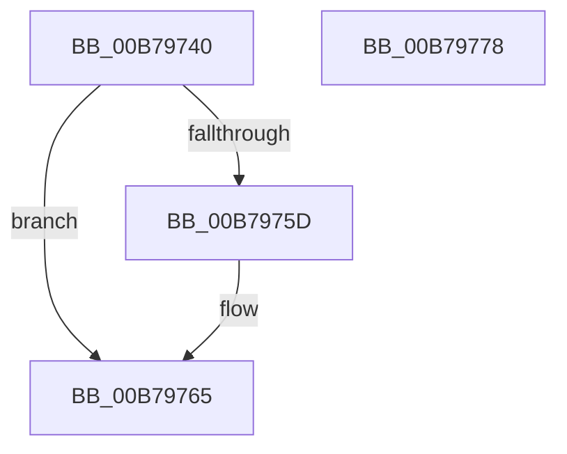

# ExpSetSwappingKernelApc

- RVA: `0x00B79740`–`0x00B79779` (길이 `57` bytes)
- VA: `0x0000000140B79740`
- 실행 섹션: `PAGELK`
- PDB 이름 있음: `예`; PDB Function 태그: `아니요`
- unwind 정보 RVA: `0x0005CF00`
- 디코드: `17`개 명령, `57/57` bytes 표시
- 미해석 바이트: `0` (있으면 어셈블리에 `.byte`로 보존)

> 이 문서는 커널 이미지의 기계어와 PDB 기호를 분석해 생성했습니다. 4번과 5번은 함수 원형과 자료형을 바이너리 사용 방식에서 추정한 C 해석이며 원본 소스 복구 결과는 아닙니다.

## 1. Dependencies

- 직접 호출 지점: **2**; 고유 호출 대상: **2**
- 직접 호출자로 확인된 함수: **0**
- RIP 상대 이미지 참조: **0**

### Outgoing calls
- `0x00B79760` → [KeSetKernelStackSwapEnable](../../text/45/KeSetKernelStackSwapEnable_function_00450760.md) (function, `0x00450760`)
- `0x00B7976D` → [KeSetEvent](../../text/33/KeSetEvent_function_0033F310.md) (function, `0x0033F310`)

### Direct callers
- 이 함수 시작 RVA로 연결되는 직접 call은 확인되지 않았습니다. 간접 호출은 완전히 역산할 수 없습니다.

### Static image references
- 디코드된 RIP-relative 메모리 참조가 없습니다.

## 2. Other-region calls and transfers

- 다른 실행 섹션으로 향하는 call: **2**
  - `0x00B79760` → [KeSetKernelStackSwapEnable](../../text/45/KeSetKernelStackSwapEnable_function_00450760.md) (`PAGELK` → `.text`)
  - `0x00B7976D` → [KeSetEvent](../../text/33/KeSetEvent_function_0033F310.md) (`PAGELK` → `.text`)
- 별도 외부 분기/꼬리 이동을 확인하지 못했습니다.

## 3. Assembly (complete function range)

```asm
00B79740  40 53                           push rbx
00B79742  48 83 EC 20                     sub rsp, 0x20
00B79746  65 48 8B 04 25 88 01 00 00      mov rax, qword ptr gs:[0x188]
00B7974F  49 8B 19                        mov rbx, qword ptr [r9]
00B79752  8B 90 A4 05 00 00               mov edx, dword ptr [rax + 0x5a4]
00B79758  F6 C2 01                        test dl, 1
00B7975B  74 08                           je 0x140b79765
00B7975D  41 8A 08                        mov cl, byte ptr [r8]
00B79760  E8 FB 6F 8D FF                  call 0x140450760
00B79765  45 33 C0                        xor r8d, r8d
00B79768  33 D2                           xor edx, edx
00B7976A  48 8B CB                        mov rcx, rbx
00B7976D  E8 9E 5B 7C FF                  call 0x14033f310
00B79772  48 83 C4 20                     add rsp, 0x20
00B79776  5B                              pop rbx
00B79777  C3                              ret
00B79778  CC                              int3
```

## 4. C-style interpretation (structured pseudocode)

```c
__int64 __fastcall ExpSetSwappingKernelApc(__int64 a1, __int64 a2, __int64 a3, __int64 a4)
{
    __int64 result;
    __int64 v_rsp;

    v_rsp = (v_rsp) - (32);
    result = *(unsigned __int64 *)(gs_base + (0 + 392));
    if ((((unsigned __int8)((unsigned int)(*(unsigned int *)(*(unsigned __int64 *)(gs_base + (0 + 392)) + 1444)))) & (1)) != 0) {
        a1 = *(unsigned __int8 *)(a3);
        result = KeSetKernelStackSwapEnable(a1, (unsigned int)(*(unsigned int *)(*(unsigned __int64 *)(gs_base + (0 + 392)) + 1444)), a3, a4);
    }
    a3 = 0;
    a2 = 0;
    result = KeSetEvent(*(unsigned __int64 *)(a4), a2, a3, a4);
    v_rsp = (v_rsp) + (32);
    return result;
}
```

## 5. (Beta) C Style

```c
int64_t ExpSetSwappingKernelApc(int64_t Arg1, int64_t Arg2, void *Arg3, void *Arg4)
{
    uint8_t *arg3 = (uint8_t *)Arg3;
    uint8_t *arg4 = (uint8_t *)Arg4;

    int64_t result;
    int64_t local_rsp;

    local_rsp = (local_rsp) - (32);
    result = *(uint64_t *)(gs_base + (0 + 0x188));
    if ((((uint8_t)((uint32_t)(*(uint32_t *)(*(uint64_t *)(gs_base + (0 + 0x188)) + 0x5A4)))) & (1)) != 0) {
        Arg1 = *(uint8_t *)(arg3);
        result = KeSetKernelStackSwapEnable(Arg1, (uint32_t)(*(uint32_t *)(*(uint64_t *)(gs_base + (0 + 0x188)) + 0x5A4)), Arg3, Arg4);
    }
    Arg3 = 0;
    Arg2 = 0;
    result = KeSetEvent(*(uint64_t *)(arg4), Arg2, Arg3, Arg4);
    local_rsp = (local_rsp) + (32);
    return result;
}
```

### 관측된 메모리 오프셋

구조체 형식이 확인되지 않은 접근은 인자 기준의 오프셋으로만 기록했습니다.

| 기준 인자 | 오프셋 표현 | 폭 (bit) | 접근 |
|---|---:|---:|---|
| `Arg3` | `+ 0x0` | `8` | `R` |
| `Arg4` | `+ 0x0` | `64` | `R` |

## 6. Execution-region graph

[열기: 2D/3D 그래프와 함수 탐색 컨트롤 패널](../../../control-panel.html?section=pagelk&rva=0x00B79740&view=graph)

- 2D 그래프는 위에서 아래로 흐르고, 3D 그래프는 빈 공간을 드래그해 회전합니다. Shift+드래그는 이동, 휠은 확대·축소, 함수 노드 선택은 대상 보고서 이동입니다.

### Static fallback


