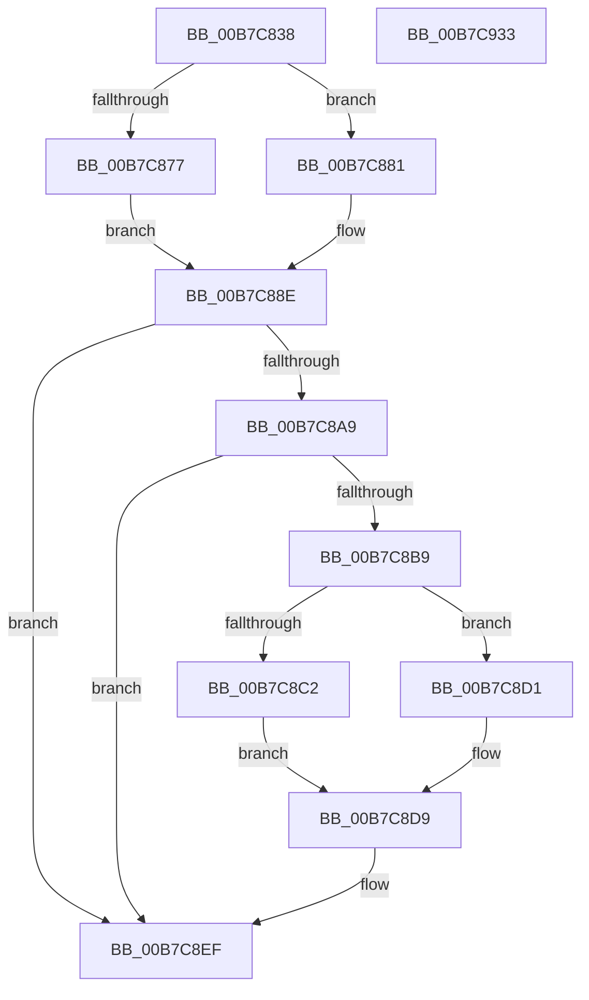

# ExpSetSystemTime

- RVA: `0x00B7C838`–`0x00B7C934` (길이 `252` bytes)
- VA: `0x0000000140B7C838`
- 실행 섹션: `PAGELK`
- PDB 이름 있음: `예`; PDB Function 태그: `아니요`
- unwind 정보 RVA: `0x000BC8C4`
- 디코드: `68`개 명령, `252/252` bytes 표시
- 미해석 바이트: `0` (있으면 어셈블리에 `.byte`로 보존)

> 이 문서는 커널 이미지의 기계어와 PDB 기호를 분석해 생성했습니다. 4번과 5번은 함수 원형과 자료형을 바이너리 사용 방식에서 추정한 C 해석이며 원본 소스 복구 결과는 아닙니다.

## 1. Dependencies

- 직접 호출 지점: **8**; 고유 호출 대상: **7**
- 직접 호출자로 확인된 함수: **2**
- RIP 상대 이미지 참조: **2**

### Outgoing calls
- `0x00B7C866` → [PsGetCurrentServerSiloGlobals](../../text/2F/PsGetCurrentServerSiloGlobals_function_002FE1F0.md) (function, `0x002FE1F0`)
- `0x00B7C889` → [ExSystemTimeToLocalTime](../../text/2F/ExSystemTimeToLocalTime_function_002FE1C0.md) (function, `0x002FE1C0`)
- `0x00B7C89F` → [KeSetSystemTime](../../text/2C/KeSetSystemTime_function_002C8E5C.md) (function, `0x002C8E5C`)
- `0x00B7C8AB` → [ExpRefreshTimeZoneInformation](../../page/A6/ExpRefreshTimeZoneInformation_function_00A6B46C.md) (function, `0x00A6B46C`)
- `0x00B7C8CA` → [ExSystemTimeToLocalTime](../../text/2F/ExSystemTimeToLocalTime_function_002FE1C0.md) (function, `0x002FE1C0`)
- `0x00B7C8E1` → [RtlTimeToTimeFields](../../text/42/RtlTimeToTimeFields_function_0042E0F0.md) (function, `0x0042E0F0`)
- `0x00B7C8EA` → [HalSetRealTimeClock](../../text/42/HalSetRealTimeClock_function_0042D310.md) (function, `0x0042D310`)
- `0x00B7C919` → [PoNotifySystemTimeSet](../../text/4D/PoNotifySystemTimeSet_function_004D4F7C.md) (function, `0x004D4F7C`)

### Direct callers
- [NtSetSystemTime](../../page/7C/NtSetSystemTime_function_007C65F0.md) at `0x007C6738`
- [ExUpdateSystemTimeFromCmos](ExUpdateSystemTimeFromCmos_function_00B7BD98.md) at `0x00B7BE68`

### Static image references
- `0x00B7C86B` → RVA `0x00E68570` (`.data`; read)
- `0x00B7C8B0` → RVA `0x00E0EB98` (`.data`; read)

## 2. Other-region calls and transfers

- 다른 실행 섹션으로 향하는 call: **8**
  - `0x00B7C866` → [PsGetCurrentServerSiloGlobals](../../text/2F/PsGetCurrentServerSiloGlobals_function_002FE1F0.md) (`PAGELK` → `.text`)
  - `0x00B7C889` → [ExSystemTimeToLocalTime](../../text/2F/ExSystemTimeToLocalTime_function_002FE1C0.md) (`PAGELK` → `.text`)
  - `0x00B7C89F` → [KeSetSystemTime](../../text/2C/KeSetSystemTime_function_002C8E5C.md) (`PAGELK` → `.text`)
  - `0x00B7C8AB` → [ExpRefreshTimeZoneInformation](../../page/A6/ExpRefreshTimeZoneInformation_function_00A6B46C.md) (`PAGELK` → `PAGE`)
  - `0x00B7C8CA` → [ExSystemTimeToLocalTime](../../text/2F/ExSystemTimeToLocalTime_function_002FE1C0.md) (`PAGELK` → `.text`)
  - `0x00B7C8E1` → [RtlTimeToTimeFields](../../text/42/RtlTimeToTimeFields_function_0042E0F0.md) (`PAGELK` → `.text`)
  - `0x00B7C8EA` → [HalSetRealTimeClock](../../text/42/HalSetRealTimeClock_function_0042D310.md) (`PAGELK` → `.text`)
  - `0x00B7C919` → [PoNotifySystemTimeSet](../../text/4D/PoNotifySystemTimeSet_function_004D4F7C.md) (`PAGELK` → `.text`)
- 별도 외부 분기/꼬리 이동을 확인하지 못했습니다.

## 3. Assembly (complete function range)

```asm
00B7C838  48 89 5C 24 08                  mov qword ptr [rsp + 8], rbx
00B7C83D  48 89 74 24 10                  mov qword ptr [rsp + 0x10], rsi
00B7C842  4C 89 4C 24 20                  mov qword ptr [rsp + 0x20], r9
00B7C847  55                              push rbp
00B7C848  57                              push rdi
00B7C849  41 56                           push r14
00B7C84B  48 8B EC                        mov rbp, rsp
00B7C84E  48 83 EC 60                     sub rsp, 0x60
00B7C852  48 83 65 E0 00                  and qword ptr [rbp - 0x20], 0
00B7C857  0F 57 C0                        xorps xmm0, xmm0
00B7C85A  0F 11 45 E8                     movups xmmword ptr [rbp - 0x18], xmm0
00B7C85E  41 8B F0                        mov esi, r8d
00B7C861  8A DA                           mov bl, dl
00B7C863  40 8A F9                        mov dil, cl
00B7C866  E8 85 19 78 FF                  call 0x1402fe1f0
00B7C86B  83 3D FE BC 2E 00 00            cmp dword ptr [rip + 0x2ebcfe], 0
00B7C872  4C 8B F0                        mov r14, rax
00B7C875  74 0A                           je 0x140b7c881
00B7C877  4C 8B 4D 38                     mov r9, qword ptr [rbp + 0x38]
00B7C87B  4C 89 4D E0                     mov qword ptr [rbp - 0x20], r9
00B7C87F  EB 0D                           jmp 0x140b7c88e
00B7C881  48 8D 55 E0                     lea rdx, [rbp - 0x20]
00B7C885  48 8D 4D 38                     lea rcx, [rbp + 0x38]
00B7C889  E8 32 19 78 FF                  call 0x1402fe1c0
00B7C88E  48 8B 55 40                     mov rdx, qword ptr [rbp + 0x40]
00B7C892  48 8D 4D 38                     lea rcx, [rbp + 0x38]
00B7C896  F6 DB                           neg bl
00B7C898  45 1B C0                        sbb r8d, r8d
00B7C89B  41 83 E0 03                     and r8d, 3
00B7C89F  E8 B8 C5 74 FF                  call 0x1402c8e5c
00B7C8A4  40 84 FF                        test dil, dil
00B7C8A7  74 46                           je 0x140b7c8ef
00B7C8A9  33 C9                           xor ecx, ecx
00B7C8AB  E8 BC EB EE FF                  call 0x140a6b46c
00B7C8B0  80 3D E1 22 29 00 00            cmp byte ptr [rip + 0x2922e1], 0
00B7C8B7  75 36                           jne 0x140b7c8ef
00B7C8B9  83 3D B0 BC 2E 00 00            cmp dword ptr [rip + 0x2ebcb0], 0
00B7C8C0  75 0F                           jne 0x140b7c8d1
00B7C8C2  48 8D 55 E0                     lea rdx, [rbp - 0x20]
00B7C8C6  48 8D 4D 38                     lea rcx, [rbp + 0x38]
00B7C8CA  E8 F1 18 78 FF                  call 0x1402fe1c0
00B7C8CF  EB 08                           jmp 0x140b7c8d9
00B7C8D1  48 8B 45 38                     mov rax, qword ptr [rbp + 0x38]
00B7C8D5  48 89 45 E0                     mov qword ptr [rbp - 0x20], rax
00B7C8D9  48 8D 55 E8                     lea rdx, [rbp - 0x18]
00B7C8DD  48 8D 4D E0                     lea rcx, [rbp - 0x20]
00B7C8E1  E8 0A 18 8B FF                  call 0x14042e0f0
00B7C8E6  48 8D 4D E8                     lea rcx, [rbp - 0x18]
00B7C8EA  E8 21 0A 8B FF                  call 0x14042d310
00B7C8EF  49 8B 8E C8 04 00 00            mov rcx, qword ptr [r14 + 0x4c8]
00B7C8F6  4C 8D 4D E0                     lea r9, [rbp - 0x20]
00B7C8FA  8A 05 98 22 29 00               mov al, byte ptr [rip + 0x292298]
00B7C900  44 8B C6                        mov r8d, esi
00B7C903  48 8B 55 40                     mov rdx, qword ptr [rbp + 0x40]
00B7C907  88 44 24 30                     mov byte ptr [rsp + 0x30], al
00B7C90B  8B 81 B4 01 00 00               mov eax, dword ptr [rcx + 0x1b4]
00B7C911  48 8D 4D 38                     lea rcx, [rbp + 0x38]
00B7C915  89 44 24 20                     mov dword ptr [rsp + 0x20], eax
00B7C919  E8 5E 86 95 FF                  call 0x1404d4f7c
00B7C91E  4C 8D 5C 24 60                  lea r11, [rsp + 0x60]
00B7C923  49 8B 5B 20                     mov rbx, qword ptr [r11 + 0x20]
00B7C927  49 8B 73 28                     mov rsi, qword ptr [r11 + 0x28]
00B7C92B  49 8B E3                        mov rsp, r11
00B7C92E  41 5E                           pop r14
00B7C930  5F                              pop rdi
00B7C931  5D                              pop rbp
00B7C932  C3                              ret
00B7C933  CC                              int3
```

## 4. C-style interpretation (structured pseudocode)

```c
__int64 __fastcall ExpSetSystemTime(unsigned __int8 a1, unsigned __int8 a2, int a3, __int64 a4, __int64 a5)
{
    __int64 result;
    __int64 v_rbx;
    __int64 v_rsp;
    unsigned __int64 v_stack_m18;
    unsigned __int64 v_stack_m30;
    unsigned __int64 v_stack_m38;
    unsigned __int8 v_stack_m48;
    unsigned int v_stack_m58;
    unsigned __int64 v_stack_p10;
    unsigned __int64 v_stack_p20;
    unsigned __int64 v_stack_p8;

    v_stack_p8 = v_rbx;
    v_stack_p10 = v_rsi;
    v_stack_p20 = a4;
    v_rsp = (v_rsp) - (96);
    v_stack_m30 = v_xmm0;
    result = PsGetCurrentServerSiloGlobals(a1, a2, a3, a4);
    if ((*(unsigned int *)(v_rip + 3063038)) == 0) goto loc_00B7C881;
    v_stack_m38 = v_stack_p20;
    goto loc_00B7C88E;
loc_00B7C881:
    result = ExSystemTimeToLocalTime(v_stack_p20, v_stack_m38, a3, v_stack_p20);
loc_00B7C88E:
    v_rbx = (unsigned __int8)(-(a2));
    a3 = (unsigned int)((a3) & (3));
    result = KeSetSystemTime(v_stack_p20, a5, a3, v_stack_p20);
    if (a1 == 0) goto loc_00B7C8EF;
    a1 = 0;
    result = ExpRefreshTimeZoneInformation(a1, a5, a3, v_stack_p20);
    if ((*(unsigned __int8 *)(v_rip + 2695905)) != 0) goto loc_00B7C8EF;
    if ((*(unsigned int *)(v_rip + 3062960)) != 0) goto loc_00B7C8D1;
    result = ExSystemTimeToLocalTime(v_stack_p20, v_stack_m38, a3, v_stack_p20);
    goto loc_00B7C8D9;
loc_00B7C8D1:
    v_stack_m38 = v_stack_p20;
loc_00B7C8D9:
    result = RtlTimeToTimeFields(v_stack_m38, v_stack_m30, a3, v_stack_p20);
    result = HalSetRealTimeClock(v_stack_m30, v_stack_m30, a3, v_stack_p20);
loc_00B7C8EF:
    v_stack_m48 = (unsigned __int8)(*(unsigned __int8 *)(v_rip + 2695832));
    v_stack_m58 = (unsigned int)((unsigned int)(*(unsigned int *)(*(unsigned __int64 *)(result + 1224) + 436)));
    result = PoNotifySystemTimeSet(v_stack_p20, a5, (unsigned int)((unsigned int)((unsigned int)(a3))), v_stack_m38);
    return result;
}
```

## 5. (Beta) C Style

```c
int64_t ExpSetSystemTime(uint8_t Arg1, uint8_t Arg2, int32_t Arg3, int64_t Arg4, int64_t Arg5)
{
    int64_t result;
    int64_t local_rbx;
    int64_t local_rsp;
    uint64_t v_stack_m18;
    uint64_t v_stack_m30;
    uint64_t v_stack_m38;
    uint8_t v_stack_m48;
    uint32_t v_stack_m58;
    uint64_t v_stack_p10;
    uint64_t v_stack_p20;
    uint64_t v_stack_p8;

    v_stack_p8 = local_rbx;
    v_stack_p10 = local_rsi;
    v_stack_p20 = Arg4;
    local_rsp = (local_rsp) - (96);
    v_stack_m30 = v_xmm0;
    result = PsGetCurrentServerSiloGlobals(Arg1, Arg2, Arg3, Arg4);
    if ((*(uint32_t *)(v_rip + 0x2EBCFE)) == 0) goto loc_00B7C881;
    v_stack_m38 = v_stack_p20;
    goto loc_00B7C88E;
loc_00B7C881:
    result = ExSystemTimeToLocalTime(v_stack_p20, v_stack_m38, Arg3, v_stack_p20);
loc_00B7C88E:
    local_rbx = (uint8_t)(-(Arg2));
    Arg3 = (uint32_t)((Arg3) & (3));
    result = KeSetSystemTime(v_stack_p20, Arg5, Arg3, v_stack_p20);
    if (Arg1 == 0) goto loc_00B7C8EF;
    Arg1 = 0;
    result = ExpRefreshTimeZoneInformation(Arg1, Arg5, Arg3, v_stack_p20);
    if ((*(uint8_t *)(v_rip + 0x2922E1)) != 0) goto loc_00B7C8EF;
    if ((*(uint32_t *)(v_rip + 0x2EBCB0)) != 0) goto loc_00B7C8D1;
    result = ExSystemTimeToLocalTime(v_stack_p20, v_stack_m38, Arg3, v_stack_p20);
    goto loc_00B7C8D9;
loc_00B7C8D1:
    v_stack_m38 = v_stack_p20;
loc_00B7C8D9:
    result = RtlTimeToTimeFields(v_stack_m38, v_stack_m30, Arg3, v_stack_p20);
    result = HalSetRealTimeClock(v_stack_m30, v_stack_m30, Arg3, v_stack_p20);
loc_00B7C8EF:
    v_stack_m48 = (uint8_t)(*(uint8_t *)(v_rip + 0x292298));
    v_stack_m58 = (uint32_t)((uint32_t)(*(uint32_t *)(*(uint64_t *)(result + 0x4C8) + 0x1B4)));
    result = PoNotifySystemTimeSet(v_stack_p20, Arg5, (uint32_t)((uint32_t)((uint32_t)(Arg3))), v_stack_m38);
    return result;
}
```

## 6. Execution-region graph

[열기: 2D/3D 그래프와 함수 탐색 컨트롤 패널](../../../control-panel.html?section=pagelk&rva=0x00B7C838&view=graph)

- 2D 그래프는 위에서 아래로 흐르고, 3D 그래프는 빈 공간을 드래그해 회전합니다. Shift+드래그는 이동, 휠은 확대·축소, 함수 노드 선택은 대상 보고서 이동입니다.

### Static fallback


