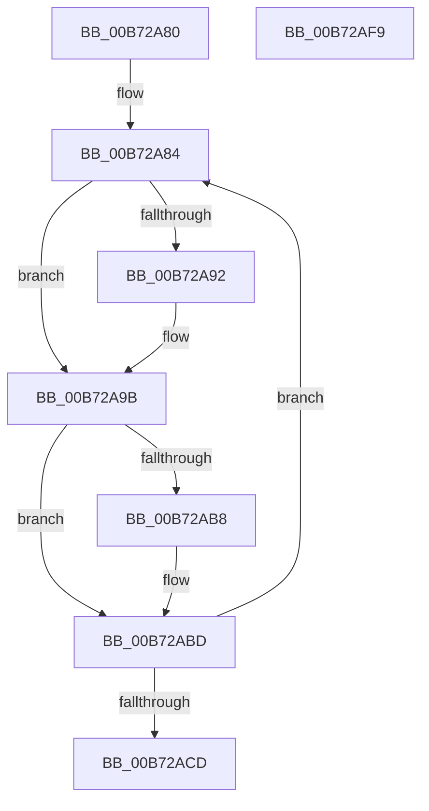

# ExpTimeRefreshWork

- RVA: `0x00B72A80`–`0x00B72AFA` (길이 `122` bytes)
- VA: `0x0000000140B72A80`
- 실행 섹션: `PAGELK`
- PDB 이름 있음: `예`; PDB Function 태그: `아니요`
- unwind 정보 RVA: `0x0005D2F4`
- 디코드: `28`개 명령, `122/122` bytes 표시
- 미해석 바이트: `0` (있으면 어셈블리에 `.byte`로 보존)

> 이 문서는 커널 이미지의 기계어와 PDB 기호를 분석해 생성했습니다. 4번과 5번은 함수 원형과 자료형을 바이너리 사용 방식에서 추정한 C 해석이며 원본 소스 복구 결과는 아닙니다.

## 1. Dependencies

- 직접 호출 지점: **6**; 고유 호출 대상: **6**
- 직접 호출자로 확인된 함수: **0**
- RIP 상대 이미지 참조: **5**

### Outgoing calls
- `0x00B72A84` → [ExAcquireTimeRefreshLockExclusive](../../page/9C/ExAcquireTimeRefreshLockExclusive_function_009C5810.md) (function, `0x009C5810`)
- `0x00B72A96` → [ExUpdateSystemTimeFromCmos](ExUpdateSystemTimeFromCmos_function_00B7BD98.md) (function, `0x00B7BD98`)
- `0x00B72A9B` → [ExReleaseTimeRefreshLockExclusive](../../page/9C/ExReleaseTimeRefreshLockExclusive_function_009C5874.md) (function, `0x009C5874`)
- `0x00B72AA0` → [PsGetCurrentServerSiloGlobals](../../text/2F/PsGetCurrentServerSiloGlobals_function_002FE1F0.md) (function, `0x002FE1F0`)
- `0x00B72AB8` → [guard_dispatch_icall](../../text/6B/guard_dispatch_icall_function_006BAAD0.md) (function, `0x006BAAD0`)
- `0x00B72AEF` → [KeSetTimer2](../../text/3A/KeSetTimer2_function_003A08E0.md) (function, `0x003A08E0`)

### Direct callers
- 이 함수 시작 RVA로 연결되는 직접 call은 확인되지 않았습니다. 간접 호출은 완전히 역산할 수 없습니다.

### Static image references
- `0x00B72A89` → RVA `0x00FC5017` (`ALMOSTRO`; read)
- `0x00B72AAC` → RVA `0x00FD8480` (`PAGEDATA`; read)
- `0x00B72AC0` → RVA `0x00EFEFC0` (`.data`; read/write)
- `0x00B72ADE` → RVA `0x00EFEEC0` (`.data`; read)
- `0x00B72AE5` → RVA `0x00EFEE58` (`.data`; read)

## 2. Other-region calls and transfers

- 다른 실행 섹션으로 향하는 call: **5**
  - `0x00B72A84` → [ExAcquireTimeRefreshLockExclusive](../../page/9C/ExAcquireTimeRefreshLockExclusive_function_009C5810.md) (`PAGELK` → `PAGE`)
  - `0x00B72A9B` → [ExReleaseTimeRefreshLockExclusive](../../page/9C/ExReleaseTimeRefreshLockExclusive_function_009C5874.md) (`PAGELK` → `PAGE`)
  - `0x00B72AA0` → [PsGetCurrentServerSiloGlobals](../../text/2F/PsGetCurrentServerSiloGlobals_function_002FE1F0.md) (`PAGELK` → `.text`)
  - `0x00B72AB8` → [guard_dispatch_icall](../../text/6B/guard_dispatch_icall_function_006BAAD0.md) (`PAGELK` → `.text`)
  - `0x00B72AEF` → [KeSetTimer2](../../text/3A/KeSetTimer2_function_003A08E0.md) (`PAGELK` → `.text`)
- 별도 외부 분기/꼬리 이동을 확인하지 못했습니다.

## 3. Assembly (complete function range)

```asm
00B72A80  48 83 EC 38                     sub rsp, 0x38
00B72A84  E8 87 2D E5 FF                  call 0x1409c5810
00B72A89  80 3D 87 25 45 00 00            cmp byte ptr [rip + 0x452587], 0
00B72A90  74 09                           je 0x140b72a9b
00B72A92  33 D2                           xor edx, edx
00B72A94  33 C9                           xor ecx, ecx
00B72A96  E8 FD 92 00 00                  call 0x140b7bd98
00B72A9B  E8 D4 2D E5 FF                  call 0x1409c5874
00B72AA0  E8 4B B7 78 FF                  call 0x1402fe1f0
00B72AA5  48 8B 88 68 03 00 00            mov rcx, qword ptr [rax + 0x368]
00B72AAC  48 8B 05 CD 59 46 00            mov rax, qword ptr [rip + 0x4659cd]
00B72AB3  48 85 C0                        test rax, rax
00B72AB6  74 05                           je 0x140b72abd
00B72AB8  E8 13 80 B4 FF                  call 0x1406baad0
00B72ABD  83 C8 FF                        or eax, 0xffffffff
00B72AC0  F0 0F C1 05 F8 C4 38 00         lock xadd dword ptr [rip + 0x38c4f8], eax
00B72AC8  83 F8 01                        cmp eax, 1
00B72ACB  75 B7                           jne 0x140b72a84
00B72ACD  48 83 64 24 20 00               and qword ptr [rsp + 0x20], 0
00B72AD3  4C 8D 4C 24 20                  lea r9, [rsp + 0x20]
00B72AD8  48 83 4C 24 28 FF               or qword ptr [rsp + 0x28], 0xffffffffffffffff
00B72ADE  48 8D 0D DB C3 38 00            lea rcx, [rip + 0x38c3db]
00B72AE5  48 8B 15 6C C3 38 00            mov rdx, qword ptr [rip + 0x38c36c]
00B72AEC  45 33 C0                        xor r8d, r8d
00B72AEF  E8 EC DD 82 FF                  call 0x1403a08e0
00B72AF4  48 83 C4 38                     add rsp, 0x38
00B72AF8  C3                              ret
00B72AF9  CC                              int3
```

## 4. C-style interpretation (structured pseudocode)

```c
__int64 __fastcall ExpTimeRefreshWork(int a1, int a2, int a3)
{
    __int64 result;
    __int64 v_rsp;
    unsigned __int64 v_stack_m10;
    unsigned __int64 v_stack_m18;

    v_rsp = (v_rsp) - (56);
loc_00B72A84:
    result = ExAcquireTimeRefreshLockExclusive(a1, a2, a3, a4);
    if ((*(unsigned __int8 *)(v_rip + 4531591)) != 0) {
        a2 = 0;
        a1 = 0;
        result = ExUpdateSystemTimeFromCmos(a1, a2, a3, a4);
    }
    result = ExReleaseTimeRefreshLockExclusive(a1, a2, a3, a4);
    result = PsGetCurrentServerSiloGlobals(a1, a2, a3, a4);
    result = *(unsigned __int64 *)(v_rip + 4610509);
    if (*(unsigned __int64 *)(v_rip + 4610509) != 0) {
        result = guard_dispatch_icall(*(unsigned __int64 *)(result + 872), a2, a3, a4);
    }
    result = (unsigned int)((result) | (0xFFFFFFFFULL));
    if (((unsigned int)(result)) != 1) goto loc_00B72A84;
    a3 = 0;
    result = KeSetTimer2(v_rip + 3720155, *(unsigned __int64 *)(v_rip + 3720044), a3, v_stack_m18);
    v_rsp = (v_rsp) + (56);
    return result;
}
```

## 5. (Beta) C Style

```c
int64_t ExpTimeRefreshWork(int32_t Arg1, int32_t Arg2, int32_t Arg3)
{
    int64_t result;
    int64_t local_rsp;
    uint64_t v_stack_m10;
    uint64_t v_stack_m18;

    local_rsp = (local_rsp) - (56);
loc_00B72A84:
    result = ExAcquireTimeRefreshLockExclusive(Arg1, Arg2, Arg3, a4);
    if ((*(uint8_t *)(v_rip + 0x452587)) != 0) {
        Arg2 = 0;
        Arg1 = 0;
        result = ExUpdateSystemTimeFromCmos(Arg1, Arg2, Arg3, a4);
    }
    result = ExReleaseTimeRefreshLockExclusive(Arg1, Arg2, Arg3, a4);
    result = PsGetCurrentServerSiloGlobals(Arg1, Arg2, Arg3, a4);
    result = *(uint64_t *)(v_rip + 0x4659CD);
    if (*(uint64_t *)(v_rip + 0x4659CD) != 0) {
        result = guard_dispatch_icall(*(uint64_t *)(result + 0x368), Arg2, Arg3, a4);
    }
    result = (uint32_t)((result) | (0xFFFFFFFFULL));
    if (((uint32_t)(result)) != 1) goto loc_00B72A84;
    Arg3 = 0;
    result = KeSetTimer2(v_rip + 3720155, *(uint64_t *)(v_rip + 0x38C36C), Arg3, v_stack_m18);
    local_rsp = (local_rsp) + (56);
    return result;
}
```

## 6. Execution-region graph

[열기: 2D/3D 그래프와 함수 탐색 컨트롤 패널](../../../control-panel.html?section=pagelk&rva=0x00B72A80&view=graph)

- 2D 그래프는 위에서 아래로 흐르고, 3D 그래프는 빈 공간을 드래그해 회전합니다. Shift+드래그는 이동, 휠은 확대·축소, 함수 노드 선택은 대상 보고서 이동입니다.

### Static fallback


