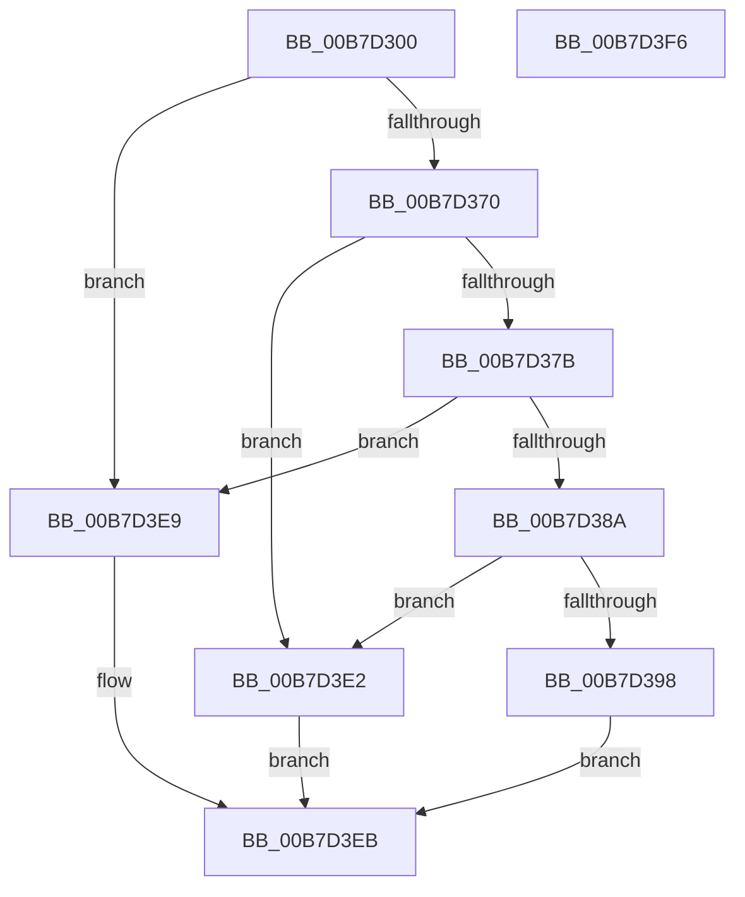

# HaliSetWakeAlarm

- RVA: `0x00B7D300`–`0x00B7D3F7` (길이 `247` bytes)
- VA: `0x0000000140B7D300`
- 실행 섹션: `PAGELK`
- PDB 이름 있음: `예`; PDB Function 태그: `아니요`
- unwind 정보 RVA: `0x00065960`
- 디코드: `62`개 명령, `247/247` bytes 표시
- 미해석 바이트: `0` (있으면 어셈블리에 `.byte`로 보존)

> 이 문서는 커널 이미지의 기계어와 PDB 기호를 분석해 생성했습니다. 4번과 5번은 함수 원형과 자료형을 바이너리 사용 방식에서 추정한 C 해석이며 원본 소스 복구 결과는 아닙니다.

## 1. Dependencies

- 직접 호출 지점: **8**; 고유 호출 대상: **7**
- 직접 호출자로 확인된 함수: **0**
- RIP 상대 이미지 참조: **5**

### Outgoing calls
- `0x00B7D334` → [HalpAdjustWakeSecondsDue](../B5/HalpAdjustWakeSecondsDue_function_00B5B014.md) (function, `0x00B5B014`)
- `0x00B7D341` → [HalpAdjustWakeSecondsDue](../B5/HalpAdjustWakeSecondsDue_function_00B5B014.md) (function, `0x00B5B014`)
- `0x00B7D35E` → [DbgPrintEx](../../text/35/DbgPrintEx_function_00359290.md) (function, `0x00359290`)
- `0x00B7D367` → [HalpArmAcpiWakeAlarm](../../page/A9/HalpArmAcpiWakeAlarm_function_00A9802C.md) (function, `0x00A9802C`)
- `0x00B7D38F` → [HalQueryRealTimeClock](../../text/42/HalQueryRealTimeClock_function_0042D810.md) (function, `0x0042D810`)
- `0x00B7D3A2` → [RtlTimeFieldsToTime](../../text/42/RtlTimeFieldsToTime_function_0042E6B0.md) (function, `0x0042E6B0`)
- `0x00B7D3BD` → [RtlTimeToTimeFields](../../text/42/RtlTimeToTimeFields_function_0042E0F0.md) (function, `0x0042E0F0`)
- `0x00B7D3DB` → [HalpSetWakeAlarm](../../text/42/HalpSetWakeAlarm_function_0042DAC8.md) (function, `0x0042DAC8`)

### Direct callers
- 이 함수 시작 RVA로 연결되는 직접 call은 확인되지 않았습니다. 간접 호출은 완전히 역산할 수 없습니다.

### Static image references
- `0x00B7D31D` → RVA `0x00F90140` (`.data`; write)
- `0x00B7D352` → RVA `0x0001E820` (`.rdata`; read)
- `0x00B7D370` → RVA `0x00E0A808` (`.data`; read)
- `0x00B7D3CC` → RVA `0x00F90141` (`.data`; write)
- `0x00B7D3D3` → RVA `0x00F90142` (`.data`; write)

## 2. Other-region calls and transfers

- 다른 실행 섹션으로 향하는 call: **6**
  - `0x00B7D35E` → [DbgPrintEx](../../text/35/DbgPrintEx_function_00359290.md) (`PAGELK` → `.text`)
  - `0x00B7D367` → [HalpArmAcpiWakeAlarm](../../page/A9/HalpArmAcpiWakeAlarm_function_00A9802C.md) (`PAGELK` → `PAGE`)
  - `0x00B7D38F` → [HalQueryRealTimeClock](../../text/42/HalQueryRealTimeClock_function_0042D810.md) (`PAGELK` → `.text`)
  - `0x00B7D3A2` → [RtlTimeFieldsToTime](../../text/42/RtlTimeFieldsToTime_function_0042E6B0.md) (`PAGELK` → `.text`)
  - `0x00B7D3BD` → [RtlTimeToTimeFields](../../text/42/RtlTimeToTimeFields_function_0042E0F0.md) (`PAGELK` → `.text`)
  - `0x00B7D3DB` → [HalpSetWakeAlarm](../../text/42/HalpSetWakeAlarm_function_0042DAC8.md) (`PAGELK` → `.text`)
- 별도 외부 분기/꼬리 이동을 확인하지 못했습니다.

## 3. Assembly (complete function range)

```asm
00B7D300  48 89 5C 24 08                  mov qword ptr [rsp + 8], rbx
00B7D305  57                              push rdi
00B7D306  48 83 EC 40                     sub rsp, 0x40
00B7D30A  48 83 64 24 60 00               and qword ptr [rsp + 0x60], 0
00B7D310  4C 8B CA                        mov r9, rdx
00B7D313  49 B8 08 00 00 00 80 F7 FF FF   movabs r8, 0xfffff78000000008
00B7D31D  66 C7 05 1A 2E 41 00 01 00      mov word ptr [rip + 0x412e1a], 1
00B7D326  0F 57 C0                        xorps xmm0, xmm0
00B7D329  0F 11 44 24 30                  movups xmmword ptr [rsp + 0x30], xmm0
00B7D32E  4D 8B 00                        mov r8, qword ptr [r8]
00B7D331  49 8B D0                        mov rdx, r8
00B7D334  E8 DB DC FD FF                  call 0x140b5b014
00B7D339  49 8B D0                        mov rdx, r8
00B7D33C  49 8B C9                        mov rcx, r9
00B7D33F  8B F8                           mov edi, eax
00B7D341  E8 CE DC FD FF                  call 0x140b5b014
00B7D346  BA 03 00 00 00                  mov edx, 3
00B7D34B  89 44 24 20                     mov dword ptr [rsp + 0x20], eax
00B7D34F  44 8B CF                        mov r9d, edi
00B7D352  4C 8D 05 C7 14 4A FF            lea r8, [rip - 0xb5eb39]
00B7D359  8B D8                           mov ebx, eax
00B7D35B  8D 4A 62                        lea ecx, [rdx + 0x62]
00B7D35E  E8 2D BF 7D FF                  call 0x140359290
00B7D363  8B D3                           mov edx, ebx
00B7D365  8B CF                           mov ecx, edi
00B7D367  E8 C0 AC F1 FF                  call 0x140a9802c
00B7D36C  85 C0                           test eax, eax
00B7D36E  79 79                           jns 0x140b7d3e9
00B7D370  8B 0D 92 D4 28 00               mov ecx, dword ptr [rip + 0x28d492]
00B7D376  F6 C1 04                        test cl, 4
00B7D379  74 67                           je 0x140b7d3e2
00B7D37B  3B FB                           cmp edi, ebx
00B7D37D  B8 FF FF FF FF                  mov eax, 0xffffffff
00B7D382  0F 42 DF                        cmovb ebx, edi
00B7D385  48 3B D8                        cmp rbx, rax
00B7D388  74 5F                           je 0x140b7d3e9
00B7D38A  48 8D 4C 24 30                  lea rcx, [rsp + 0x30]
00B7D38F  E8 7C 04 8B FF                  call 0x14042d810
00B7D394  84 C0                           test al, al
00B7D396  74 4A                           je 0x140b7d3e2
00B7D398  48 8D 54 24 60                  lea rdx, [rsp + 0x60]
00B7D39D  48 8D 4C 24 30                  lea rcx, [rsp + 0x30]
00B7D3A2  E8 09 13 8B FF                  call 0x14042e6b0
00B7D3A7  48 69 C3 80 96 98 00            imul rax, rbx, 0x989680
00B7D3AE  48 8D 54 24 30                  lea rdx, [rsp + 0x30]
00B7D3B3  48 01 44 24 60                  add qword ptr [rsp + 0x60], rax
00B7D3B8  48 8D 4C 24 60                  lea rcx, [rsp + 0x60]
00B7D3BD  E8 2E 0D 8B FF                  call 0x14042e0f0
00B7D3C2  0F 10 44 24 30                  movups xmm0, xmmword ptr [rsp + 0x30]
00B7D3C7  48 8D 54 24 30                  lea rdx, [rsp + 0x30]
00B7D3CC  C6 05 6E 2D 41 00 01            mov byte ptr [rip + 0x412d6e], 1
00B7D3D3  F3 0F 7F 05 67 2D 41 00         movdqu xmmword ptr [rip + 0x412d67], xmm0
00B7D3DB  E8 E8 06 8B FF                  call 0x14042dac8
00B7D3E0  EB 09                           jmp 0x140b7d3eb
00B7D3E2  B8 01 00 00 C0                  mov eax, 0xc0000001
00B7D3E7  EB 02                           jmp 0x140b7d3eb
00B7D3E9  33 C0                           xor eax, eax
00B7D3EB  48 8B 5C 24 50                  mov rbx, qword ptr [rsp + 0x50]
00B7D3F0  48 83 C4 40                     add rsp, 0x40
00B7D3F4  5F                              pop rdi
00B7D3F5  C3                              ret
00B7D3F6  CC                              int3
```

## 4. C-style interpretation (structured pseudocode)

```c
__int64 __fastcall HaliSetWakeAlarm(__int64 a1, __int64 a2)
{
    __int64 result;
    __int64 v_rbx;
    __int64 v_rsp;
    unsigned __int64 v_stack_m18;
    unsigned int v_stack_m28;
    unsigned __int64 v_stack_p18;
    unsigned __int64 v_stack_p8;

    v_stack_p8 = v_rbx;
    v_rsp = (v_rsp) - (64);
    *(unsigned __int16 *)(v_rip + 4271642) = 1;
    v_stack_m18 = v_xmm0;
    result = HalpAdjustWakeSecondsDue(a1, *(unsigned __int64 *)(a3), *(unsigned __int64 *)(a3), a2);
    result = HalpAdjustWakeSecondsDue(a2, *(unsigned __int64 *)(a3), *(unsigned __int64 *)(a3), a2);
    v_stack_m28 = (unsigned int)(result);
    result = DbgPrintEx(3 + 98, 3, v_rip - 11922233, (unsigned int)((unsigned int)((unsigned int)((unsigned int)(result)))));
    result = HalpArmAcpiWakeAlarm((unsigned int)((unsigned int)((unsigned int)((unsigned int)(result)))), (unsigned int)((unsigned int)((unsigned int)((unsigned int)(result)))), v_rip - 11922233, (unsigned int)((unsigned int)((unsigned int)((unsigned int)(result)))));
    if (!sign_flag) goto loc_00B7D3E9;
    if ((((unsigned __int8)((unsigned int)(*(unsigned int *)(v_rip + 2675858)))) & (4)) == 0) goto loc_00B7D3E2;
    v_rbx = (unsigned int)((unsigned int)(result));
    if (((unsigned int)((unsigned int)((unsigned int)(result)))) < ((unsigned int)((unsigned int)((unsigned int)(result))))) { v_rbx = (unsigned int)((unsigned int)((unsigned int)(result))); }
    if (v_rbx == ((unsigned int)(0xFFFFFFFFULL))) goto loc_00B7D3E9;
    result = HalQueryRealTimeClock(v_stack_m18, (unsigned int)((unsigned int)((unsigned int)((unsigned int)(result)))), v_rip - 11922233, (unsigned int)((unsigned int)((unsigned int)((unsigned int)(result)))));
    if ((unsigned __int8)(result) == 0) goto loc_00B7D3E2;
    result = RtlTimeFieldsToTime(v_stack_m18, v_stack_p18, v_rip - 11922233, (unsigned int)((unsigned int)((unsigned int)((unsigned int)(result)))));
    result = (result) * (v_rbx);
    result = RtlTimeToTimeFields(v_stack_p18, v_stack_m18, v_rip - 11922233, (unsigned int)((unsigned int)((unsigned int)((unsigned int)(result)))));
    *(unsigned __int8 *)(v_rip + 4271470) = 1;
    *(unsigned __int64 *)(v_rip + 4271463) = v_xmm0;
    result = HalpSetWakeAlarm(v_stack_p18, v_stack_m18, v_rip - 11922233, (unsigned int)((unsigned int)((unsigned int)((unsigned int)(result)))));
    goto loc_00B7D3EB;
loc_00B7D3E2:
    goto loc_00B7D3EB;
loc_00B7D3E9:
    result = 0;
loc_00B7D3EB:
    v_rsp = (v_rsp) + (64);
    return result;
}
```

## 5. (Beta) C Style

```c
int64_t HaliSetWakeAlarm(int64_t Arg1, int64_t Arg2)
{
    int64_t result;
    int64_t local_rbx;
    int64_t local_rsp;
    uint64_t v_stack_m18;
    uint32_t v_stack_m28;
    uint64_t v_stack_p18;
    uint64_t v_stack_p8;

    v_stack_p8 = local_rbx;
    local_rsp = (local_rsp) - (64);
    *(uint16_t *)(v_rip + 0x412E1A) = 1;
    v_stack_m18 = v_xmm0;
    result = HalpAdjustWakeSecondsDue(Arg1, *(uint64_t *)(a3), *(uint64_t *)(a3), Arg2);
    result = HalpAdjustWakeSecondsDue(Arg2, *(uint64_t *)(a3), *(uint64_t *)(a3), Arg2);
    v_stack_m28 = (uint32_t)(result);
    result = DbgPrintEx(3 + 98, 3, v_rip - 11922233, (uint32_t)((uint32_t)((uint32_t)((uint32_t)(result)))));
    result = HalpArmAcpiWakeAlarm((uint32_t)((uint32_t)((uint32_t)((uint32_t)(result)))), (uint32_t)((uint32_t)((uint32_t)((uint32_t)(result)))), v_rip - 11922233, (uint32_t)((uint32_t)((uint32_t)((uint32_t)(result)))));
    if (!sign_flag) goto loc_00B7D3E9;
    if ((((uint8_t)((uint32_t)(*(uint32_t *)(v_rip + 0x28D492)))) & (4)) == 0) goto loc_00B7D3E2;
    local_rbx = (uint32_t)((uint32_t)(result));
    if (((uint32_t)((uint32_t)((uint32_t)(result)))) < ((uint32_t)((uint32_t)((uint32_t)(result))))) { local_rbx = (uint32_t)((uint32_t)((uint32_t)(result))); }
    if (local_rbx == ((uint32_t)(0xFFFFFFFFULL))) goto loc_00B7D3E9;
    result = HalQueryRealTimeClock(v_stack_m18, (uint32_t)((uint32_t)((uint32_t)((uint32_t)(result)))), v_rip - 11922233, (uint32_t)((uint32_t)((uint32_t)((uint32_t)(result)))));
    if ((uint8_t)(result) == 0) goto loc_00B7D3E2;
    result = RtlTimeFieldsToTime(v_stack_m18, v_stack_p18, v_rip - 11922233, (uint32_t)((uint32_t)((uint32_t)((uint32_t)(result)))));
    result = (result) * (local_rbx);
    result = RtlTimeToTimeFields(v_stack_p18, v_stack_m18, v_rip - 11922233, (uint32_t)((uint32_t)((uint32_t)((uint32_t)(result)))));
    *(uint8_t *)(v_rip + 0x412D6E) = 1;
    *(uint64_t *)(v_rip + 0x412D67) = v_xmm0;
    result = HalpSetWakeAlarm(v_stack_p18, v_stack_m18, v_rip - 11922233, (uint32_t)((uint32_t)((uint32_t)((uint32_t)(result)))));
    goto loc_00B7D3EB;
loc_00B7D3E2:
    goto loc_00B7D3EB;
loc_00B7D3E9:
    result = 0;
loc_00B7D3EB:
    local_rsp = (local_rsp) + (64);
    return result;
}
```

## 6. Execution-region graph

[열기: 2D/3D 그래프와 함수 탐색 컨트롤 패널](../../../control-panel.html?section=pagelk&rva=0x00B7D300&view=graph)

- 2D 그래프는 위에서 아래로 흐르고, 3D 그래프는 빈 공간을 드래그해 회전합니다. Shift+드래그는 이동, 휠은 확대·축소, 함수 노드 선택은 대상 보고서 이동입니다.

### Static fallback


