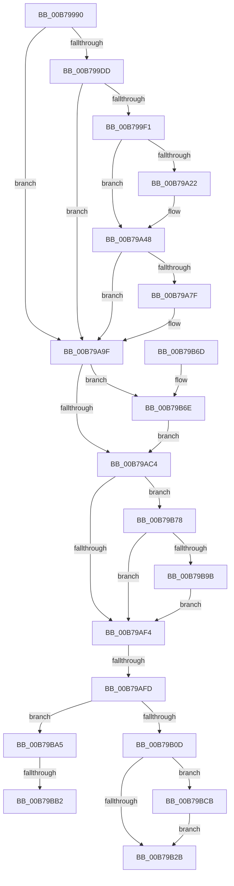

# HalpAcpiPostSleep

- RVA: `0x00B79990`–`0x00B79BE5` (길이 `597` bytes)
- VA: `0x0000000140B79990`
- 실행 섹션: `PAGELK`
- PDB 이름 있음: `예`; PDB Function 태그: `예`
- unwind 정보 RVA: `0x000B8D04`
- 디코드: `143`개 명령, `597/597` bytes 표시
- 미해석 바이트: `0` (있으면 어셈블리에 `.byte`로 보존)

> 이 문서는 커널 이미지의 기계어와 PDB 기호를 분석해 생성했습니다. 4번과 5번은 함수 원형과 자료형을 바이너리 사용 방식에서 추정한 C 해석이며 원본 소스 복구 결과는 아닙니다.

## 1. Dependencies

- 직접 호출 지점: **24**; 고유 호출 대상: **18**
- 직접 호출자로 확인된 함수: **1**
- RIP 상대 이미지 참조: **13**

### Outgoing calls
- `0x00B799DD` → [HalpCheckFixedWakeSources](HalpCheckFixedWakeSources_function_00B7A594.md) (function, `0x00B7A594`)
- `0x00B799E4` → [HalpAcpiPmRegisterAvailable](../../text/43/HalpAcpiPmRegisterAvailable_function_0043F330.md) (function, `0x0043F330`)
- `0x00B79A09` → [HalpAcpiPmRegisterRead](../../text/41/HalpAcpiPmRegisterRead_function_0041DB30.md) (function, `0x0041DB30`)
- `0x00B79A19` → [HalpAcpiPmRegisterAvailable](../../text/43/HalpAcpiPmRegisterAvailable_function_0043F330.md) (function, `0x0043F330`)
- `0x00B79A3B` → [HalpAcpiPmRegisterRead](../../text/41/HalpAcpiPmRegisterRead_function_0041DB30.md) (function, `0x0041DB30`)
- `0x00B79A6E` → [HalpAcpiPmRegisterWrite](../../text/41/HalpAcpiPmRegisterWrite_function_0041C760.md) (function, `0x0041C760`)
- `0x00B79A76` → [HalpAcpiPmRegisterAvailable](../../text/43/HalpAcpiPmRegisterAvailable_function_0043F330.md) (function, `0x0043F330`)
- `0x00B79A9A` → [HalpAcpiPmRegisterWrite](../../text/41/HalpAcpiPmRegisterWrite_function_0041C760.md) (function, `0x0041C760`)
- `0x00B79AAB` → [HalpCheckLowMemoryPostSleep](HalpCheckLowMemoryPostSleep_function_00B7A458.md) (function, `0x00B7A458`)
- `0x00B79AC4` → [HalpTimerRestorePerformanceCounter](../../text/4A/HalpTimerRestorePerformanceCounter_function_004AB768.md) (function, `0x004AB768`)
- `0x00B79ACB` → [HalpTimerSwitchStallSource](../../text/4F/HalpTimerSwitchStallSource_function_004F9FF0.md) (function, `0x004F9FF0`)
- `0x00B79AE2` → [HalpInterruptReinitialize](HalpInterruptReinitialize_function_00B79BEC.md) (function, `0x00B79BEC`)
- `0x00B79B0D` → [HalpTimerInitializeVpptClockTimer](../../text/4F/HalpTimerInitializeVpptClockTimer_function_004F8100.md) (function, `0x004F8100`)
- `0x00B79B12` → [HalpTimerEnableHypervisorTimer](../../text/4D/HalpTimerEnableHypervisorTimer_function_004D6ECC.md) (function, `0x004D6ECC`)
- `0x00B79B19` → [HalpPiix4Detect](HalpPiix4Detect_function_00B79E00.md) (function, `0x00B79E00`)
- `0x00B79B38` → [guard_dispatch_icall](../../text/6B/guard_dispatch_icall_function_006BAAD0.md) (function, `0x006BAAD0`)
- `0x00B79B3D` → [HalpRestoreNvsArea](../../text/4F/HalpRestoreNvsArea_function_004F8C3C.md) (function, `0x004F8C3C`)
- `0x00B79B42` → [HalpResetSBF](../B5/HalpResetSBF_function_00B5B064.md) (function, `0x00B5B064`)
- `0x00B79B50` → [_security_check_cookie](../../text/6A/_security_check_cookie_function_006AC640.md) (function, `0x006AC640`)
- `0x00B79B6E` → [HalpSetClockAfterSleep](../../text/42/HalpSetClockAfterSleep_function_0042D4A4.md) (function, `0x0042D4A4`)
- `0x00B79B89` → [guard_dispatch_icall](../../text/6B/guard_dispatch_icall_function_006BAAD0.md) (function, `0x006BAAD0`)
- `0x00B79B9B` → [HalpHvNotifyDebugDeviceAvailable](../../text/54/HalpHvNotifyDebugDeviceAvailable_function_0054CEA0.md) (function, `0x0054CEA0`)
- `0x00B79BB9` → `kdcom.dll!KdInitialize` (import, 간접 대상; import `kdcom.dll!KdInitialize`)
- `0x00B79BDB` → [guard_dispatch_icall](../../text/6B/guard_dispatch_icall_function_006BAAD0.md) (function, `0x006BAAD0`)

### Direct callers
- [HaliAcpiSleep](../../text/56/HaliAcpiSleep_function_0056AD60.md) at `0x0056B256`

### Static image references
- `0x00B799A8` → RVA `0x00E0A740` (`.data`; read)
- `0x00B799B6` → RVA `0x00E0A808` (`.data`; read)
- `0x00B799F1` → RVA `0x00FC1B38` (`.data`; read)
- `0x00B79AD0` → RVA `0x00FC1AB8` (`.data`; read)
- `0x00B79AD9` → RVA `0x00F90141` (`.data`; write)
- `0x00B79AE7` → RVA `0x00FC1AB2` (`.data`; read)
- `0x00B79AFD` → RVA `0x00FC1AD8` (`.data`; read)
- `0x00B79B2B` → RVA `0x00E11750` (`.data`; read)
- `0x00B79B78` → RVA `0x00E00A20` (`.data`; read)
- `0x00B79B8E` → RVA `0x00FC1ED0` (`.data`; read)
- `0x00B79BA5` → RVA `0x00E10320` (`.data`; read)
- `0x00B79BB9` → RVA `0x001516B8` (`kdcom.dll!KdInitialize (IAT)`; read)
- `0x00B79BCB` → RVA `0x00E00920` (`.data`; read)

## 2. Other-region calls and transfers

- 다른 실행 섹션으로 향하는 call: **18**
  - `0x00B799E4` → [HalpAcpiPmRegisterAvailable](../../text/43/HalpAcpiPmRegisterAvailable_function_0043F330.md) (`PAGELK` → `.text`)
  - `0x00B79A09` → [HalpAcpiPmRegisterRead](../../text/41/HalpAcpiPmRegisterRead_function_0041DB30.md) (`PAGELK` → `.text`)
  - `0x00B79A19` → [HalpAcpiPmRegisterAvailable](../../text/43/HalpAcpiPmRegisterAvailable_function_0043F330.md) (`PAGELK` → `.text`)
  - `0x00B79A3B` → [HalpAcpiPmRegisterRead](../../text/41/HalpAcpiPmRegisterRead_function_0041DB30.md) (`PAGELK` → `.text`)
  - `0x00B79A6E` → [HalpAcpiPmRegisterWrite](../../text/41/HalpAcpiPmRegisterWrite_function_0041C760.md) (`PAGELK` → `.text`)
  - `0x00B79A76` → [HalpAcpiPmRegisterAvailable](../../text/43/HalpAcpiPmRegisterAvailable_function_0043F330.md) (`PAGELK` → `.text`)
  - `0x00B79A9A` → [HalpAcpiPmRegisterWrite](../../text/41/HalpAcpiPmRegisterWrite_function_0041C760.md) (`PAGELK` → `.text`)
  - `0x00B79AC4` → [HalpTimerRestorePerformanceCounter](../../text/4A/HalpTimerRestorePerformanceCounter_function_004AB768.md) (`PAGELK` → `.text`)
  - `0x00B79ACB` → [HalpTimerSwitchStallSource](../../text/4F/HalpTimerSwitchStallSource_function_004F9FF0.md) (`PAGELK` → `.text`)
  - `0x00B79B0D` → [HalpTimerInitializeVpptClockTimer](../../text/4F/HalpTimerInitializeVpptClockTimer_function_004F8100.md) (`PAGELK` → `.text`)
  - `0x00B79B12` → [HalpTimerEnableHypervisorTimer](../../text/4D/HalpTimerEnableHypervisorTimer_function_004D6ECC.md) (`PAGELK` → `.text`)
  - `0x00B79B38` → [guard_dispatch_icall](../../text/6B/guard_dispatch_icall_function_006BAAD0.md) (`PAGELK` → `.text`)
  - `0x00B79B3D` → [HalpRestoreNvsArea](../../text/4F/HalpRestoreNvsArea_function_004F8C3C.md) (`PAGELK` → `.text`)
  - `0x00B79B50` → [_security_check_cookie](../../text/6A/_security_check_cookie_function_006AC640.md) (`PAGELK` → `.text`)
  - `0x00B79B6E` → [HalpSetClockAfterSleep](../../text/42/HalpSetClockAfterSleep_function_0042D4A4.md) (`PAGELK` → `.text`)
  - `0x00B79B89` → [guard_dispatch_icall](../../text/6B/guard_dispatch_icall_function_006BAAD0.md) (`PAGELK` → `.text`)
  - `0x00B79B9B` → [HalpHvNotifyDebugDeviceAvailable](../../text/54/HalpHvNotifyDebugDeviceAvailable_function_0054CEA0.md) (`PAGELK` → `.text`)
  - `0x00B79BDB` → [guard_dispatch_icall](../../text/6B/guard_dispatch_icall_function_006BAAD0.md) (`PAGELK` → `.text`)
- call이 아닌 외부 분기/꼬리 이동: **3**
  - `0x00B79AF7` → [sub_00B80A42](../B8/Unknown_function_00B80A42.md) (`tail-transfer`)
  - `0x00B79BAC` → [sub_00B80A42 + 0x74](../B8/Unknown_function_00B80A42.md) (`tail-transfer`)
  - `0x00B79BC6` → [sub_00B80A42 + 0x74](../B8/Unknown_function_00B80A42.md) (`tail-transfer`)

## 3. Assembly (complete function range)

```asm
00B79990  48 89 5C 24 10                  mov qword ptr [rsp + 0x10], rbx
00B79995  48 89 74 24 18                  mov qword ptr [rsp + 0x18], rsi
00B7999A  55                              push rbp
00B7999B  57                              push rdi
00B7999C  41 56                           push r14
00B7999E  48 8B EC                        mov rbp, rsp
00B799A1  48 81 EC 80 00 00 00            sub rsp, 0x80
00B799A8  48 8B 05 91 0D 29 00            mov rax, qword ptr [rip + 0x290d91]
00B799AF  48 33 C4                        xor rax, rsp
00B799B2  48 89 45 F8                     mov qword ptr [rbp - 8], rax
00B799B6  8B 05 4C 0E 29 00               mov eax, dword ptr [rip + 0x290e4c]
00B799BC  33 F6                           xor esi, esi
00B799BE  89 75 BC                        mov dword ptr [rbp - 0x44], esi
00B799C1  8B D9                           mov ebx, ecx
00B799C3  89 75 C0                        mov dword ptr [rbp - 0x40], esi
00B799C6  89 75 B8                        mov dword ptr [rbp - 0x48], esi
00B799C9  66 89 75 B0                     mov word ptr [rbp - 0x50], si
00B799CD  44 8D 76 03                     lea r14d, [rsi + 3]
00B799D1  66 89 75 B4                     mov word ptr [rbp - 0x4c], si
00B799D5  A8 01                           test al, 1
00B799D7  0F 84 C2 00 00 00               je 0x140b79a9f
00B799DD  E8 B2 0B 00 00                  call 0x140b7a594
00B799E2  33 C9                           xor ecx, ecx
00B799E4  E8 47 59 8C FF                  call 0x14043f330
00B799E9  85 C0                           test eax, eax
00B799EB  0F 88 AE 00 00 00               js 0x140b79a9f
00B799F1  0F B6 15 40 81 44 00            movzx edx, byte ptr [rip + 0x448140]
00B799F8  44 8D 4E 02                     lea r9d, [rsi + 2]
00B799FC  D1 EA                           shr edx, 1
00B799FE  4C 8D 45 B4                     lea r8, [rbp - 0x4c]
00B79A02  33 C9                           xor ecx, ecx
00B79A04  48 89 74 24 20                  mov qword ptr [rsp + 0x20], rsi
00B79A09  E8 22 41 8A FF                  call 0x14041db30
00B79A0E  0F B7 7D B4                     movzx edi, word ptr [rbp - 0x4c]
00B79A12  41 8B CE                        mov ecx, r14d
00B79A15  66 89 7D B0                     mov word ptr [rbp - 0x50], di
00B79A19  E8 12 59 8C FF                  call 0x14043f330
00B79A1E  85 C0                           test eax, eax
00B79A20  78 26                           js 0x140b79a48
00B79A22  0F B6 15 0F 81 44 00            movzx edx, byte ptr [rip + 0x44810f]
00B79A29  44 8D 4E 02                     lea r9d, [rsi + 2]
00B79A2D  D1 EA                           shr edx, 1
00B79A2F  4C 8D 45 B4                     lea r8, [rbp - 0x4c]
00B79A33  41 8B CE                        mov ecx, r14d
00B79A36  48 89 74 24 20                  mov qword ptr [rsp + 0x20], rsi
00B79A3B  E8 F0 40 8A FF                  call 0x14041db30
00B79A40  0F B7 7D B4                     movzx edi, word ptr [rbp - 0x4c]
00B79A44  66 0B 7D B0                     or di, word ptr [rbp - 0x50]
00B79A48  0F B6 15 E9 80 44 00            movzx edx, byte ptr [rip + 0x4480e9]
00B79A4F  4C 8D 45 B0                     lea r8, [rbp - 0x50]
00B79A53  B8 FF FB 00 00                  mov eax, 0xfbff
00B79A58  D1 EA                           shr edx, 1
00B79A5A  66 23 F8                        and di, ax
00B79A5D  48 89 74 24 20                  mov qword ptr [rsp + 0x20], rsi
00B79A62  41 B9 02 00 00 00               mov r9d, 2
00B79A68  66 89 7D B0                     mov word ptr [rbp - 0x50], di
00B79A6C  33 C9                           xor ecx, ecx
00B79A6E  E8 ED 2C 8A FF                  call 0x14041c760
00B79A73  41 8B CE                        mov ecx, r14d
00B79A76  E8 B5 58 8C FF                  call 0x14043f330
00B79A7B  85 C0                           test eax, eax
00B79A7D  78 20                           js 0x140b79a9f
00B79A7F  0F B6 15 B2 80 44 00            movzx edx, byte ptr [rip + 0x4480b2]
00B79A86  4C 8D 45 B0                     lea r8, [rbp - 0x50]
00B79A8A  D1 EA                           shr edx, 1
00B79A8C  41 B9 02 00 00 00               mov r9d, 2
00B79A92  41 8B CE                        mov ecx, r14d
00B79A95  48 89 74 24 20                  mov qword ptr [rsp + 0x20], rsi
00B79A9A  E8 C1 2C 8A FF                  call 0x14041c760
00B79A9F  4C 8D 45 B8                     lea r8, [rbp - 0x48]
00B79AA3  48 8D 55 C0                     lea rdx, [rbp - 0x40]
00B79AA7  48 8D 4D BC                     lea rcx, [rbp - 0x44]
00B79AAB  E8 A8 09 00 00                  call 0x140b7a458
00B79AB0  8B 05 52 0D 29 00               mov eax, dword ptr [rip + 0x290d52]
00B79AB6  BF 04 00 00 00                  mov edi, 4
00B79ABB  40 84 C7                        test dil, al
00B79ABE  0F 85 AA 00 00 00               jne 0x140b79b6e
00B79AC4  E8 9F 1C 93 FF                  call 0x1404ab768
00B79AC9  33 C9                           xor ecx, ecx
00B79ACB  E8 20 05 98 FF                  call 0x1404f9ff0
00B79AD0  48 8B 05 E1 7F 44 00            mov rax, qword ptr [rip + 0x447fe1]
00B79AD7  8B CB                           mov ecx, ebx
00B79AD9  40 88 35 61 66 41 00            mov byte ptr [rip + 0x416661], sil
00B79AE0  89 30                           mov dword ptr [rax], esi
00B79AE2  E8 05 01 00 00                  call 0x140b79bec
00B79AE7  40 38 35 C4 7F 44 00            cmp byte ptr [rip + 0x447fc4], sil
00B79AEE  0F 84 84 00 00 00               je 0x140b79b78
00B79AF4  39 75 B8                        cmp dword ptr [rbp - 0x48], esi
00B79AF7  0F 85 45 6F 00 00               jne 0x140b80a42
00B79AFD  F7 05 D1 7F 44 00 00 40 00 00   test dword ptr [rip + 0x447fd1], 0x4000
00B79B07  0F 85 98 00 00 00               jne 0x140b79ba5
00B79B0D  E8 EE E5 97 FF                  call 0x1404f8100
00B79B12  E8 B5 D3 95 FF                  call 0x1404d6ecc
00B79B17  33 C9                           xor ecx, ecx
00B79B19  E8 E2 02 00 00                  call 0x140b79e00
00B79B1E  40 38 35 8D 7F 44 00            cmp byte ptr [rip + 0x447f8d], sil
00B79B25  0F 84 A0 00 00 00               je 0x140b79bcb
00B79B2B  48 8B 0D 1E 7C 29 00            mov rcx, qword ptr [rip + 0x297c1e]
00B79B32  48 8B 41 08                     mov rax, qword ptr [rcx + 8]
00B79B36  B1 01                           mov cl, 1
00B79B38  E8 93 0F B4 FF                  call 0x1406baad0
00B79B3D  E8 FA F0 97 FF                  call 0x1404f8c3c
00B79B42  E8 1D 15 FE FF                  call 0x140b5b064
00B79B47  B0 01                           mov al, 1
00B79B49  48 8B 4D F8                     mov rcx, qword ptr [rbp - 8]
00B79B4D  48 33 CC                        xor rcx, rsp
00B79B50  E8 EB 2A B3 FF                  call 0x1406ac640
00B79B55  4C 8D 9C 24 80 00 00 00         lea r11, [rsp + 0x80]
00B79B5D  49 8B 5B 28                     mov rbx, qword ptr [r11 + 0x28]
00B79B61  49 8B 73 30                     mov rsi, qword ptr [r11 + 0x30]
00B79B65  49 8B E3                        mov rsp, r11
00B79B68  41 5E                           pop r14
00B79B6A  5F                              pop rdi
00B79B6B  5D                              pop rbp
00B79B6C  C3                              ret
00B79B6D  CC                              int3
00B79B6E  E8 31 39 8B FF                  call 0x14042d4a4
00B79B73  E9 4C FF FF FF                  jmp 0x140b79ac4
00B79B78  48 8B 05 A1 6E 28 00            mov rax, qword ptr [rip + 0x286ea1]
00B79B7F  8B CB                           mov ecx, ebx
00B79B81  C1 E9 08                        shr ecx, 8
00B79B84  83 E1 0F                        and ecx, 0xf
00B79B87  FF C1                           inc ecx
00B79B89  E8 42 0F B4 FF                  call 0x1406baad0
00B79B8E  40 38 35 3B 83 44 00            cmp byte ptr [rip + 0x44833b], sil
00B79B95  0F 84 59 FF FF FF               je 0x140b79af4
00B79B9B  E8 00 33 9D FF                  call 0x14054cea0
00B79BA0  E9 4F FF FF FF                  jmp 0x140b79af4
00B79BA5  48 39 35 74 67 29 00            cmp qword ptr [rip + 0x296774], rsi
00B79BAC  0F 84 04 6F 00 00               je 0x140b80ab6
00B79BB2  45 33 C0                        xor r8d, r8d
00B79BB5  33 D2                           xor edx, edx
00B79BB7  8B CF                           mov ecx, edi
00B79BB9  48 FF 15 F8 7A 5D FF            call qword ptr [rip - 0xa28508]
00B79BC0  0F 1F 44 00 00                  nop dword ptr [rax + rax]
00B79BC5  90                              nop
00B79BC6  E9 EB 6E 00 00                  jmp 0x140b80ab6
00B79BCB  48 8B 05 4E 6D 28 00            mov rax, qword ptr [rip + 0x286d4e]
00B79BD2  C1 EB 08                        shr ebx, 8
00B79BD5  83 E3 0F                        and ebx, 0xf
00B79BD8  8D 4B 01                        lea ecx, [rbx + 1]
00B79BDB  E8 F0 0E B4 FF                  call 0x1406baad0
00B79BE0  E9 46 FF FF FF                  jmp 0x140b79b2b
```

## 4. C-style interpretation (structured pseudocode)

```c
__int64 __fastcall HalpAcpiPostSleep(int a1)
{
    __int64 result;
    __int64 v_rbx;
    __int64 v_rdi;
    __int64 v_rsi;
    __int64 v_rsp;
    unsigned __int64 v_stack_m18;
    unsigned __int64 v_stack_m20;
    unsigned int v_stack_m58;
    unsigned int v_stack_m5C;
    unsigned int v_stack_m60;
    unsigned __int16 v_stack_m64;
    unsigned __int16 v_stack_m68;
    unsigned __int64 v_stack_m78;
    unsigned __int64 v_stack_p10;
    unsigned __int64 v_stack_p18;

    v_stack_p10 = v_rbx;
    v_stack_p18 = v_rsi;
    v_rsp = (v_rsp) - (128);
    result = (*(unsigned __int64 *)(v_rip + 2690449)) ^ (v_rsp);
    v_stack_m20 = result;
    v_rsi = 0;
    v_stack_m5C = 0;
    v_stack_m58 = 0;
    v_stack_m60 = 0;
    v_stack_m68 = 0;
    v_stack_m64 = 0;
    if ((((unsigned __int8)((unsigned int)(*(unsigned int *)(v_rip + 2690636)))) & (1)) == 0) goto loc_00B79A9F;
    result = HalpCheckFixedWakeSources(a1, a2, a3, a4);
    a1 = 0;
    result = HalpAcpiPmRegisterAvailable(a1, a2, a3, a4);
    if (sign_flag) goto loc_00B79A9F;
    a2 = (unsigned int)((*(unsigned __int8 *)(v_rip + 4489536)) >> (1));
    a1 = 0;
    v_stack_m78 = 0;
    result = HalpAcpiPmRegisterRead(a1, a2, v_stack_m64, v_rsi + 2);
    v_stack_m68 = (unsigned __int16)(v_stack_m64);
    result = HalpAcpiPmRegisterAvailable((unsigned int)((unsigned int)(v_rsi + 3)), a2, v_stack_m64, v_rsi + 2);
    v_rdi = v_stack_m64;
    if (!(sign_flag)) {
        a2 = *(unsigned __int8 *)(v_rip + 4489487);
        a4 = v_rsi + 2;
        a2 = (unsigned int)((a2) >> (1));
        a3 = v_stack_m64;
        a1 = (unsigned int)(v_rsi + 3);
        v_stack_m78 = 0;
        result = HalpAcpiPmRegisterRead(a1, a2, a3, a4);
        v_rdi = v_stack_m64;
        v_rdi = (unsigned __int16)((v_rdi) | (v_stack_m68));
    }
    a2 = (unsigned int)((*(unsigned __int8 *)(v_rip + 4489449)) >> (1));
    v_rdi = (unsigned __int16)((v_rdi) & ((unsigned __int16)((unsigned int)(0xFBFFULL))));
    v_stack_m78 = 0;
    v_stack_m68 = (unsigned __int16)(v_rdi);
    a1 = 0;
    result = HalpAcpiPmRegisterWrite(a1, a2, v_stack_m68, 2);
    result = HalpAcpiPmRegisterAvailable((unsigned int)((unsigned int)(v_rsi + 3)), a2, v_stack_m68, 2);
    if (!(sign_flag)) {
        a2 = *(unsigned __int8 *)(v_rip + 4489394);
        a3 = v_stack_m68;
        a2 = (unsigned int)((a2) >> (1));
        a4 = 2;
        a1 = (unsigned int)(v_rsi + 3);
        v_stack_m78 = 0;
        result = HalpAcpiPmRegisterWrite(a1, a2, a3, a4);
    }
    result = HalpCheckLowMemoryPostSleep(v_stack_m5C, v_stack_m58, v_stack_m60, a4);
    if (((4) & ((unsigned __int8)((unsigned int)(*(unsigned int *)(v_rip + 2690386))))) != 0) goto loc_00B79B6E;
loc_00B79AC4:
    result = HalpTimerRestorePerformanceCounter(v_stack_m5C, v_stack_m58, v_stack_m60, a4);
    a1 = 0;
    result = HalpTimerSwitchStallSource(a1, v_stack_m58, v_stack_m60, a4);
    *(unsigned __int8 *)(v_rip + 4286049) = 0;
    *(unsigned int *)(*(unsigned __int64 *)(v_rip + 4489185)) = 0;
    result = HalpInterruptReinitialize((unsigned int)((unsigned int)((unsigned int)(a1))), v_stack_m58, v_stack_m60, a4);
    if ((*(unsigned __int8 *)(v_rip + 4489156)) == 0) goto loc_00B79B78;
loc_00B79AF4:
    if (((*(unsigned int *)(v_rip + 4489169)) & (0x4000ULL)) != 0) goto loc_00B79BA5;
    result = HalpTimerInitializeVpptClockTimer((unsigned int)((unsigned int)((unsigned int)(a1))), v_stack_m58, v_stack_m60, a4);
    result = HalpTimerEnableHypervisorTimer((unsigned int)((unsigned int)((unsigned int)(a1))), v_stack_m58, v_stack_m60, a4);
    a1 = 0;
    result = HalpPiix4Detect(a1, v_stack_m58, v_stack_m60, a4);
    if ((*(unsigned __int8 *)(v_rip + 4489101)) == 0) goto loc_00B79BCB;
loc_00B79B2B:
    result = guard_dispatch_icall(1, v_stack_m58, v_stack_m60, a4);
    result = HalpRestoreNvsArea(1, v_stack_m58, v_stack_m60, a4);
    result = HalpResetSBF(1, v_stack_m58, v_stack_m60, a4);
    a1 = (v_stack_m20) ^ (v_rsp);
    result = _security_check_cookie(a1, v_stack_m58, v_stack_m60, a4);
    return result;
loc_00B79B6E:
    result = HalpSetClockAfterSleep(a1, v_stack_m58, v_stack_m60, a4);
    goto loc_00B79AC4;
loc_00B79B78:
    a1 = (unsigned int)(((unsigned int)((unsigned int)(*(unsigned __int64 *)(v_stack_m18 + 40)))) >> (8));
    a1 = (unsigned int)((a1) & (15));
    a1 = (unsigned int)((a1) + 1);
    result = guard_dispatch_icall(a1, v_stack_m58, v_stack_m60, a4);
    if ((*(unsigned __int8 *)(v_rip + 4490043)) == ((unsigned __int8)(*(unsigned __int64 *)(v_stack_m18 + 48)))) goto loc_00B79AF4;
    result = HalpHvNotifyDebugDeviceAvailable(a1, v_stack_m58, v_stack_m60, a4);
    goto loc_00B79AF4;
loc_00B79BA5:
    a3 = 0;
    a2 = 0;
    result = kdcom_dll_KdInitialize(4, a2, a3, a4);
loc_00B79BCB:
    v_rbx = (unsigned int)((*(unsigned __int64 *)(v_stack_m18 + 40)) >> (8));
    v_rbx = (unsigned int)((v_rbx) & (15));
    result = guard_dispatch_icall(v_rbx + 1, a2, a3, a4);
    goto loc_00B79B2B;
}
```

## 5. (Beta) C Style

```c
int64_t HalpAcpiPostSleep(int32_t Arg1)
{
    int64_t result;
    int64_t local_rbx;
    int64_t local_rdi;
    int64_t local_rsi;
    int64_t local_rsp;
    uint64_t v_stack_m18;
    uint64_t v_stack_m20;
    uint32_t v_stack_m58;
    uint32_t v_stack_m5C;
    uint32_t v_stack_m60;
    uint16_t v_stack_m64;
    uint16_t v_stack_m68;
    uint64_t v_stack_m78;
    uint64_t v_stack_p10;
    uint64_t v_stack_p18;

    v_stack_p10 = local_rbx;
    v_stack_p18 = local_rsi;
    local_rsp = (local_rsp) - (128);
    result = (*(uint64_t *)(v_rip + 0x290D91)) ^ (local_rsp);
    v_stack_m20 = result;
    local_rsi = 0;
    v_stack_m5C = 0;
    v_stack_m58 = 0;
    v_stack_m60 = 0;
    v_stack_m68 = 0;
    v_stack_m64 = 0;
    if ((((uint8_t)((uint32_t)(*(uint32_t *)(v_rip + 0x290E4C)))) & (1)) == 0) goto loc_00B79A9F;
    result = HalpCheckFixedWakeSources(Arg1, a2, a3, a4);
    Arg1 = 0;
    result = HalpAcpiPmRegisterAvailable(Arg1, a2, a3, a4);
    if (sign_flag) goto loc_00B79A9F;
    a2 = (uint32_t)((*(uint8_t *)(v_rip + 0x448140)) >> (1));
    Arg1 = 0;
    v_stack_m78 = 0;
    result = HalpAcpiPmRegisterRead(Arg1, a2, v_stack_m64, local_rsi + 2);
    v_stack_m68 = (uint16_t)(v_stack_m64);
    result = HalpAcpiPmRegisterAvailable((uint32_t)((uint32_t)(local_rsi + 3)), a2, v_stack_m64, local_rsi + 2);
    local_rdi = v_stack_m64;
    if (!(sign_flag)) {
        a2 = *(uint8_t *)(v_rip + 0x44810F);
        a4 = local_rsi + 2;
        a2 = (uint32_t)((a2) >> (1));
        a3 = v_stack_m64;
        Arg1 = (uint32_t)(local_rsi + 3);
        v_stack_m78 = 0;
        result = HalpAcpiPmRegisterRead(Arg1, a2, a3, a4);
        local_rdi = v_stack_m64;
        local_rdi = (uint16_t)((local_rdi) | (v_stack_m68));
    }
    a2 = (uint32_t)((*(uint8_t *)(v_rip + 0x4480E9)) >> (1));
    local_rdi = (uint16_t)((local_rdi) & ((uint16_t)((uint32_t)(0xFBFFULL))));
    v_stack_m78 = 0;
    v_stack_m68 = (uint16_t)(local_rdi);
    Arg1 = 0;
    result = HalpAcpiPmRegisterWrite(Arg1, a2, v_stack_m68, 2);
    result = HalpAcpiPmRegisterAvailable((uint32_t)((uint32_t)(local_rsi + 3)), a2, v_stack_m68, 2);
    if (!(sign_flag)) {
        a2 = *(uint8_t *)(v_rip + 0x4480B2);
        a3 = v_stack_m68;
        a2 = (uint32_t)((a2) >> (1));
        a4 = 2;
        Arg1 = (uint32_t)(local_rsi + 3);
        v_stack_m78 = 0;
        result = HalpAcpiPmRegisterWrite(Arg1, a2, a3, a4);
    }
    result = HalpCheckLowMemoryPostSleep(v_stack_m5C, v_stack_m58, v_stack_m60, a4);
    if (((4) & ((uint8_t)((uint32_t)(*(uint32_t *)(v_rip + 0x290D52))))) != 0) goto loc_00B79B6E;
loc_00B79AC4:
    result = HalpTimerRestorePerformanceCounter(v_stack_m5C, v_stack_m58, v_stack_m60, a4);
    Arg1 = 0;
    result = HalpTimerSwitchStallSource(Arg1, v_stack_m58, v_stack_m60, a4);
    *(uint8_t *)(v_rip + 0x416661) = 0;
    *(uint32_t *)(*(uint64_t *)(v_rip + 0x447FE1)) = 0;
    result = HalpInterruptReinitialize((uint32_t)((uint32_t)((uint32_t)(Arg1))), v_stack_m58, v_stack_m60, a4);
    if ((*(uint8_t *)(v_rip + 0x447FC4)) == 0) goto loc_00B79B78;
loc_00B79AF4:
    if (((*(uint32_t *)(v_rip + 0x447FD1)) & (0x4000ULL)) != 0) goto loc_00B79BA5;
    result = HalpTimerInitializeVpptClockTimer((uint32_t)((uint32_t)((uint32_t)(Arg1))), v_stack_m58, v_stack_m60, a4);
    result = HalpTimerEnableHypervisorTimer((uint32_t)((uint32_t)((uint32_t)(Arg1))), v_stack_m58, v_stack_m60, a4);
    Arg1 = 0;
    result = HalpPiix4Detect(Arg1, v_stack_m58, v_stack_m60, a4);
    if ((*(uint8_t *)(v_rip + 0x447F8D)) == 0) goto loc_00B79BCB;
loc_00B79B2B:
    result = guard_dispatch_icall(1, v_stack_m58, v_stack_m60, a4);
    result = HalpRestoreNvsArea(1, v_stack_m58, v_stack_m60, a4);
    result = HalpResetSBF(1, v_stack_m58, v_stack_m60, a4);
    Arg1 = (v_stack_m20) ^ (local_rsp);
    result = _security_check_cookie(Arg1, v_stack_m58, v_stack_m60, a4);
    return result;
loc_00B79B6E:
    result = HalpSetClockAfterSleep(Arg1, v_stack_m58, v_stack_m60, a4);
    goto loc_00B79AC4;
loc_00B79B78:
    Arg1 = (uint32_t)(((uint32_t)((uint32_t)(*(uint64_t *)(v_stack_m18 + 0x28)))) >> (8));
    Arg1 = (uint32_t)((Arg1) & (15));
    Arg1 = (uint32_t)((Arg1) + 1);
    result = guard_dispatch_icall(Arg1, v_stack_m58, v_stack_m60, a4);
    if ((*(uint8_t *)(v_rip + 0x44833B)) == ((uint8_t)(*(uint64_t *)(v_stack_m18 + 0x30)))) goto loc_00B79AF4;
    result = HalpHvNotifyDebugDeviceAvailable(Arg1, v_stack_m58, v_stack_m60, a4);
    goto loc_00B79AF4;
loc_00B79BA5:
    a3 = 0;
    a2 = 0;
    result = kernel_indirect_call(4, a2, a3, a4);
loc_00B79BCB:
    local_rbx = (uint32_t)((*(uint64_t *)(v_stack_m18 + 0x28)) >> (8));
    local_rbx = (uint32_t)((local_rbx) & (15));
    result = guard_dispatch_icall(local_rbx + 1, a2, a3, a4);
    goto loc_00B79B2B;
}
```

## 6. Execution-region graph

[열기: 2D/3D 그래프와 함수 탐색 컨트롤 패널](../../../control-panel.html?section=pagelk&rva=0x00B79990&view=graph)

- 2D 그래프는 위에서 아래로 흐르고, 3D 그래프는 빈 공간을 드래그해 회전합니다. Shift+드래그는 이동, 휠은 확대·축소, 함수 노드 선택은 대상 보고서 이동입니다.

### Static fallback


