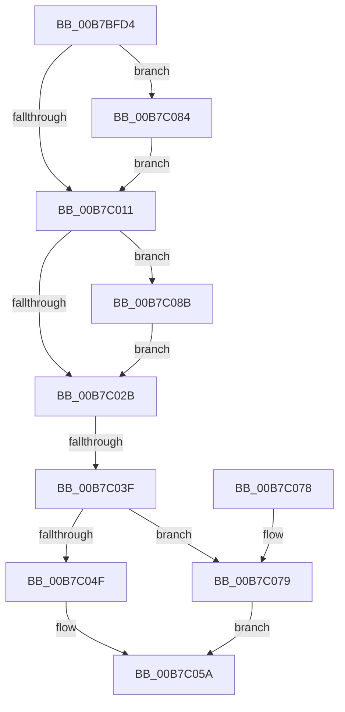

# HalpAcpiPreSleep

- RVA: `0x00B7BFD4`–`0x00B7C092` (길이 `190` bytes)
- VA: `0x0000000140B7BFD4`
- 실행 섹션: `PAGELK`
- PDB 이름 있음: `예`; PDB Function 태그: `예`
- unwind 정보 RVA: `0x000BB7B8`
- 디코드: `52`개 명령, `190/190` bytes 표시
- 미해석 바이트: `0` (있으면 어셈블리에 `.byte`로 보존)

> 이 문서는 커널 이미지의 기계어와 PDB 기호를 분석해 생성했습니다. 4번과 5번은 함수 원형과 자료형을 바이너리 사용 방식에서 추정한 C 해석이며 원본 소스 복구 결과는 아닙니다.

## 1. Dependencies

- 직접 호출 지점: **10**; 고유 호출 대상: **9**
- 직접 호출자로 확인된 함수: **1**
- RIP 상대 이미지 참조: **6**

### Outgoing calls
- `0x00B7BFFD` → [HalpTimerSwitchStallSource](../../text/4F/HalpTimerSwitchStallSource_function_004F9FF0.md) (function, `0x004F9FF0`)
- `0x00B7C002` → [HalpTimerSavePerformanceCounter](../../text/4B/HalpTimerSavePerformanceCounter_function_004B37F0.md) (function, `0x004B37F0`)
- `0x00B7C011` → [HalpTimerGetSavedPerformanceCounter](../../text/4E/HalpTimerGetSavedPerformanceCounter_function_004E2E48.md) (function, `0x004E2E48`)
- `0x00B7C019` → [KeSynchronizeTimeToQpc](../../text/4F/KeSynchronizeTimeToQpc_function_004F9A70.md) (function, `0x004F9A70`)
- `0x00B7C02D` → [HalpAcpiPmRegisterAvailable](../../text/43/HalpAcpiPmRegisterAvailable_function_0043F330.md) (function, `0x0043F330`)
- `0x00B7C055` → [guard_dispatch_icall](../../text/6B/guard_dispatch_icall_function_006BAAD0.md) (function, `0x006BAAD0`)
- `0x00B7C05A` → [HalpPreserveNvsArea](../../text/4F/HalpPreserveNvsArea_function_004F8BC4.md) (function, `0x004F8BC4`)
- `0x00B7C07D` → [guard_dispatch_icall](../../text/6B/guard_dispatch_icall_function_006BAAD0.md) (function, `0x006BAAD0`)
- `0x00B7C084` → [HalpSetClockBeforeSleep](../../text/42/HalpSetClockBeforeSleep_function_0042D518.md) (function, `0x0042D518`)
- `0x00B7C08B` → [HalpSaveDmaControllerState](../B5/HalpSaveDmaControllerState_function_00B5C130.md) (function, `0x00B5C130`)

### Direct callers
- [HaliAcpiSleep](../../text/56/HaliAcpiSleep_function_0056AD60.md) at `0x0056AE52`

### Static image references
- `0x00B7BFEB` → RVA `0x00FC1AD8` (`.data`; write)
- `0x00B7C007` → RVA `0x00E0A808` (`.data`; read)
- `0x00B7C01E` → RVA `0x00FC1C41` (`.data`; write)
- `0x00B7C03F` → RVA `0x00F90140` (`.data`; read)
- `0x00B7C046` → RVA `0x00E11750` (`.data`; read)
- `0x00B7C064` → RVA `0x00FC1A98` (`.data`; write)

## 2. Other-region calls and transfers

- 다른 실행 섹션으로 향하는 call: **9**
  - `0x00B7BFFD` → [HalpTimerSwitchStallSource](../../text/4F/HalpTimerSwitchStallSource_function_004F9FF0.md) (`PAGELK` → `.text`)
  - `0x00B7C002` → [HalpTimerSavePerformanceCounter](../../text/4B/HalpTimerSavePerformanceCounter_function_004B37F0.md) (`PAGELK` → `.text`)
  - `0x00B7C011` → [HalpTimerGetSavedPerformanceCounter](../../text/4E/HalpTimerGetSavedPerformanceCounter_function_004E2E48.md) (`PAGELK` → `.text`)
  - `0x00B7C019` → [KeSynchronizeTimeToQpc](../../text/4F/KeSynchronizeTimeToQpc_function_004F9A70.md) (`PAGELK` → `.text`)
  - `0x00B7C02D` → [HalpAcpiPmRegisterAvailable](../../text/43/HalpAcpiPmRegisterAvailable_function_0043F330.md) (`PAGELK` → `.text`)
  - `0x00B7C055` → [guard_dispatch_icall](../../text/6B/guard_dispatch_icall_function_006BAAD0.md) (`PAGELK` → `.text`)
  - `0x00B7C05A` → [HalpPreserveNvsArea](../../text/4F/HalpPreserveNvsArea_function_004F8BC4.md) (`PAGELK` → `.text`)
  - `0x00B7C07D` → [guard_dispatch_icall](../../text/6B/guard_dispatch_icall_function_006BAAD0.md) (`PAGELK` → `.text`)
  - `0x00B7C084` → [HalpSetClockBeforeSleep](../../text/42/HalpSetClockBeforeSleep_function_0042D518.md) (`PAGELK` → `.text`)
- call이 아닌 외부 분기/꼬리 이동: **1**
  - `0x00B7C039` → [sub_00B8109C](../B8/Unknown_function_00B8109C.md) (`tail-transfer`)

## 3. Assembly (complete function range)

```asm
00B7BFD4  48 89 5C 24 18                  mov qword ptr [rsp + 0x18], rbx
00B7BFD9  48 89 74 24 20                  mov qword ptr [rsp + 0x20], rsi
00B7BFDE  55                              push rbp
00B7BFDF  57                              push rdi
00B7BFE0  41 56                           push r14
00B7BFE2  48 8B EC                        mov rbp, rsp
00B7BFE5  48 83 EC 30                     sub rsp, 0x30
00B7BFE9  8B D9                           mov ebx, ecx
00B7BFEB  89 0D E7 5A 44 00               mov dword ptr [rip + 0x445ae7], ecx
00B7BFF1  33 FF                           xor edi, edi
00B7BFF3  B1 01                           mov cl, 1
00B7BFF5  66 89 7D 20                     mov word ptr [rbp + 0x20], di
00B7BFF9  66 89 7D 28                     mov word ptr [rbp + 0x28], di
00B7BFFD  E8 EE DF 97 FF                  call 0x1404f9ff0
00B7C002  E8 E9 77 93 FF                  call 0x1404b37f0
00B7C007  8B 05 FB E7 28 00               mov eax, dword ptr [rip + 0x28e7fb]
00B7C00D  A8 04                           test al, 4
00B7C00F  75 73                           jne 0x140b7c084
00B7C011  E8 32 6E 96 FF                  call 0x1404e2e48
00B7C016  48 8B C8                        mov rcx, rax
00B7C019  E8 52 DA 97 FF                  call 0x1404f9a70
00B7C01E  C6 05 1C 5C 44 00 01            mov byte ptr [rip + 0x445c1c], 1
00B7C025  0F BA E3 0E                     bt ebx, 0xe
00B7C029  72 60                           jb 0x140b7c08b
00B7C02B  33 C9                           xor ecx, ecx
00B7C02D  E8 FE 32 8C FF                  call 0x14043f330
00B7C032  BE 02 00 00 00                  mov esi, 2
00B7C037  85 C0                           test eax, eax
00B7C039  0F 89 5D 50 00 00               jns 0x140b8109c
00B7C03F  40 38 3D FA 40 41 00            cmp byte ptr [rip + 0x4140fa], dil
00B7C046  48 8B 05 03 57 29 00            mov rax, qword ptr [rip + 0x295703]
00B7C04D  75 2A                           jne 0x140b7c079
00B7C04F  48 8B 40 08                     mov rax, qword ptr [rax + 8]
00B7C053  33 C9                           xor ecx, ecx
00B7C055  E8 76 EA B3 FF                  call 0x1406baad0
00B7C05A  E8 65 CB 97 FF                  call 0x1404f8bc4
00B7C05F  48 8B 5C 24 60                  mov rbx, qword ptr [rsp + 0x60]
00B7C064  89 35 2E 5A 44 00               mov dword ptr [rip + 0x445a2e], esi
00B7C06A  48 8B 74 24 68                  mov rsi, qword ptr [rsp + 0x68]
00B7C06F  48 83 C4 30                     add rsp, 0x30
00B7C073  41 5E                           pop r14
00B7C075  5F                              pop rdi
00B7C076  5D                              pop rbp
00B7C077  C3                              ret
00B7C078  CC                              int3
00B7C079  48 8B 40 18                     mov rax, qword ptr [rax + 0x18]
00B7C07D  E8 4E EA B3 FF                  call 0x1406baad0
00B7C082  EB D6                           jmp 0x140b7c05a
00B7C084  E8 8F 14 8B FF                  call 0x14042d518
00B7C089  EB 86                           jmp 0x140b7c011
00B7C08B  E8 A0 00 FE FF                  call 0x140b5c130
00B7C090  EB 99                           jmp 0x140b7c02b
```

## 4. C-style interpretation (structured pseudocode)

```c
__int64 __fastcall HalpAcpiPreSleep(int a1)
{
    __int64 result;
    __int64 v_rdi;
    __int64 v_rsp;
    unsigned __int16 v_stack_p10;
    unsigned __int64 v_stack_p18;
    unsigned __int64 v_stack_p20;
    unsigned __int16 v_stack_p8;

    v_stack_p18 = v_rbx;
    v_stack_p20 = v_rsi;
    v_rsp = (v_rsp) - (48);
    *(unsigned int *)(v_rip + 4479719) = a1;
    v_rdi = 0;
    v_stack_p8 = 0;
    v_stack_p10 = 0;
    result = HalpTimerSwitchStallSource(1, a2, a3, a4);
    result = HalpTimerSavePerformanceCounter(1, a2, a3, a4);
    if ((((unsigned __int8)((unsigned int)(*(unsigned int *)(v_rip + 2680827)))) & (4)) != 0) goto loc_00B7C084;
loc_00B7C011:
    result = HalpTimerGetSavedPerformanceCounter(1, a2, a3, a4);
    result = KeSynchronizeTimeToQpc(result, a2, a3, a4);
    *(unsigned __int8 *)(v_rip + 4480028) = 1;
    if (condition_is_below) goto loc_00B7C08B;
loc_00B7C02B:
    a1 = 0;
    result = HalpAcpiPmRegisterAvailable(a1, a2, a3, a4);
    if ((*(unsigned __int8 *)(v_rip + 4276474)) != 0) goto loc_00B7C079;
    a1 = 0;
    result = guard_dispatch_icall(a1, a2, a3, a4);
loc_00B7C05A:
    result = HalpPreserveNvsArea(a1, a2, a3, a4);
    *(unsigned int *)(v_rip + 4479534) = 2;
    v_rsp = (v_rsp) + (48);
    return result;
loc_00B7C079:
    result = guard_dispatch_icall(a1, a2, a3, a4);
    goto loc_00B7C05A;
loc_00B7C084:
    result = HalpSetClockBeforeSleep(a1, a2, a3, a4);
    goto loc_00B7C011;
loc_00B7C08B:
    result = HalpSaveDmaControllerState(a1, a2, a3, a4);
    goto loc_00B7C02B;
}
```

## 5. (Beta) C Style

```c
int64_t HalpAcpiPreSleep(int32_t Arg1)
{
    int64_t result;
    int64_t local_rdi;
    int64_t local_rsp;
    uint16_t v_stack_p10;
    uint64_t v_stack_p18;
    uint64_t v_stack_p20;
    uint16_t v_stack_p8;

    v_stack_p18 = local_rbx;
    v_stack_p20 = local_rsi;
    local_rsp = (local_rsp) - (48);
    *(uint32_t *)(v_rip + 0x445AE7) = Arg1;
    local_rdi = 0;
    v_stack_p8 = 0;
    v_stack_p10 = 0;
    result = HalpTimerSwitchStallSource(1, a2, a3, a4);
    result = HalpTimerSavePerformanceCounter(1, a2, a3, a4);
    if ((((uint8_t)((uint32_t)(*(uint32_t *)(v_rip + 0x28E7FB)))) & (4)) != 0) goto loc_00B7C084;
loc_00B7C011:
    result = HalpTimerGetSavedPerformanceCounter(1, a2, a3, a4);
    result = KeSynchronizeTimeToQpc(result, a2, a3, a4);
    *(uint8_t *)(v_rip + 0x445C1C) = 1;
    if (condition_is_below) goto loc_00B7C08B;
loc_00B7C02B:
    Arg1 = 0;
    result = HalpAcpiPmRegisterAvailable(Arg1, a2, a3, a4);
    if ((*(uint8_t *)(v_rip + 0x4140FA)) != 0) goto loc_00B7C079;
    Arg1 = 0;
    result = guard_dispatch_icall(Arg1, a2, a3, a4);
loc_00B7C05A:
    result = HalpPreserveNvsArea(Arg1, a2, a3, a4);
    *(uint32_t *)(v_rip + 0x445A2E) = 2;
    local_rsp = (local_rsp) + (48);
    return result;
loc_00B7C079:
    result = guard_dispatch_icall(Arg1, a2, a3, a4);
    goto loc_00B7C05A;
loc_00B7C084:
    result = HalpSetClockBeforeSleep(Arg1, a2, a3, a4);
    goto loc_00B7C011;
loc_00B7C08B:
    result = HalpSaveDmaControllerState(Arg1, a2, a3, a4);
    goto loc_00B7C02B;
}
```

## 6. Execution-region graph

[열기: 2D/3D 그래프와 함수 탐색 컨트롤 패널](../../../control-panel.html?section=pagelk&rva=0x00B7BFD4&view=graph)

- 2D 그래프는 위에서 아래로 흐르고, 3D 그래프는 빈 공간을 드래그해 회전합니다. Shift+드래그는 이동, 휠은 확대·축소, 함수 노드 선택은 대상 보고서 이동입니다.

### Static fallback


