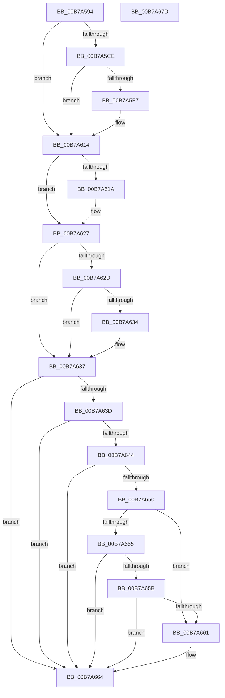

# HalpCheckFixedWakeSources

- RVA: `0x00B7A594`–`0x00B7A67E` (길이 `234` bytes)
- VA: `0x0000000140B7A594`
- 실행 섹션: `PAGELK`
- PDB 이름 있음: `예`; PDB Function 태그: `아니요`
- unwind 정보 RVA: `0x000B8D7C`
- 디코드: `67`개 명령, `234/234` bytes 표시
- 미해석 바이트: `0` (있으면 어셈블리에 `.byte`로 보존)

> 이 문서는 커널 이미지의 기계어와 PDB 기호를 분석해 생성했습니다. 4번과 5번은 함수 원형과 자료형을 바이너리 사용 방식에서 추정한 C 해석이며 원본 소스 복구 결과는 아닙니다.

## 1. Dependencies

- 직접 호출 지점: **4**; 고유 호출 대상: **2**
- 직접 호출자로 확인된 함수: **1**
- RIP 상대 이미지 참조: **4**

### Outgoing calls
- `0x00B7A5C5` → [HalpAcpiPmRegisterAvailable](../../text/43/HalpAcpiPmRegisterAvailable_function_0043F330.md) (function, `0x0043F330`)
- `0x00B7A5E0` → [HalpAcpiPmRegisterRead](../../text/41/HalpAcpiPmRegisterRead_function_0041DB30.md) (function, `0x0041DB30`)
- `0x00B7A5EE` → [HalpAcpiPmRegisterAvailable](../../text/43/HalpAcpiPmRegisterAvailable_function_0043F330.md) (function, `0x0043F330`)
- `0x00B7A60A` → [HalpAcpiPmRegisterRead](../../text/41/HalpAcpiPmRegisterRead_function_0041DB30.md) (function, `0x0041DB30`)

### Direct callers
- [HalpAcpiPostSleep](HalpAcpiPostSleep_function_00B79990.md) at `0x00B799DD`

### Static image references
- `0x00B7A5A6` → RVA `0x00FC1B50` (`.data`; read)
- `0x00B7A5AF` → RVA `0x00FC1AE8` (`.data`; read)
- `0x00B7A647` → RVA `0x00FC1AB2` (`.data`; read)
- `0x00B7A664` → RVA `0x00F0DEF4` (`.data`; read/write)

## 2. Other-region calls and transfers

- 다른 실행 섹션으로 향하는 call: **4**
  - `0x00B7A5C5` → [HalpAcpiPmRegisterAvailable](../../text/43/HalpAcpiPmRegisterAvailable_function_0043F330.md) (`PAGELK` → `.text`)
  - `0x00B7A5E0` → [HalpAcpiPmRegisterRead](../../text/41/HalpAcpiPmRegisterRead_function_0041DB30.md) (`PAGELK` → `.text`)
  - `0x00B7A5EE` → [HalpAcpiPmRegisterAvailable](../../text/43/HalpAcpiPmRegisterAvailable_function_0043F330.md) (`PAGELK` → `.text`)
  - `0x00B7A60A` → [HalpAcpiPmRegisterRead](../../text/41/HalpAcpiPmRegisterRead_function_0041DB30.md) (`PAGELK` → `.text`)
- 별도 외부 분기/꼬리 이동을 확인하지 못했습니다.

## 3. Assembly (complete function range)

```asm
00B7A594  48 89 5C 24 10                  mov qword ptr [rsp + 0x10], rbx
00B7A599  48 89 6C 24 18                  mov qword ptr [rsp + 0x18], rbp
00B7A59E  56                              push rsi
00B7A59F  57                              push rdi
00B7A5A0  41 56                           push r14
00B7A5A2  48 83 EC 30                     sub rsp, 0x30
00B7A5A6  8B 3D A4 75 44 00               mov edi, dword ptr [rip + 0x4475a4]
00B7A5AC  45 33 F6                        xor r14d, r14d
00B7A5AF  40 8A 2D 32 75 44 00            mov bpl, byte ptr [rip + 0x447532]
00B7A5B6  33 C9                           xor ecx, ecx
00B7A5B8  66 44 89 74 24 50               mov word ptr [rsp + 0x50], r14w
00B7A5BE  41 8B DE                        mov ebx, r14d
00B7A5C1  41 0F B7 F6                     movzx esi, r14w
00B7A5C5  E8 66 4D 8C FF                  call 0x14043f330
00B7A5CA  85 C0                           test eax, eax
00B7A5CC  78 46                           js 0x140b7a614
00B7A5CE  45 8D 4E 02                     lea r9d, [r14 + 2]
00B7A5D2  4C 89 74 24 20                  mov qword ptr [rsp + 0x20], r14
00B7A5D7  4C 8D 44 24 50                  lea r8, [rsp + 0x50]
00B7A5DC  33 D2                           xor edx, edx
00B7A5DE  33 C9                           xor ecx, ecx
00B7A5E0  E8 4B 35 8A FF                  call 0x14041db30
00B7A5E5  0F B7 74 24 50                  movzx esi, word ptr [rsp + 0x50]
00B7A5EA  41 8D 4E 03                     lea ecx, [r14 + 3]
00B7A5EE  E8 3D 4D 8C FF                  call 0x14043f330
00B7A5F3  85 C0                           test eax, eax
00B7A5F5  78 1D                           js 0x140b7a614
00B7A5F7  33 D2                           xor edx, edx
00B7A5F9  4C 89 74 24 20                  mov qword ptr [rsp + 0x20], r14
00B7A5FE  45 8D 4E 02                     lea r9d, [r14 + 2]
00B7A602  4C 8D 44 24 50                  lea r8, [rsp + 0x50]
00B7A607  8D 4A 03                        lea ecx, [rdx + 3]
00B7A60A  E8 21 35 8A FF                  call 0x14041db30
00B7A60F  66 0B 74 24 50                  or si, word ptr [rsp + 0x50]
00B7A614  40 F6 C7 10                     test dil, 0x10
00B7A618  75 0D                           jne 0x140b7a627
00B7A61A  66 0F BA E6 08                  bt si, 8
00B7A61F  B8 01 00 00 00                  mov eax, 1
00B7A624  0F 42 D8                        cmovb ebx, eax
00B7A627  40 F6 C7 20                     test dil, 0x20
00B7A62B  75 0A                           jne 0x140b7a637
00B7A62D  66 0F BA E6 09                  bt si, 9
00B7A632  73 03                           jae 0x140b7a637
00B7A634  83 CB 02                        or ebx, 2
00B7A637  40 F6 C7 40                     test dil, 0x40
00B7A63B  75 27                           jne 0x140b7a664
00B7A63D  66 0F BA E6 0A                  bt si, 0xa
00B7A642  73 20                           jae 0x140b7a664
00B7A644  83 CB 04                        or ebx, 4
00B7A647  44 38 35 64 74 44 00            cmp byte ptr [rip + 0x447464], r14b
00B7A64E  74 14                           je 0x140b7a664
00B7A650  40 84 FF                        test dil, dil
00B7A653  79 0C                           jns 0x140b7a661
00B7A655  40 80 FD 04                     cmp bpl, 4
00B7A659  72 09                           jb 0x140b7a664
00B7A65B  0F BA E7 10                     bt edi, 0x10
00B7A65F  72 03                           jb 0x140b7a664
00B7A661  83 E3 FB                        and ebx, 0xfffffffb
00B7A664  09 1D 8A 38 39 00               or dword ptr [rip + 0x39388a], ebx
00B7A66A  48 8B 5C 24 58                  mov rbx, qword ptr [rsp + 0x58]
00B7A66F  48 8B 6C 24 60                  mov rbp, qword ptr [rsp + 0x60]
00B7A674  48 83 C4 30                     add rsp, 0x30
00B7A678  41 5E                           pop r14
00B7A67A  5F                              pop rdi
00B7A67B  5E                              pop rsi
00B7A67C  C3                              ret
00B7A67D  CC                              int3
```

## 4. C-style interpretation (structured pseudocode)

```c
__int64 __fastcall HalpCheckFixedWakeSources(int a1, int a2)
{
    __int64 result;
    __int64 v_r14;
    __int64 v_rbx;
    __int64 v_rsi;
    __int64 v_rsp;
    unsigned __int64 v_stack_m28;
    unsigned __int64 v_stack_p10;
    unsigned __int64 v_stack_p18;
    unsigned __int16 v_stack_p8;

    v_stack_p10 = v_rbx;
    v_stack_p18 = v_rbp;
    v_rsp = (v_rsp) - (48);
    v_r14 = 0;
    a1 = 0;
    v_stack_p8 = 0;
    result = HalpAcpiPmRegisterAvailable(a1, a2, a3, a4);
    if (sign_flag) goto loc_00B7A614;
    v_stack_m28 = 0;
    a2 = 0;
    a1 = 0;
    result = HalpAcpiPmRegisterRead(a1, a2, v_stack_p8, v_r14 + 2);
    result = HalpAcpiPmRegisterAvailable(v_r14 + 3, a2, v_stack_p8, v_r14 + 2);
    v_rsi = v_stack_p8;
    if (!(sign_flag)) {
        a2 = 0;
        v_stack_m28 = 0;
        a4 = v_r14 + 2;
        a3 = v_stack_p8;
        a1 = a2 + 3;
        result = HalpAcpiPmRegisterRead(a1, a2, a3, a4);
        v_rsi = (unsigned __int16)((v_stack_p8) | (v_stack_p8));
    }
    v_rbx = 0;
    if ((((unsigned __int8)((unsigned int)(*(unsigned int *)(v_rip + 4486564)))) & (16)) == 0) {
        result = 1;
        v_rbx = 0;
        if (condition_is_below) { v_rbx = (unsigned int)(result); }
    }
    if ((((unsigned __int8)((unsigned int)(*(unsigned int *)(v_rip + 4486564)))) & (32)) != 0) goto loc_00B7A637;
    if (!(condition_is_above_or_equal)) {
        v_rbx = (unsigned int)((v_rbx) | (2));
    }
    if ((((unsigned __int8)((unsigned int)(*(unsigned int *)(v_rip + 4486564)))) & (64)) != 0) goto loc_00B7A664;
    if (condition_is_above_or_equal) goto loc_00B7A664;
    v_rbx = (unsigned int)((v_rbx) | (4));
    if ((*(unsigned __int8 *)(v_rip + 4486244)) == 0) goto loc_00B7A664;
    if (!sign_flag) goto loc_00B7A661;
    if (((unsigned __int8)(*(unsigned __int8 *)(v_rip + 4486450))) < 4) goto loc_00B7A664;
    if (((unsigned __int8)(*(unsigned __int8 *)(v_rip + 4486450))) >= 4) {
        v_rbx = (unsigned int)((v_rbx) & (0xFFFFFFFBULL));
    }
    v_rsp = (v_rsp) + (48);
    return result;
}
```

## 5. (Beta) C Style

```c
int64_t HalpCheckFixedWakeSources(int32_t Arg1, int32_t Arg2)
{
    int64_t result;
    int64_t local_r14;
    int64_t local_rbx;
    int64_t local_rsi;
    int64_t local_rsp;
    uint64_t v_stack_m28;
    uint64_t v_stack_p10;
    uint64_t v_stack_p18;
    uint16_t v_stack_p8;

    v_stack_p10 = local_rbx;
    v_stack_p18 = local_rbp;
    local_rsp = (local_rsp) - (48);
    local_r14 = 0;
    Arg1 = 0;
    v_stack_p8 = 0;
    result = HalpAcpiPmRegisterAvailable(Arg1, Arg2, a3, a4);
    if (sign_flag) goto loc_00B7A614;
    v_stack_m28 = 0;
    Arg2 = 0;
    Arg1 = 0;
    result = HalpAcpiPmRegisterRead(Arg1, Arg2, v_stack_p8, local_r14 + 2);
    result = HalpAcpiPmRegisterAvailable(local_r14 + 3, Arg2, v_stack_p8, local_r14 + 2);
    local_rsi = v_stack_p8;
    if (!(sign_flag)) {
        Arg2 = 0;
        v_stack_m28 = 0;
        a4 = local_r14 + 2;
        a3 = v_stack_p8;
        Arg1 = Arg2 + 3;
        result = HalpAcpiPmRegisterRead(Arg1, Arg2, a3, a4);
        local_rsi = (uint16_t)((v_stack_p8) | (v_stack_p8));
    }
    local_rbx = 0;
    if ((((uint8_t)((uint32_t)(*(uint32_t *)(v_rip + 0x4475A4)))) & (16)) == 0) {
        result = 1;
        local_rbx = 0;
        if (condition_is_below) { local_rbx = (uint32_t)(result); }
    }
    if ((((uint8_t)((uint32_t)(*(uint32_t *)(v_rip + 0x4475A4)))) & (32)) != 0) goto loc_00B7A637;
    if (!(condition_is_above_or_equal)) {
        local_rbx = (uint32_t)((local_rbx) | (2));
    }
    if ((((uint8_t)((uint32_t)(*(uint32_t *)(v_rip + 0x4475A4)))) & (64)) != 0) goto loc_00B7A664;
    if (condition_is_above_or_equal) goto loc_00B7A664;
    local_rbx = (uint32_t)((local_rbx) | (4));
    if ((*(uint8_t *)(v_rip + 0x447464)) == 0) goto loc_00B7A664;
    if (!sign_flag) goto loc_00B7A661;
    if (((uint8_t)(*(uint8_t *)(v_rip + 0x447532))) < 4) goto loc_00B7A664;
    if (((uint8_t)(*(uint8_t *)(v_rip + 0x447532))) >= 4) {
        local_rbx = (uint32_t)((local_rbx) & (0xFFFFFFFBULL));
    }
    local_rsp = (local_rsp) + (48);
    return result;
}
```

## 6. Execution-region graph

[열기: 2D/3D 그래프와 함수 탐색 컨트롤 패널](../../../control-panel.html?section=pagelk&rva=0x00B7A594&view=graph)

- 2D 그래프는 위에서 아래로 흐르고, 3D 그래프는 빈 공간을 드래그해 회전합니다. Shift+드래그는 이동, 휠은 확대·축소, 함수 노드 선택은 대상 보고서 이동입니다.

### Static fallback


