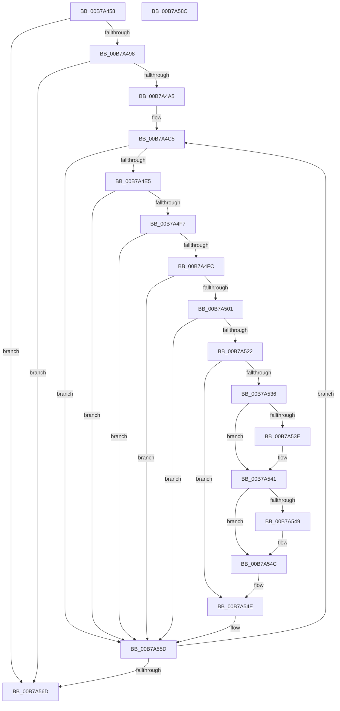

# HalpCheckLowMemoryPostSleep

- RVA: `0x00B7A458`–`0x00B7A58D` (길이 `309` bytes)
- VA: `0x0000000140B7A458`
- 실행 섹션: `PAGELK`
- PDB 이름 있음: `예`; PDB Function 태그: `아니요`
- unwind 정보 RVA: `0x0005FEF8`
- 디코드: `84`개 명령, `309/309` bytes 표시
- 미해석 바이트: `0` (있으면 어셈블리에 `.byte`로 보존)

> 이 문서는 커널 이미지의 기계어와 PDB 기호를 분석해 생성했습니다. 4번과 5번은 함수 원형과 자료형을 바이너리 사용 방식에서 추정한 C 해석이며 원본 소스 복구 결과는 아닙니다.

## 1. Dependencies

- 직접 호출 지점: **3**; 고유 호출 대상: **3**
- 직접 호출자로 확인된 함수: **1**
- RIP 상대 이미지 참조: **6**

### Outgoing calls
- `0x00B7A515` → [HalpMapPhysicalMemory64](../../text/3F/HalpMapPhysicalMemory64_function_003F88C8.md) (function, `0x003F88C8`)
- `0x00B7A525` → [HalpSimpleCheck](../B5/HalpSimpleCheck_function_00B5EE7C.md) (function, `0x00B5EE7C`)
- `0x00B7A558` → [HalpUnmapVirtualAddress](../../text/3F/HalpUnmapVirtualAddress_function_003F8C30.md) (function, `0x003F8C30`)

### Direct callers
- [HalpAcpiPostSleep](HalpAcpiPostSleep_function_00B79990.md) at `0x00B79AAB`

### Static image references
- `0x00B7A488` → RVA `0x00FC1AD8` (`.data`; read)
- `0x00B7A498` → RVA `0x00FC1AB2` (`.data`; read)
- `0x00B7A4A5` → RVA `0x00FC1AA0` (`.data`; read)
- `0x00B7A4C5` → RVA `0x00F901B8` (`.data`; read)
- `0x00B7A4E5` → RVA `0x00F901A8` (`.data`; read)
- `0x00B7A52A` → RVA `0x00F90040` (`.data`; read)

## 2. Other-region calls and transfers

- 다른 실행 섹션으로 향하는 call: **2**
  - `0x00B7A515` → [HalpMapPhysicalMemory64](../../text/3F/HalpMapPhysicalMemory64_function_003F88C8.md) (`PAGELK` → `.text`)
  - `0x00B7A558` → [HalpUnmapVirtualAddress](../../text/3F/HalpUnmapVirtualAddress_function_003F8C30.md) (`PAGELK` → `.text`)
- 별도 외부 분기/꼬리 이동을 확인하지 못했습니다.

## 3. Assembly (complete function range)

```asm
00B7A458  48 8B C4                        mov rax, rsp
00B7A45B  48 89 58 08                     mov qword ptr [rax + 8], rbx
00B7A45F  48 89 68 10                     mov qword ptr [rax + 0x10], rbp
00B7A463  48 89 70 18                     mov qword ptr [rax + 0x18], rsi
00B7A467  48 89 78 20                     mov qword ptr [rax + 0x20], rdi
00B7A46B  41 54                           push r12
00B7A46D  41 56                           push r14
00B7A46F  41 57                           push r15
00B7A471  48 83 EC 20                     sub rsp, 0x20
00B7A475  83 09 FF                        or dword ptr [rcx], 0xffffffff
00B7A478  49 8B F0                        mov rsi, r8
00B7A47B  83 22 00                        and dword ptr [rdx], 0
00B7A47E  4C 8B F2                        mov r14, rdx
00B7A481  41 83 20 00                     and dword ptr [r8], 0
00B7A485  4C 8B F9                        mov r15, rcx
00B7A488  F7 05 46 76 44 00 00 00 02 00   test dword ptr [rip + 0x447646], 0x20000
00B7A492  0F 84 D5 00 00 00               je 0x140b7a56d
00B7A498  80 3D 13 76 44 00 00            cmp byte ptr [rip + 0x447613], 0
00B7A49F  0F 85 C8 00 00 00               jne 0x140b7a56d
00B7A4A5  48 8B 3D F4 75 44 00            mov rdi, qword ptr [rip + 0x4475f4]
00B7A4AC  48 C1 EF 0C                     shr rdi, 0xc
00B7A4B0  48 F7 05 E5 75 44 00 FF 0F 00 00  test qword ptr [rip + 0x4475e5], 0xfff
00B7A4BB  4C 8D 67 01                     lea r12, [rdi + 1]
00B7A4BF  4C 0F 44 E7                     cmove r12, rdi
00B7A4C3  33 DB                           xor ebx, ebx
00B7A4C5  48 8B 05 EC 5C 41 00            mov rax, qword ptr [rip + 0x415cec]
00B7A4CC  8A CB                           mov cl, bl
00B7A4CE  80 E1 07                        and cl, 7
00B7A4D1  44 8B C3                        mov r8d, ebx
00B7A4D4  49 C1 E8 03                     shr r8, 3
00B7A4D8  8B EB                           mov ebp, ebx
00B7A4DA  41 8A 14 00                     mov dl, byte ptr [r8 + rax]
00B7A4DE  D2 FA                           sar dl, cl
00B7A4E0  F6 C2 01                        test dl, 1
00B7A4E3  75 78                           jne 0x140b7a55d
00B7A4E5  48 8B 05 BC 5C 41 00            mov rax, qword ptr [rip + 0x415cbc]
00B7A4EC  41 8A 14 00                     mov dl, byte ptr [r8 + rax]
00B7A4F0  D2 FA                           sar dl, cl
00B7A4F2  F6 C2 01                        test dl, 1
00B7A4F5  75 66                           jne 0x140b7a55d
00B7A4F7  48 3B DF                        cmp rbx, rdi
00B7A4FA  74 61                           je 0x140b7a55d
00B7A4FC  49 3B DC                        cmp rbx, r12
00B7A4FF  74 5C                           je 0x140b7a55d
00B7A501  41 B9 04 00 00 00               mov r9d, 4
00B7A507  48 8B CB                        mov rcx, rbx
00B7A50A  48 C1 E1 0C                     shl rcx, 0xc
00B7A50E  45 33 C0                        xor r8d, r8d
00B7A511  41 8D 51 FD                     lea edx, [r9 - 3]
00B7A515  E8 AE E3 87 FF                  call 0x1403f88c8
00B7A51A  4C 8B C8                        mov r9, rax
00B7A51D  48 85 C0                        test rax, rax
00B7A520  74 3B                           je 0x140b7a55d
00B7A522  48 8B C8                        mov rcx, rax
00B7A525  E8 52 49 FE FF                  call 0x140b5ee7c
00B7A52A  48 8D 0D 0F 5B 41 00            lea rcx, [rip + 0x415b0f]
00B7A531  3A 04 0B                        cmp al, byte ptr [rbx + rcx]
00B7A534  74 18                           je 0x140b7a54e
00B7A536  41 8B 0F                        mov ecx, dword ptr [r15]
00B7A539  48 3B D9                        cmp rbx, rcx
00B7A53C  73 03                           jae 0x140b7a541
00B7A53E  41 89 2F                        mov dword ptr [r15], ebp
00B7A541  41 8B 06                        mov eax, dword ptr [r14]
00B7A544  48 3B D8                        cmp rbx, rax
00B7A547  76 03                           jbe 0x140b7a54c
00B7A549  41 89 2E                        mov dword ptr [r14], ebp
00B7A54C  FF 06                           inc dword ptr [rsi]
00B7A54E  45 33 C0                        xor r8d, r8d
00B7A551  49 8B C9                        mov rcx, r9
00B7A554  41 8D 50 01                     lea edx, [r8 + 1]
00B7A558  E8 D3 E6 87 FF                  call 0x1403f8c30
00B7A55D  48 FF C3                        inc rbx
00B7A560  48 81 FB 00 01 00 00            cmp rbx, 0x100
00B7A567  0F 82 58 FF FF FF               jb 0x140b7a4c5
00B7A56D  48 8B 5C 24 40                  mov rbx, qword ptr [rsp + 0x40]
00B7A572  48 8B 6C 24 48                  mov rbp, qword ptr [rsp + 0x48]
00B7A577  48 8B 74 24 50                  mov rsi, qword ptr [rsp + 0x50]
00B7A57C  48 8B 7C 24 58                  mov rdi, qword ptr [rsp + 0x58]
00B7A581  48 83 C4 20                     add rsp, 0x20
00B7A585  41 5F                           pop r15
00B7A587  41 5E                           pop r14
00B7A589  41 5C                           pop r12
00B7A58B  C3                              ret
00B7A58C  CC                              int3
```

## 4. C-style interpretation (structured pseudocode)

```c
__int64 __fastcall HalpCheckLowMemoryPostSleep(__int64 a1, __int64 a2, __int64 a3)
{
    __int64 result;
    __int64 v_r12;
    __int64 v_rbx;
    __int64 v_rdi;
    __int64 v_rsp;
    unsigned __int64 v_stack_p10;
    unsigned __int64 v_stack_p18;
    unsigned __int64 v_stack_p20;
    unsigned __int64 v_stack_p8;

    *(unsigned __int64 *)(v_rsp + 8) = v_rbx;
    *(unsigned __int64 *)(v_rsp + 16) = v_rbp;
    *(unsigned __int64 *)(v_rsp + 24) = v_rsi;
    *(unsigned __int64 *)(v_rsp + 32) = v_rdi;
    v_rsp = (v_rsp) - (32);
    if (((*(unsigned int *)(v_rip + 4486726)) & (0x20000ULL)) == 0) goto loc_00B7A56D;
    if ((*(unsigned __int8 *)(v_rip + 4486675)) != 0) goto loc_00B7A56D;
    v_rdi = (*(unsigned __int64 *)(v_rip + 4486644)) >> (12);
    v_r12 = v_rdi + 1;
    if (((*(unsigned __int64 *)(v_rip + 4486629)) & (0xFFFULL)) == 0) { v_r12 = v_rdi; }
    v_rbx = 0;
loc_00B7A4C5:
    a1 = (unsigned __int8)((0) & (7));
    a3 = (0) >> (3);
    a2 = (unsigned __int8)((*(unsigned __int8 *)(a3 + *(unsigned __int64 *)(v_rip + 4283628) * 1)) >> ((unsigned __int8)(a1)));
    if ((((unsigned __int8)(a2)) & (1)) != 0) goto loc_00B7A55D;
    a2 = (unsigned __int8)((*(unsigned __int8 *)(a3 + *(unsigned __int64 *)(v_rip + 4283580) * 1)) >> ((unsigned __int8)(a1)));
    if ((((unsigned __int8)(a2)) & (1)) != 0) goto loc_00B7A55D;
    if (0 == v_rdi) goto loc_00B7A55D;
    if (0 == v_r12) goto loc_00B7A55D;
    a1 = (0) << (12);
    a3 = 0;
    result = HalpMapPhysicalMemory64(a1, 4 - 3, a3, 4);
    if (result == 0) goto loc_00B7A55D;
    result = HalpSimpleCheck(result, 4 - 3, a3, result);
    if (((unsigned __int8)(result)) == (*(unsigned __int8 *)(v_rbx + v_rip + 4283151 * 1))) goto loc_00B7A54E;
    if (0 < ((unsigned int)(*(unsigned int *)(a1)))) {
        *(unsigned int *)(a1) = 0;
    }
    if (0 >= = ((unsigned int)(*(unsigned int *)(a2)))) {
        *(unsigned int *)(a2) = 0;
    }
loc_00B7A54E:
    a3 = 0;
    result = HalpUnmapVirtualAddress(result, a3 + 1, a3, result);
loc_00B7A55D:
    v_rbx = (v_rbx) + 1;
    if (v_rbx < 256) goto loc_00B7A4C5;
loc_00B7A56D:
    v_rsp = (v_rsp) + (32);
    return result;
}
```

## 5. (Beta) C Style

```c
int64_t HalpCheckLowMemoryPostSleep(void *Arg1, void *Arg2, void *Arg3)
{
    uint8_t *arg1 = (uint8_t *)Arg1;
    uint8_t *arg2 = (uint8_t *)Arg2;
    uint8_t *arg3 = (uint8_t *)Arg3;

    int64_t result;
    int64_t local_r12;
    int64_t local_rbx;
    int64_t local_rdi;
    int64_t local_rsp;
    uint64_t v_stack_p10;
    uint64_t v_stack_p18;
    uint64_t v_stack_p20;
    uint64_t v_stack_p8;

    *(uint64_t *)(local_rsp + 0x8) = local_rbx;
    *(uint64_t *)(local_rsp + 0x10) = local_rbp;
    *(uint64_t *)(local_rsp + 0x18) = local_rsi;
    *(uint64_t *)(local_rsp + 0x20) = local_rdi;
    local_rsp = (local_rsp) - (32);
    if (((*(uint32_t *)(v_rip + 0x447646)) & (0x20000ULL)) == 0) goto loc_00B7A56D;
    if ((*(uint8_t *)(v_rip + 0x447613)) != 0) goto loc_00B7A56D;
    local_rdi = (*(uint64_t *)(v_rip + 0x4475F4)) >> (12);
    local_r12 = local_rdi + 1;
    if (((*(uint64_t *)(v_rip + 0x4475E5)) & (0xFFFULL)) == 0) { local_r12 = local_rdi; }
    local_rbx = 0;
loc_00B7A4C5:
    Arg1 = (uint8_t)((0) & (7));
    Arg3 = (0) >> (3);
    Arg2 = (uint8_t)((*(uint8_t *)(arg3 + *(uint64_t *)(v_rip + 0x415CEC) * 1)) >> ((uint8_t)(Arg1)));
    if ((((uint8_t)(Arg2)) & (1)) != 0) goto loc_00B7A55D;
    Arg2 = (uint8_t)((*(uint8_t *)(arg3 + *(uint64_t *)(v_rip + 0x415CBC) * 1)) >> ((uint8_t)(Arg1)));
    if ((((uint8_t)(Arg2)) & (1)) != 0) goto loc_00B7A55D;
    if (0 == local_rdi) goto loc_00B7A55D;
    if (0 == local_r12) goto loc_00B7A55D;
    Arg1 = (0) << (12);
    Arg3 = 0;
    result = HalpMapPhysicalMemory64(Arg1, 4 - 3, Arg3, 4);
    if (result == 0) goto loc_00B7A55D;
    result = HalpSimpleCheck(result, 4 - 3, Arg3, result);
    if (((uint8_t)(result)) == (*(uint8_t *)(local_rbx + v_rip + 0x415B0F * 1))) goto loc_00B7A54E;
    if (0 < ((uint32_t)(*(uint32_t *)(arg1)))) {
        *(uint32_t *)(arg1) = 0;
    }
    if (0 >= = ((uint32_t)(*(uint32_t *)(arg2)))) {
        *(uint32_t *)(arg2) = 0;
    }
loc_00B7A54E:
    Arg3 = 0;
    result = HalpUnmapVirtualAddress(result, Arg3 + 1, Arg3, result);
loc_00B7A55D:
    local_rbx = (local_rbx) + 1;
    if (local_rbx < 256) goto loc_00B7A4C5;
loc_00B7A56D:
    local_rsp = (local_rsp) + (32);
    return result;
}
```

### 관측된 메모리 오프셋

구조체 형식이 확인되지 않은 접근은 인자 기준의 오프셋으로만 기록했습니다.

| 기준 인자 | 오프셋 표현 | 폭 (bit) | 접근 |
|---|---:|---:|---|
| `Arg1` | `+ 0x0` | `32` | `R` |
| `Arg1` | `+ 0x0` | `32` | `R/W` |
| `Arg1` | `+ 0x0` | `32` | `W` |
| `Arg2` | `+ 0x0` | `32` | `R` |
| `Arg2` | `+ 0x0` | `32` | `R/W` |
| `Arg2` | `+ 0x0` | `32` | `W` |
| `Arg3` | `+ 0x0` | `32` | `R/W` |

## 6. Execution-region graph

[열기: 2D/3D 그래프와 함수 탐색 컨트롤 패널](../../../control-panel.html?section=pagelk&rva=0x00B7A458&view=graph)

- 2D 그래프는 위에서 아래로 흐르고, 3D 그래프는 빈 공간을 드래그해 회전합니다. Shift+드래그는 이동, 휠은 확대·축소, 함수 노드 선택은 대상 보고서 이동입니다.

### Static fallback


