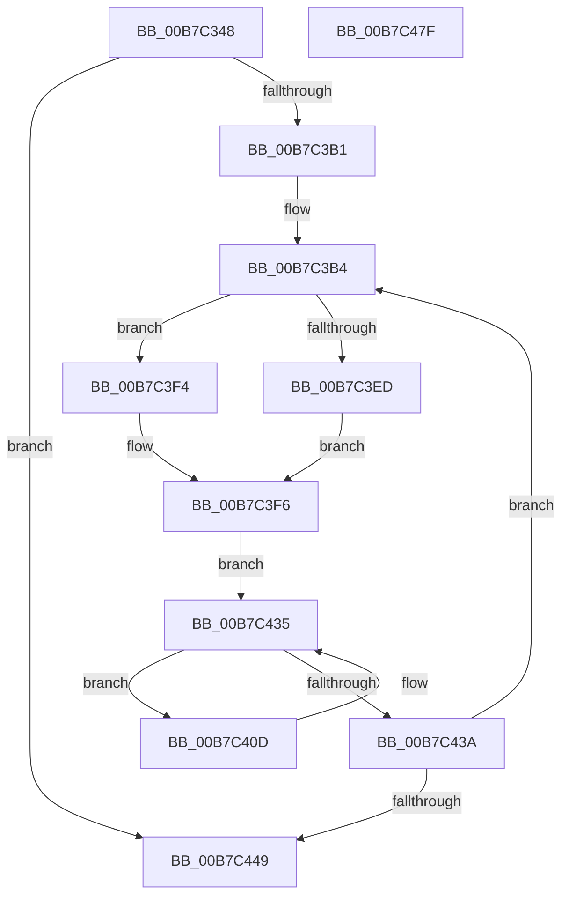

# HalpCmciInit

- RVA: `0x00B7C348`–`0x00B7C480` (길이 `312` bytes)
- VA: `0x0000000140B7C348`
- 실행 섹션: `PAGELK`
- PDB 이름 있음: `예`; PDB Function 태그: `아니요`
- unwind 정보 RVA: `0x000BC32C`
- 디코드: `81`개 명령, `312/312` bytes 표시
- 미해석 바이트: `0` (있으면 어셈블리에 `.byte`로 보존)

> 이 문서는 커널 이미지의 기계어와 PDB 기호를 분석해 생성했습니다. 4번과 5번은 함수 원형과 자료형을 바이너리 사용 방식에서 추정한 C 해석이며 원본 소스 복구 결과는 아닙니다.

## 1. Dependencies

- 직접 호출 지점: **8**; 고유 호출 대상: **8**
- 직접 호출자로 확인된 함수: **1**
- RIP 상대 이미지 참조: **3**

### Outgoing calls
- `0x00B7C38B` → [HalpCmciLoadThresholdConfiguration](../../text/4E/HalpCmciLoadThresholdConfiguration_function_004E06A0.md) (function, `0x004E06A0`)
- `0x00B7C392` → [KeQueryPerformanceCounter](../../text/37/KeQueryPerformanceCounter_function_0037E7E0.md) (function, `0x0037E7E0`)
- `0x00B7C39F` → [KeQueryActiveProcessorCountEx](../../text/24/KeQueryActiveProcessorCountEx_function_00249EF0.md) (function, `0x00249EF0`)
- `0x00B7C3F6` → [KeSetSystemGroupAffinityThread](../../text/39/KeSetSystemGroupAffinityThread_function_00399140.md) (function, `0x00399140`)
- `0x00B7C41E` → [HalpCmciInitializeErrorPacket](../../text/48/HalpCmciInitializeErrorPacket_function_00487010.md) (function, `0x00487010`)
- `0x00B7C429` → [HalpCmciInitProcessor](../../text/48/HalpCmciInitProcessor_function_004875E4.md) (function, `0x004875E4`)
- `0x00B7C44E` → [KeRevertToUserGroupAffinityThread](../../text/39/KeRevertToUserGroupAffinityThread_function_00398EC0.md) (function, `0x00398EC0`)
- `0x00B7C45B` → [_security_check_cookie](../../text/6A/_security_check_cookie_function_006AC640.md) (function, `0x006AC640`)

### Direct callers
- [sub_00B3E38E](../../page/B3/Unknown_function_00B3E38E.md) at `0x00B3E3D6`

### Static image references
- `0x00B7C365` → RVA `0x00E0A740` (`.data`; read)
- `0x00B7C374` → RVA `0x00E0F6C8` (`.data`; read)
- `0x00B7C3B4` → RVA `0x00F231B0` (`.data`; read)

## 2. Other-region calls and transfers

- 다른 실행 섹션으로 향하는 call: **8**
  - `0x00B7C38B` → [HalpCmciLoadThresholdConfiguration](../../text/4E/HalpCmciLoadThresholdConfiguration_function_004E06A0.md) (`PAGELK` → `.text`)
  - `0x00B7C392` → [KeQueryPerformanceCounter](../../text/37/KeQueryPerformanceCounter_function_0037E7E0.md) (`PAGELK` → `.text`)
  - `0x00B7C39F` → [KeQueryActiveProcessorCountEx](../../text/24/KeQueryActiveProcessorCountEx_function_00249EF0.md) (`PAGELK` → `.text`)
  - `0x00B7C3F6` → [KeSetSystemGroupAffinityThread](../../text/39/KeSetSystemGroupAffinityThread_function_00399140.md) (`PAGELK` → `.text`)
  - `0x00B7C41E` → [HalpCmciInitializeErrorPacket](../../text/48/HalpCmciInitializeErrorPacket_function_00487010.md) (`PAGELK` → `.text`)
  - `0x00B7C429` → [HalpCmciInitProcessor](../../text/48/HalpCmciInitProcessor_function_004875E4.md) (`PAGELK` → `.text`)
  - `0x00B7C44E` → [KeRevertToUserGroupAffinityThread](../../text/39/KeRevertToUserGroupAffinityThread_function_00398EC0.md) (`PAGELK` → `.text`)
  - `0x00B7C45B` → [_security_check_cookie](../../text/6A/_security_check_cookie_function_006AC640.md) (`PAGELK` → `.text`)
- 별도 외부 분기/꼬리 이동을 확인하지 못했습니다.

## 3. Assembly (complete function range)

```asm
00B7C348  48 8B C4                        mov rax, rsp
00B7C34B  48 89 58 08                     mov qword ptr [rax + 8], rbx
00B7C34F  48 89 68 10                     mov qword ptr [rax + 0x10], rbp
00B7C353  48 89 70 18                     mov qword ptr [rax + 0x18], rsi
00B7C357  48 89 78 20                     mov qword ptr [rax + 0x20], rdi
00B7C35B  41 54                           push r12
00B7C35D  41 56                           push r14
00B7C35F  41 57                           push r15
00B7C361  48 83 EC 50                     sub rsp, 0x50
00B7C365  48 8B 05 D4 E3 28 00            mov rax, qword ptr [rip + 0x28e3d4]
00B7C36C  48 33 C4                        xor rax, rsp
00B7C36F  48 89 44 24 40                  mov qword ptr [rsp + 0x40], rax
00B7C374  4C 8B 25 4D 33 29 00            mov r12, qword ptr [rip + 0x29334d]
00B7C37B  0F 57 C0                        xorps xmm0, xmm0
00B7C37E  0F 57 C9                        xorps xmm1, xmm1
00B7C381  0F 11 44 24 20                  movups xmmword ptr [rsp + 0x20], xmm0
00B7C386  0F 11 4C 24 30                  movups xmmword ptr [rsp + 0x30], xmm1
00B7C38B  E8 10 43 96 FF                  call 0x1404e06a0
00B7C390  33 C9                           xor ecx, ecx
00B7C392  E8 49 24 80 FF                  call 0x14037e7e0
00B7C397  B9 FF FF 00 00                  mov ecx, 0xffff
00B7C39C  48 8B F8                        mov rdi, rax
00B7C39F  E8 4C DB 6C FF                  call 0x140249ef0
00B7C3A4  33 ED                           xor ebp, ebp
00B7C3A6  44 8B F8                        mov r15d, eax
00B7C3A9  85 C0                           test eax, eax
00B7C3AB  0F 84 98 00 00 00               je 0x140b7c449
00B7C3B1  45 33 F6                        xor r14d, r14d
00B7C3B4  48 8B 0D F5 6D 3A 00            mov rcx, qword ptr [rip + 0x3a6df5]
00B7C3BB  33 C0                           xor eax, eax
00B7C3BD  89 44 24 2A                     mov dword ptr [rsp + 0x2a], eax
00B7C3C1  66 89 44 24 2E                  mov word ptr [rsp + 0x2e], ax
00B7C3C6  41 8B 0C 0E                     mov ecx, dword ptr [r14 + rcx]
00B7C3CA  8B C1                           mov eax, ecx
00B7C3CC  C1 E8 06                        shr eax, 6
00B7C3CF  83 E1 3F                        and ecx, 0x3f
00B7C3D2  66 89 44 24 28                  mov word ptr [rsp + 0x28], ax
00B7C3D7  B8 01 00 00 00                  mov eax, 1
00B7C3DC  48 D3 E0                        shl rax, cl
00B7C3DF  48 8D 4C 24 20                  lea rcx, [rsp + 0x20]
00B7C3E4  48 89 44 24 20                  mov qword ptr [rsp + 0x20], rax
00B7C3E9  85 ED                           test ebp, ebp
00B7C3EB  75 07                           jne 0x140b7c3f4
00B7C3ED  48 8D 54 24 30                  lea rdx, [rsp + 0x30]
00B7C3F2  EB 02                           jmp 0x140b7c3f6
00B7C3F4  33 D2                           xor edx, edx
00B7C3F6  E8 45 CD 81 FF                  call 0x140399140
00B7C3FB  65 48 8B 04 25 18 00 00 00      mov rax, qword ptr gs:[0x18]
00B7C404  48 8B B0 D8 00 00 00            mov rsi, qword ptr [rax + 0xd8]
00B7C40B  EB 28                           jmp 0x140b7c435
00B7C40D  48 8B 9E AC 00 00 00            mov rbx, qword ptr [rsi + 0xac]
00B7C414  49 8B CC                        mov rcx, r12
00B7C417  48 8B D3                        mov rdx, rbx
00B7C41A  48 89 7E 70                     mov qword ptr [rsi + 0x70], rdi
00B7C41E  E8 ED AB 90 FF                  call 0x140487010
00B7C423  48 8B D3                        mov rdx, rbx
00B7C426  49 8B CC                        mov rcx, r12
00B7C429  E8 B6 B1 90 FF                  call 0x1404875e4
00B7C42E  48 8B B6 B8 00 00 00            mov rsi, qword ptr [rsi + 0xb8]
00B7C435  48 85 F6                        test rsi, rsi
00B7C438  75 D3                           jne 0x140b7c40d
00B7C43A  FF C5                           inc ebp
00B7C43C  49 83 C6 04                     add r14, 4
00B7C440  41 3B EF                        cmp ebp, r15d
00B7C443  0F 82 6B FF FF FF               jb 0x140b7c3b4
00B7C449  48 8D 4C 24 30                  lea rcx, [rsp + 0x30]
00B7C44E  E8 6D CA 81 FF                  call 0x140398ec0
00B7C453  48 8B 4C 24 40                  mov rcx, qword ptr [rsp + 0x40]
00B7C458  48 33 CC                        xor rcx, rsp
00B7C45B  E8 E0 01 B3 FF                  call 0x1406ac640
00B7C460  4C 8D 5C 24 50                  lea r11, [rsp + 0x50]
00B7C465  49 8B 5B 20                     mov rbx, qword ptr [r11 + 0x20]
00B7C469  49 8B 6B 28                     mov rbp, qword ptr [r11 + 0x28]
00B7C46D  49 8B 73 30                     mov rsi, qword ptr [r11 + 0x30]
00B7C471  49 8B 7B 38                     mov rdi, qword ptr [r11 + 0x38]
00B7C475  49 8B E3                        mov rsp, r11
00B7C478  41 5F                           pop r15
00B7C47A  41 5E                           pop r14
00B7C47C  41 5C                           pop r12
00B7C47E  C3                              ret
00B7C47F  CC                              int3
```

## 4. C-style interpretation (structured pseudocode)

```c
__int64 __fastcall HalpCmciInit(int a1)
{
    __int64 result;
    __int64 v_r14;
    __int64 v_rbp;
    __int64 v_rsp;
    unsigned __int64 v_stack_m18;
    unsigned __int64 v_stack_m28;
    unsigned __int64 v_stack_m38;
    unsigned __int16 v_stack_m3A;
    unsigned int v_stack_m3E;
    unsigned __int16 v_stack_m40;
    unsigned __int64 v_stack_m48;

    *(unsigned __int64 *)(v_rsp + 8) = v_rbx;
    *(unsigned __int64 *)(v_rsp + 16) = v_rbp;
    *(unsigned __int64 *)(v_rsp + 24) = v_rsi;
    *(unsigned __int64 *)(v_rsp + 32) = v_rdi;
    v_rsp = (v_rsp) - (80);
    result = (*(unsigned __int64 *)(v_rip + 2679764)) ^ (v_rsp);
    v_stack_m28 = result;
    v_stack_m48 = v_xmm0;
    v_stack_m38 = v_xmm1;
    result = HalpCmciLoadThresholdConfiguration(a1, a2, a3, a4);
    a1 = 0;
    result = KeQueryPerformanceCounter(a1, a2, a3, a4);
    result = KeQueryActiveProcessorCountEx((unsigned int)(0xFFFFULL), a2, a3, a4);
    v_rbp = 0;
    if ((unsigned int)(result) == 0) goto loc_00B7C449;
    v_r14 = 0;
loc_00B7C3B4:
    result = 0;
    v_stack_m3E = 0;
    v_stack_m3A = 0;
    result = (unsigned int)(((unsigned int)((unsigned int)((unsigned int)(*(unsigned int *)(v_r14 + *(unsigned __int64 *)(v_rip + 3829237) * 1))))) >> (6));
    a1 = (unsigned int)(((unsigned int)(*(unsigned int *)(v_r14 + *(unsigned __int64 *)(v_rip + 3829237) * 1))) & (63));
    v_stack_m40 = (unsigned __int16)(result);
    result = (1) << ((unsigned __int8)(a1));
    v_stack_m48 = result;
    if (0 != 0) goto loc_00B7C3F4;
    goto loc_00B7C3F6;
loc_00B7C3F4:
    a2 = 0;
loc_00B7C3F6:
    result = KeSetSystemGroupAffinityThread(v_stack_m48, a2, a3, a4);
    goto loc_00B7C435;
loc_00B7C40D:
    *(unsigned __int64 *)(*(unsigned __int64 *)(*(unsigned __int64 *)(gs_base + (0 + 24)) + 216) + 112) = result;
    result = HalpCmciInitializeErrorPacket(*(unsigned __int64 *)(v_rip + 2700109), *(unsigned __int64 *)(*(unsigned __int64 *)(*(unsigned __int64 *)(gs_base + (0 + 24)) + 216) + 172), a3, a4);
    result = HalpCmciInitProcessor(*(unsigned __int64 *)(v_rip + 2700109), *(unsigned __int64 *)(*(unsigned __int64 *)(*(unsigned __int64 *)(gs_base + (0 + 24)) + 216) + 172), a3, a4);
loc_00B7C435:
    if (*(unsigned __int64 *)(*(unsigned __int64 *)(*(unsigned __int64 *)(gs_base + (0 + 24)) + 216) + 184) != 0) goto loc_00B7C40D;
    v_rbp = (unsigned int)((v_rbp) + 1);
    v_r14 = (v_r14) + (4);
    if (((unsigned int)(v_rbp)) < ((unsigned int)((unsigned int)((unsigned int)(result))))) goto loc_00B7C3B4;
loc_00B7C449:
    result = KeRevertToUserGroupAffinityThread(v_stack_m38, *(unsigned __int64 *)(*(unsigned __int64 *)(*(unsigned __int64 *)(gs_base + (0 + 24)) + 216) + 172), a3, a4);
    a1 = (v_stack_m28) ^ (v_rsp);
    result = _security_check_cookie(a1, *(unsigned __int64 *)(*(unsigned __int64 *)(*(unsigned __int64 *)(gs_base + (0 + 24)) + 216) + 172), a3, a4);
    return result;
}
```

## 5. (Beta) C Style

```c
int64_t HalpCmciInit(int32_t Arg1)
{
    int64_t result;
    int64_t local_r14;
    int64_t local_rbp;
    int64_t local_rsp;
    uint64_t v_stack_m18;
    uint64_t v_stack_m28;
    uint64_t v_stack_m38;
    uint16_t v_stack_m3A;
    uint32_t v_stack_m3E;
    uint16_t v_stack_m40;
    uint64_t v_stack_m48;

    *(uint64_t *)(local_rsp + 0x8) = local_rbx;
    *(uint64_t *)(local_rsp + 0x10) = local_rbp;
    *(uint64_t *)(local_rsp + 0x18) = local_rsi;
    *(uint64_t *)(local_rsp + 0x20) = local_rdi;
    local_rsp = (local_rsp) - (80);
    result = (*(uint64_t *)(v_rip + 0x28E3D4)) ^ (local_rsp);
    v_stack_m28 = result;
    v_stack_m48 = v_xmm0;
    v_stack_m38 = v_xmm1;
    result = HalpCmciLoadThresholdConfiguration(Arg1, a2, a3, a4);
    Arg1 = 0;
    result = KeQueryPerformanceCounter(Arg1, a2, a3, a4);
    result = KeQueryActiveProcessorCountEx((uint32_t)(0xFFFFULL), a2, a3, a4);
    local_rbp = 0;
    if ((uint32_t)(result) == 0) goto loc_00B7C449;
    local_r14 = 0;
loc_00B7C3B4:
    result = 0;
    v_stack_m3E = 0;
    v_stack_m3A = 0;
    result = (uint32_t)(((uint32_t)((uint32_t)((uint32_t)(*(uint32_t *)(local_r14 + *(uint64_t *)(v_rip + 0x3A6DF5) * 1))))) >> (6));
    Arg1 = (uint32_t)(((uint32_t)(*(uint32_t *)(local_r14 + *(uint64_t *)(v_rip + 0x3A6DF5) * 1))) & (63));
    v_stack_m40 = (uint16_t)(result);
    result = (1) << ((uint8_t)(Arg1));
    v_stack_m48 = result;
    if (0 != 0) goto loc_00B7C3F4;
    goto loc_00B7C3F6;
loc_00B7C3F4:
    a2 = 0;
loc_00B7C3F6:
    result = KeSetSystemGroupAffinityThread(v_stack_m48, a2, a3, a4);
    goto loc_00B7C435;
loc_00B7C40D:
    *(uint64_t *)(*(uint64_t *)(*(uint64_t *)(gs_base + (0 + 0x18)) + 0xD8) + 0x70) = result;
    result = HalpCmciInitializeErrorPacket(*(uint64_t *)(v_rip + 0x29334D), *(uint64_t *)(*(uint64_t *)(*(uint64_t *)(gs_base + (0 + 0x18)) + 0xD8) + 0xAC), a3, a4);
    result = HalpCmciInitProcessor(*(uint64_t *)(v_rip + 0x29334D), *(uint64_t *)(*(uint64_t *)(*(uint64_t *)(gs_base + (0 + 0x18)) + 0xD8) + 0xAC), a3, a4);
loc_00B7C435:
    if (*(uint64_t *)(*(uint64_t *)(*(uint64_t *)(gs_base + (0 + 0x18)) + 0xD8) + 0xB8) != 0) goto loc_00B7C40D;
    local_rbp = (uint32_t)((local_rbp) + 1);
    local_r14 = (local_r14) + (4);
    if (((uint32_t)(local_rbp)) < ((uint32_t)((uint32_t)((uint32_t)(result))))) goto loc_00B7C3B4;
loc_00B7C449:
    result = KeRevertToUserGroupAffinityThread(v_stack_m38, *(uint64_t *)(*(uint64_t *)(*(uint64_t *)(gs_base + (0 + 0x18)) + 0xD8) + 0xAC), a3, a4);
    Arg1 = (v_stack_m28) ^ (local_rsp);
    result = _security_check_cookie(Arg1, *(uint64_t *)(*(uint64_t *)(*(uint64_t *)(gs_base + (0 + 0x18)) + 0xD8) + 0xAC), a3, a4);
    return result;
}
```

## 6. Execution-region graph

[열기: 2D/3D 그래프와 함수 탐색 컨트롤 패널](../../../control-panel.html?section=pagelk&rva=0x00B7C348&view=graph)

- 2D 그래프는 위에서 아래로 흐르고, 3D 그래프는 빈 공간을 드래그해 회전합니다. Shift+드래그는 이동, 휠은 확대·축소, 함수 노드 선택은 대상 보고서 이동입니다.

### Static fallback


