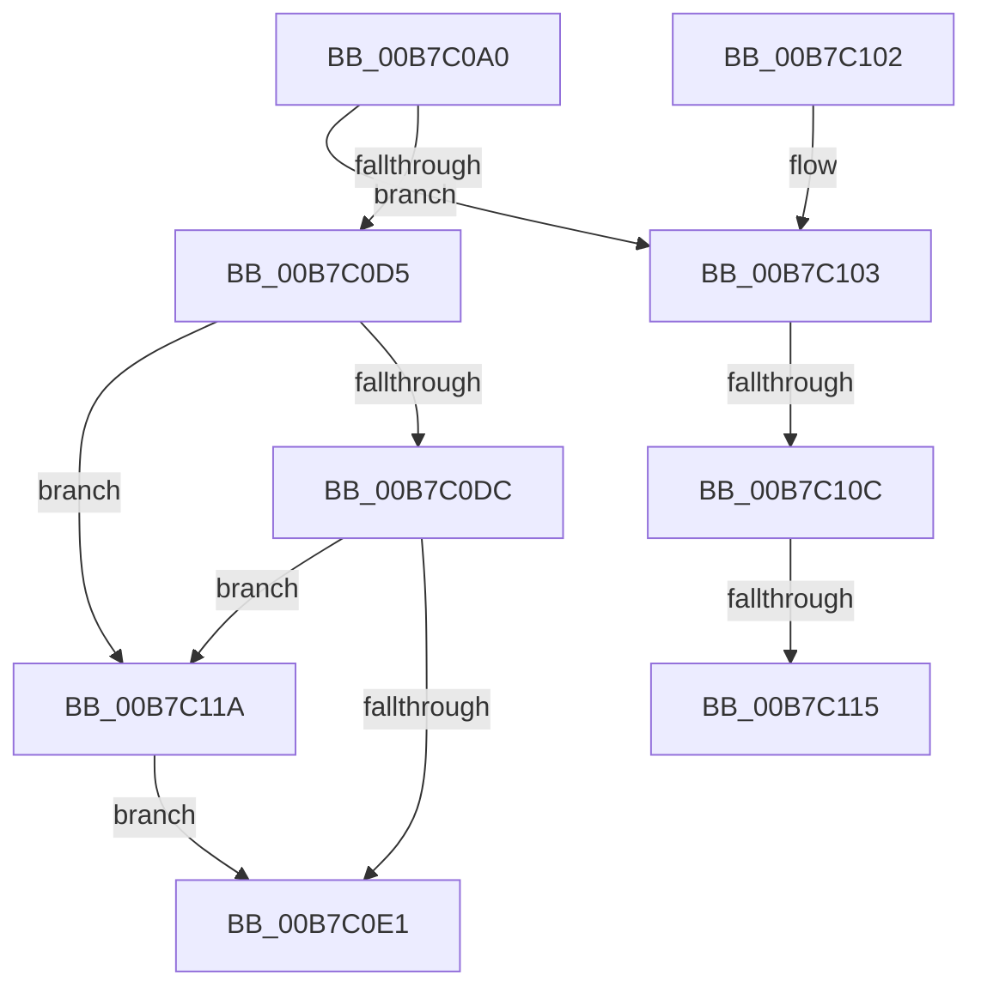

# HalpDispatchPower

- RVA: `0x00B7C0A0`–`0x00B7C121` (길이 `129` bytes)
- VA: `0x0000000140B7C0A0`
- 실행 섹션: `PAGELK`
- PDB 이름 있음: `예`; PDB Function 태그: `예`
- unwind 정보 RVA: `0x000BB928`
- 디코드: `37`개 명령, `129/129` bytes 표시
- 미해석 바이트: `0` (있으면 어셈블리에 `.byte`로 보존)

> 이 문서는 커널 이미지의 기계어와 PDB 기호를 분석해 생성했습니다. 4번과 5번은 함수 원형과 자료형을 바이너리 사용 방식에서 추정한 C 해석이며 원본 소스 복구 결과는 아닙니다.

## 1. Dependencies

- 직접 호출 지점: **1**; 고유 호출 대상: **1**
- 직접 호출자로 확인된 함수: **0**
- RIP 상대 이미지 참조: **0**

### Outgoing calls
- `0x00B7C0E6` → [IofCompleteRequest](../../text/29/IofCompleteRequest_function_0029B5C0.md) (function, `0x0029B5C0`)

### Direct callers
- 이 함수 시작 RVA로 연결되는 직접 call은 확인되지 않았습니다. 간접 호출은 완전히 역산할 수 없습니다.

### Static image references
- 디코드된 RIP-relative 메모리 참조가 없습니다.

## 2. Other-region calls and transfers

- 다른 실행 섹션으로 향하는 call: **1**
  - `0x00B7C0E6` → [IofCompleteRequest](../../text/29/IofCompleteRequest_function_0029B5C0.md) (`PAGELK` → `.text`)
- call이 아닌 외부 분기/꼬리 이동: **3**
  - `0x00B7C106` → [sub_00B811F2](../B8/Unknown_function_00B811F2.md) (`tail-transfer`)
  - `0x00B7C10F` → [sub_00B811F2](../B8/Unknown_function_00B811F2.md) (`tail-transfer`)
  - `0x00B7C115` → [sub_00B811F2 + 0x2D](../B8/Unknown_function_00B811F2.md) (`tail-transfer`)

## 3. Assembly (complete function range)

```asm
00B7C0A0  48 89 5C 24 08                  mov qword ptr [rsp + 8], rbx
00B7C0A5  48 89 6C 24 10                  mov qword ptr [rsp + 0x10], rbp
00B7C0AA  48 89 74 24 18                  mov qword ptr [rsp + 0x18], rsi
00B7C0AF  57                              push rdi
00B7C0B0  48 83 EC 20                     sub rsp, 0x20
00B7C0B4  48 8B 41 40                     mov rax, qword ptr [rcx + 0x40]
00B7C0B8  48 8B FA                        mov rdi, rdx
00B7C0BB  4C 8B 82 B8 00 00 00            mov r8, qword ptr [rdx + 0xb8]
00B7C0C2  48 8B E9                        mov rbp, rcx
00B7C0C5  8B 5A 30                        mov ebx, dword ptr [rdx + 0x30]
00B7C0C8  81 38 C1 00 00 00               cmp dword ptr [rax], 0xc1
00B7C0CE  41 0F B6 50 01                  movzx edx, byte ptr [r8 + 1]
00B7C0D3  74 2E                           je 0x140b7c103
00B7C0D5  8B CA                           mov ecx, edx
00B7C0D7  83 E9 02                        sub ecx, 2
00B7C0DA  74 3E                           je 0x140b7c11a
00B7C0DC  83 F9 01                        cmp ecx, 1
00B7C0DF  74 39                           je 0x140b7c11a
00B7C0E1  33 D2                           xor edx, edx
00B7C0E3  48 8B CF                        mov rcx, rdi
00B7C0E6  E8 D5 F4 71 FF                  call 0x14029b5c0
00B7C0EB  8B C3                           mov eax, ebx
00B7C0ED  48 8B 5C 24 30                  mov rbx, qword ptr [rsp + 0x30]
00B7C0F2  48 8B 6C 24 38                  mov rbp, qword ptr [rsp + 0x38]
00B7C0F7  48 8B 74 24 40                  mov rsi, qword ptr [rsp + 0x40]
00B7C0FC  48 83 C4 20                     add rsp, 0x20
00B7C100  5F                              pop rdi
00B7C101  C3                              ret
00B7C102  CC                              int3
00B7C103  83 EA 02                        sub edx, 2
00B7C106  0F 84 E6 50 00 00               je 0x140b811f2
00B7C10C  83 FA 01                        cmp edx, 1
00B7C10F  0F 84 DD 50 00 00               je 0x140b811f2
00B7C115  E9 05 51 00 00                  jmp 0x140b8121f
00B7C11A  33 DB                           xor ebx, ebx
00B7C11C  89 5F 30                        mov dword ptr [rdi + 0x30], ebx
00B7C11F  EB C0                           jmp 0x140b7c0e1
```

## 4. C-style interpretation (structured pseudocode)

```c
__int64 __fastcall HalpDispatchPower(__int64 a1, __int64 a2)
{
    __int64 result;
    __int64 v_rbx;
    __int64 v_rsp;
    unsigned __int64 v_stack_p10;
    unsigned __int64 v_stack_p18;
    unsigned __int64 v_stack_p8;

    v_stack_p8 = v_rbx;
    v_stack_p10 = v_rbp;
    v_stack_p18 = v_rsi;
    v_rsp = (v_rsp) - (32);
    if ((*(unsigned int *)(*(unsigned __int64 *)(a1 + 64))) == 193) goto loc_00B7C103;
    a1 = (unsigned int)(((unsigned int)((unsigned int)(*(unsigned __int8 *)(*(unsigned __int64 *)(a2 + 184) + 1)))) - (2));
    if (condition_is_equal) goto loc_00B7C11A;
    if (((unsigned int)(a1)) == 1) goto loc_00B7C11A;
loc_00B7C0E1:
    a2 = 0;
    result = IofCompleteRequest(0, a2, *(unsigned __int64 *)(a2 + 184), a4);
    v_rsp = (v_rsp) + (32);
    return (unsigned int)((unsigned int)((unsigned int)(*(unsigned int *)(a2 + 48))));
loc_00B7C103:
    a2 = (unsigned int)((a2) - (2));
loc_00B7C11A:
    v_rbx = 0;
    *(unsigned int *)(a2 + 48) = 0;
    goto loc_00B7C0E1;
}
```

## 5. (Beta) C Style

```c
int64_t HalpDispatchPower(void *Arg1, void *Arg2)
{
    uint8_t *arg1 = (uint8_t *)Arg1;
    uint8_t *arg2 = (uint8_t *)Arg2;

    int64_t result;
    int64_t local_rbx;
    int64_t local_rsp;
    uint64_t v_stack_p10;
    uint64_t v_stack_p18;
    uint64_t v_stack_p8;

    v_stack_p8 = local_rbx;
    v_stack_p10 = local_rbp;
    v_stack_p18 = local_rsi;
    local_rsp = (local_rsp) - (32);
    if ((*(uint32_t *)(*(uint64_t *)(arg1 + 0x40))) == 193) goto loc_00B7C103;
    Arg1 = (uint32_t)(((uint32_t)((uint32_t)(*(uint8_t *)(*(uint64_t *)(arg2 + 0xB8) + 0x1)))) - (2));
    if (condition_is_equal) goto loc_00B7C11A;
    if (((uint32_t)(Arg1)) == 1) goto loc_00B7C11A;
loc_00B7C0E1:
    Arg2 = 0;
    result = IofCompleteRequest(0, Arg2, *(uint64_t *)(arg2 + 0xB8), a4);
    local_rsp = (local_rsp) + (32);
    return (uint32_t)((uint32_t)((uint32_t)(*(uint32_t *)(arg2 + 0x30))));
loc_00B7C103:
    Arg2 = (uint32_t)((Arg2) - (2));
loc_00B7C11A:
    local_rbx = 0;
    *(uint32_t *)(arg2 + 0x30) = 0;
    goto loc_00B7C0E1;
}
```

### 관측된 메모리 오프셋

구조체 형식이 확인되지 않은 접근은 인자 기준의 오프셋으로만 기록했습니다.

| 기준 인자 | 오프셋 표현 | 폭 (bit) | 접근 |
|---|---:|---:|---|
| `Arg1` | `+ 0x40` | `64` | `R` |
| `Arg2` | `+ 0x30` | `32` | `R` |
| `Arg2` | `+ 0x30` | `32` | `W` |
| `Arg2` | `+ 0xB8` | `64` | `R` |

## 6. Execution-region graph

[열기: 2D/3D 그래프와 함수 탐색 컨트롤 패널](../../../control-panel.html?section=pagelk&rva=0x00B7C0A0&view=graph)

- 2D 그래프는 위에서 아래로 흐르고, 3D 그래프는 빈 공간을 드래그해 회전합니다. Shift+드래그는 이동, 휠은 확대·축소, 함수 노드 선택은 대상 보고서 이동입니다.

### Static fallback


