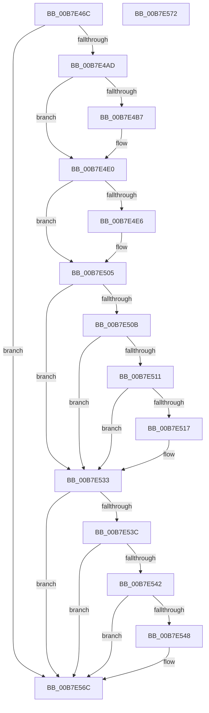

# HalpErrataApplyPerProcessor

- RVA: `0x00B7E46C`–`0x00B7E573` (길이 `263` bytes)
- VA: `0x0000000140B7E46C`
- 실행 섹션: `PAGELK`
- PDB 이름 있음: `예`; PDB Function 태그: `아니요`
- unwind 정보 RVA: `0x000BE840`
- 디코드: `75`개 명령, `263/263` bytes 표시
- 미해석 바이트: `0` (있으면 어셈블리에 `.byte`로 보존)

> 이 문서는 커널 이미지의 기계어와 PDB 기호를 분석해 생성했습니다. 4번과 5번은 함수 원형과 자료형을 바이너리 사용 방식에서 추정한 C 해석이며 원본 소스 복구 결과는 아닙니다.

## 1. Dependencies

- 직접 호출 지점: **1**; 고유 호출 대상: **1**
- 직접 호출자로 확인된 함수: **2**
- RIP 상대 이미지 참조: **1**

### Outgoing calls
- `0x00B7E495` → [HalpGetCpuInfo](../../text/49/HalpGetCpuInfo_function_00498A70.md) (function, `0x00498A70`)

### Direct callers
- [HalpErrataInitSystem](../B5/HalpErrataInitSystem_function_00B5D310.md) at `0x00B5D354`
- [HalpPostSleepMP](../B5/HalpPostSleepMP_function_00B5ECC4.md) at `0x00B5EE26`

### Static image references
- `0x00B7E533` → RVA `0x00FC1ED0` (`.data`; read)

## 2. Other-region calls and transfers

- 다른 실행 섹션으로 향하는 call: **1**
  - `0x00B7E495` → [HalpGetCpuInfo](../../text/49/HalpGetCpuInfo_function_00498A70.md) (`PAGELK` → `.text`)
- 별도 외부 분기/꼬리 이동을 확인하지 못했습니다.

## 3. Assembly (complete function range)

```asm
00B7E46C  40 55                           push rbp
00B7E46E  48 8B EC                        mov rbp, rsp
00B7E471  48 83 EC 30                     sub rsp, 0x30
00B7E475  4C 8D 4D 18                     lea r9, [rbp + 0x18]
00B7E479  C6 45 20 00                     mov byte ptr [rbp + 0x20], 0
00B7E47D  4C 8D 45 10                     lea r8, [rbp + 0x10]
00B7E481  C6 45 10 00                     mov byte ptr [rbp + 0x10], 0
00B7E485  48 8D 55 F0                     lea rdx, [rbp - 0x10]
00B7E489  C6 45 F0 00                     mov byte ptr [rbp - 0x10], 0
00B7E48D  48 8D 4D 20                     lea rcx, [rbp + 0x20]
00B7E491  C6 45 18 00                     mov byte ptr [rbp + 0x18], 0
00B7E495  E8 D6 A5 91 FF                  call 0x140498a70
00B7E49A  F6 D8                           neg al
00B7E49C  41 B1 01                        mov r9b, 1
00B7E49F  1A C9                           sbb cl, cl
00B7E4A1  22 4D 18                        and cl, byte ptr [rbp + 0x18]
00B7E4A4  41 3A C9                        cmp cl, r9b
00B7E4A7  0F 85 BF 00 00 00               jne 0x140b7e56c
00B7E4AD  44 8A 45 20                     mov r8b, byte ptr [rbp + 0x20]
00B7E4B1  41 80 F8 0F                     cmp r8b, 0xf
00B7E4B5  75 29                           jne 0x140b7e4e0
00B7E4B7  B9 1F 00 01 C0                  mov ecx, 0xc001001f
00B7E4BC  0F 32                           rdmsr
00B7E4BE  48 C1 E2 20                     shl rdx, 0x20
00B7E4C2  48 0B C2                        or rax, rdx
00B7E4C5  48 BA 00 00 00 00 01 00 00 00   movabs rdx, 0x100000000
00B7E4CF  48 0F BA F0 14                  btr rax, 0x14
00B7E4D4  48 0B C2                        or rax, rdx
00B7E4D7  48 8B D0                        mov rdx, rax
00B7E4DA  48 C1 EA 20                     shr rdx, 0x20
00B7E4DE  0F 30                           wrmsr
00B7E4E0  41 80 F8 12                     cmp r8b, 0x12
00B7E4E4  75 1F                           jne 0x140b7e505
00B7E4E6  B9 29 10 01 C0                  mov ecx, 0xc0011029
00B7E4EB  0F 32                           rdmsr
00B7E4ED  48 C1 E2 20                     shl rdx, 0x20
00B7E4F1  48 0B C2                        or rax, rdx
00B7E4F4  BA 00 00 00 80                  mov edx, 0x80000000
00B7E4F9  48 0B C2                        or rax, rdx
00B7E4FC  48 8B D0                        mov rdx, rax
00B7E4FF  48 C1 EA 20                     shr rdx, 0x20
00B7E503  0F 30                           wrmsr
00B7E505  41 80 F8 17                     cmp r8b, 0x17
00B7E509  75 28                           jne 0x140b7e533
00B7E50B  44 38 4D 10                     cmp byte ptr [rbp + 0x10], r9b
00B7E50F  75 22                           jne 0x140b7e533
00B7E511  44 38 4D F0                     cmp byte ptr [rbp - 0x10], r9b
00B7E515  75 1C                           jne 0x140b7e533
00B7E517  B9 23 10 01 C0                  mov ecx, 0xc0011023
00B7E51C  0F 32                           rdmsr
00B7E51E  48 C1 E2 20                     shl rdx, 0x20
00B7E522  48 0B C2                        or rax, rdx
00B7E525  48 0F BA E8 08                  bts rax, 8
00B7E52A  48 8B D0                        mov rdx, rax
00B7E52D  48 C1 EA 20                     shr rdx, 0x20
00B7E531  0F 30                           wrmsr
00B7E533  80 3D 96 39 44 00 00            cmp byte ptr [rip + 0x443996], 0
00B7E53A  75 30                           jne 0x140b7e56c
00B7E53C  41 80 F8 17                     cmp r8b, 0x17
00B7E540  75 2A                           jne 0x140b7e56c
00B7E542  80 7D 10 2F                     cmp byte ptr [rbp + 0x10], 0x2f
00B7E546  77 24                           ja 0x140b7e56c
00B7E548  B9 2C 10 01 C0                  mov ecx, 0xc001102c
00B7E54D  0F 32                           rdmsr
00B7E54F  48 C1 E2 20                     shl rdx, 0x20
00B7E553  48 0B C2                        or rax, rdx
00B7E556  48 BA 00 00 00 00 00 00 08 00   movabs rdx, 0x8000000000000
00B7E560  48 0B C2                        or rax, rdx
00B7E563  48 8B D0                        mov rdx, rax
00B7E566  48 C1 EA 20                     shr rdx, 0x20
00B7E56A  0F 30                           wrmsr
00B7E56C  48 83 C4 30                     add rsp, 0x30
00B7E570  5D                              pop rbp
00B7E571  C3                              ret
00B7E572  CC                              int3
```

## 4. C-style interpretation (structured pseudocode)

```c
__int64 __fastcall HalpErrataApplyPerProcessor(void)
{
    __int64 result;
    __int64 v_rsp;
    unsigned __int64 v_stack_m18;
    unsigned __int64 v_stack_p10;
    unsigned __int8 v_stack_p18;
    unsigned __int64 v_stack_p8;

    v_rsp = (v_rsp) - (48);
    v_stack_p18 = 0;
    v_stack_p8 = 0;
    v_stack_m18 = 0;
    v_stack_p10 = 0;
    result = HalpGetCpuInfo(v_stack_p18, v_stack_m18, v_stack_p8, v_stack_p10);
    result = (unsigned __int8)(-(result));
    a1 = (unsigned __int8)((v_stack_p18) & (v_stack_p10));
    if (((unsigned __int8)(a1)) != 1) goto loc_00B7E56C;
    if (((unsigned __int8)(v_stack_p18)) == 15) {
        a1 = 0xC001001FULL;
        a2 = (v_stack_m18) << (32);
        result = (result) | (a2);
        result = (result) | (a2);
        a2 = result;
        a2 = (a2) >> (32);
    }
    if (((unsigned __int8)(v_stack_p18)) == 18) {
        a1 = 0xC0011029ULL;
        a2 = (a2) << (32);
        result = (result) | (a2);
        a2 = 0x80000000ULL;
        result = (result) | (a2);
        a2 = result;
        a2 = (a2) >> (32);
    }
    if (((unsigned __int8)(v_stack_p18)) != 23) goto loc_00B7E533;
    if (v_stack_p8 != 1) goto loc_00B7E533;
    if (v_stack_m18 == 1) {
        a1 = 0xC0011023ULL;
        a2 = (a2) << (32);
        result = (result) | (a2);
        a2 = result;
        a2 = (a2) >> (32);
    }
    if ((*(unsigned __int8 *)(v_rip + 4471190)) != 0) goto loc_00B7E56C;
    if (((unsigned __int8)(v_stack_p18)) != 23) goto loc_00B7E56C;
    if (v_stack_p8 <= 47) {
        a1 = 0xC001102CULL;
        a2 = (a2) << (32);
        result = (result) | (a2);
        result = (result) | (a2);
        a2 = result;
        a2 = (a2) >> (32);
    }
    v_rsp = (v_rsp) + (48);
    return result;
}
```

## 5. (Beta) C Style

```c
void HalpErrataApplyPerProcessor(void)
{
    int64_t result;
    int64_t local_rsp;
    uint64_t v_stack_m18;
    uint64_t v_stack_p10;
    uint8_t v_stack_p18;
    uint64_t v_stack_p8;

    local_rsp = (local_rsp) - (48);
    v_stack_p18 = 0;
    v_stack_p8 = 0;
    v_stack_m18 = 0;
    v_stack_p10 = 0;
    result = HalpGetCpuInfo(v_stack_p18, v_stack_m18, v_stack_p8, v_stack_p10);
    result = (uint8_t)(-(result));
    a1 = (uint8_t)((v_stack_p18) & (v_stack_p10));
    if (((uint8_t)(a1)) != 1) goto loc_00B7E56C;
    if (((uint8_t)(v_stack_p18)) == 15) {
        a1 = 0xC001001FULL;
        a2 = (v_stack_m18) << (32);
        result = (result) | (a2);
        result = (result) | (a2);
        a2 = result;
        a2 = (a2) >> (32);
    }
    if (((uint8_t)(v_stack_p18)) == 18) {
        a1 = 0xC0011029ULL;
        a2 = (a2) << (32);
        result = (result) | (a2);
        a2 = 0x80000000ULL;
        result = (result) | (a2);
        a2 = result;
        a2 = (a2) >> (32);
    }
    if (((uint8_t)(v_stack_p18)) != 23) goto loc_00B7E533;
    if (v_stack_p8 != 1) goto loc_00B7E533;
    if (v_stack_m18 == 1) {
        a1 = 0xC0011023ULL;
        a2 = (a2) << (32);
        result = (result) | (a2);
        a2 = result;
        a2 = (a2) >> (32);
    }
    if ((*(uint8_t *)(v_rip + 0x443996)) != 0) goto loc_00B7E56C;
    if (((uint8_t)(v_stack_p18)) != 23) goto loc_00B7E56C;
    if (v_stack_p8 <= 47) {
        a1 = 0xC001102CULL;
        a2 = (a2) << (32);
        result = (result) | (a2);
        result = (result) | (a2);
        a2 = result;
        a2 = (a2) >> (32);
    }
    local_rsp = (local_rsp) + (48);
    return result;
}
```

## 6. Execution-region graph

[열기: 2D/3D 그래프와 함수 탐색 컨트롤 패널](../../../control-panel.html?section=pagelk&rva=0x00B7E46C&view=graph)

- 2D 그래프는 위에서 아래로 흐르고, 3D 그래프는 빈 공간을 드래그해 회전합니다. Shift+드래그는 이동, 휠은 확대·축소, 함수 노드 선택은 대상 보고서 이동입니다.

### Static fallback


