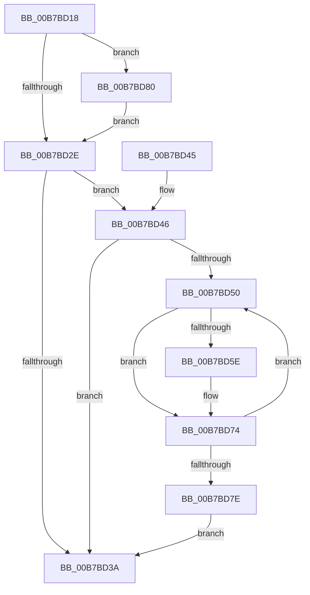

# HalpFreeNvsBuffers

- RVA: `0x00B7BD18`–`0x00B7BD8F` (길이 `119` bytes)
- VA: `0x0000000140B7BD18`
- 실행 섹션: `PAGELK`
- PDB 이름 있음: `예`; PDB Function 태그: `아니요`
- unwind 정보 RVA: `0x00080A00`
- 디코드: `32`개 명령, `119/119` bytes 표시
- 미해석 바이트: `0` (있으면 어셈블리에 `.byte`로 보존)

> 이 문서는 커널 이미지의 기계어와 PDB 기호를 분석해 생성했습니다. 4번과 5번은 함수 원형과 자료형을 바이너리 사용 방식에서 추정한 C 해석이며 원본 소스 복구 결과는 아닙니다.

## 1. Dependencies

- 직접 호출 지점: **2**; 고유 호출 대상: **2**
- 직접 호출자로 확인된 함수: **2**
- RIP 상대 이미지 참조: **4**

### Outgoing calls
- `0x00B7BD62` → [MmUnmapIoSpace](../../text/3F/MmUnmapIoSpace_function_003F78F0.md) (function, `0x003F78F0`)
- `0x00B7BD80` → [HalpMmAllocCtxFree](../../text/3E/HalpMmAllocCtxFree_function_003E1904.md) (function, `0x003E1904`)

### Direct callers
- [HalpPowerStateCallback](../../text/4B/HalpPowerStateCallback_function_004B8150.md) at `0x004B8173`
- [HalpMapNvsArea](HalpMapNvsArea_function_00B7D180.md) at `0x00B7D208`

### Static image references
- `0x00B7BD22` → RVA `0x00F90158` (`.data`; read)
- `0x00B7BD2E` → RVA `0x00F90168` (`.data`; read)
- `0x00B7BD48` → RVA `0x00F90018` (`.data`; read)
- `0x00B7BD85` → RVA `0x00F90158` (`.data`; read/write)

## 2. Other-region calls and transfers

- 다른 실행 섹션으로 향하는 call: **2**
  - `0x00B7BD62` → [MmUnmapIoSpace](../../text/3F/MmUnmapIoSpace_function_003F78F0.md) (`PAGELK` → `.text`)
  - `0x00B7BD80` → [HalpMmAllocCtxFree](../../text/3E/HalpMmAllocCtxFree_function_003E1904.md) (`PAGELK` → `.text`)
- 별도 외부 분기/꼬리 이동을 확인하지 못했습니다.

## 3. Assembly (complete function range)

```asm
00B7BD18  48 89 5C 24 08                  mov qword ptr [rsp + 8], rbx
00B7BD1D  57                              push rdi
00B7BD1E  48 83 EC 20                     sub rsp, 0x20
00B7BD22  48 8B 15 2F 44 41 00            mov rdx, qword ptr [rip + 0x41442f]
00B7BD29  48 85 D2                        test rdx, rdx
00B7BD2C  75 52                           jne 0x140b7bd80
00B7BD2E  48 8B 15 33 44 41 00            mov rdx, qword ptr [rip + 0x414433]
00B7BD35  48 85 D2                        test rdx, rdx
00B7BD38  75 0C                           jne 0x140b7bd46
00B7BD3A  48 8B 5C 24 30                  mov rbx, qword ptr [rsp + 0x30]
00B7BD3F  48 83 C4 20                     add rsp, 0x20
00B7BD43  5F                              pop rdi
00B7BD44  C3                              ret
00B7BD45  CC                              int3
00B7BD46  33 DB                           xor ebx, ebx
00B7BD48  39 1D CA 42 41 00               cmp dword ptr [rip + 0x4142ca], ebx
00B7BD4E  74 EA                           je 0x140b7bd3a
00B7BD50  48 8D 3C 5B                     lea rdi, [rbx + rbx*2]
00B7BD54  48 8B 4C FA 10                  mov rcx, qword ptr [rdx + rdi*8 + 0x10]
00B7BD59  48 85 C9                        test rcx, rcx
00B7BD5C  74 16                           je 0x140b7bd74
00B7BD5E  8B 54 FA 08                     mov edx, dword ptr [rdx + rdi*8 + 8]
00B7BD62  E8 89 BB 87 FF                  call 0x1403f78f0
00B7BD67  48 8B 15 FA 43 41 00            mov rdx, qword ptr [rip + 0x4143fa]
00B7BD6E  48 83 64 FA 10 00               and qword ptr [rdx + rdi*8 + 0x10], 0
00B7BD74  FF C3                           inc ebx
00B7BD76  3B 1D 9C 42 41 00               cmp ebx, dword ptr [rip + 0x41429c]
00B7BD7C  72 D2                           jb 0x140b7bd50
00B7BD7E  EB BA                           jmp 0x140b7bd3a
00B7BD80  E8 7F 5B 86 FF                  call 0x1403e1904
00B7BD85  48 83 25 CB 43 41 00 00         and qword ptr [rip + 0x4143cb], 0
00B7BD8D  EB 9F                           jmp 0x140b7bd2e
```

## 4. C-style interpretation (structured pseudocode)

```c
__int64 __fastcall HalpFreeNvsBuffers(void)
{
    __int64 result;
    __int64 v_rbx;
    __int64 v_rsp;
    unsigned __int64 v_stack_p8;

    v_stack_p8 = v_rbx;
    v_rsp = (v_rsp) - (32);
    if (*(unsigned __int64 *)(v_rip + 4277295) != 0) goto loc_00B7BD80;
loc_00B7BD2E:
    if (*(unsigned __int64 *)(v_rip + 4277299) != 0) goto loc_00B7BD46;
loc_00B7BD3A:
    v_rsp = (v_rsp) + (32);
    return result;
loc_00B7BD46:
    v_rbx = 0;
    if ((*(unsigned int *)(v_rip + 4276938)) == 0) goto loc_00B7BD3A;
loc_00B7BD50:
    if (*(unsigned __int64 *)(*(unsigned __int64 *)(v_rip + 4277299) + v_rbx + v_rbx * 2 * 8 + 16) != 0) {
        a2 = *(unsigned int *)(*(unsigned __int64 *)(v_rip + 4277299) + v_rbx + v_rbx * 2 * 8 + 8);
        result = MmUnmapIoSpace(*(unsigned __int64 *)(*(unsigned __int64 *)(v_rip + 4277299) + v_rbx + v_rbx * 2 * 8 + 16), a2, a3, a4);
        a2 = *(unsigned __int64 *)(v_rip + 4277242);
    }
    v_rbx = (unsigned int)((v_rbx) + 1);
    if (((unsigned int)(v_rbx)) < (*(unsigned int *)(v_rip + 4276892))) goto loc_00B7BD50;
    goto loc_00B7BD3A;
loc_00B7BD80:
    result = HalpMmAllocCtxFree(*(unsigned __int64 *)(*(unsigned __int64 *)(v_rip + 4277299) + v_rbx + v_rbx * 2 * 8 + 16), a2, a3, a4);
    goto loc_00B7BD2E;
}
```

## 5. (Beta) C Style

```c
void HalpFreeNvsBuffers(void)
{
    int64_t result;
    int64_t local_rbx;
    int64_t local_rsp;
    uint64_t v_stack_p8;

    v_stack_p8 = local_rbx;
    local_rsp = (local_rsp) - (32);
    if (*(uint64_t *)(v_rip + 0x41442F) != 0) goto loc_00B7BD80;
loc_00B7BD2E:
    if (*(uint64_t *)(v_rip + 0x414433) != 0) goto loc_00B7BD46;
loc_00B7BD3A:
    local_rsp = (local_rsp) + (32);
    return result;
loc_00B7BD46:
    local_rbx = 0;
    if ((*(uint32_t *)(v_rip + 0x4142CA)) == 0) goto loc_00B7BD3A;
loc_00B7BD50:
    if (*(uint64_t *)(*(uint64_t *)(v_rip + 0x414433) + local_rbx + local_rbx * 2 * 8 + 0x10) != 0) {
        a2 = *(uint32_t *)(*(uint64_t *)(v_rip + 0x414433) + local_rbx + local_rbx * 2 * 8 + 0x8);
        result = MmUnmapIoSpace(*(uint64_t *)(*(uint64_t *)(v_rip + 0x414433) + local_rbx + local_rbx * 2 * 8 + 0x10), a2, a3, a4);
        a2 = *(uint64_t *)(v_rip + 0x4143FA);
    }
    local_rbx = (uint32_t)((local_rbx) + 1);
    if (((uint32_t)(local_rbx)) < (*(uint32_t *)(v_rip + 0x41429C))) goto loc_00B7BD50;
    goto loc_00B7BD3A;
loc_00B7BD80:
    result = HalpMmAllocCtxFree(*(uint64_t *)(*(uint64_t *)(v_rip + 0x414433) + local_rbx + local_rbx * 2 * 8 + 0x10), a2, a3, a4);
    goto loc_00B7BD2E;
}
```

## 6. Execution-region graph

[열기: 2D/3D 그래프와 함수 탐색 컨트롤 패널](../../../control-panel.html?section=pagelk&rva=0x00B7BD18&view=graph)

- 2D 그래프는 위에서 아래로 흐르고, 3D 그래프는 빈 공간을 드래그해 회전합니다. Shift+드래그는 이동, 휠은 확대·축소, 함수 노드 선택은 대상 보고서 이동입니다.

### Static fallback


