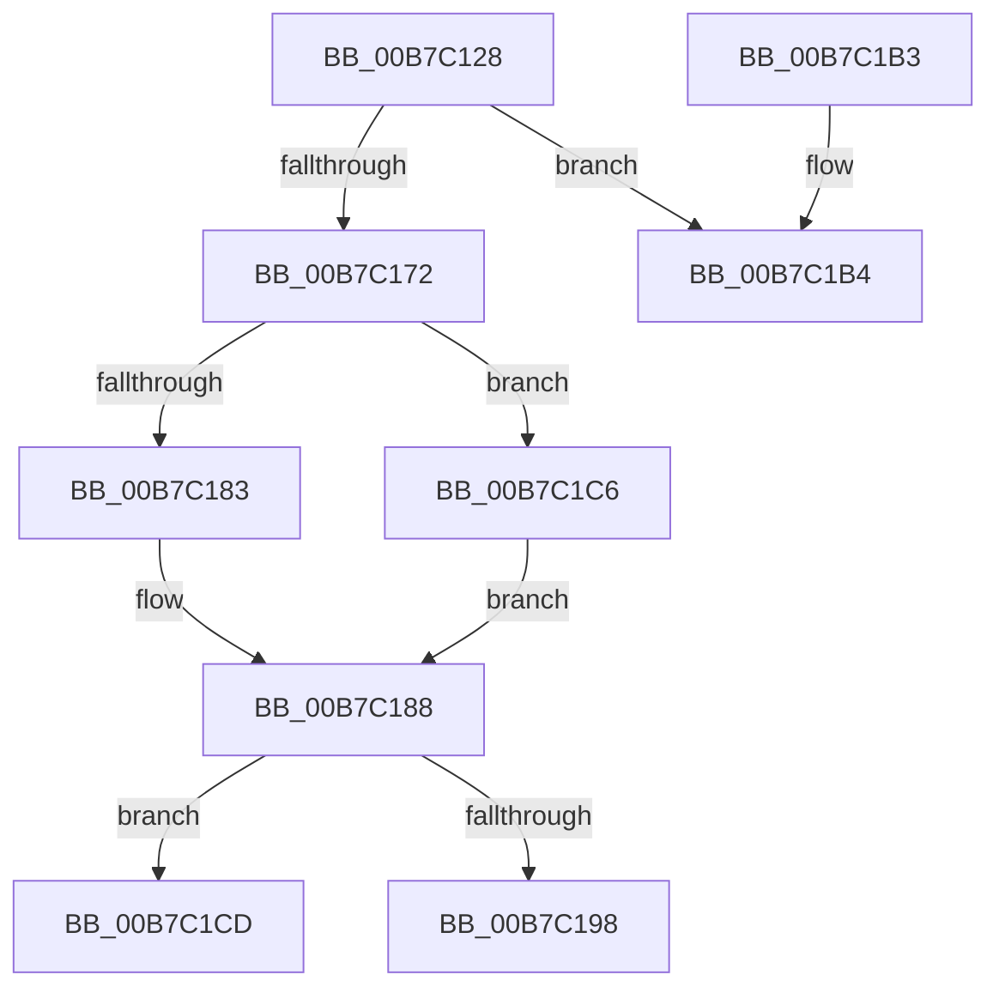

# HalpInterruptMaskAcpi

- RVA: `0x00B7C128`–`0x00B7C1DF` (길이 `183` bytes)
- VA: `0x0000000140B7C128`
- 실행 섹션: `PAGELK`
- PDB 이름 있음: `예`; PDB Function 태그: `예`
- unwind 정보 RVA: `0x0006EDA8`
- 디코드: `46`개 명령, `183/183` bytes 표시
- 미해석 바이트: `0` (있으면 어셈블리에 `.byte`로 보존)

> 이 문서는 커널 이미지의 기계어와 PDB 기호를 분석해 생성했습니다. 4번과 5번은 함수 원형과 자료형을 바이너리 사용 방식에서 추정한 C 해석이며 원본 소스 복구 결과는 아닙니다.

## 1. Dependencies

- 직접 호출 지점: **5**; 고유 호출 대상: **5**
- 직접 호출자로 확인된 함수: **1**
- RIP 상대 이미지 참조: **1**

### Outgoing calls
- `0x00B7C147` → [HalpInterruptPicLine](../../text/4B/HalpInterruptPicLine_function_004BC1DC.md) (function, `0x004BC1DC`)
- `0x00B7C156` → [HalpInterruptApplyOverrides](../../text/2D/HalpInterruptApplyOverrides_function_002D2CE0.md) (function, `0x002D2CE0`)
- `0x00B7C165` → [HalpInterruptFindLines](../../text/2D/HalpInterruptFindLines_function_002D2C88.md) (function, `0x002D2C88`)
- `0x00B7C18B` → [HalpInterruptLookupController](../../text/2D/HalpInterruptLookupController_function_002D20D4.md) (function, `0x002D20D4`)
- `0x00B7C1A8` → [HalpInterruptSetLineStateInternal](../../text/2D/HalpInterruptSetLineStateInternal_function_002D2104.md) (function, `0x002D2104`)

### Direct callers
- [HalpDispatchSystemStateTransition](../../text/4C/HalpDispatchSystemStateTransition_function_004C8E34.md) at `0x004C8EF9`

### Static image references
- `0x00B7C12E` → RVA `0x00FC1B0E` (`.data`; read)

## 2. Other-region calls and transfers

- 다른 실행 섹션으로 향하는 call: **5**
  - `0x00B7C147` → [HalpInterruptPicLine](../../text/4B/HalpInterruptPicLine_function_004BC1DC.md) (`PAGELK` → `.text`)
  - `0x00B7C156` → [HalpInterruptApplyOverrides](../../text/2D/HalpInterruptApplyOverrides_function_002D2CE0.md) (`PAGELK` → `.text`)
  - `0x00B7C165` → [HalpInterruptFindLines](../../text/2D/HalpInterruptFindLines_function_002D2C88.md) (`PAGELK` → `.text`)
  - `0x00B7C18B` → [HalpInterruptLookupController](../../text/2D/HalpInterruptLookupController_function_002D20D4.md) (`PAGELK` → `.text`)
  - `0x00B7C1A8` → [HalpInterruptSetLineStateInternal](../../text/2D/HalpInterruptSetLineStateInternal_function_002D2104.md) (`PAGELK` → `.text`)
- call이 아닌 외부 분기/꼬리 이동: **2**
  - `0x00B7C1C1` → [sub_00B81232](../B8/Unknown_function_00B81232.md) (`tail-transfer`)
  - `0x00B7C1DA` → [sub_00B81232](../B8/Unknown_function_00B81232.md) (`tail-transfer`)

## 3. Assembly (complete function range)

```asm
00B7C128  40 53                           push rbx
00B7C12A  48 83 EC 30                     sub rsp, 0x30
00B7C12E  0F B7 15 D9 59 44 00            movzx edx, word ptr [rip + 0x4459d9]
00B7C135  8A D9                           mov bl, cl
00B7C137  48 83 64 24 50 00               and qword ptr [rsp + 0x50], 0
00B7C13D  48 8D 4C 24 50                  lea rcx, [rsp + 0x50]
00B7C142  83 64 24 48 00                  and dword ptr [rsp + 0x48], 0
00B7C147  E8 90 00 94 FF                  call 0x1404bc1dc
00B7C14C  33 D2                           xor edx, edx
00B7C14E  48 8D 4C 24 50                  lea rcx, [rsp + 0x50]
00B7C153  45 33 C0                        xor r8d, r8d
00B7C156  E8 85 6B 75 FF                  call 0x1402d2ce0
00B7C15B  48 8D 54 24 48                  lea rdx, [rsp + 0x48]
00B7C160  48 8D 4C 24 50                  lea rcx, [rsp + 0x50]
00B7C165  E8 1E 6B 75 FF                  call 0x1402d2c88
00B7C16A  4C 8B C8                        mov r9, rax
00B7C16D  48 85 C0                        test rax, rax
00B7C170  74 42                           je 0x140b7c1b4
00B7C172  44 8B 44 24 48                  mov r8d, dword ptr [rsp + 0x48]
00B7C177  48 8B 50 28                     mov rdx, qword ptr [rax + 0x28]
00B7C17B  49 6B C8 38                     imul rcx, r8, 0x38
00B7C17F  84 DB                           test bl, bl
00B7C181  75 43                           jne 0x140b7c1c6
00B7C183  83 64 11 0C EF                  and dword ptr [rcx + rdx + 0xc], 0xffffffef
00B7C188  8B 48 10                        mov ecx, dword ptr [rax + 0x10]
00B7C18B  E8 44 5F 75 FF                  call 0x1402d20d4
00B7C190  48 8B C8                        mov rcx, rax
00B7C193  48 85 C0                        test rax, rax
00B7C196  74 35                           je 0x140b7c1cd
00B7C198  41 8B C0                        mov eax, r8d
00B7C19B  48 8D 54 24 50                  lea rdx, [rsp + 0x50]
00B7C1A0  4C 6B C0 38                     imul r8, rax, 0x38
00B7C1A4  4D 03 41 28                     add r8, qword ptr [r9 + 0x28]
00B7C1A8  E8 57 5F 75 FF                  call 0x1402d2104
00B7C1AD  48 83 C4 30                     add rsp, 0x30
00B7C1B1  5B                              pop rbx
00B7C1B2  C3                              ret
00B7C1B3  CC                              int3
00B7C1B4  C7 44 24 20 6C 09 00 00         mov dword ptr [rsp + 0x20], 0x96c
00B7C1BC  BA 12 00 00 00                  mov edx, 0x12
00B7C1C1  E9 6C 50 00 00                  jmp 0x140b81232
00B7C1C6  83 4C 11 0C 10                  or dword ptr [rcx + rdx + 0xc], 0x10
00B7C1CB  EB BB                           jmp 0x140b7c188
00B7C1CD  C7 44 24 20 7C 09 00 00         mov dword ptr [rsp + 0x20], 0x97c
00B7C1D5  BA 11 00 00 00                  mov edx, 0x11
00B7C1DA  E9 53 50 00 00                  jmp 0x140b81232
```

## 4. C-style interpretation (structured pseudocode)

```c
__int64 __fastcall HalpInterruptMaskAcpi(unsigned __int8 a1, __int64 a2, int a3)
{
    __int64 result;
    __int64 v_rsp;
    unsigned int v_stack_p10;
    unsigned __int64 v_stack_p18;
    unsigned int v_stack_p20;

    v_rsp = (v_rsp) - (48);
    result = HalpInterruptPicLine(v_stack_p18, *(unsigned __int16 *)(v_rip + 4479449), a3, a4);
    a2 = 0;
    a3 = 0;
    result = HalpInterruptApplyOverrides(v_stack_p18, a2, a3, a4);
    result = HalpInterruptFindLines(v_stack_p18, v_stack_p10, a3, a4);
    if (result == 0) goto loc_00B7C1B4;
    a1 = (v_stack_p18) * ((unsigned int)(v_stack_p10));
    if (a1 != 0) goto loc_00B7C1C6;
loc_00B7C188:
    result = HalpInterruptLookupController((unsigned int)(*(unsigned int *)(result + 16)), *(unsigned __int64 *)(result + 40), (unsigned int)(v_stack_p10), result);
    if (result == 0) goto loc_00B7C1CD;
    a3 = ((unsigned int)(v_stack_p10)) * ((unsigned int)((unsigned int)((unsigned int)(v_stack_p10))));
    a3 = (a3) + (*(unsigned __int64 *)(result + 40));
    result = HalpInterruptSetLineStateInternal(result, v_stack_p18, a3, result);
    v_rsp = (v_rsp) + (48);
    return result;
loc_00B7C1B4:
    v_stack_p20 = 0x96CULL;
loc_00B7C1C6:
    goto loc_00B7C188;
loc_00B7C1CD:
    v_stack_p20 = 0x97CULL;
}
```

## 5. (Beta) C Style

```c
int64_t HalpInterruptMaskAcpi(uint8_t Arg1, int64_t Arg2, int32_t Arg3)
{
    int64_t result;
    int64_t local_rsp;
    uint32_t v_stack_p10;
    uint64_t v_stack_p18;
    uint32_t v_stack_p20;

    local_rsp = (local_rsp) - (48);
    result = HalpInterruptPicLine(v_stack_p18, *(uint16_t *)(v_rip + 0x4459D9), Arg3, a4);
    Arg2 = 0;
    Arg3 = 0;
    result = HalpInterruptApplyOverrides(v_stack_p18, Arg2, Arg3, a4);
    result = HalpInterruptFindLines(v_stack_p18, v_stack_p10, Arg3, a4);
    if (result == 0) goto loc_00B7C1B4;
    Arg1 = (v_stack_p18) * ((uint32_t)(v_stack_p10));
    if (Arg1 != 0) goto loc_00B7C1C6;
loc_00B7C188:
    result = HalpInterruptLookupController((uint32_t)(*(uint32_t *)(result + 0x10)), *(uint64_t *)(result + 0x28), (uint32_t)(v_stack_p10), result);
    if (result == 0) goto loc_00B7C1CD;
    Arg3 = ((uint32_t)(v_stack_p10)) * ((uint32_t)((uint32_t)((uint32_t)(v_stack_p10))));
    Arg3 = (Arg3) + (*(uint64_t *)(result + 0x28));
    result = HalpInterruptSetLineStateInternal(result, v_stack_p18, Arg3, result);
    local_rsp = (local_rsp) + (48);
    return result;
loc_00B7C1B4:
    v_stack_p20 = 0x96CULL;
loc_00B7C1C6:
    goto loc_00B7C188;
loc_00B7C1CD:
    v_stack_p20 = 0x97CULL;
}
```

## 6. Execution-region graph

[열기: 2D/3D 그래프와 함수 탐색 컨트롤 패널](../../../control-panel.html?section=pagelk&rva=0x00B7C128&view=graph)

- 2D 그래프는 위에서 아래로 흐르고, 3D 그래프는 빈 공간을 드래그해 회전합니다. Shift+드래그는 이동, 휠은 확대·축소, 함수 노드 선택은 대상 보고서 이동입니다.

### Static fallback


