# HalpInterruptReinitialize

- RVA: `0x00B79BEC`–`0x00B79DF7` (길이 `523` bytes)
- VA: `0x0000000140B79BEC`
- 실행 섹션: `PAGELK`
- PDB 이름 있음: `예`; PDB Function 태그: `아니요`
- unwind 정보 RVA: `0x000B8D34`
- 디코드: `142`개 명령, `523/523` bytes 표시
- 미해석 바이트: `0` (있으면 어셈블리에 `.byte`로 보존)

> 이 문서는 커널 이미지의 기계어와 PDB 기호를 분석해 생성했습니다. 4번과 5번은 함수 원형과 자료형을 바이너리 사용 방식에서 추정한 C 해석이며 원본 소스 복구 결과는 아닙니다.

## 1. Dependencies

- 직접 호출 지점: **16**; 고유 호출 대상: **13**
- 직접 호출자로 확인된 함수: **1**
- RIP 상대 이미지 참조: **12**

### Outgoing calls
- `0x00B79C3B` → [HalpInterruptInitializeController](../../text/55/HalpInterruptInitializeController_function_00557914.md) (function, `0x00557914`)
- `0x00B79C4A` → [HalpInterruptControllerInUse](../../text/55/HalpInterruptControllerInUse_function_005577AC.md) (function, `0x005577AC`)
- `0x00B79C6C` → [KeBugCheckEx](../../text/4F/KeBugCheckEx_function_004FD660.md) (function, `0x004FD660`)
- `0x00B79C76` → [HalpIommuInitializeAll](HalpIommuInitializeAll_function_00B7A684.md) (function, `0x00B7A684`)
- `0x00B79C93` → [KeBugCheckEx](../../text/4F/KeBugCheckEx_function_004FD660.md) (function, `0x004FD660`)
- `0x00B79CAF` → [KiRaiseIrqlProcessIrqlFlags](../../text/4F/KiRaiseIrqlProcessIrqlFlags_function_004F56FC.md) (function, `0x004F56FC`)
- `0x00B79CB4` → [HalpDisableInterrupts](../../text/25/HalpDisableInterrupts_function_002521A0.md) (function, `0x002521A0`)
- `0x00B79CD2` → [Feature_ProcessorStartupCacheFlushOptimization__private_IsEnabledDeviceUsageNoInline](../../text/54/Feature_ProcessorStartupCacheFlushOptimization__private_IsEnabledDeviceUsageNoInline_function_00543D04.md) (function, `0x00543D04`)
- `0x00B79CDB` → [HalpInterruptResetProcessorCacheFlushOptimization](../../text/55/HalpInterruptResetProcessorCacheFlushOptimization_function_0055A904.md) (function, `0x0055A904`)
- `0x00B79CEB` → [HalpInterruptStartBlockedProcessors](../../text/55/HalpInterruptStartBlockedProcessors_function_00558914.md) (function, `0x00558914`)
- `0x00B79D1D` → [HalGetProcessorIdByNtNumber](../../text/2D/HalGetProcessorIdByNtNumber_function_002D5560.md) (function, `0x002D5560`)
- `0x00B79D30` → [HalStartNextProcessor](../../text/54/HalStartNextProcessor_function_005479B0.md) (function, `0x005479B0`)
- `0x00B79D5B` → [KeBugCheckEx](../../text/4F/KeBugCheckEx_function_004FD660.md) (function, `0x004FD660`)
- `0x00B79D7E` → [KeGetProcessorIndexFromNumber](../../text/2D/KeGetProcessorIndexFromNumber_function_002DD2D0.md) (function, `0x002DD2D0`)
- `0x00B79D9E` → [HalStartDynamicProcessor](../../text/54/HalStartDynamicProcessor_function_00543300.md) (function, `0x00543300`)
- `0x00B79DC5` → [KeBugCheckEx](../../text/4F/KeBugCheckEx_function_004FD660.md) (function, `0x004FD660`)

### Direct callers
- [HalpAcpiPostSleep](HalpAcpiPostSleep_function_00B79990.md) at `0x00B79AE2`

### Static image references
- `0x00B79C09` → RVA `0x00FC38F0` (`.data`; read)
- `0x00B79C53` → RVA `0x00F90694` (`.data`; read)
- `0x00B79CA6` → RVA `0x00FC6D20` (`ALMOSTRO`; read)
- `0x00B79CC6` → RVA `0x00E0A774` (`.data`; read)
- `0x00B79CCC` → RVA `0x00FC3E4C` (`.data`; read)
- `0x00B79CE0` → RVA `0x00F90690` (`.data`; read)
- `0x00B79D0B` → RVA `0x00FC1A90` (`.data`; read)
- `0x00B79D16` → RVA `0x00FC3E30` (`.data`; read)
- `0x00B79D42` → RVA `0x00E10200` (`.data`; read)
- `0x00B79D73` → RVA `0x00FC3E10` (`.data`; read)
- `0x00B79DCB` → RVA `0x00FC3E19` (`.data`; write)
- `0x00B79DD2` → RVA `0x00E101B0` (`.data`; write)

## 2. Other-region calls and transfers

- 다른 실행 섹션으로 향하는 call: **15**
  - `0x00B79C3B` → [HalpInterruptInitializeController](../../text/55/HalpInterruptInitializeController_function_00557914.md) (`PAGELK` → `.text`)
  - `0x00B79C4A` → [HalpInterruptControllerInUse](../../text/55/HalpInterruptControllerInUse_function_005577AC.md) (`PAGELK` → `.text`)
  - `0x00B79C6C` → [KeBugCheckEx](../../text/4F/KeBugCheckEx_function_004FD660.md) (`PAGELK` → `.text`)
  - `0x00B79C93` → [KeBugCheckEx](../../text/4F/KeBugCheckEx_function_004FD660.md) (`PAGELK` → `.text`)
  - `0x00B79CAF` → [KiRaiseIrqlProcessIrqlFlags](../../text/4F/KiRaiseIrqlProcessIrqlFlags_function_004F56FC.md) (`PAGELK` → `.text`)
  - `0x00B79CB4` → [HalpDisableInterrupts](../../text/25/HalpDisableInterrupts_function_002521A0.md) (`PAGELK` → `.text`)
  - `0x00B79CD2` → [Feature_ProcessorStartupCacheFlushOptimization__private_IsEnabledDeviceUsageNoInline](../../text/54/Feature_ProcessorStartupCacheFlushOptimization__private_IsEnabledDeviceUsageNoInline_function_00543D04.md) (`PAGELK` → `.text`)
  - `0x00B79CDB` → [HalpInterruptResetProcessorCacheFlushOptimization](../../text/55/HalpInterruptResetProcessorCacheFlushOptimization_function_0055A904.md) (`PAGELK` → `.text`)
  - `0x00B79CEB` → [HalpInterruptStartBlockedProcessors](../../text/55/HalpInterruptStartBlockedProcessors_function_00558914.md) (`PAGELK` → `.text`)
  - `0x00B79D1D` → [HalGetProcessorIdByNtNumber](../../text/2D/HalGetProcessorIdByNtNumber_function_002D5560.md) (`PAGELK` → `.text`)
  - `0x00B79D30` → [HalStartNextProcessor](../../text/54/HalStartNextProcessor_function_005479B0.md) (`PAGELK` → `.text`)
  - `0x00B79D5B` → [KeBugCheckEx](../../text/4F/KeBugCheckEx_function_004FD660.md) (`PAGELK` → `.text`)
  - `0x00B79D7E` → [KeGetProcessorIndexFromNumber](../../text/2D/KeGetProcessorIndexFromNumber_function_002DD2D0.md) (`PAGELK` → `.text`)
  - `0x00B79D9E` → [HalStartDynamicProcessor](../../text/54/HalStartDynamicProcessor_function_00543300.md) (`PAGELK` → `.text`)
  - `0x00B79DC5` → [KeBugCheckEx](../../text/4F/KeBugCheckEx_function_004FD660.md) (`PAGELK` → `.text`)
- 별도 외부 분기/꼬리 이동을 확인하지 못했습니다.

## 3. Assembly (complete function range)

```asm
00B79BEC  48 89 5C 24 10                  mov qword ptr [rsp + 0x10], rbx
00B79BF1  48 89 6C 24 18                  mov qword ptr [rsp + 0x18], rbp
00B79BF6  56                              push rsi
00B79BF7  57                              push rdi
00B79BF8  41 54                           push r12
00B79BFA  41 56                           push r14
00B79BFC  41 57                           push r15
00B79BFE  48 83 EC 30                     sub rsp, 0x30
00B79C02  83 64 24 60 00                  and dword ptr [rsp + 0x60], 0
00B79C07  8B E9                           mov ebp, ecx
00B79C09  48 8B 3D E0 9C 44 00            mov rdi, qword ptr [rip + 0x449ce0]
00B79C10  45 33 FF                        xor r15d, r15d
00B79C13  48 8D 05 D6 9C 44 00            lea rax, [rip + 0x449cd6]
00B79C1A  48 3B F8                        cmp rdi, rax
00B79C1D  74 53                           je 0x140b79c72
00B79C1F  48 8B DF                        mov rbx, rdi
00B79C22  48 8B 3F                        mov rdi, qword ptr [rdi]
00B79C25  8B 83 F8 00 00 00               mov eax, dword ptr [rbx + 0xf8]
00B79C2B  A8 01                           test al, 1
00B79C2D  74 E4                           je 0x140b79c13
00B79C2F  83 E0 FE                        and eax, 0xfffffffe
00B79C32  48 8B CB                        mov rcx, rbx
00B79C35  89 83 F8 00 00 00               mov dword ptr [rbx + 0xf8], eax
00B79C3B  E8 D4 DC 9D FF                  call 0x140557914
00B79C40  48 63 F0                        movsxd rsi, eax
00B79C43  85 C0                           test eax, eax
00B79C45  79 CC                           jns 0x140b79c13
00B79C47  48 8B CB                        mov rcx, rbx
00B79C4A  E8 5D DB 9D FF                  call 0x1405577ac
00B79C4F  84 C0                           test al, al
00B79C51  74 C0                           je 0x140b79c13
00B79C53  4C 63 05 3A 6A 41 00            movsxd r8, dword ptr [rip + 0x416a3a]
00B79C5A  4C 8B CB                        mov r9, rbx
00B79C5D  BA 00 02 00 00                  mov edx, 0x200
00B79C62  48 89 74 24 20                  mov qword ptr [rsp + 0x20], rsi
00B79C67  B9 5C 00 00 00                  mov ecx, 0x5c
00B79C6C  E8 EF 39 98 FF                  call 0x1404fd660
00B79C71  CC                              int3
00B79C72  33 D2                           xor edx, edx
00B79C74  B1 01                           mov cl, 1
00B79C76  E8 09 0A 00 00                  call 0x140b7a684
00B79C7B  85 C0                           test eax, eax
00B79C7D  79 1A                           jns 0x140b79c99
00B79C7F  4C 21 7C 24 20                  and qword ptr [rsp + 0x20], r15
00B79C84  45 33 C9                        xor r9d, r9d
00B79C87  4C 63 C0                        movsxd r8, eax
00B79C8A  BA 00 05 00 00                  mov edx, 0x500
00B79C8F  41 8D 49 5C                     lea ecx, [r9 + 0x5c]
00B79C93  E8 C8 39 98 FF                  call 0x1404fd660
00B79C98  CC                              int3
00B79C99  44 0F 20 C1                     mov rcx, cr8
00B79C9D  BA 0F 00 00 00                  mov edx, 0xf
00B79CA2  44 0F 22 C2                     mov cr8, rdx
00B79CA6  44 39 3D 73 D0 44 00            cmp dword ptr [rip + 0x44d073], r15d
00B79CAD  74 05                           je 0x140b79cb4
00B79CAF  E8 48 BA 97 FF                  call 0x1404f56fc
00B79CB4  E8 E7 84 6D FF                  call 0x1402521a0
00B79CB9  44 8A E0                        mov r12b, al
00B79CBC  0F BA E5 10                     bt ebp, 0x10
00B79CC0  0F 83 0C 01 00 00               jae 0x140b79dd2
00B79CC6  8B 3D A8 0A 29 00               mov edi, dword ptr [rip + 0x290aa8]
00B79CCC  2B 3D 7A A1 44 00               sub edi, dword ptr [rip + 0x44a17a]
00B79CD2  E8 2D A0 9C FF                  call 0x140543d04
00B79CD7  85 C0                           test eax, eax
00B79CD9  74 05                           je 0x140b79ce0
00B79CDB  E8 24 0C 9E FF                  call 0x14055a904
00B79CE0  44 39 3D A9 69 41 00            cmp dword ptr [rip + 0x4169a9], r15d
00B79CE7  74 07                           je 0x140b79cf0
00B79CE9  33 C9                           xor ecx, ecx
00B79CEB  E8 24 EC 9D FF                  call 0x140558914
00B79CF0  BB 01 00 00 00                  mov ebx, 1
00B79CF5  3B DF                           cmp ebx, edi
00B79CF7  73 68                           jae 0x140b79d61
00B79CF9  8B EB                           mov ebp, ebx
00B79CFB  48 8D 54 24 60                  lea rdx, [rsp + 0x60]
00B79D00  4C 69 F5 C0 05 00 00            imul r14, rbp, 0x5c0
00B79D07  8B F3                           mov esi, ebx
00B79D09  8B CB                           mov ecx, ebx
00B79D0B  4C 03 35 7E 7D 44 00            add r14, qword ptr [rip + 0x447d7e]
00B79D12  48 C1 E6 06                     shl rsi, 6
00B79D16  48 03 35 13 A1 44 00            add rsi, qword ptr [rip + 0x44a113]
00B79D1D  E8 3E B8 75 FF                  call 0x1402d5560
00B79D22  85 C0                           test eax, eax
00B79D24  78 12                           js 0x140b79d38
00B79D26  44 8B 44 24 60                  mov r8d, dword ptr [rsp + 0x60]
00B79D2B  8B D3                           mov edx, ebx
00B79D2D  49 8B CE                        mov rcx, r14
00B79D30  E8 7B DC 9C FF                  call 0x1405479b0
00B79D35  44 8B F8                        mov r15d, eax
00B79D38  41 83 FF 04                     cmp r15d, 4
00B79D3C  75 04                           jne 0x140b79d42
00B79D3E  FF C3                           inc ebx
00B79D40  EB B3                           jmp 0x140b79cf5
00B79D42  44 8B 0D B7 64 29 00            mov r9d, dword ptr [rip + 0x2964b7]
00B79D49  4C 8B C5                        mov r8, rbp
00B79D4C  BA 01 20 00 00                  mov edx, 0x2001
00B79D51  48 89 74 24 20                  mov qword ptr [rsp + 0x20], rsi
00B79D56  B9 5C 00 00 00                  mov ecx, 0x5c
00B79D5B  E8 00 39 98 FF                  call 0x1404fd660
00B79D60  CC                              int3
00B79D61  8B 35 E5 A0 44 00               mov esi, dword ptr [rip + 0x44a0e5]
00B79D67  33 DB                           xor ebx, ebx
00B79D69  3B DE                           cmp ebx, esi
00B79D6B  73 5E                           jae 0x140b79dcb
00B79D6D  8B FB                           mov edi, ebx
00B79D6F  48 C1 E7 06                     shl rdi, 6
00B79D73  48 03 3D 96 A0 44 00            add rdi, qword ptr [rip + 0x44a096]
00B79D7A  48 8D 4F 10                     lea rcx, [rdi + 0x10]
00B79D7E  E8 4D 35 76 FF                  call 0x1402dd2d0
00B79D83  44 8B 07                        mov r8d, dword ptr [rdi]
00B79D86  41 B9 FF FF 00 00               mov r9d, 0xffff
00B79D8C  8B E8                           mov ebp, eax
00B79D8E  8B D0                           mov edx, eax
00B79D90  48 69 CD C0 05 00 00            imul rcx, rbp, 0x5c0
00B79D97  48 03 0D F2 7C 44 00            add rcx, qword ptr [rip + 0x447cf2]
00B79D9E  E8 5D 95 9C FF                  call 0x140543300
00B79DA3  83 F8 04                        cmp eax, 4
00B79DA6  75 04                           jne 0x140b79dac
00B79DA8  FF C3                           inc ebx
00B79DAA  EB BD                           jmp 0x140b79d69
00B79DAC  44 8B 0D 4D 64 29 00            mov r9d, dword ptr [rip + 0x29644d]
00B79DB3  4C 8B C5                        mov r8, rbp
00B79DB6  BA 01 20 00 00                  mov edx, 0x2001
00B79DBB  48 89 7C 24 20                  mov qword ptr [rsp + 0x20], rdi
00B79DC0  B9 5C 00 00 00                  mov ecx, 0x5c
00B79DC5  E8 96 38 98 FF                  call 0x1404fd660
00B79DCA  CC                              int3
00B79DCB  C6 05 47 A0 44 00 00            mov byte ptr [rip + 0x44a047], 0
00B79DD2  C6 05 D7 63 29 00 00            mov byte ptr [rip + 0x2963d7], 0
00B79DD9  45 84 E4                        test r12b, r12b
00B79DDC  74 01                           je 0x140b79ddf
00B79DDE  FB                              sti
00B79DDF  48 8B 5C 24 68                  mov rbx, qword ptr [rsp + 0x68]
00B79DE4  48 8B 6C 24 70                  mov rbp, qword ptr [rsp + 0x70]
00B79DE9  48 83 C4 30                     add rsp, 0x30
00B79DED  41 5F                           pop r15
00B79DEF  41 5E                           pop r14
00B79DF1  41 5C                           pop r12
00B79DF3  5F                              pop rdi
00B79DF4  5E                              pop rsi
00B79DF5  C3                              ret
00B79DF6  CC                              int3
```

## 4. C-style interpretation (structured pseudocode)

```c
__int64 __fastcall HalpInterruptReinitialize(int a1)
{
    __int64 result;
    __int64 v_r14;
    __int64 v_r15;
    __int64 v_rbx;
    __int64 v_rdi;
    __int64 v_rsi;
    __int64 v_rsp;
    unsigned __int64 v_stack_m38;
    unsigned __int64 v_stack_p10;
    unsigned __int64 v_stack_p18;
    unsigned int v_stack_p8;

    v_stack_p10 = v_rbx;
    v_stack_p18 = v_rbp;
    v_rsp = (v_rsp) - (48);
    v_r15 = 0;
loc_00B79C13:
    if ((*(unsigned __int64 *)(v_rip + 4496608)) == (v_rip + 4496598)) goto loc_00B79C72;
    if ((((unsigned __int8)((unsigned int)(*(unsigned int *)(*(unsigned __int64 *)(v_rip + 4496608) + 248)))) & (1)) == 0) goto loc_00B79C13;
    result = (unsigned int)(((unsigned int)(*(unsigned int *)(*(unsigned __int64 *)(v_rip + 4496608) + 248))) & (0xFFFFFFFEULL));
    *(unsigned int *)(*(unsigned __int64 *)(v_rip + 4496608) + 248) = (unsigned int)(result);
    result = HalpInterruptInitializeController(*(unsigned __int64 *)(v_rip + 4496608), a2, a3, a4);
    if (!sign_flag) goto loc_00B79C13;
    result = HalpInterruptControllerInUse(*(unsigned __int64 *)(v_rip + 4496608), a2, a3, a4);
    if ((unsigned __int8)(result) == 0) goto loc_00B79C13;
    v_stack_m38 = (int)((unsigned int)(result));
    result = KeBugCheckEx(92, 512, (int)(*(unsigned int *)(v_rip + 4287034)), *(unsigned __int64 *)(v_rip + 4496608));
loc_00B79C72:
    a2 = 0;
    result = HalpIommuInitializeAll(1, a2, (int)(*(unsigned int *)(v_rip + 4287034)), *(unsigned __int64 *)(v_rip + 4496608));
    if (sign_flag) {
        a4 = 0;
        a3 = (int)((unsigned int)(result));
        a2 = 0x500ULL;
        a1 = a4 + 92;
        result = KeBugCheckEx(a1, a2, a3, a4);
    }
    if ((*(unsigned int *)(v_rip + 4509811)) != 0) {
        result = KiRaiseIrqlProcessIrqlFlags(v_cr8, 15, a3, a4);
    }
    result = HalpDisableInterrupts(v_cr8, 15, a3, a4);
    if ((*(unsigned int *)(v_rip + 4509811)) >= 0) goto loc_00B79DD2;
    v_rdi = (unsigned int)(((unsigned int)(*(unsigned int *)(v_rip + 2689704))) - (*(unsigned int *)(v_rip + 4497786)));
    result = Feature_ProcessorStartupCacheFlushOptimization__private_IsEnabledDeviceUsageNoInline(v_cr8, 15, a3, a4);
    if ((unsigned int)(result) != 0) {
        result = HalpInterruptResetProcessorCacheFlushOptimization(v_cr8, 15, a3, a4);
    }
    if ((*(unsigned int *)(v_rip + 4286889)) != 0) {
        a1 = 0;
        result = HalpInterruptStartBlockedProcessors(a1, 15, a3, a4);
    }
loc_00B79CF5:
    if (1 >= ((unsigned int)(v_rdi))) goto loc_00B79D61;
    v_r14 = (v_r14) * (1);
    v_r14 = (v_r14) + (*(unsigned __int64 *)(v_rip + 4488574));
    v_rsi = (1) << (6);
    v_rsi = (v_rsi) + (*(unsigned __int64 *)(v_rip + 4497683));
    result = HalGetProcessorIdByNtNumber(1, v_stack_p8, a3, a4);
    if (!(sign_flag)) {
        a3 = v_stack_p8;
        a2 = 1;
        a1 = v_r14;
        result = HalStartNextProcessor(a1, a2, a3, a4);
        v_r15 = (unsigned int)(result);
    }
    if (((unsigned int)(v_r15)) != 4) goto loc_00B79D42;
    v_rbx = (unsigned int)((1) + 1);
    goto loc_00B79CF5;
loc_00B79D42:
    v_stack_m38 = v_rsi;
    result = KeBugCheckEx(92, (unsigned int)(0x2001ULL), 1, (unsigned int)(*(unsigned int *)(v_rip + 2712759)));
loc_00B79D61:
    v_rbx = 0;
loc_00B79D69:
    if (0 >= ((unsigned int)((unsigned int)(*(unsigned int *)(v_rip + 4497637))))) goto loc_00B79DCB;
    v_rdi = (0) << (6);
    v_rdi = (v_rdi) + (*(unsigned __int64 *)(v_rip + 4497558));
    result = KeGetProcessorIndexFromNumber(v_rdi + 16, (unsigned int)(0x2001ULL), 1, (unsigned int)(*(unsigned int *)(v_rip + 2712759)));
    a1 = (v_rdi + 16) * ((unsigned int)((unsigned int)(result)));
    a1 = (a1) + (*(unsigned __int64 *)(v_rip + 4488434));
    result = HalStartDynamicProcessor(a1, (unsigned int)((unsigned int)(result)), (unsigned int)(*(unsigned int *)(v_rdi)), (unsigned int)(0xFFFFULL));
    if (((unsigned int)(result)) != 4) goto loc_00B79DAC;
    v_rbx = (unsigned int)((v_rbx) + 1);
    goto loc_00B79D69;
loc_00B79DAC:
    v_stack_m38 = v_rdi;
    result = KeBugCheckEx(92, (unsigned int)(0x2001ULL), (unsigned int)((unsigned int)(result)), (unsigned int)(*(unsigned int *)(v_rip + 2712653)));
loc_00B79DCB:
    *(unsigned __int8 *)(v_rip + 4497479) = 0;
loc_00B79DD2:
    *(unsigned __int8 *)(v_rip + 2712535) = 0;
    if ((unsigned __int8)((unsigned __int8)(result)) != 0) {
    }
    v_rsp = (v_rsp) + (48);
    return result;
}
```

## 5. (Beta) C Style

```c
int64_t HalpInterruptReinitialize(int32_t Arg1)
{
    int64_t result;
    int64_t local_r14;
    int64_t local_r15;
    int64_t local_rbx;
    int64_t local_rdi;
    int64_t local_rsi;
    int64_t local_rsp;
    uint64_t v_stack_m38;
    uint64_t v_stack_p10;
    uint64_t v_stack_p18;
    uint32_t v_stack_p8;

    v_stack_p10 = local_rbx;
    v_stack_p18 = local_rbp;
    local_rsp = (local_rsp) - (48);
    local_r15 = 0;
loc_00B79C13:
    if ((*(uint64_t *)(v_rip + 0x449CE0)) == (v_rip + 4496598)) goto loc_00B79C72;
    if ((((uint8_t)((uint32_t)(*(uint32_t *)(*(uint64_t *)(v_rip + 0x449CE0) + 0xF8)))) & (1)) == 0) goto loc_00B79C13;
    result = (uint32_t)(((uint32_t)(*(uint32_t *)(*(uint64_t *)(v_rip + 0x449CE0) + 0xF8))) & (0xFFFFFFFEULL));
    *(uint32_t *)(*(uint64_t *)(v_rip + 0x449CE0) + 0xF8) = (uint32_t)(result);
    result = HalpInterruptInitializeController(*(uint64_t *)(v_rip + 0x449CE0), a2, a3, a4);
    if (!sign_flag) goto loc_00B79C13;
    result = HalpInterruptControllerInUse(*(uint64_t *)(v_rip + 0x449CE0), a2, a3, a4);
    if ((uint8_t)(result) == 0) goto loc_00B79C13;
    v_stack_m38 = (int32_t)((uint32_t)(result));
    result = KeBugCheckEx(92, 512, (int32_t)(*(uint32_t *)(v_rip + 0x416A3A)), *(uint64_t *)(v_rip + 0x449CE0));
loc_00B79C72:
    a2 = 0;
    result = HalpIommuInitializeAll(1, a2, (int32_t)(*(uint32_t *)(v_rip + 0x416A3A)), *(uint64_t *)(v_rip + 0x449CE0));
    if (sign_flag) {
        a4 = 0;
        a3 = (int32_t)((uint32_t)(result));
        a2 = 0x500ULL;
        Arg1 = a4 + 92;
        result = KeBugCheckEx(Arg1, a2, a3, a4);
    }
    if ((*(uint32_t *)(v_rip + 0x44D073)) != 0) {
        result = KiRaiseIrqlProcessIrqlFlags(v_cr8, 15, a3, a4);
    }
    result = HalpDisableInterrupts(v_cr8, 15, a3, a4);
    if ((*(uint32_t *)(v_rip + 0x44D073)) >= 0) goto loc_00B79DD2;
    local_rdi = (uint32_t)(((uint32_t)(*(uint32_t *)(v_rip + 0x290AA8))) - (*(uint32_t *)(v_rip + 0x44A17A)));
    result = Feature_ProcessorStartupCacheFlushOptimization__private_IsEnabledDeviceUsageNoInline(v_cr8, 15, a3, a4);
    if ((uint32_t)(result) != 0) {
        result = HalpInterruptResetProcessorCacheFlushOptimization(v_cr8, 15, a3, a4);
    }
    if ((*(uint32_t *)(v_rip + 0x4169A9)) != 0) {
        Arg1 = 0;
        result = HalpInterruptStartBlockedProcessors(Arg1, 15, a3, a4);
    }
loc_00B79CF5:
    if (1 >= ((uint32_t)(local_rdi))) goto loc_00B79D61;
    local_r14 = (local_r14) * (1);
    local_r14 = (local_r14) + (*(uint64_t *)(v_rip + 0x447D7E));
    local_rsi = (1) << (6);
    local_rsi = (local_rsi) + (*(uint64_t *)(v_rip + 0x44A113));
    result = HalGetProcessorIdByNtNumber(1, v_stack_p8, a3, a4);
    if (!(sign_flag)) {
        a3 = v_stack_p8;
        a2 = 1;
        Arg1 = local_r14;
        result = HalStartNextProcessor(Arg1, a2, a3, a4);
        local_r15 = (uint32_t)(result);
    }
    if (((uint32_t)(local_r15)) != 4) goto loc_00B79D42;
    local_rbx = (uint32_t)((1) + 1);
    goto loc_00B79CF5;
loc_00B79D42:
    v_stack_m38 = local_rsi;
    result = KeBugCheckEx(92, (uint32_t)(0x2001ULL), 1, (uint32_t)(*(uint32_t *)(v_rip + 0x2964B7)));
loc_00B79D61:
    local_rbx = 0;
loc_00B79D69:
    if (0 >= ((uint32_t)((uint32_t)(*(uint32_t *)(v_rip + 0x44A0E5))))) goto loc_00B79DCB;
    local_rdi = (0) << (6);
    local_rdi = (local_rdi) + (*(uint64_t *)(v_rip + 0x44A096));
    result = KeGetProcessorIndexFromNumber(local_rdi + 16, (uint32_t)(0x2001ULL), 1, (uint32_t)(*(uint32_t *)(v_rip + 0x2964B7)));
    Arg1 = (local_rdi + 16) * ((uint32_t)((uint32_t)(result)));
    Arg1 = (Arg1) + (*(uint64_t *)(v_rip + 0x447CF2));
    result = HalStartDynamicProcessor(Arg1, (uint32_t)((uint32_t)(result)), (uint32_t)(*(uint32_t *)(local_rdi)), (uint32_t)(0xFFFFULL));
    if (((uint32_t)(result)) != 4) goto loc_00B79DAC;
    local_rbx = (uint32_t)((local_rbx) + 1);
    goto loc_00B79D69;
loc_00B79DAC:
    v_stack_m38 = local_rdi;
    result = KeBugCheckEx(92, (uint32_t)(0x2001ULL), (uint32_t)((uint32_t)(result)), (uint32_t)(*(uint32_t *)(v_rip + 0x29644D)));
loc_00B79DCB:
    *(uint8_t *)(v_rip + 0x44A047) = 0;
loc_00B79DD2:
    *(uint8_t *)(v_rip + 0x2963D7) = 0;
    if ((uint8_t)((uint8_t)(result)) != 0) {
    }
    local_rsp = (local_rsp) + (48);
    return result;
}
```

## 6. Execution-region graph

[열기: 2D/3D 그래프와 함수 탐색 컨트롤 패널](../../../control-panel.html?section=pagelk&rva=0x00B79BEC&view=graph)

- 2D 그래프는 위에서 아래로 흐르고, 3D 그래프는 빈 공간을 드래그해 회전합니다. Shift+드래그는 이동, 휠은 확대·축소, 함수 노드 선택은 대상 보고서 이동입니다.

### Static fallback

```mermaid
flowchart TD
  bb_00B79BEC[BB_00B79BEC]
  bb_00B79C13[BB_00B79C13]
  bb_00B79C1F[BB_00B79C1F]
  bb_00B79C2F[BB_00B79C2F]
  bb_00B79C47[BB_00B79C47]
  bb_00B79C53[BB_00B79C53]
  bb_00B79C72[BB_00B79C72]
  bb_00B79C7F[BB_00B79C7F]
  bb_00B79C99[BB_00B79C99]
  bb_00B79CAF[BB_00B79CAF]
  bb_00B79CB4[BB_00B79CB4]
  bb_00B79CC6[BB_00B79CC6]
  bb_00B79CDB[BB_00B79CDB]
  bb_00B79CE0[BB_00B79CE0]
  bb_00B79CE9[BB_00B79CE9]
  bb_00B79CF0[BB_00B79CF0]
  bb_00B79CF5[BB_00B79CF5]
  bb_00B79CF9[BB_00B79CF9]
  bb_00B79D26[BB_00B79D26]
  bb_00B79D38[BB_00B79D38]
  bb_00B79D3E[BB_00B79D3E]
  bb_00B79D42[BB_00B79D42]
  bb_00B79D61[BB_00B79D61]
  bb_00B79D69[BB_00B79D69]
  bb_00B79D6D[BB_00B79D6D]
  bb_00B79DA8[BB_00B79DA8]
  bb_00B79DAC[BB_00B79DAC]
  bb_00B79DCB[BB_00B79DCB]
  bb_00B79DD2[BB_00B79DD2]
  bb_00B79DDE[BB_00B79DDE]
  bb_00B79DDF[BB_00B79DDF]
  bb_00B79DF6[BB_00B79DF6]
  bb_00B79BEC -->|flow| bb_00B79C13
  bb_00B79C13 -->|branch| bb_00B79C72
  bb_00B79C13 -->|fallthrough| bb_00B79C1F
  bb_00B79C1F -->|branch| bb_00B79C13
  bb_00B79C1F -->|fallthrough| bb_00B79C2F
  bb_00B79C2F -->|branch| bb_00B79C13
  bb_00B79C2F -->|fallthrough| bb_00B79C47
  bb_00B79C47 -->|branch| bb_00B79C13
  bb_00B79C47 -->|fallthrough| bb_00B79C53
  bb_00B79C53 -->|flow| bb_00B79C72
  bb_00B79C72 -->|branch| bb_00B79C99
  bb_00B79C72 -->|fallthrough| bb_00B79C7F
  bb_00B79C7F -->|flow| bb_00B79C99
  bb_00B79C99 -->|branch| bb_00B79CB4
  bb_00B79C99 -->|fallthrough| bb_00B79CAF
  bb_00B79CAF -->|flow| bb_00B79CB4
  bb_00B79CB4 -->|branch| bb_00B79DD2
  bb_00B79CB4 -->|fallthrough| bb_00B79CC6
  bb_00B79CC6 -->|branch| bb_00B79CE0
  bb_00B79CC6 -->|fallthrough| bb_00B79CDB
  bb_00B79CDB -->|flow| bb_00B79CE0
  bb_00B79CE0 -->|branch| bb_00B79CF0
  bb_00B79CE0 -->|fallthrough| bb_00B79CE9
  bb_00B79CE9 -->|flow| bb_00B79CF0
  bb_00B79CF0 -->|flow| bb_00B79CF5
  bb_00B79CF5 -->|branch| bb_00B79D61
  bb_00B79CF5 -->|fallthrough| bb_00B79CF9
  bb_00B79CF9 -->|branch| bb_00B79D38
  bb_00B79CF9 -->|fallthrough| bb_00B79D26
  bb_00B79D26 -->|flow| bb_00B79D38
  bb_00B79D38 -->|branch| bb_00B79D42
  bb_00B79D38 -->|fallthrough| bb_00B79D3E
  bb_00B79D3E -->|branch| bb_00B79CF5
  bb_00B79D42 -->|flow| bb_00B79D61
  bb_00B79D61 -->|flow| bb_00B79D69
  bb_00B79D69 -->|branch| bb_00B79DCB
  bb_00B79D69 -->|fallthrough| bb_00B79D6D
  bb_00B79D6D -->|branch| bb_00B79DAC
  bb_00B79D6D -->|fallthrough| bb_00B79DA8
  bb_00B79DA8 -->|branch| bb_00B79D69
  bb_00B79DAC -->|flow| bb_00B79DCB
  bb_00B79DCB -->|flow| bb_00B79DD2
  bb_00B79DD2 -->|branch| bb_00B79DDF
  bb_00B79DD2 -->|fallthrough| bb_00B79DDE
  bb_00B79DDE -->|flow| bb_00B79DDF
```


