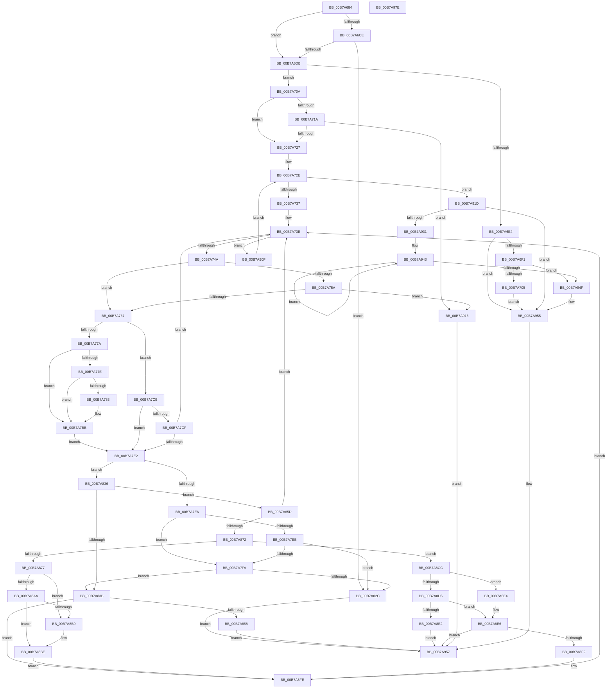

# HalpIommuInitializeAll

- RVA: `0x00B7A684`–`0x00B7A97F` (길이 `763` bytes)
- VA: `0x0000000140B7A684`
- 실행 섹션: `PAGELK`
- PDB 이름 있음: `예`; PDB Function 태그: `아니요`
- unwind 정보 RVA: `0x000B8D94`
- 디코드: `205`개 명령, `763/763` bytes 표시
- 미해석 바이트: `0` (있으면 어셈블리에 `.byte`로 보존)

> 이 문서는 커널 이미지의 기계어와 PDB 기호를 분석해 생성했습니다. 4번과 5번은 함수 원형과 자료형을 바이너리 사용 방식에서 추정한 C 해석이며 원본 소스 복구 결과는 아닙니다.

## 1. Dependencies

- 직접 호출 지점: **15**; 고유 호출 대상: **13**
- 직접 호출자로 확인된 함수: **2**
- RIP 상대 이미지 참조: **10**

### Outgoing calls
- `0x00B7A6CE` → [HalpIommuPopulateExceptionList](../../text/4D/HalpIommuPopulateExceptionList_function_004DA400.md) (function, `0x004DA400`)
- `0x00B7A6F5` → [HviGetHardwareFeatures](../../text/4A/HviGetHardwareFeatures_function_004ADBC0.md) (function, `0x004ADBC0`)
- `0x00B7A797` → [HalpMmAllocateMemory](../../text/54/HalpMmAllocateMemory_function_00544974.md) (function, `0x00544974`)
- `0x00B7A7A9` → [RtlClearAllBits](../../text/45/RtlClearAllBits_function_00450230.md) (function, `0x00450230`)
- `0x00B7A7F1` → [HalpIommuProcessReservedDomains](../B5/HalpIommuProcessReservedDomains_function_00B5DE2C.md) (function, `0x00B5DE2C`)
- `0x00B7A80F` → [HalpGetIrtEntryCount](../../text/55/HalpGetIrtEntryCount_function_005572DC.md) (function, `0x005572DC`)
- `0x00B7A823` → [guard_dispatch_icall](../../text/6B/guard_dispatch_icall_function_006BAAD0.md) (function, `0x006BAAD0`)
- `0x00B7A84B` → [guard_dispatch_icall](../../text/6B/guard_dispatch_icall_function_006BAAD0.md) (function, `0x006BAAD0`)
- `0x00B7A8A1` → [HalpInterruptIsRemappingRequired](../../text/4B/HalpInterruptIsRemappingRequired_function_004B7AB0.md) (function, `0x004B7AB0`)
- `0x00B7A8C5` → [HalpIommuConfigureInterrupt](../../text/55/HalpIommuConfigureInterrupt_function_00553464.md) (function, `0x00553464`)
- `0x00B7A8D9` → [HalpIommuSetupMessageInterruptRouting](../B5/HalpIommuSetupMessageInterruptRouting_function_00B5DCF0.md) (function, `0x00B5DCF0`)
- `0x00B7A8F9` → [guard_dispatch_icall](../../text/6B/guard_dispatch_icall_function_006BAAD0.md) (function, `0x006BAAD0`)
- `0x00B7A91D` → [HalpIommuUpdatePageWalkCapability](../../text/54/HalpIommuUpdatePageWalkCapability_function_0054EAD0.md) (function, `0x0054EAD0`)
- `0x00B7A922` → [HalpIommuUpdatePageTableLevel](../../text/54/HalpIommuUpdatePageTableLevel_function_0054EA70.md) (function, `0x0054EA70`)
- `0x00B7A95E` → [_security_check_cookie](../../text/6A/_security_check_cookie_function_006AC640.md) (function, `0x006AC640`)

### Direct callers
- [HalpIommuInitSystem](../B5/HalpIommuInitSystem_function_00B5D7E0.md) at `0x00B5D984`
- [HalpInterruptReinitialize](HalpInterruptReinitialize_function_00B79BEC.md) at `0x00B79C76`

### Static image references
- `0x00B7A69E` → RVA `0x00E0A740` (`.data`; read)
- `0x00B7A6DB` → RVA `0x00FC1710` (`.data`; read)
- `0x00B7A6E4` → RVA `0x00FC1ED0` (`.data`; read)
- `0x00B7A70A` → RVA `0x00FC18E4` (`.data`; read)
- `0x00B7A711` → RVA `0x00FC1740` (`.data`; read)
- `0x00B7A7BD` → RVA `0x00FC1734` (`.data`; read)
- `0x00B7A877` → RVA `0x00F231B0` (`.data`; read)
- `0x00B7A927` → RVA `0x00FC18F0` (`.data`; read)
- `0x00B7A933` → RVA `0x00026020` (`.rdata`; read)
- `0x00B7A93A` → RVA `0x00E0A80D` (`.data`; write)

## 2. Other-region calls and transfers

- 다른 실행 섹션으로 향하는 call: **13**
  - `0x00B7A6CE` → [HalpIommuPopulateExceptionList](../../text/4D/HalpIommuPopulateExceptionList_function_004DA400.md) (`PAGELK` → `.text`)
  - `0x00B7A6F5` → [HviGetHardwareFeatures](../../text/4A/HviGetHardwareFeatures_function_004ADBC0.md) (`PAGELK` → `.text`)
  - `0x00B7A797` → [HalpMmAllocateMemory](../../text/54/HalpMmAllocateMemory_function_00544974.md) (`PAGELK` → `.text`)
  - `0x00B7A7A9` → [RtlClearAllBits](../../text/45/RtlClearAllBits_function_00450230.md) (`PAGELK` → `.text`)
  - `0x00B7A80F` → [HalpGetIrtEntryCount](../../text/55/HalpGetIrtEntryCount_function_005572DC.md) (`PAGELK` → `.text`)
  - `0x00B7A823` → [guard_dispatch_icall](../../text/6B/guard_dispatch_icall_function_006BAAD0.md) (`PAGELK` → `.text`)
  - `0x00B7A84B` → [guard_dispatch_icall](../../text/6B/guard_dispatch_icall_function_006BAAD0.md) (`PAGELK` → `.text`)
  - `0x00B7A8A1` → [HalpInterruptIsRemappingRequired](../../text/4B/HalpInterruptIsRemappingRequired_function_004B7AB0.md) (`PAGELK` → `.text`)
  - `0x00B7A8C5` → [HalpIommuConfigureInterrupt](../../text/55/HalpIommuConfigureInterrupt_function_00553464.md) (`PAGELK` → `.text`)
  - `0x00B7A8F9` → [guard_dispatch_icall](../../text/6B/guard_dispatch_icall_function_006BAAD0.md) (`PAGELK` → `.text`)
  - `0x00B7A91D` → [HalpIommuUpdatePageWalkCapability](../../text/54/HalpIommuUpdatePageWalkCapability_function_0054EAD0.md) (`PAGELK` → `.text`)
  - `0x00B7A922` → [HalpIommuUpdatePageTableLevel](../../text/54/HalpIommuUpdatePageTableLevel_function_0054EA70.md) (`PAGELK` → `.text`)
  - `0x00B7A95E` → [_security_check_cookie](../../text/6A/_security_check_cookie_function_006AC640.md) (`PAGELK` → `.text`)
- 별도 외부 분기/꼬리 이동을 확인하지 못했습니다.

## 3. Assembly (complete function range)

```asm
00B7A684  48 89 5C 24 18                  mov qword ptr [rsp + 0x18], rbx
00B7A689  55                              push rbp
00B7A68A  56                              push rsi
00B7A68B  57                              push rdi
00B7A68C  41 54                           push r12
00B7A68E  41 55                           push r13
00B7A690  41 56                           push r14
00B7A692  41 57                           push r15
00B7A694  48 8B EC                        mov rbp, rsp
00B7A697  48 81 EC 80 00 00 00            sub rsp, 0x80
00B7A69E  48 8B 05 9B 00 29 00            mov rax, qword ptr [rip + 0x29009b]
00B7A6A5  48 33 C4                        xor rax, rsp
00B7A6A8  48 89 45 F0                     mov qword ptr [rbp - 0x10], rax
00B7A6AC  33 C0                           xor eax, eax
00B7A6AE  0F 57 C0                        xorps xmm0, xmm0
00B7A6B1  48 89 45 D8                     mov qword ptr [rbp - 0x28], rax
00B7A6B5  0F 57 C9                        xorps xmm1, xmm1
00B7A6B8  4C 8B EA                        mov r13, rdx
00B7A6BB  44 8A F9                        mov r15b, cl
00B7A6BE  0F 11 45 E0                     movups xmmword ptr [rbp - 0x20], xmm0
00B7A6C2  0F 11 4D B0                     movups xmmword ptr [rbp - 0x50], xmm1
00B7A6C6  0F 11 45 C8                     movups xmmword ptr [rbp - 0x38], xmm0
00B7A6CA  84 C9                           test cl, cl
00B7A6CC  75 0D                           jne 0x140b7a6db
00B7A6CE  E8 2D FD 95 FF                  call 0x1404da400
00B7A6D3  85 C0                           test eax, eax
00B7A6D5  0F 88 51 01 00 00               js 0x140b7a82c
00B7A6DB  80 3D 2E 70 44 00 00            cmp byte ptr [rip + 0x44702e], 0
00B7A6E2  74 26                           je 0x140b7a70a
00B7A6E4  80 3D E5 77 44 00 00            cmp byte ptr [rip + 0x4477e5], 0
00B7A6EB  0F 84 64 02 00 00               je 0x140b7a955
00B7A6F1  48 8D 4D E0                     lea rcx, [rbp - 0x20]
00B7A6F5  E8 C6 34 93 FF                  call 0x1404adbc0
00B7A6FA  8B 45 E4                        mov eax, dword ptr [rbp - 0x1c]
00B7A6FD  84 C0                           test al, al
00B7A6FF  0F 85 4A 02 00 00               jne 0x140b7a94f
00B7A705  E9 4B 02 00 00                  jmp 0x140b7a955
00B7A70A  83 3D D3 71 44 00 00            cmp dword ptr [rip + 0x4471d3], 0
00B7A711  48 8D 05 28 70 44 00            lea rax, [rip + 0x447028]
00B7A718  74 0D                           je 0x140b7a727
00B7A71A  48 39 05 1F 70 44 00            cmp qword ptr [rip + 0x44701f], rax
00B7A721  0F 84 EF 01 00 00               je 0x140b7a916
00B7A727  33 F6                           xor esi, esi
00B7A729  BA 00 00 01 00                  mov edx, 0x10000
00B7A72E  83 FE 05                        cmp esi, 5
00B7A731  0F 87 E6 01 00 00               ja 0x140b7a91d
00B7A737  4C 8B 35 02 70 44 00            mov r14, qword ptr [rip + 0x447002]
00B7A73E  4D 8B E6                        mov r12, r14
00B7A741  4C 3B F0                        cmp r14, rax
00B7A744  0F 84 C5 01 00 00               je 0x140b7a90f
00B7A74A  49 8B FE                        mov rdi, r14
00B7A74D  4D 8B 36                        mov r14, qword ptr [r14]
00B7A750  8B 87 D8 01 00 00               mov eax, dword ptr [rdi + 0x1d8]
00B7A756  A8 40                           test al, 0x40
00B7A758  75 0D                           jne 0x140b7a767
00B7A75A  83 3D 83 71 44 00 00            cmp dword ptr [rip + 0x447183], 0
00B7A761  0F 85 AF 01 00 00               jne 0x140b7a916
00B7A767  8B C8                           mov ecx, eax
00B7A769  BB 00 00 00 00                  mov ebx, 0
00B7A76E  83 E1 20                        and ecx, 0x20
00B7A771  0F 95 C3                        setne bl
00B7A774  0F BA E0 08                     bt eax, 8
00B7A778  73 51                           jae 0x140b7a7cb
00B7A77A  85 F6                           test esi, esi
00B7A77C  75 3D                           jne 0x140b7a7bb
00B7A77E  45 84 FF                        test r15b, r15b
00B7A781  75 38                           jne 0x140b7a7bb
00B7A783  8B 9F B8 01 00 00               mov ebx, dword ptr [rdi + 0x1b8]
00B7A789  3B DA                           cmp ebx, edx
00B7A78B  0F 47 DA                        cmova ebx, edx
00B7A78E  8D 4B 20                        lea ecx, [rbx + 0x20]
00B7A791  C1 E9 05                        shr ecx, 5
00B7A794  C1 E1 02                        shl ecx, 2
00B7A797  E8 D8 A1 9C FF                  call 0x140544974
00B7A79C  48 8D 8F C8 01 00 00            lea rcx, [rdi + 0x1c8]
00B7A7A3  89 19                           mov dword ptr [rcx], ebx
00B7A7A5  48 89 41 08                     mov qword ptr [rcx + 8], rax
00B7A7A9  E8 82 5A 8D FF                  call 0x140450230
00B7A7AE  48 83 A7 C0 01 00 00 00         and qword ptr [rdi + 0x1c0], 0
00B7A7B6  BA 00 00 01 00                  mov edx, 0x10000
00B7A7BB  33 DB                           xor ebx, ebx
00B7A7BD  83 3D 70 6F 44 00 03            cmp dword ptr [rip + 0x446f70], 3
00B7A7C4  0F 94 C3                        sete bl
00B7A7C7  FF C3                           inc ebx
00B7A7C9  EB 17                           jmp 0x140b7a7e2
00B7A7CB  85 C9                           test ecx, ecx
00B7A7CD  75 13                           jne 0x140b7a7e2
00B7A7CF  39 0D 0F 71 44 00               cmp dword ptr [rip + 0x44710f], ecx
00B7A7D5  48 8D 05 64 6F 44 00            lea rax, [rip + 0x446f64]
00B7A7DC  0F 84 5C FF FF FF               je 0x140b7a73e
00B7A7E2  85 F6                           test esi, esi
00B7A7E4  75 50                           jne 0x140b7a836
00B7A7E6  45 84 FF                        test r15b, r15b
00B7A7E9  75 0F                           jne 0x140b7a7fa
00B7A7EB  48 8B D7                        mov rdx, rdi
00B7A7EE  49 8B CD                        mov rcx, r13
00B7A7F1  E8 36 36 FE FF                  call 0x140b5de2c
00B7A7F6  85 C0                           test eax, eax
00B7A7F8  78 32                           js 0x140b7a82c
00B7A7FA  8B 05 E4 70 44 00               mov eax, dword ptr [rip + 0x4470e4]
00B7A800  48 83 65 C8 00                  and qword ptr [rbp - 0x38], 0
00B7A805  83 65 DC 00                     and dword ptr [rbp - 0x24], 0
00B7A809  89 45 D4                        mov dword ptr [rbp - 0x2c], eax
00B7A80C  89 5D D0                        mov dword ptr [rbp - 0x30], ebx
00B7A80F  E8 C8 CA 9D FF                  call 0x1405572dc
00B7A814  89 45 D8                        mov dword ptr [rbp - 0x28], eax
00B7A817  48 8D 55 C8                     lea rdx, [rbp - 0x38]
00B7A81B  48 8B 47 38                     mov rax, qword ptr [rdi + 0x38]
00B7A81F  48 8B 4F 10                     mov rcx, qword ptr [rdi + 0x10]
00B7A823  E8 A8 02 B4 FF                  call 0x1406baad0
00B7A828  85 C0                           test eax, eax
00B7A82A  79 0F                           jns 0x140b7a83b
00B7A82C  B8 01 00 00 C0                  mov eax, 0xc0000001
00B7A831  E9 21 01 00 00                  jmp 0x140b7a957
00B7A836  83 FE 05                        cmp esi, 5
00B7A839  73 22                           jae 0x140b7a85d
00B7A83B  48 8B 47 40                     mov rax, qword ptr [rdi + 0x40]
00B7A83F  45 33 C9                        xor r9d, r9d
00B7A842  48 8B 4F 10                     mov rcx, qword ptr [rdi + 0x10]
00B7A846  45 8A C7                        mov r8b, r15b
00B7A849  8B D6                           mov edx, esi
00B7A84B  E8 80 02 B4 FF                  call 0x1406baad0
00B7A850  85 C0                           test eax, eax
00B7A852  0F 89 A6 00 00 00               jns 0x140b7a8fe
00B7A858  E9 FA 00 00 00                  jmp 0x140b7a957
00B7A85D  48 83 BF 30 01 00 00 00         cmp qword ptr [rdi + 0x130], 0
00B7A865  48 8D 05 D4 6E 44 00            lea rax, [rip + 0x446ed4]
00B7A86C  0F 84 CC FE FF FF               je 0x140b7a73e
00B7A872  45 84 FF                        test r15b, r15b
00B7A875  75 55                           jne 0x140b7a8cc
00B7A877  48 8B 05 32 89 3A 00            mov rax, qword ptr [rip + 0x3a8932]
00B7A87E  8B 08                           mov ecx, dword ptr [rax]
00B7A880  33 C0                           xor eax, eax
00B7A882  89 45 BA                        mov dword ptr [rbp - 0x46], eax
00B7A885  66 89 45 BE                     mov word ptr [rbp - 0x42], ax
00B7A889  8B C1                           mov eax, ecx
00B7A88B  C1 E8 06                        shr eax, 6
00B7A88E  83 E1 3F                        and ecx, 0x3f
00B7A891  66 89 45 B8                     mov word ptr [rbp - 0x48], ax
00B7A895  B8 01 00 00 00                  mov eax, 1
00B7A89A  48 D3 E0                        shl rax, cl
00B7A89D  48 89 45 B0                     mov qword ptr [rbp - 0x50], rax
00B7A8A1  E8 0A D2 93 FF                  call 0x1404b7ab0
00B7A8A6  84 C0                           test al, al
00B7A8A8  74 0F                           je 0x140b7a8b9
00B7A8AA  8B 87 D8 01 00 00               mov eax, dword ptr [rdi + 0x1d8]
00B7A8B0  BA 06 00 00 00                  mov edx, 6
00B7A8B5  A8 10                           test al, 0x10
00B7A8B7  74 05                           je 0x140b7a8be
00B7A8B9  BA FE FF FF 3F                  mov edx, 0x3ffffffe
00B7A8BE  4C 8D 45 B0                     lea r8, [rbp - 0x50]
00B7A8C2  49 8B CC                        mov rcx, r12
00B7A8C5  E8 9A 8B 9D FF                  call 0x140553464
00B7A8CA  EB 32                           jmp 0x140b7a8fe
00B7A8CC  8B 87 88 01 00 00               mov eax, dword ptr [rdi + 0x188]
00B7A8D2  A8 02                           test al, 2
00B7A8D4  74 0E                           je 0x140b7a8e4
00B7A8D6  48 8B CF                        mov rcx, rdi
00B7A8D9  E8 12 34 FE FF                  call 0x140b5dcf0
00B7A8DE  85 C0                           test eax, eax
00B7A8E0  79 04                           jns 0x140b7a8e6
00B7A8E2  EB 73                           jmp 0x140b7a957
00B7A8E4  33 C0                           xor eax, eax
00B7A8E6  48 8B 97 20 01 00 00            mov rdx, qword ptr [rdi + 0x120]
00B7A8ED  48 85 D2                        test rdx, rdx
00B7A8F0  74 65                           je 0x140b7a957
00B7A8F2  48 8B 4F 10                     mov rcx, qword ptr [rdi + 0x10]
00B7A8F6  48 8B C2                        mov rax, rdx
00B7A8F9  E8 D2 01 B4 FF                  call 0x1406baad0
00B7A8FE  48 8D 05 3B 6E 44 00            lea rax, [rip + 0x446e3b]
00B7A905  BA 00 00 01 00                  mov edx, 0x10000
00B7A90A  E9 2F FE FF FF                  jmp 0x140b7a73e
00B7A90F  FF C6                           inc esi
00B7A911  E9 18 FE FF FF                  jmp 0x140b7a72e
00B7A916  B8 BB 00 00 C0                  mov eax, 0xc00000bb
00B7A91B  EB 3A                           jmp 0x140b7a957
00B7A91D  E8 AE 41 9D FF                  call 0x14054ead0
00B7A922  E8 49 41 9D FF                  call 0x14054ea70
00B7A927  8B 15 C3 6F 44 00               mov edx, dword ptr [rip + 0x446fc3]
00B7A92D  85 D2                           test edx, edx
00B7A92F  74 24                           je 0x140b7a955
00B7A931  B0 0C                           mov al, 0xc
00B7A933  48 8D 0D E6 B6 4A FF            lea rcx, [rip - 0xb5491a]
00B7A93A  88 05 CD FE 28 00               mov byte ptr [rip + 0x28fecd], al
00B7A940  44 8B C2                        mov r8d, edx
00B7A943  02 01                           add al, byte ptr [rcx]
00B7A945  48 8D 49 04                     lea rcx, [rcx + 4]
00B7A949  49 83 E8 01                     sub r8, 1
00B7A94D  75 F4                           jne 0x140b7a943
00B7A94F  88 05 B8 FE 28 00               mov byte ptr [rip + 0x28feb8], al
00B7A955  33 C0                           xor eax, eax
00B7A957  48 8B 4D F0                     mov rcx, qword ptr [rbp - 0x10]
00B7A95B  48 33 CC                        xor rcx, rsp
00B7A95E  E8 DD 1C B3 FF                  call 0x1406ac640
00B7A963  48 8B 9C 24 D0 00 00 00         mov rbx, qword ptr [rsp + 0xd0]
00B7A96B  48 81 C4 80 00 00 00            add rsp, 0x80
00B7A972  41 5F                           pop r15
00B7A974  41 5E                           pop r14
00B7A976  41 5D                           pop r13
00B7A978  41 5C                           pop r12
00B7A97A  5F                              pop rdi
00B7A97B  5E                              pop rsi
00B7A97C  5D                              pop rbp
00B7A97D  C3                              ret
00B7A97E  CC                              int3
```

## 4. C-style interpretation (structured pseudocode)

```c
__int64 __fastcall HalpIommuInitializeAll(unsigned __int8 a1, __int64 a2, __int64 a3, int a4)
{
    __int64 result;
    __int64 v_rbx;
    __int64 v_rsi;
    __int64 v_rsp;
    unsigned __int64 v_stack_m48;
    unsigned int v_stack_m54;
    unsigned __int64 v_stack_m58;
    unsigned int v_stack_m5C;
    unsigned __int64 v_stack_m60;
    unsigned int v_stack_m64;
    unsigned int v_stack_m68;
    unsigned __int64 v_stack_m70;
    unsigned __int16 v_stack_m7A;
    unsigned int v_stack_m7E;
    unsigned __int16 v_stack_m80;
    unsigned __int64 v_stack_m88;
    unsigned __int64 v_stack_p18;

    v_stack_p18 = v_rbx;
    v_rsp = (v_rsp) - (128);
    result = (*(unsigned __int64 *)(v_rip + 2687131)) ^ (v_rsp);
    v_stack_m48 = result;
    result = 0;
    v_stack_m60 = 0;
    v_stack_m58 = v_xmm0;
    v_stack_m88 = v_xmm1;
    v_stack_m70 = v_xmm0;
    if (a1 != 0) goto loc_00B7A6DB;
    result = HalpIommuPopulateExceptionList(a1, a2, a3, a4);
    if (sign_flag) goto loc_00B7A82C;
loc_00B7A6DB:
    if ((*(unsigned __int8 *)(v_rip + 4485166)) == 0) goto loc_00B7A70A;
    if ((*(unsigned __int8 *)(v_rip + 4487141)) == 0) goto loc_00B7A955;
    result = HviGetHardwareFeatures(v_stack_m58, a2, a3, a4);
    if ((unsigned __int8)((unsigned int)(v_stack_m54)) != 0) goto loc_00B7A94F;
    goto loc_00B7A955;
loc_00B7A70A:
    if ((*(unsigned int *)(v_rip + 4485587)) == 0) goto loc_00B7A727;
    if ((*(unsigned __int64 *)(v_rip + 4485151)) == (v_rip + 4485160)) goto loc_00B7A916;
loc_00B7A727:
    v_rsi = 0;
loc_00B7A72E:
    if (0 > 5) goto loc_00B7A91D;
loc_00B7A73E:
    if ((*(unsigned __int64 *)(v_rip + 4485122)) == (v_rip + 4485160)) goto loc_00B7A90F;
    if ((((unsigned __int8)((unsigned int)(*(unsigned int *)(*(unsigned __int64 *)(v_rip + 4485122) + 472)))) & (64)) != 0) goto loc_00B7A767;
    if ((*(unsigned int *)(v_rip + 4485507)) != 0) goto loc_00B7A916;
loc_00B7A767:
    a1 = (unsigned int)(((unsigned int)((unsigned int)((unsigned int)(*(unsigned int *)(*(unsigned __int64 *)(v_rip + 4485122) + 472))))) & (32));
    v_rbx = (condition_is_not_equal) ? 1 : 0;
    if (condition_is_above_or_equal) goto loc_00B7A7CB;
    if (0 != 0) goto loc_00B7A7BB;
    result = (unsigned int)(*(unsigned int *)(*(unsigned __int64 *)(v_rip + 4485122) + 472));
    if (a1 == 0) {
        v_rbx = *(unsigned int *)(*(unsigned __int64 *)(v_rip + 4485122) + 440);
        if (((unsigned int)(v_rbx)) > ((unsigned int)((unsigned int)(0x10000ULL)))) { v_rbx = (unsigned int)((unsigned int)(0x10000ULL)); }
        a1 = v_rbx + 32;
        a1 = (unsigned int)((a1) >> (5));
        a1 = (unsigned int)((a1) << (2));
        result = HalpMmAllocateMemory(a1, (unsigned int)(0x10000ULL), a3, a4);
        a1 = *(unsigned __int64 *)(v_rip + 4485122) + 456;
        *(unsigned int *)(a1) = (unsigned int)(v_rbx);
        *(unsigned __int64 *)(a1 + 8) = result;
        result = RtlClearAllBits(a1, (unsigned int)(0x10000ULL), a3, a4);
        a2 = 0x10000ULL;
    }
    v_rbx = 0;
    v_rbx = ((*(unsigned int *)(v_rip + 4484976)) == 3) ? 1 : 0;
    v_rbx = (unsigned int)((v_rbx) + 1);
    goto loc_00B7A7E2;
loc_00B7A7CB:
    if (a1 != 0) goto loc_00B7A7E2;
    if ((*(unsigned int *)(v_rip + 4485391)) == a1) goto loc_00B7A73E;
loc_00B7A7E2:
    if (0 != 0) goto loc_00B7A836;
    if (a1 != 0) goto loc_00B7A7FA;
    result = HalpIommuProcessReservedDomains(a2, *(unsigned __int64 *)(v_rip + 4485122), a3, a4);
    if (sign_flag) goto loc_00B7A82C;
loc_00B7A7FA:
    v_stack_m64 = (unsigned int)((unsigned int)(*(unsigned int *)(v_rip + 4485348)));
    v_stack_m68 = (unsigned int)(v_rbx);
    result = HalpGetIrtEntryCount(a2, *(unsigned __int64 *)(v_rip + 4485122), a3, a4);
    v_stack_m60 = (unsigned int)(result);
    result = guard_dispatch_icall(*(unsigned __int64 *)(*(unsigned __int64 *)(v_rip + 4485122) + 16), v_stack_m70, a3, a4);
    if (!sign_flag) goto loc_00B7A83B;
loc_00B7A82C:
    goto loc_00B7A957;
loc_00B7A836:
    if (0 >= 5) goto loc_00B7A85D;
loc_00B7A83B:
    a4 = 0;
    result = guard_dispatch_icall(*(unsigned __int64 *)(*(unsigned __int64 *)(v_rip + 4485122) + 16), 0, a1, a4);
    if (!sign_flag) goto loc_00B7A8FE;
    goto loc_00B7A957;
loc_00B7A85D:
    if ((*(unsigned __int64 *)(*(unsigned __int64 *)(v_rip + 4485122) + 304)) == 0) goto loc_00B7A73E;
    if (a1 != 0) goto loc_00B7A8CC;
    result = 0;
    v_stack_m7E = 0;
    v_stack_m7A = 0;
    result = (unsigned int)(((unsigned int)((unsigned int)((unsigned int)(*(unsigned int *)(*(unsigned __int64 *)(v_rip + 3836210)))))) >> (6));
    a1 = (unsigned int)(((unsigned int)(*(unsigned int *)(*(unsigned __int64 *)(v_rip + 3836210)))) & (63));
    v_stack_m80 = (unsigned __int16)(result);
    result = (1) << (a1);
    v_stack_m88 = result;
    result = HalpInterruptIsRemappingRequired(a1, 0, a1, a4);
    if ((unsigned __int8)(result) == 0) goto loc_00B7A8B9;
    if ((((unsigned __int8)((unsigned int)(*(unsigned int *)(*(unsigned __int64 *)(v_rip + 4485122) + 472)))) & (16)) != 0) {
        a2 = 0x3FFFFFFEULL;
    }
    result = HalpIommuConfigureInterrupt(*(unsigned __int64 *)(v_rip + 4485122), a2, v_stack_m88, a4);
    goto loc_00B7A8FE;
loc_00B7A8CC:
    if ((((unsigned __int8)((unsigned int)(*(unsigned int *)(*(unsigned __int64 *)(v_rip + 4485122) + 392)))) & (2)) == 0) goto loc_00B7A8E4;
    result = HalpIommuSetupMessageInterruptRouting(*(unsigned __int64 *)(v_rip + 4485122), a2, v_stack_m88, a4);
    if (!sign_flag) goto loc_00B7A8E6;
    goto loc_00B7A957;
loc_00B7A8E4:
    result = 0;
loc_00B7A8E6:
    if (*(unsigned __int64 *)(*(unsigned __int64 *)(v_rip + 4485122) + 288) == 0) goto loc_00B7A957;
    result = guard_dispatch_icall(*(unsigned __int64 *)(*(unsigned __int64 *)(v_rip + 4485122) + 16), *(unsigned __int64 *)(*(unsigned __int64 *)(v_rip + 4485122) + 288), v_stack_m88, a4);
loc_00B7A8FE:
    goto loc_00B7A73E;
loc_00B7A90F:
    v_rsi = (unsigned int)((v_rsi) + 1);
    goto loc_00B7A72E;
loc_00B7A916:
    goto loc_00B7A957;
loc_00B7A91D:
    result = HalpIommuUpdatePageWalkCapability(*(unsigned __int64 *)(*(unsigned __int64 *)(v_rip + 4485122) + 16), (unsigned int)(0x10000ULL), v_stack_m88, a4);
    result = HalpIommuUpdatePageTableLevel(*(unsigned __int64 *)(*(unsigned __int64 *)(v_rip + 4485122) + 16), (unsigned int)(0x10000ULL), v_stack_m88, a4);
    if ((unsigned int)((unsigned int)(*(unsigned int *)(v_rip + 4485059))) == 0) goto loc_00B7A955;
    *(unsigned __int8 *)(v_rip + 2686669) = 12;
loc_00B7A943:
    result = (unsigned __int8)((12) + (*(unsigned __int8 *)(v_rip - 11880730)));
    a3 = ((unsigned int)((unsigned int)((unsigned int)(*(unsigned int *)(v_rip + 4485059))))) - (1);
    if (condition_is_not_equal) goto loc_00B7A943;
loc_00B7A94F:
    *(unsigned __int8 *)(v_rip + 2686648) = (unsigned __int8)(result);
loc_00B7A955:
    result = 0;
loc_00B7A957:
    a1 = (v_stack_m48) ^ (v_rsp);
    result = _security_check_cookie(a1, (unsigned int)(*(unsigned int *)(v_rip + 4485059)), a3, a4);
    v_rsp = (v_rsp) + (128);
    return result;
}
```

## 5. (Beta) C Style

```c
int64_t HalpIommuInitializeAll(uint8_t Arg1, int64_t Arg2, int64_t Arg3, int32_t Arg4)
{
    int64_t result;
    int64_t local_rbx;
    int64_t local_rsi;
    int64_t local_rsp;
    uint64_t v_stack_m48;
    uint32_t v_stack_m54;
    uint64_t v_stack_m58;
    uint32_t v_stack_m5C;
    uint64_t v_stack_m60;
    uint32_t v_stack_m64;
    uint32_t v_stack_m68;
    uint64_t v_stack_m70;
    uint16_t v_stack_m7A;
    uint32_t v_stack_m7E;
    uint16_t v_stack_m80;
    uint64_t v_stack_m88;
    uint64_t v_stack_p18;

    v_stack_p18 = local_rbx;
    local_rsp = (local_rsp) - (128);
    result = (*(uint64_t *)(v_rip + 0x29009B)) ^ (local_rsp);
    v_stack_m48 = result;
    result = 0;
    v_stack_m60 = 0;
    v_stack_m58 = v_xmm0;
    v_stack_m88 = v_xmm1;
    v_stack_m70 = v_xmm0;
    if (Arg1 != 0) goto loc_00B7A6DB;
    result = HalpIommuPopulateExceptionList(Arg1, Arg2, Arg3, Arg4);
    if (sign_flag) goto loc_00B7A82C;
loc_00B7A6DB:
    if ((*(uint8_t *)(v_rip + 0x44702E)) == 0) goto loc_00B7A70A;
    if ((*(uint8_t *)(v_rip + 0x4477E5)) == 0) goto loc_00B7A955;
    result = HviGetHardwareFeatures(v_stack_m58, Arg2, Arg3, Arg4);
    if ((uint8_t)((uint32_t)(v_stack_m54)) != 0) goto loc_00B7A94F;
    goto loc_00B7A955;
loc_00B7A70A:
    if ((*(uint32_t *)(v_rip + 0x4471D3)) == 0) goto loc_00B7A727;
    if ((*(uint64_t *)(v_rip + 0x44701F)) == (v_rip + 4485160)) goto loc_00B7A916;
loc_00B7A727:
    local_rsi = 0;
loc_00B7A72E:
    if (0 > 5) goto loc_00B7A91D;
loc_00B7A73E:
    if ((*(uint64_t *)(v_rip + 0x447002)) == (v_rip + 4485160)) goto loc_00B7A90F;
    if ((((uint8_t)((uint32_t)(*(uint32_t *)(*(uint64_t *)(v_rip + 0x447002) + 0x1D8)))) & (64)) != 0) goto loc_00B7A767;
    if ((*(uint32_t *)(v_rip + 0x447183)) != 0) goto loc_00B7A916;
loc_00B7A767:
    Arg1 = (uint32_t)(((uint32_t)((uint32_t)((uint32_t)(*(uint32_t *)(*(uint64_t *)(v_rip + 0x447002) + 0x1D8))))) & (32));
    local_rbx = (condition_is_not_equal) ? 1 : 0;
    if (condition_is_above_or_equal) goto loc_00B7A7CB;
    if (0 != 0) goto loc_00B7A7BB;
    result = (uint32_t)(*(uint32_t *)(*(uint64_t *)(v_rip + 0x447002) + 0x1D8));
    if (Arg1 == 0) {
        local_rbx = *(uint32_t *)(*(uint64_t *)(v_rip + 0x447002) + 0x1B8);
        if (((uint32_t)(local_rbx)) > ((uint32_t)((uint32_t)(0x10000ULL)))) { local_rbx = (uint32_t)((uint32_t)(0x10000ULL)); }
        Arg1 = local_rbx + 32;
        Arg1 = (uint32_t)((Arg1) >> (5));
        Arg1 = (uint32_t)((Arg1) << (2));
        result = HalpMmAllocateMemory(Arg1, (uint32_t)(0x10000ULL), Arg3, Arg4);
        Arg1 = *(uint64_t *)(v_rip + 0x447002) + 456;
        *(uint32_t *)(Arg1) = (uint32_t)(local_rbx);
        *(uint64_t *)(Arg1 + 0x8) = result;
        result = RtlClearAllBits(Arg1, (uint32_t)(0x10000ULL), Arg3, Arg4);
        Arg2 = 0x10000ULL;
    }
    local_rbx = 0;
    local_rbx = ((*(uint32_t *)(v_rip + 0x446F70)) == 3) ? 1 : 0;
    local_rbx = (uint32_t)((local_rbx) + 1);
    goto loc_00B7A7E2;
loc_00B7A7CB:
    if (Arg1 != 0) goto loc_00B7A7E2;
    if ((*(uint32_t *)(v_rip + 0x44710F)) == Arg1) goto loc_00B7A73E;
loc_00B7A7E2:
    if (0 != 0) goto loc_00B7A836;
    if (Arg1 != 0) goto loc_00B7A7FA;
    result = HalpIommuProcessReservedDomains(Arg2, *(uint64_t *)(v_rip + 0x447002), Arg3, Arg4);
    if (sign_flag) goto loc_00B7A82C;
loc_00B7A7FA:
    v_stack_m64 = (uint32_t)((uint32_t)(*(uint32_t *)(v_rip + 0x4470E4)));
    v_stack_m68 = (uint32_t)(local_rbx);
    result = HalpGetIrtEntryCount(Arg2, *(uint64_t *)(v_rip + 0x447002), Arg3, Arg4);
    v_stack_m60 = (uint32_t)(result);
    result = guard_dispatch_icall(*(uint64_t *)(*(uint64_t *)(v_rip + 0x447002) + 0x10), v_stack_m70, Arg3, Arg4);
    if (!sign_flag) goto loc_00B7A83B;
loc_00B7A82C:
    goto loc_00B7A957;
loc_00B7A836:
    if (0 >= 5) goto loc_00B7A85D;
loc_00B7A83B:
    Arg4 = 0;
    result = guard_dispatch_icall(*(uint64_t *)(*(uint64_t *)(v_rip + 0x447002) + 0x10), 0, Arg1, Arg4);
    if (!sign_flag) goto loc_00B7A8FE;
    goto loc_00B7A957;
loc_00B7A85D:
    if ((*(uint64_t *)(*(uint64_t *)(v_rip + 0x447002) + 0x130)) == 0) goto loc_00B7A73E;
    if (Arg1 != 0) goto loc_00B7A8CC;
    result = 0;
    v_stack_m7E = 0;
    v_stack_m7A = 0;
    result = (uint32_t)(((uint32_t)((uint32_t)((uint32_t)(*(uint32_t *)(*(uint64_t *)(v_rip + 0x3A8932)))))) >> (6));
    Arg1 = (uint32_t)(((uint32_t)(*(uint32_t *)(*(uint64_t *)(v_rip + 0x3A8932)))) & (63));
    v_stack_m80 = (uint16_t)(result);
    result = (1) << (Arg1);
    v_stack_m88 = result;
    result = HalpInterruptIsRemappingRequired(Arg1, 0, Arg1, Arg4);
    if ((uint8_t)(result) == 0) goto loc_00B7A8B9;
    if ((((uint8_t)((uint32_t)(*(uint32_t *)(*(uint64_t *)(v_rip + 0x447002) + 0x1D8)))) & (16)) != 0) {
        Arg2 = 0x3FFFFFFEULL;
    }
    result = HalpIommuConfigureInterrupt(*(uint64_t *)(v_rip + 0x447002), Arg2, v_stack_m88, Arg4);
    goto loc_00B7A8FE;
loc_00B7A8CC:
    if ((((uint8_t)((uint32_t)(*(uint32_t *)(*(uint64_t *)(v_rip + 0x447002) + 0x188)))) & (2)) == 0) goto loc_00B7A8E4;
    result = HalpIommuSetupMessageInterruptRouting(*(uint64_t *)(v_rip + 0x447002), Arg2, v_stack_m88, Arg4);
    if (!sign_flag) goto loc_00B7A8E6;
    goto loc_00B7A957;
loc_00B7A8E4:
    result = 0;
loc_00B7A8E6:
    if (*(uint64_t *)(*(uint64_t *)(v_rip + 0x447002) + 0x120) == 0) goto loc_00B7A957;
    result = guard_dispatch_icall(*(uint64_t *)(*(uint64_t *)(v_rip + 0x447002) + 0x10), *(uint64_t *)(*(uint64_t *)(v_rip + 0x447002) + 0x120), v_stack_m88, Arg4);
loc_00B7A8FE:
    goto loc_00B7A73E;
loc_00B7A90F:
    local_rsi = (uint32_t)((local_rsi) + 1);
    goto loc_00B7A72E;
loc_00B7A916:
    goto loc_00B7A957;
loc_00B7A91D:
    result = HalpIommuUpdatePageWalkCapability(*(uint64_t *)(*(uint64_t *)(v_rip + 0x447002) + 0x10), (uint32_t)(0x10000ULL), v_stack_m88, Arg4);
    result = HalpIommuUpdatePageTableLevel(*(uint64_t *)(*(uint64_t *)(v_rip + 0x447002) + 0x10), (uint32_t)(0x10000ULL), v_stack_m88, Arg4);
    if ((uint32_t)((uint32_t)(*(uint32_t *)(v_rip + 0x446FC3))) == 0) goto loc_00B7A955;
    *(uint8_t *)(v_rip + 0x28FECD) = 12;
loc_00B7A943:
    result = (uint8_t)((12) + (*(uint8_t *)(v_rip - 0xB5491A)));
    Arg3 = ((uint32_t)((uint32_t)((uint32_t)(*(uint32_t *)(v_rip + 0x446FC3))))) - (1);
    if (condition_is_not_equal) goto loc_00B7A943;
loc_00B7A94F:
    *(uint8_t *)(v_rip + 0x28FEB8) = (uint8_t)(result);
loc_00B7A955:
    result = 0;
loc_00B7A957:
    Arg1 = (v_stack_m48) ^ (local_rsp);
    result = _security_check_cookie(Arg1, (uint32_t)(*(uint32_t *)(v_rip + 0x446FC3)), Arg3, Arg4);
    local_rsp = (local_rsp) + (128);
    return result;
}
```

## 6. Execution-region graph

[열기: 2D/3D 그래프와 함수 탐색 컨트롤 패널](../../../control-panel.html?section=pagelk&rva=0x00B7A684&view=graph)

- 2D 그래프는 위에서 아래로 흐르고, 3D 그래프는 빈 공간을 드래그해 회전합니다. Shift+드래그는 이동, 휠은 확대·축소, 함수 노드 선택은 대상 보고서 이동입니다.

### Static fallback


