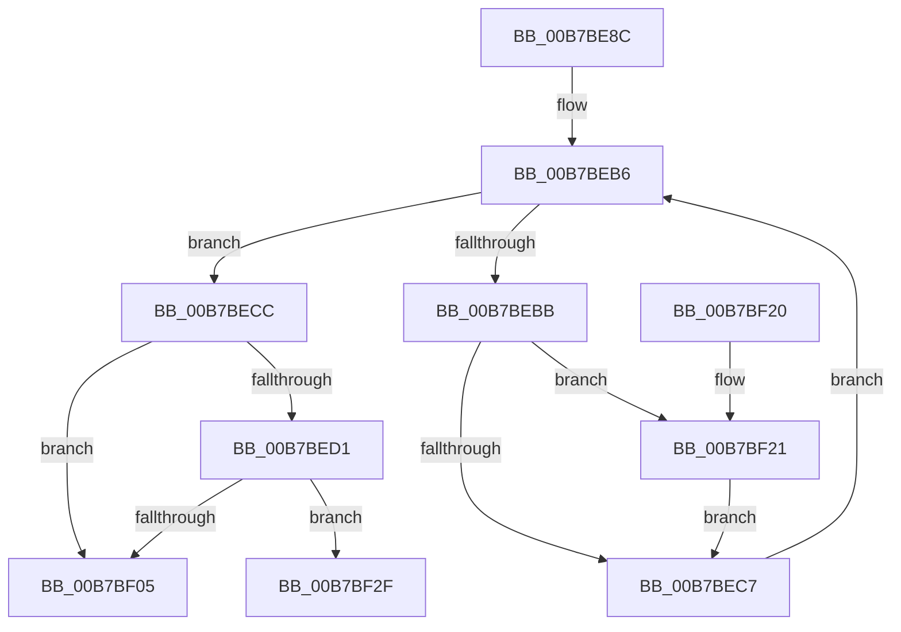

# HalpIommuMarkHiberPhase

- RVA: `0x00B7BE8C`–`0x00B7BF58` (길이 `204` bytes)
- VA: `0x0000000140B7BE8C`
- 실행 섹션: `PAGELK`
- PDB 이름 있음: `예`; PDB Function 태그: `예`
- unwind 정보 RVA: `0x000BB3D8`
- 디코드: `50`개 명령, `204/204` bytes 표시
- 미해석 바이트: `0` (있으면 어셈블리에 `.byte`로 보존)

> 이 문서는 커널 이미지의 기계어와 PDB 기호를 분석해 생성했습니다. 4번과 5번은 함수 원형과 자료형을 바이너리 사용 방식에서 추정한 C 해석이며 원본 소스 복구 결과는 아닙니다.

## 1. Dependencies

- 직접 호출 지점: **3**; 고유 호출 대상: **2**
- 직접 호출자로 확인된 함수: **1**
- RIP 상대 이미지 참조: **3**

### Outgoing calls
- `0x00B7BEED` → [PoSetHiberRange](../../text/47/PoSetHiberRange_function_0047C580.md) (function, `0x0047C580`)
- `0x00B7BF28` → [guard_dispatch_icall](../../text/6B/guard_dispatch_icall_function_006BAAD0.md) (function, `0x006BAAD0`)
- `0x00B7BF47` → [PoSetHiberRange](../../text/47/PoSetHiberRange_function_0047C580.md) (function, `0x0047C580`)

### Direct callers
- [HaliLocateHiberRanges](../B5/HaliLocateHiberRanges_function_00B5CE50.md) at `0x00B5CF3F`
- [HaliLocateHiberRanges](../B5/HaliLocateHiberRanges_function_00B5CE50.md) at `0x00B5CF67`

### Static image references
- `0x00B7BEA5` → RVA `0x00FC1740` (`.data`; read)
- `0x00B7BEDF` → RVA `0x00F8FB00` (`.data`; read)
- `0x00B7BEF2` → RVA `0x00F8FB10` (`.data`; read)

## 2. Other-region calls and transfers

- 다른 실행 섹션으로 향하는 call: **3**
  - `0x00B7BEED` → [PoSetHiberRange](../../text/47/PoSetHiberRange_function_0047C580.md) (`PAGELK` → `.text`)
  - `0x00B7BF28` → [guard_dispatch_icall](../../text/6B/guard_dispatch_icall_function_006BAAD0.md) (`PAGELK` → `.text`)
  - `0x00B7BF47` → [PoSetHiberRange](../../text/47/PoSetHiberRange_function_0047C580.md) (`PAGELK` → `.text`)
- call이 아닌 외부 분기/꼬리 이동: **1**
  - `0x00B7BF53` → [sub_00B8106E + 0x21](../B8/Unknown_function_00B8106E.md) (`tail-transfer`)

## 3. Assembly (complete function range)

```asm
00B7BE8C  48 8B C4                        mov rax, rsp
00B7BE8F  48 89 58 08                     mov qword ptr [rax + 8], rbx
00B7BE93  48 89 70 10                     mov qword ptr [rax + 0x10], rsi
00B7BE97  48 89 78 18                     mov qword ptr [rax + 0x18], rdi
00B7BE9B  4C 89 60 20                     mov qword ptr [rax + 0x20], r12
00B7BE9F  41 56                           push r14
00B7BEA1  48 83 EC 30                     sub rsp, 0x30
00B7BEA5  48 8B 1D 94 58 44 00            mov rbx, qword ptr [rip + 0x445894]
00B7BEAC  48 8D 35 8D 58 44 00            lea rsi, [rip + 0x44588d]
00B7BEB3  48 8B F9                        mov rdi, rcx
00B7BEB6  48 3B DE                        cmp rbx, rsi
00B7BEB9  74 11                           je 0x140b7becc
00B7BEBB  48 8B 83 40 01 00 00            mov rax, qword ptr [rbx + 0x140]
00B7BEC2  48 85 C0                        test rax, rax
00B7BEC5  75 5A                           jne 0x140b7bf21
00B7BEC7  48 8B 1B                        mov rbx, qword ptr [rbx]
00B7BECA  EB EA                           jmp 0x140b7beb6
00B7BECC  48 85 FF                        test rdi, rdi
00B7BECF  74 34                           je 0x140b7bf05
00B7BED1  41 B9 08 00 00 00               mov r9d, 8
00B7BED7  C7 44 24 20 48 61 6C 49         mov dword ptr [rsp + 0x20], 0x496c6148
00B7BEDF  4C 8D 05 1A 3C 41 00            lea r8, [rip + 0x413c1a]
00B7BEE6  48 8B CF                        mov rcx, rdi
00B7BEE9  41 8D 51 FA                     lea edx, [r9 - 6]
00B7BEED  E8 8E 06 90 FF                  call 0x14047c580
00B7BEF2  48 8B 1D 17 3C 41 00            mov rbx, qword ptr [rip + 0x413c17]
00B7BEF9  4C 8D 25 10 3C 41 00            lea r12, [rip + 0x413c10]
00B7BF00  49 3B DC                        cmp rbx, r12
00B7BF03  75 2A                           jne 0x140b7bf2f
00B7BF05  48 8B 5C 24 40                  mov rbx, qword ptr [rsp + 0x40]
00B7BF0A  48 8B 74 24 48                  mov rsi, qword ptr [rsp + 0x48]
00B7BF0F  48 8B 7C 24 50                  mov rdi, qword ptr [rsp + 0x50]
00B7BF14  4C 8B 64 24 58                  mov r12, qword ptr [rsp + 0x58]
00B7BF19  48 83 C4 30                     add rsp, 0x30
00B7BF1D  41 5E                           pop r14
00B7BF1F  C3                              ret
00B7BF20  CC                              int3
00B7BF21  48 8B 53 10                     mov rdx, qword ptr [rbx + 0x10]
00B7BF25  48 8B CF                        mov rcx, rdi
00B7BF28  E8 A3 EB B3 FF                  call 0x1406baad0
00B7BF2D  EB 98                           jmp 0x140b7bec7
00B7BF2F  41 B9 40 00 00 00               mov r9d, 0x40
00B7BF35  C7 44 24 20 48 61 6C 49         mov dword ptr [rsp + 0x20], 0x496c6148
00B7BF3D  4C 8B C3                        mov r8, rbx
00B7BF40  48 8B CF                        mov rcx, rdi
00B7BF43  41 8D 51 C2                     lea edx, [r9 - 0x3e]
00B7BF47  E8 34 06 90 FF                  call 0x14047c580
00B7BF4C  4C 8D 73 30                     lea r14, [rbx + 0x30]
00B7BF50  49 8B 36                        mov rsi, qword ptr [r14]
00B7BF53  E9 37 51 00 00                  jmp 0x140b8108f
```

## 4. C-style interpretation (structured pseudocode)

```c
__int64 __fastcall HalpIommuMarkHiberPhase(__int64 a1)
{
    __int64 result;
    __int64 v_rsp;
    unsigned int v_stack_m18;
    unsigned __int64 v_stack_p10;
    unsigned __int64 v_stack_p18;
    unsigned __int64 v_stack_p20;
    unsigned __int64 v_stack_p8;

    *(unsigned __int64 *)(v_rsp + 8) = v_rbx;
    *(unsigned __int64 *)(v_rsp + 16) = v_rsi;
    *(unsigned __int64 *)(v_rsp + 24) = v_rdi;
    *(unsigned __int64 *)(v_rsp + 32) = v_r12;
    v_rsp = (v_rsp) - (48);
loc_00B7BEB6:
    if ((*(unsigned __int64 *)(v_rip + 4479124)) == (v_rip + 4479117)) goto loc_00B7BECC;
    if (*(unsigned __int64 *)(*(unsigned __int64 *)(v_rip + 4479124) + 320) != 0) goto loc_00B7BF21;
loc_00B7BEC7:
    goto loc_00B7BEB6;
loc_00B7BECC:
    if (a1 == 0) goto loc_00B7BF05;
    v_stack_m18 = 0x496C6148ULL;
    result = PoSetHiberRange(a1, 8 - 6, v_rip + 4275226, 8);
    if ((*(unsigned __int64 *)(v_rip + 4275223)) != (v_rip + 4275216)) goto loc_00B7BF2F;
loc_00B7BF05:
    v_rsp = (v_rsp) + (48);
    return result;
loc_00B7BF21:
    result = guard_dispatch_icall(v_stack_p18, *(unsigned __int64 *)(v_stack_p8 + 16), v_rip + 4275226, 8);
    goto loc_00B7BEC7;
loc_00B7BF2F:
    v_stack_p20 = 0x496C6148ULL;
    result = PoSetHiberRange(v_stack_p18, 64 - 62, v_stack_p8, 64);
}
```

## 5. (Beta) C Style

```c
int64_t HalpIommuMarkHiberPhase(int64_t Arg1)
{
    int64_t result;
    int64_t local_rsp;
    uint32_t v_stack_m18;
    uint64_t v_stack_p10;
    uint64_t v_stack_p18;
    uint64_t v_stack_p20;
    uint64_t v_stack_p8;

    *(uint64_t *)(local_rsp + 0x8) = local_rbx;
    *(uint64_t *)(local_rsp + 0x10) = local_rsi;
    *(uint64_t *)(local_rsp + 0x18) = local_rdi;
    *(uint64_t *)(local_rsp + 0x20) = local_r12;
    local_rsp = (local_rsp) - (48);
loc_00B7BEB6:
    if ((*(uint64_t *)(v_rip + 0x445894)) == (v_rip + 4479117)) goto loc_00B7BECC;
    if (*(uint64_t *)(*(uint64_t *)(v_rip + 0x445894) + 0x140) != 0) goto loc_00B7BF21;
loc_00B7BEC7:
    goto loc_00B7BEB6;
loc_00B7BECC:
    if (Arg1 == 0) goto loc_00B7BF05;
    v_stack_m18 = 0x496C6148ULL;
    result = PoSetHiberRange(Arg1, 8 - 6, v_rip + 4275226, 8);
    if ((*(uint64_t *)(v_rip + 0x413C17)) != (v_rip + 4275216)) goto loc_00B7BF2F;
loc_00B7BF05:
    local_rsp = (local_rsp) + (48);
    return result;
loc_00B7BF21:
    result = guard_dispatch_icall(v_stack_p18, *(uint64_t *)(v_stack_p8 + 0x10), v_rip + 4275226, 8);
    goto loc_00B7BEC7;
loc_00B7BF2F:
    v_stack_p20 = 0x496C6148ULL;
    result = PoSetHiberRange(v_stack_p18, 64 - 62, v_stack_p8, 64);
}
```

## 6. Execution-region graph

[열기: 2D/3D 그래프와 함수 탐색 컨트롤 패널](../../../control-panel.html?section=pagelk&rva=0x00B7BE8C&view=graph)

- 2D 그래프는 위에서 아래로 흐르고, 3D 그래프는 빈 공간을 드래그해 회전합니다. Shift+드래그는 이동, 휠은 확대·축소, 함수 노드 선택은 대상 보고서 이동입니다.

### Static fallback


