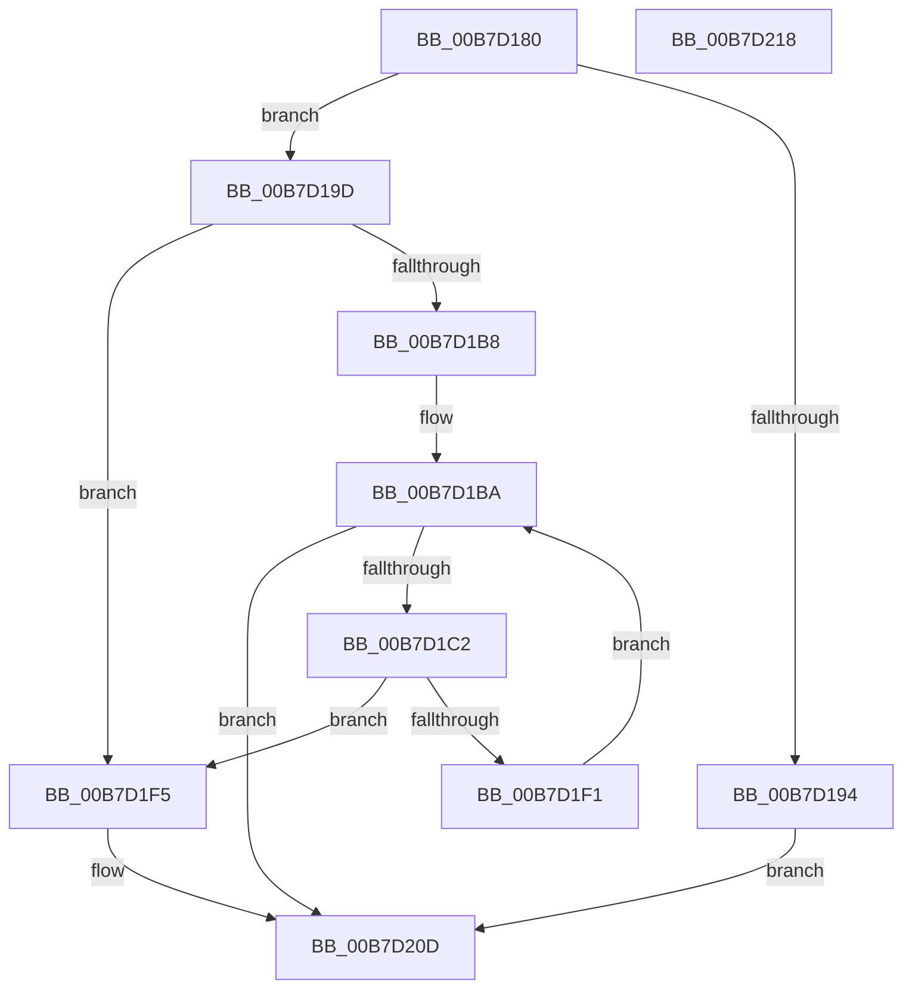

# HalpMapNvsArea

- RVA: `0x00B7D180`–`0x00B7D219` (길이 `153` bytes)
- VA: `0x0000000140B7D180`
- 실행 섹션: `PAGELK`
- PDB 이름 있음: `예`; PDB Function 태그: `아니요`
- unwind 정보 RVA: `0x0005CAAC`
- 디코드: `38`개 명령, `153/153` bytes 표시
- 미해석 바이트: `0` (있으면 어셈블리에 `.byte`로 보존)

> 이 문서는 커널 이미지의 기계어와 PDB 기호를 분석해 생성했습니다. 4번과 5번은 함수 원형과 자료형을 바이너리 사용 방식에서 추정한 C 해석이며 원본 소스 복구 결과는 아닙니다.

## 1. Dependencies

- 직접 호출 지점: **4**; 고유 호출 대상: **4**
- 직접 호출자로 확인된 함수: **1**
- RIP 상대 이미지 참조: **6**

### Outgoing calls
- `0x00B7D1A7` → [HalpMmAllocCtxAlloc](../../text/3E/HalpMmAllocCtxAlloc_function_003E10B8.md) (function, `0x003E10B8`)
- `0x00B7D1DB` → [MmMapIoSpaceEx](../../text/32/MmMapIoSpaceEx_function_00327830.md) (function, `0x00327830`)
- `0x00B7D1FC` → [DbgPrint](../../text/35/DbgPrint_function_00358CB0.md) (function, `0x00358CB0`)
- `0x00B7D208` → [HalpFreeNvsBuffers](HalpFreeNvsBuffers_function_00B7BD18.md) (function, `0x00B7BD18`)

### Direct callers
- [HalpPowerStateCallback](../../text/4B/HalpPowerStateCallback_function_004B8150.md) at `0x004B81C5`

### Static image references
- `0x00B7D18A` → RVA `0x00F90028` (`.data`; read)
- `0x00B7D194` → RVA `0x00E0A834` (`.data`; write)
- `0x00B7D1AC` → RVA `0x00F90158` (`.data`; write)
- `0x00B7D1BA` → RVA `0x00F90018` (`.data`; read)
- `0x00B7D1C2` → RVA `0x00F90168` (`.data`; read)
- `0x00B7D1F5` → RVA `0x00025938` (`.rdata`; read)

## 2. Other-region calls and transfers

- 다른 실행 섹션으로 향하는 call: **3**
  - `0x00B7D1A7` → [HalpMmAllocCtxAlloc](../../text/3E/HalpMmAllocCtxAlloc_function_003E10B8.md) (`PAGELK` → `.text`)
  - `0x00B7D1DB` → [MmMapIoSpaceEx](../../text/32/MmMapIoSpaceEx_function_00327830.md) (`PAGELK` → `.text`)
  - `0x00B7D1FC` → [DbgPrint](../../text/35/DbgPrint_function_00358CB0.md) (`PAGELK` → `.text`)
- 별도 외부 분기/꼬리 이동을 확인하지 못했습니다.

## 3. Assembly (complete function range)

```asm
00B7D180  48 89 5C 24 08                  mov qword ptr [rsp + 8], rbx
00B7D185  57                              push rdi
00B7D186  48 83 EC 20                     sub rsp, 0x20
00B7D18A  8B 05 98 2E 41 00               mov eax, dword ptr [rip + 0x412e98]
00B7D190  85 C0                           test eax, eax
00B7D192  75 09                           jne 0x140b7d19d
00B7D194  C6 05 99 D6 28 00 01            mov byte ptr [rip + 0x28d699], 1
00B7D19B  EB 70                           jmp 0x140b7d20d
00B7D19D  48 8B D0                        mov rdx, rax
00B7D1A0  C6 05 8D D6 28 00 00            mov byte ptr [rip + 0x28d68d], 0
00B7D1A7  E8 0C 3F 86 FF                  call 0x1403e10b8
00B7D1AC  48 89 05 A5 2F 41 00            mov qword ptr [rip + 0x412fa5], rax
00B7D1B3  48 85 C0                        test rax, rax
00B7D1B6  74 3D                           je 0x140b7d1f5
00B7D1B8  33 FF                           xor edi, edi
00B7D1BA  3B 3D 58 2E 41 00               cmp edi, dword ptr [rip + 0x412e58]
00B7D1C0  73 4B                           jae 0x140b7d20d
00B7D1C2  48 8B 0D 9F 2F 41 00            mov rcx, qword ptr [rip + 0x412f9f]
00B7D1C9  48 8D 1C 7F                     lea rbx, [rdi + rdi*2]
00B7D1CD  41 B8 04 02 00 00               mov r8d, 0x204
00B7D1D3  8B 54 D9 08                     mov edx, dword ptr [rcx + rbx*8 + 8]
00B7D1D7  48 8B 0C D9                     mov rcx, qword ptr [rcx + rbx*8]
00B7D1DB  E8 50 A6 7A FF                  call 0x140327830
00B7D1E0  48 8B 0D 81 2F 41 00            mov rcx, qword ptr [rip + 0x412f81]
00B7D1E7  48 89 44 D9 10                  mov qword ptr [rcx + rbx*8 + 0x10], rax
00B7D1EC  48 85 C0                        test rax, rax
00B7D1EF  74 04                           je 0x140b7d1f5
00B7D1F1  FF C7                           inc edi
00B7D1F3  EB C5                           jmp 0x140b7d1ba
00B7D1F5  48 8D 0D 3C 87 4A FF            lea rcx, [rip - 0xb578c4]
00B7D1FC  E8 AF BA 7D FF                  call 0x140358cb0
00B7D201  C6 05 2C D6 28 00 01            mov byte ptr [rip + 0x28d62c], 1
00B7D208  E8 0B EB FF FF                  call 0x140b7bd18
00B7D20D  48 8B 5C 24 30                  mov rbx, qword ptr [rsp + 0x30]
00B7D212  48 83 C4 20                     add rsp, 0x20
00B7D216  5F                              pop rdi
00B7D217  C3                              ret
00B7D218  CC                              int3
```

## 4. C-style interpretation (structured pseudocode)

```c
__int64 __fastcall HalpMapNvsArea(void)
{
    __int64 result;
    __int64 v_rdi;
    __int64 v_rsp;
    unsigned __int64 v_stack_p8;

    v_stack_p8 = v_rbx;
    v_rsp = (v_rsp) - (32);
    if ((unsigned int)((unsigned int)(*(unsigned int *)(v_rip + 4271768))) != 0) goto loc_00B7D19D;
    *(unsigned __int8 *)(v_rip + 2676377) = 1;
    goto loc_00B7D20D;
loc_00B7D19D:
    *(unsigned __int8 *)(v_rip + 2676365) = 0;
    result = HalpMmAllocCtxAlloc(a1, (unsigned int)(*(unsigned int *)(v_rip + 4271768)), a3, a4);
    *(unsigned __int64 *)(v_rip + 4272037) = result;
    if (result == 0) goto loc_00B7D1F5;
    v_rdi = 0;
loc_00B7D1BA:
    if (0 >= (*(unsigned int *)(v_rip + 4271704))) goto loc_00B7D20D;
    result = MmMapIoSpaceEx(*(unsigned __int64 *)(*(unsigned __int64 *)(v_rip + 4272031) + v_rdi + v_rdi * 2 * 8), (unsigned int)(*(unsigned int *)(*(unsigned __int64 *)(v_rip + 4272031) + v_rdi + v_rdi * 2 * 8 + 8)), 516, a4);
    *(unsigned __int64 *)(*(unsigned __int64 *)(v_rip + 4272001) + v_rdi + v_rdi * 2 * 8 + 16) = result;
    if (result == 0) goto loc_00B7D1F5;
    v_rdi = (unsigned int)((v_rdi) + 1);
    goto loc_00B7D1BA;
loc_00B7D1F5:
    result = DbgPrint(v_rip - 11892932, (unsigned int)(*(unsigned int *)(*(unsigned __int64 *)(v_rip + 4272031) + v_rdi + v_rdi * 2 * 8 + 8)), 516, a4);
    *(unsigned __int8 *)(v_rip + 2676268) = 1;
    result = HalpFreeNvsBuffers(v_rip - 11892932, (unsigned int)(*(unsigned int *)(*(unsigned __int64 *)(v_rip + 4272031) + v_rdi + v_rdi * 2 * 8 + 8)), 516, a4);
loc_00B7D20D:
    v_rsp = (v_rsp) + (32);
    return result;
}
```

## 5. (Beta) C Style

```c
void HalpMapNvsArea(void)
{
    int64_t result;
    int64_t local_rdi;
    int64_t local_rsp;
    uint64_t v_stack_p8;

    v_stack_p8 = local_rbx;
    local_rsp = (local_rsp) - (32);
    if ((uint32_t)((uint32_t)(*(uint32_t *)(v_rip + 0x412E98))) != 0) goto loc_00B7D19D;
    *(uint8_t *)(v_rip + 0x28D699) = 1;
    goto loc_00B7D20D;
loc_00B7D19D:
    *(uint8_t *)(v_rip + 0x28D68D) = 0;
    result = HalpMmAllocCtxAlloc(a1, (uint32_t)(*(uint32_t *)(v_rip + 0x412E98)), a3, a4);
    *(uint64_t *)(v_rip + 0x412FA5) = result;
    if (result == 0) goto loc_00B7D1F5;
    local_rdi = 0;
loc_00B7D1BA:
    if (0 >= (*(uint32_t *)(v_rip + 0x412E58))) goto loc_00B7D20D;
    result = MmMapIoSpaceEx(*(uint64_t *)(*(uint64_t *)(v_rip + 0x412F9F) + local_rdi + local_rdi * 2 * 8), (uint32_t)(*(uint32_t *)(*(uint64_t *)(v_rip + 0x412F9F) + local_rdi + local_rdi * 2 * 8 + 0x8)), 516, a4);
    *(uint64_t *)(*(uint64_t *)(v_rip + 0x412F81) + local_rdi + local_rdi * 2 * 8 + 0x10) = result;
    if (result == 0) goto loc_00B7D1F5;
    local_rdi = (uint32_t)((local_rdi) + 1);
    goto loc_00B7D1BA;
loc_00B7D1F5:
    result = DbgPrint(v_rip - 11892932, (uint32_t)(*(uint32_t *)(*(uint64_t *)(v_rip + 0x412F9F) + local_rdi + local_rdi * 2 * 8 + 0x8)), 516, a4);
    *(uint8_t *)(v_rip + 0x28D62C) = 1;
    result = HalpFreeNvsBuffers(v_rip - 11892932, (uint32_t)(*(uint32_t *)(*(uint64_t *)(v_rip + 0x412F9F) + local_rdi + local_rdi * 2 * 8 + 0x8)), 516, a4);
loc_00B7D20D:
    local_rsp = (local_rsp) + (32);
    return result;
}
```

## 6. Execution-region graph

[열기: 2D/3D 그래프와 함수 탐색 컨트롤 패널](../../../control-panel.html?section=pagelk&rva=0x00B7D180&view=graph)

- 2D 그래프는 위에서 아래로 흐르고, 3D 그래프는 빈 공간을 드래그해 회전합니다. Shift+드래그는 이동, 휠은 확대·축소, 함수 노드 선택은 대상 보고서 이동입니다.

### Static fallback


