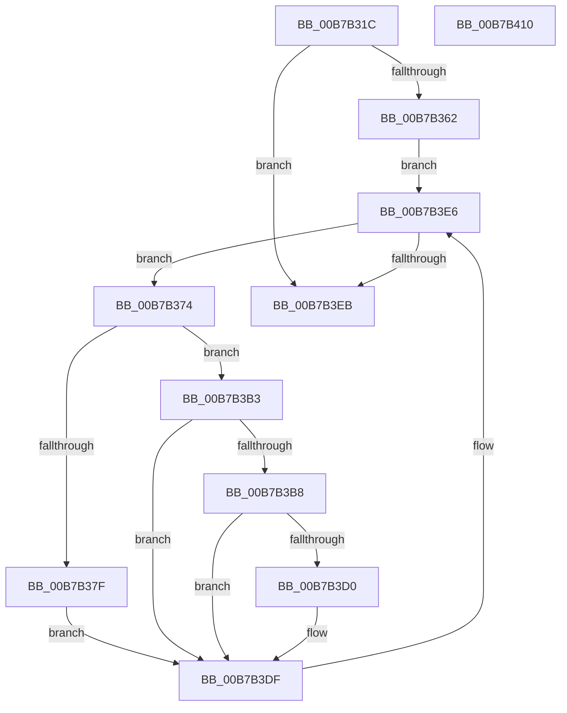

# HalpMcaResumeProcessorConfig

- RVA: `0x00B7B31C`–`0x00B7B411` (길이 `245` bytes)
- VA: `0x0000000140B7B31C`
- 실행 섹션: `PAGELK`
- PDB 이름 있음: `예`; PDB Function 태그: `아니요`
- unwind 정보 RVA: `0x000B9880`
- 디코드: `57`개 명령, `245/245` bytes 표시
- 미해석 바이트: `0` (있으면 어셈블리에 `.byte`로 보존)

> 이 문서는 커널 이미지의 기계어와 PDB 기호를 분석해 생성했습니다. 4번과 5번은 함수 원형과 자료형을 바이너리 사용 방식에서 추정한 C 해석이며 원본 소스 복구 결과는 아닙니다.

## 1. Dependencies

- 직접 호출 지점: **8**; 고유 호출 대상: **6**
- 직접 호출자로 확인된 함수: **2**
- RIP 상대 이미지 참조: **5**

### Outgoing calls
- `0x00B7B34F` → [memset](../../text/6C/memset_function_006C6C40.md) (function, `0x006C6C40`)
- `0x00B7B38C` → [memset](../../text/6C/memset_function_006C6C40.md) (function, `0x006C6C40`)
- `0x00B7B398` → `PSHED.dll!PshedGetErrorSourceInfo` (import, 간접 대상; import `PSHED.dll!PshedGetErrorSourceInfo`)
- `0x00B7B3AC` → [HalpMcaSetProcessorConfig](HalpMcaSetProcessorConfig_function_00B7B418.md) (function, `0x00B7B418`)
- `0x00B7B3C2` → [HalpMcaSetProcessorConfig](HalpMcaSetProcessorConfig_function_00B7B418.md) (function, `0x00B7B418`)
- `0x00B7B3C7` → [HalpIsCmciImplemented](../B5/HalpIsCmciImplemented_function_00B5C314.md) (function, `0x00B5C314`)
- `0x00B7B3DA` → [HalpCmciInitProcessor](../../text/48/HalpCmciInitProcessor_function_004875E4.md) (function, `0x004875E4`)
- `0x00B7B3F6` → [_security_check_cookie](../../text/6A/_security_check_cookie_function_006AC640.md) (function, `0x006AC640`)

### Direct callers
- [HalpPostSleepMP](../B5/HalpPostSleepMP_function_00B5ECC4.md) at `0x00B5ED1B`
- [HalpPostSleepMP](../B5/HalpPostSleepMP_function_00B5ECC4.md) at `0x00B5EE69`
- [HalpDpPostReplaceInitialization](../B5/HalpDpPostReplaceInitialization_function_00B5FE3C.md) at `0x00B5FE95`

### Static image references
- `0x00B7B32E` → RVA `0x00E0A740` (`.data`; read)
- `0x00B7B354` → RVA `0x00FC1C44` (`.data`; read)
- `0x00B7B398` → RVA `0x00151148` (`PSHED.dll!PshedGetErrorSourceInfo (IAT)`; read)
- `0x00B7B3B8` → RVA `0x00E0F6F0` (`.data`; read)
- `0x00B7B3D0` → RVA `0x00E0F6C8` (`.data`; read)

## 2. Other-region calls and transfers

- 다른 실행 섹션으로 향하는 call: **4**
  - `0x00B7B34F` → [memset](../../text/6C/memset_function_006C6C40.md) (`PAGELK` → `.text`)
  - `0x00B7B38C` → [memset](../../text/6C/memset_function_006C6C40.md) (`PAGELK` → `.text`)
  - `0x00B7B3DA` → [HalpCmciInitProcessor](../../text/48/HalpCmciInitProcessor_function_004875E4.md) (`PAGELK` → `.text`)
  - `0x00B7B3F6` → [_security_check_cookie](../../text/6A/_security_check_cookie_function_006AC640.md) (`PAGELK` → `.text`)
- 별도 외부 분기/꼬리 이동을 확인하지 못했습니다.

## 3. Assembly (complete function range)

```asm
00B7B31C  48 89 5C 24 08                  mov qword ptr [rsp + 8], rbx
00B7B321  48 89 74 24 10                  mov qword ptr [rsp + 0x10], rsi
00B7B326  57                              push rdi
00B7B327  48 81 EC 00 04 00 00            sub rsp, 0x400
00B7B32E  48 8B 05 0B F4 28 00            mov rax, qword ptr [rip + 0x28f40b]
00B7B335  48 33 C4                        xor rax, rsp
00B7B338  48 89 84 24 F0 03 00 00         mov qword ptr [rsp + 0x3f0], rax
00B7B340  8B F1                           mov esi, ecx
00B7B342  33 D2                           xor edx, edx
00B7B344  48 8D 4C 24 20                  lea rcx, [rsp + 0x20]
00B7B349  41 B8 CC 03 00 00               mov r8d, 0x3cc
00B7B34F  E8 EC B8 B4 FF                  call 0x1406c6c40
00B7B354  8B 05 EA 68 44 00               mov eax, dword ptr [rip + 0x4468ea]
00B7B35A  A8 0C                           test al, 0xc
00B7B35C  0F 84 89 00 00 00               je 0x140b7b3eb
00B7B362  65 48 8B 04 25 18 00 00 00      mov rax, qword ptr gs:[0x18]
00B7B36B  48 8B B8 D8 00 00 00            mov rdi, qword ptr [rax + 0xd8]
00B7B372  EB 72                           jmp 0x140b7b3e6
00B7B374  48 8B 9F AC 00 00 00            mov rbx, qword ptr [rdi + 0xac]
00B7B37B  85 F6                           test esi, esi
00B7B37D  75 34                           jne 0x140b7b3b3
00B7B37F  33 D2                           xor edx, edx
00B7B381  48 8D 4C 24 20                  lea rcx, [rsp + 0x20]
00B7B386  41 B8 CC 03 00 00               mov r8d, 0x3cc
00B7B38C  E8 AF B8 B4 FF                  call 0x1406c6c40
00B7B391  48 8D 54 24 20                  lea rdx, [rsp + 0x20]
00B7B396  33 C9                           xor ecx, ecx
00B7B398  48 FF 15 A9 5D 5D FF            call qword ptr [rip - 0xa2a257]
00B7B39F  0F 1F 44 00 00                  nop dword ptr [rax + rax]
00B7B3A4  48 8B D3                        mov rdx, rbx
00B7B3A7  48 8D 4C 24 20                  lea rcx, [rsp + 0x20]
00B7B3AC  E8 67 00 00 00                  call 0x140b7b418
00B7B3B1  EB 2C                           jmp 0x140b7b3df
00B7B3B3  83 FE 01                        cmp esi, 1
00B7B3B6  75 27                           jne 0x140b7b3df
00B7B3B8  48 8B 0D 31 43 29 00            mov rcx, qword ptr [rip + 0x294331]
00B7B3BF  48 8B D3                        mov rdx, rbx
00B7B3C2  E8 51 00 00 00                  call 0x140b7b418
00B7B3C7  E8 48 0F FE FF                  call 0x140b5c314
00B7B3CC  84 C0                           test al, al
00B7B3CE  74 0F                           je 0x140b7b3df
00B7B3D0  48 8B 0D F1 42 29 00            mov rcx, qword ptr [rip + 0x2942f1]
00B7B3D7  48 8B D3                        mov rdx, rbx
00B7B3DA  E8 05 C2 90 FF                  call 0x1404875e4
00B7B3DF  48 8B BF B8 00 00 00            mov rdi, qword ptr [rdi + 0xb8]
00B7B3E6  48 85 FF                        test rdi, rdi
00B7B3E9  75 89                           jne 0x140b7b374
00B7B3EB  48 8B 8C 24 F0 03 00 00         mov rcx, qword ptr [rsp + 0x3f0]
00B7B3F3  48 33 CC                        xor rcx, rsp
00B7B3F6  E8 45 12 B3 FF                  call 0x1406ac640
00B7B3FB  4C 8D 9C 24 00 04 00 00         lea r11, [rsp + 0x400]
00B7B403  49 8B 5B 10                     mov rbx, qword ptr [r11 + 0x10]
00B7B407  49 8B 73 18                     mov rsi, qword ptr [r11 + 0x18]
00B7B40B  49 8B E3                        mov rsp, r11
00B7B40E  5F                              pop rdi
00B7B40F  C3                              ret
00B7B410  CC                              int3
```

## 4. C-style interpretation (structured pseudocode)

```c
__int64 __fastcall HalpMcaResumeProcessorConfig(int a1, int a2)
{
    __int64 result;
    __int64 v_rsp;
    unsigned __int64 v_stack_m18;
    unsigned __int64 v_stack_m3E8;
    unsigned __int64 v_stack_m8;
    unsigned __int64 v_stack_p10;
    unsigned __int64 v_stack_p8;

    v_stack_p8 = v_rbx;
    v_stack_p10 = v_rsi;
    v_rsp = (v_rsp) - (0x400ULL);
    result = (*(unsigned __int64 *)(v_rip + 2683915)) ^ (v_rsp);
    v_stack_m18 = result;
    a2 = 0;
    result = memset(v_stack_m3E8, a2, 972, a4);
    if ((((unsigned __int8)((unsigned int)(*(unsigned int *)(v_rip + 4483306)))) & (12)) == 0) goto loc_00B7B3EB;
    goto loc_00B7B3E6;
loc_00B7B374:
    if ((unsigned int)((unsigned int)(a1)) != 0) goto loc_00B7B3B3;
    a2 = 0;
    result = memset(v_stack_m3E8, a2, 972, a4);
    a1 = 0;
    result = PSHED_dll_PshedGetErrorSourceInfo(a1, v_stack_m3E8, 972, a4);
    result = HalpMcaSetProcessorConfig(v_stack_m3E8, *(unsigned __int64 *)(*(unsigned __int64 *)(*(unsigned __int64 *)(gs_base + (0 + 24)) + 216) + 172), 972, a4);
    goto loc_00B7B3DF;
loc_00B7B3B3:
    if (((unsigned int)((unsigned int)(a1))) != 1) goto loc_00B7B3DF;
    result = HalpMcaSetProcessorConfig(*(unsigned __int64 *)(v_rip + 2704177), *(unsigned __int64 *)(*(unsigned __int64 *)(*(unsigned __int64 *)(gs_base + (0 + 24)) + 216) + 172), 972, a4);
    result = HalpIsCmciImplemented(*(unsigned __int64 *)(v_rip + 2704177), *(unsigned __int64 *)(*(unsigned __int64 *)(*(unsigned __int64 *)(gs_base + (0 + 24)) + 216) + 172), 972, a4);
    if ((unsigned __int8)(result) != 0) {
        a1 = *(unsigned __int64 *)(v_rip + 2704113);
        a2 = *(unsigned __int64 *)(*(unsigned __int64 *)(*(unsigned __int64 *)(gs_base + (0 + 24)) + 216) + 172);
        result = HalpCmciInitProcessor(a1, a2, 972, a4);
    }
loc_00B7B3E6:
    if (*(unsigned __int64 *)(*(unsigned __int64 *)(*(unsigned __int64 *)(gs_base + (0 + 24)) + 216) + 184) != 0) goto loc_00B7B374;
loc_00B7B3EB:
    a1 = (v_stack_m18) ^ (v_rsp);
    result = _security_check_cookie(a1, a2, 972, a4);
    return result;
}
```

## 5. (Beta) C Style

```c
int64_t HalpMcaResumeProcessorConfig(int32_t Arg1, int32_t Arg2)
{
    int64_t result;
    int64_t local_rsp;
    uint64_t v_stack_m18;
    uint64_t v_stack_m3E8;
    uint64_t v_stack_m8;
    uint64_t v_stack_p10;
    uint64_t v_stack_p8;

    v_stack_p8 = local_rbx;
    v_stack_p10 = local_rsi;
    local_rsp = (local_rsp) - (0x400ULL);
    result = (*(uint64_t *)(v_rip + 0x28F40B)) ^ (local_rsp);
    v_stack_m18 = result;
    Arg2 = 0;
    result = memset(v_stack_m3E8, Arg2, 972, a4);
    if ((((uint8_t)((uint32_t)(*(uint32_t *)(v_rip + 0x4468EA)))) & (12)) == 0) goto loc_00B7B3EB;
    goto loc_00B7B3E6;
loc_00B7B374:
    if ((uint32_t)((uint32_t)(Arg1)) != 0) goto loc_00B7B3B3;
    Arg2 = 0;
    result = memset(v_stack_m3E8, Arg2, 972, a4);
    Arg1 = 0;
    result = kernel_indirect_call(Arg1, v_stack_m3E8, 972, a4);
    result = HalpMcaSetProcessorConfig(v_stack_m3E8, *(uint64_t *)(*(uint64_t *)(*(uint64_t *)(gs_base + (0 + 0x18)) + 0xD8) + 0xAC), 972, a4);
    goto loc_00B7B3DF;
loc_00B7B3B3:
    if (((uint32_t)((uint32_t)(Arg1))) != 1) goto loc_00B7B3DF;
    result = HalpMcaSetProcessorConfig(*(uint64_t *)(v_rip + 0x294331), *(uint64_t *)(*(uint64_t *)(*(uint64_t *)(gs_base + (0 + 0x18)) + 0xD8) + 0xAC), 972, a4);
    result = HalpIsCmciImplemented(*(uint64_t *)(v_rip + 0x294331), *(uint64_t *)(*(uint64_t *)(*(uint64_t *)(gs_base + (0 + 0x18)) + 0xD8) + 0xAC), 972, a4);
    if ((uint8_t)(result) != 0) {
        Arg1 = *(uint64_t *)(v_rip + 0x2942F1);
        Arg2 = *(uint64_t *)(*(uint64_t *)(*(uint64_t *)(gs_base + (0 + 0x18)) + 0xD8) + 0xAC);
        result = HalpCmciInitProcessor(Arg1, Arg2, 972, a4);
    }
loc_00B7B3E6:
    if (*(uint64_t *)(*(uint64_t *)(*(uint64_t *)(gs_base + (0 + 0x18)) + 0xD8) + 0xB8) != 0) goto loc_00B7B374;
loc_00B7B3EB:
    Arg1 = (v_stack_m18) ^ (local_rsp);
    result = _security_check_cookie(Arg1, Arg2, 972, a4);
    return result;
}
```

## 6. Execution-region graph

[열기: 2D/3D 그래프와 함수 탐색 컨트롤 패널](../../../control-panel.html?section=pagelk&rva=0x00B7B31C&view=graph)

- 2D 그래프는 위에서 아래로 흐르고, 3D 그래프는 빈 공간을 드래그해 회전합니다. Shift+드래그는 이동, 휠은 확대·축소, 함수 노드 선택은 대상 보고서 이동입니다.

### Static fallback


