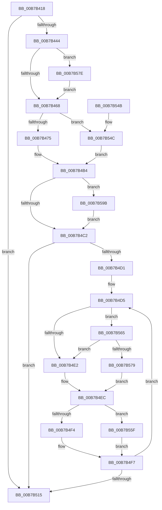

# HalpMcaSetProcessorConfig

- RVA: `0x00B7B418`–`0x00B7B5B1` (길이 `409` bytes)
- VA: `0x0000000140B7B418`
- 실행 섹션: `PAGELK`
- PDB 이름 있음: `예`; PDB Function 태그: `아니요`
- unwind 정보 RVA: `0x000B98A0`
- 디코드: `106`개 명령, `409/409` bytes 표시
- 미해석 바이트: `0` (있으면 어셈블리에 `.byte`로 보존)

> 이 문서는 커널 이미지의 기계어와 PDB 기호를 분석해 생성했습니다. 4번과 5번은 함수 원형과 자료형을 바이너리 사용 방식에서 추정한 C 해석이며 원본 소스 복구 결과는 아닙니다.

## 1. Dependencies

- 직접 호출 지점: **9**; 고유 호출 대상: **6**
- 직접 호출자로 확인된 함수: **2**
- RIP 상대 이미지 참조: **12**

### Outgoing calls
- `0x00B7B458` → [guard_dispatch_icall](../../text/6B/guard_dispatch_icall_function_006BAAD0.md) (function, `0x006BAAD0`)
- `0x00B7B468` → [HalpIsLmceSupported](../../text/4F/HalpIsLmceSupported_function_004FBD7C.md) (function, `0x004FBD7C`)
- `0x00B7B497` → [guard_dispatch_icall](../../text/6B/guard_dispatch_icall_function_006BAAD0.md) (function, `0x006BAAD0`)
- `0x00B7B4AF` → [guard_dispatch_icall](../../text/6B/guard_dispatch_icall_function_006BAAD0.md) (function, `0x006BAAD0`)
- `0x00B7B4E7` → [HalpWheaWriteMsrStatus](../../text/48/HalpWheaWriteMsrStatus_function_004874C0.md) (function, `0x004874C0`)
- `0x00B7B4FC` → [HalpWheaWriteMsrControl](../../text/48/HalpWheaWriteMsrControl_function_0048750C.md) (function, `0x0048750C`)
- `0x00B7B506` → [HalpMcaProcessorBankConfig](../../text/48/HalpMcaProcessorBankConfig_function_004872BC.md) (function, `0x004872BC`)
- `0x00B7B565` → `PSHED.dll!PshedIsSystemWheaEnabled` (import, 간접 대상; import `PSHED.dll!PshedIsSystemWheaEnabled`)
- `0x00B7B591` → [guard_dispatch_icall](../../text/6B/guard_dispatch_icall_function_006BAAD0.md) (function, `0x006BAAD0`)

### Direct callers
- [HalpMceInitProcessor](HalpMceInitProcessor_function_00B7B298.md) at `0x00B7B2E0`
- [HalpMcaResumeProcessorConfig](HalpMcaResumeProcessorConfig_function_00B7B31C.md) at `0x00B7B3AC`
- [HalpMcaResumeProcessorConfig](HalpMcaResumeProcessorConfig_function_00B7B31C.md) at `0x00B7B3C2`

### Static image references
- `0x00B7B430` → RVA `0x00E0A769` (`.data`; read)
- `0x00B7B444` → RVA `0x00FC1990` (`.data`; read)
- `0x00B7B475` → RVA `0x00E100D0` (`.data`; read)
- `0x00B7B485` → RVA `0x00E100D0` (`.data`; write)
- `0x00B7B4A8` → RVA `0x00FC1980` (`.data`; read)
- `0x00B7B4B4` → RVA `0x00E100E0` (`.data`; read)
- `0x00B7B4D5` → RVA `0x00E0F6B0` (`.data`; read)
- `0x00B7B515` → RVA `0x00E0A768` (`.data`; read)
- `0x00B7B54C` → RVA `0x00E0F6D4` (`.data`; read)
- `0x00B7B554` → RVA `0x00E0F6D4` (`.data`; write)
- `0x00B7B565` → RVA `0x00151130` (`PSHED.dll!PshedIsSystemWheaEnabled (IAT)`; read)
- `0x00B7B5A6` → RVA `0x00E100E0` (`.data`; write)

## 2. Other-region calls and transfers

- 다른 실행 섹션으로 향하는 call: **8**
  - `0x00B7B458` → [guard_dispatch_icall](../../text/6B/guard_dispatch_icall_function_006BAAD0.md) (`PAGELK` → `.text`)
  - `0x00B7B468` → [HalpIsLmceSupported](../../text/4F/HalpIsLmceSupported_function_004FBD7C.md) (`PAGELK` → `.text`)
  - `0x00B7B497` → [guard_dispatch_icall](../../text/6B/guard_dispatch_icall_function_006BAAD0.md) (`PAGELK` → `.text`)
  - `0x00B7B4AF` → [guard_dispatch_icall](../../text/6B/guard_dispatch_icall_function_006BAAD0.md) (`PAGELK` → `.text`)
  - `0x00B7B4E7` → [HalpWheaWriteMsrStatus](../../text/48/HalpWheaWriteMsrStatus_function_004874C0.md) (`PAGELK` → `.text`)
  - `0x00B7B4FC` → [HalpWheaWriteMsrControl](../../text/48/HalpWheaWriteMsrControl_function_0048750C.md) (`PAGELK` → `.text`)
  - `0x00B7B506` → [HalpMcaProcessorBankConfig](../../text/48/HalpMcaProcessorBankConfig_function_004872BC.md) (`PAGELK` → `.text`)
  - `0x00B7B591` → [guard_dispatch_icall](../../text/6B/guard_dispatch_icall_function_006BAAD0.md) (`PAGELK` → `.text`)
- 별도 외부 분기/꼬리 이동을 확인하지 못했습니다.

## 3. Assembly (complete function range)

```asm
00B7B418  48 89 5C 24 08                  mov qword ptr [rsp + 8], rbx
00B7B41D  48 89 6C 24 10                  mov qword ptr [rsp + 0x10], rbp
00B7B422  48 89 74 24 18                  mov qword ptr [rsp + 0x18], rsi
00B7B427  57                              push rdi
00B7B428  41 56                           push r14
00B7B42A  41 57                           push r15
00B7B42C  48 83 EC 20                     sub rsp, 0x20
00B7B430  8A 05 33 F3 28 00               mov al, byte ptr [rip + 0x28f333]
00B7B436  48 8B DA                        mov rbx, rdx
00B7B439  48 8B E9                        mov rbp, rcx
00B7B43C  84 C0                           test al, al
00B7B43E  0F 84 D1 00 00 00               je 0x140b7b515
00B7B444  48 8B 05 45 65 44 00            mov rax, qword ptr [rip + 0x446545]
00B7B44B  BE 79 01 00 00                  mov esi, 0x179
00B7B450  8B D6                           mov edx, esi
00B7B452  45 33 C0                        xor r8d, r8d
00B7B455  48 8B CB                        mov rcx, rbx
00B7B458  E8 73 F6 B3 FF                  call 0x1406baad0
00B7B45D  48 0F BA E0 08                  bt rax, 8
00B7B462  0F 82 16 01 00 00               jb 0x140b7b57e
00B7B468  E8 0F 09 98 FF                  call 0x1404fbd7c
00B7B46D  84 C0                           test al, al
00B7B46F  0F 84 D7 00 00 00               je 0x140b7b54c
00B7B475  8B 05 55 4C 29 00               mov eax, dword ptr [rip + 0x294c55]
00B7B47B  BF D0 04 00 00                  mov edi, 0x4d0
00B7B480  FF C0                           inc eax
00B7B482  45 33 C0                        xor r8d, r8d
00B7B485  89 05 45 4C 29 00               mov dword ptr [rip + 0x294c45], eax
00B7B48B  8B D7                           mov edx, edi
00B7B48D  48 8B 05 FC 64 44 00            mov rax, qword ptr [rip + 0x4464fc]
00B7B494  48 8B CB                        mov rcx, rbx
00B7B497  E8 34 F6 B3 FF                  call 0x1406baad0
00B7B49C  48 83 C8 01                     or rax, 1
00B7B4A0  8B D7                           mov edx, edi
00B7B4A2  4C 8B C0                        mov r8, rax
00B7B4A5  48 8B CB                        mov rcx, rbx
00B7B4A8  48 8B 05 D1 64 44 00            mov rax, qword ptr [rip + 0x4464d1]
00B7B4AF  E8 1C F6 B3 FF                  call 0x1406baad0
00B7B4B4  8A 05 26 4C 29 00               mov al, byte ptr [rip + 0x294c26]
00B7B4BA  84 C0                           test al, al
00B7B4BC  0F 84 D9 00 00 00               je 0x140b7b59b
00B7B4C2  8A 05 18 4C 29 00               mov al, byte ptr [rip + 0x294c18]
00B7B4C8  33 FF                           xor edi, edi
00B7B4CA  0F B6 F0                        movzx esi, al
00B7B4CD  84 C0                           test al, al
00B7B4CF  74 44                           je 0x140b7b515
00B7B4D1  4C 8D 75 54                     lea r14, [rbp + 0x54]
00B7B4D5  80 3D D4 41 29 00 00            cmp byte ptr [rip + 0x2941d4], 0
00B7B4DC  0F 85 83 00 00 00               jne 0x140b7b565
00B7B4E2  8B D7                           mov edx, edi
00B7B4E4  48 8B CB                        mov rcx, rbx
00B7B4E7  E8 D4 BF 90 FF                  call 0x1404874c0
00B7B4EC  0F B6 45 2B                     movzx eax, byte ptr [rbp + 0x2b]
00B7B4F0  3B F0                           cmp esi, eax
00B7B4F2  77 6B                           ja 0x140b7b55f
00B7B4F4  4D 8B 06                        mov r8, qword ptr [r14]
00B7B4F7  8B D7                           mov edx, edi
00B7B4F9  48 8B CB                        mov rcx, rbx
00B7B4FC  E8 0B C0 90 FF                  call 0x14048750c
00B7B501  8B D7                           mov edx, edi
00B7B503  48 8B CB                        mov rcx, rbx
00B7B506  E8 B1 BD 90 FF                  call 0x1404872bc
00B7B50B  FF C7                           inc edi
00B7B50D  49 83 C6 1C                     add r14, 0x1c
00B7B511  3B FE                           cmp edi, esi
00B7B513  72 C0                           jb 0x140b7b4d5
00B7B515  8A 0D 4D F2 28 00               mov cl, byte ptr [rip + 0x28f24d]
00B7B51B  0F 20 E2                        mov rdx, cr4
00B7B51E  48 8B C2                        mov rax, rdx
00B7B521  48 83 CA 40                     or rdx, 0x40
00B7B525  48 83 F0 40                     xor rax, 0x40
00B7B529  84 C9                           test cl, cl
00B7B52B  48 0F 44 D0                     cmove rdx, rax
00B7B52F  0F 22 E2                        mov cr4, rdx
00B7B532  48 8B 5C 24 40                  mov rbx, qword ptr [rsp + 0x40]
00B7B537  48 8B 6C 24 48                  mov rbp, qword ptr [rsp + 0x48]
00B7B53C  48 8B 74 24 50                  mov rsi, qword ptr [rsp + 0x50]
00B7B541  48 83 C4 20                     add rsp, 0x20
00B7B545  41 5F                           pop r15
00B7B547  41 5E                           pop r14
00B7B549  5F                              pop rdi
00B7B54A  C3                              ret
00B7B54B  CC                              int3
00B7B54C  8B 05 82 41 29 00               mov eax, dword ptr [rip + 0x294182]
00B7B552  FF C0                           inc eax
00B7B554  89 05 7A 41 29 00               mov dword ptr [rip + 0x29417a], eax
00B7B55A  E9 55 FF FF FF                  jmp 0x140b7b4b4
00B7B55F  4C 8B 45 54                     mov r8, qword ptr [rbp + 0x54]
00B7B563  EB 92                           jmp 0x140b7b4f7
00B7B565  48 FF 15 C4 5B 5D FF            call qword ptr [rip - 0xa2a43c]
00B7B56C  0F 1F 44 00 00                  nop dword ptr [rax + rax]
00B7B571  84 C0                           test al, al
00B7B573  0F 85 69 FF FF FF               jne 0x140b7b4e2
00B7B579  E9 6E FF FF FF                  jmp 0x140b7b4ec
00B7B57E  48 8B 05 FB 63 44 00            mov rax, qword ptr [rip + 0x4463fb]
00B7B585  BA 7B 01 00 00                  mov edx, 0x17b
00B7B58A  4C 8B 45 38                     mov r8, qword ptr [rbp + 0x38]
00B7B58E  48 8B CB                        mov rcx, rbx
00B7B591  E8 3A F5 B3 FF                  call 0x1406baad0
00B7B596  E9 CD FE FF FF                  jmp 0x140b7b468
00B7B59B  8B CE                           mov ecx, esi
00B7B59D  0F 32                           rdmsr
00B7B59F  48 C1 E2 20                     shl rdx, 0x20
00B7B5A3  48 0B C2                        or rax, rdx
00B7B5A6  88 05 34 4B 29 00               mov byte ptr [rip + 0x294b34], al
00B7B5AC  E9 11 FF FF FF                  jmp 0x140b7b4c2
```

## 4. C-style interpretation (structured pseudocode)

```c
__int64 __fastcall HalpMcaSetProcessorConfig(__int64 a1, __int64 a2, int a3)
{
    __int64 result;
    __int64 v_r14;
    __int64 v_rdi;
    __int64 v_rsp;
    unsigned __int64 v_stack_p10;
    unsigned __int64 v_stack_p18;
    unsigned __int64 v_stack_p8;

    v_stack_p8 = v_rbx;
    v_stack_p10 = v_rbp;
    v_stack_p18 = v_rsi;
    v_rsp = (v_rsp) - (32);
    if ((unsigned __int8)(*(unsigned __int8 *)(v_rip + 2683699)) == 0) goto loc_00B7B515;
    a3 = 0;
    result = guard_dispatch_icall(a2, 377, a3, a4);
    if (condition_is_below) goto loc_00B7B57E;
loc_00B7B468:
    result = HalpIsLmceSupported(a2, 377, a3, a4);
    if ((unsigned __int8)(result) == 0) goto loc_00B7B54C;
    result = (unsigned int)(((unsigned int)(*(unsigned int *)(v_rip + 2706517))) + 1);
    a3 = 0;
    *(unsigned int *)(v_rip + 2706501) = (unsigned int)(result);
    result = guard_dispatch_icall(a2, (unsigned int)((unsigned int)((unsigned int)(0x4D0ULL))), a3, a4);
    result = (result) | (1);
    result = guard_dispatch_icall(a2, (unsigned int)((unsigned int)((unsigned int)(0x4D0ULL))), result, a4);
loc_00B7B4B4:
    if ((unsigned __int8)(*(unsigned __int8 *)(v_rip + 2706470)) == 0) goto loc_00B7B59B;
loc_00B7B4C2:
    v_rdi = 0;
    if ((unsigned __int8)(*(unsigned __int8 *)(v_rip + 2706456)) == 0) goto loc_00B7B515;
loc_00B7B4D5:
    if ((*(unsigned __int8 *)(v_rip + 2703828)) != 0) goto loc_00B7B565;
loc_00B7B4E2:
    result = HalpWheaWriteMsrStatus(a2, 0, result, a4);
loc_00B7B4EC:
    if (((unsigned int)((unsigned __int8)(*(unsigned __int8 *)(v_rip + 2706456)))) > ((unsigned int)(*(unsigned __int8 *)(a1 + 43)))) goto loc_00B7B55F;
loc_00B7B4F7:
    result = HalpWheaWriteMsrControl(a2, 0, *(unsigned __int64 *)(a1 + 84), a4);
    result = HalpMcaProcessorBankConfig(a2, 0, *(unsigned __int64 *)(a1 + 84), a4);
    v_rdi = (unsigned int)((v_rdi) + 1);
    v_r14 = (a1 + 84) + (28);
    if (((unsigned int)(v_rdi)) < ((unsigned int)((unsigned __int8)(*(unsigned __int8 *)(v_rip + 2706456))))) goto loc_00B7B4D5;
loc_00B7B515:
    a2 = (v_cr4) | (64);
    result = (v_cr4) ^ (64);
    if ((unsigned __int8)(*(unsigned __int8 *)(v_rip + 2683469)) == 0) { a2 = result; }
    v_rsp = (v_rsp) + (32);
    return result;
loc_00B7B54C:
    result = (unsigned int)(((unsigned int)(*(unsigned int *)(v_rip + 2703746))) + 1);
    *(unsigned int *)(v_rip + 2703738) = (unsigned int)(result);
    goto loc_00B7B4B4;
loc_00B7B55F:
    goto loc_00B7B4F7;
loc_00B7B565:
    result = PSHED_dll_PshedIsSystemWheaEnabled(*(unsigned __int8 *)(v_rip + 2683469), a2, *(unsigned __int64 *)(v_stack_p10 + 84), a4);
    if ((unsigned __int8)(result) != 0) goto loc_00B7B4E2;
    goto loc_00B7B4EC;
loc_00B7B57E:
    result = guard_dispatch_icall(v_stack_p8, 379, *(unsigned __int64 *)(v_stack_p10 + 56), a4);
    goto loc_00B7B468;
loc_00B7B59B:
    a2 = (379) << (32);
    result = (result) | (a2);
    *(unsigned __int8 *)(v_rip + 2706228) = (unsigned __int8)(result);
    goto loc_00B7B4C2;
}
```

## 5. (Beta) C Style

```c
int64_t HalpMcaSetProcessorConfig(void *Arg1, int64_t Arg2, int32_t Arg3)
{
    uint8_t *arg1 = (uint8_t *)Arg1;

    int64_t result;
    int64_t local_r14;
    int64_t local_rdi;
    int64_t local_rsp;
    uint64_t v_stack_p10;
    uint64_t v_stack_p18;
    uint64_t v_stack_p8;

    v_stack_p8 = local_rbx;
    v_stack_p10 = local_rbp;
    v_stack_p18 = local_rsi;
    local_rsp = (local_rsp) - (32);
    if ((uint8_t)(*(uint8_t *)(v_rip + 0x28F333)) == 0) goto loc_00B7B515;
    Arg3 = 0;
    result = guard_dispatch_icall(Arg2, 377, Arg3, a4);
    if (condition_is_below) goto loc_00B7B57E;
loc_00B7B468:
    result = HalpIsLmceSupported(Arg2, 377, Arg3, a4);
    if ((uint8_t)(result) == 0) goto loc_00B7B54C;
    result = (uint32_t)(((uint32_t)(*(uint32_t *)(v_rip + 0x294C55))) + 1);
    Arg3 = 0;
    *(uint32_t *)(v_rip + 0x294C45) = (uint32_t)(result);
    result = guard_dispatch_icall(Arg2, (uint32_t)((uint32_t)((uint32_t)(0x4D0ULL))), Arg3, a4);
    result = (result) | (1);
    result = guard_dispatch_icall(Arg2, (uint32_t)((uint32_t)((uint32_t)(0x4D0ULL))), result, a4);
loc_00B7B4B4:
    if ((uint8_t)(*(uint8_t *)(v_rip + 0x294C26)) == 0) goto loc_00B7B59B;
loc_00B7B4C2:
    local_rdi = 0;
    if ((uint8_t)(*(uint8_t *)(v_rip + 0x294C18)) == 0) goto loc_00B7B515;
loc_00B7B4D5:
    if ((*(uint8_t *)(v_rip + 0x2941D4)) != 0) goto loc_00B7B565;
loc_00B7B4E2:
    result = HalpWheaWriteMsrStatus(Arg2, 0, result, a4);
loc_00B7B4EC:
    if (((uint32_t)((uint8_t)(*(uint8_t *)(v_rip + 0x294C18)))) > ((uint32_t)(*(uint8_t *)(arg1 + 0x2B)))) goto loc_00B7B55F;
loc_00B7B4F7:
    result = HalpWheaWriteMsrControl(Arg2, 0, *(uint64_t *)(arg1 + 0x54), a4);
    result = HalpMcaProcessorBankConfig(Arg2, 0, *(uint64_t *)(arg1 + 0x54), a4);
    local_rdi = (uint32_t)((local_rdi) + 1);
    local_r14 = (Arg1 + 84) + (28);
    if (((uint32_t)(local_rdi)) < ((uint32_t)((uint8_t)(*(uint8_t *)(v_rip + 0x294C18))))) goto loc_00B7B4D5;
loc_00B7B515:
    Arg2 = (v_cr4) | (64);
    result = (v_cr4) ^ (64);
    if ((uint8_t)(*(uint8_t *)(v_rip + 0x28F24D)) == 0) { Arg2 = result; }
    local_rsp = (local_rsp) + (32);
    return result;
loc_00B7B54C:
    result = (uint32_t)(((uint32_t)(*(uint32_t *)(v_rip + 0x294182))) + 1);
    *(uint32_t *)(v_rip + 0x29417A) = (uint32_t)(result);
    goto loc_00B7B4B4;
loc_00B7B55F:
    goto loc_00B7B4F7;
loc_00B7B565:
    result = kernel_indirect_call(*(uint8_t *)(v_rip + 0x28F24D), Arg2, *(uint64_t *)(v_stack_p10 + 0x54), a4);
    if ((uint8_t)(result) != 0) goto loc_00B7B4E2;
    goto loc_00B7B4EC;
loc_00B7B57E:
    result = guard_dispatch_icall(v_stack_p8, 379, *(uint64_t *)(v_stack_p10 + 0x38), a4);
    goto loc_00B7B468;
loc_00B7B59B:
    Arg2 = (379) << (32);
    result = (result) | (Arg2);
    *(uint8_t *)(v_rip + 0x294B34) = (uint8_t)(result);
    goto loc_00B7B4C2;
}
```

### 관측된 메모리 오프셋

구조체 형식이 확인되지 않은 접근은 인자 기준의 오프셋으로만 기록했습니다.

| 기준 인자 | 오프셋 표현 | 폭 (bit) | 접근 |
|---|---:|---:|---|
| `Arg1` | `+ 0x0` | `64` | `R` |
| `Arg1` | `+ 0x2B` | `8` | `R` |
| `Arg1` | `+ 0x38` | `64` | `R` |
| `Arg1` | `+ 0x54` | `64` | `R` |

## 6. Execution-region graph

[열기: 2D/3D 그래프와 함수 탐색 컨트롤 패널](../../../control-panel.html?section=pagelk&rva=0x00B7B418&view=graph)

- 2D 그래프는 위에서 아래로 흐르고, 3D 그래프는 빈 공간을 드래그해 회전합니다. Shift+드래그는 이동, 휠은 확대·축소, 함수 노드 선택은 대상 보고서 이동입니다.

### Static fallback


