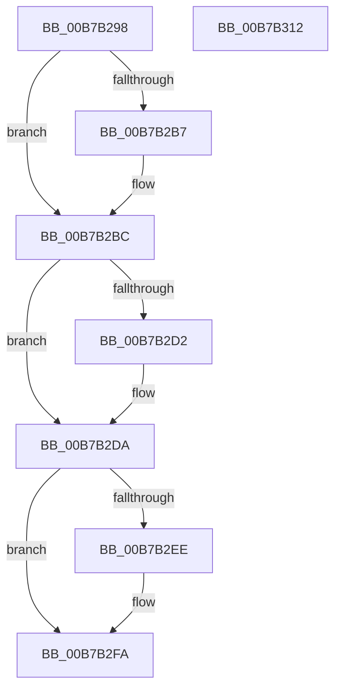

# HalpMceInitProcessor

- RVA: `0x00B7B298`–`0x00B7B313` (길이 `123` bytes)
- VA: `0x0000000140B7B298`
- 실행 섹션: `PAGELK`
- PDB 이름 있음: `예`; PDB Function 태그: `아니요`
- unwind 정보 RVA: `0x00060BC4`
- 디코드: `33`개 명령, `123/123` bytes 표시
- 미해석 바이트: `0` (있으면 어셈블리에 `.byte`로 보존)

> 이 문서는 커널 이미지의 기계어와 PDB 기호를 분석해 생성했습니다. 4번과 5번은 함수 원형과 자료형을 바이너리 사용 방식에서 추정한 C 해석이며 원본 소스 복구 결과는 아닙니다.

## 1. Dependencies

- 직접 호출 지점: **4**; 고유 호출 대상: **4**
- 직접 호출자로 확인된 함수: **2**
- RIP 상대 이미지 참조: **2**

### Outgoing calls
- `0x00B7B2B7` → [HalpMceInitializeErrorPacket](HalpMceInitializeErrorPacket_function_00B7D4BC.md) (function, `0x00B7D4BC`)
- `0x00B7B2D5` → [KiRaiseIrqlProcessIrqlFlags](../../text/4F/KiRaiseIrqlProcessIrqlFlags_function_004F56FC.md) (function, `0x004F56FC`)
- `0x00B7B2E0` → [HalpMcaSetProcessorConfig](HalpMcaSetProcessorConfig_function_00B7B418.md) (function, `0x00B7B418`)
- `0x00B7B2F5` → [KiLowerIrqlProcessIrqlFlags](../../text/4F/KiLowerIrqlProcessIrqlFlags_function_004F5698.md) (function, `0x004F5698`)

### Direct callers
- [HalpInitializeMce](../B5/HalpInitializeMce_function_00B5BC04.md) at `0x00B5BD91`
- [HalpMceInit](HalpMceInit_function_00B7B144.md) at `0x00B7B229`

### Static image references
- `0x00B7B2A7` → RVA `0x00E0A769` (`.data`; read)
- `0x00B7B2C9` → RVA `0x00FC6D20` (`ALMOSTRO`; read)

## 2. Other-region calls and transfers

- 다른 실행 섹션으로 향하는 call: **2**
  - `0x00B7B2D5` → [KiRaiseIrqlProcessIrqlFlags](../../text/4F/KiRaiseIrqlProcessIrqlFlags_function_004F56FC.md) (`PAGELK` → `.text`)
  - `0x00B7B2F5` → [KiLowerIrqlProcessIrqlFlags](../../text/4F/KiLowerIrqlProcessIrqlFlags_function_004F5698.md) (`PAGELK` → `.text`)
- 별도 외부 분기/꼬리 이동을 확인하지 못했습니다.

## 3. Assembly (complete function range)

```asm
00B7B298  48 89 5C 24 08                  mov qword ptr [rsp + 8], rbx
00B7B29D  48 89 74 24 10                  mov qword ptr [rsp + 0x10], rsi
00B7B2A2  57                              push rdi
00B7B2A3  48 83 EC 20                     sub rsp, 0x20
00B7B2A7  8A 05 BC F4 28 00               mov al, byte ptr [rip + 0x28f4bc]
00B7B2AD  48 8B DA                        mov rbx, rdx
00B7B2B0  48 8B F1                        mov rsi, rcx
00B7B2B3  84 C0                           test al, al
00B7B2B5  74 05                           je 0x140b7b2bc
00B7B2B7  E8 00 22 00 00                  call 0x140b7d4bc
00B7B2BC  44 0F 20 C7                     mov rdi, cr8
00B7B2C0  BA 0F 00 00 00                  mov edx, 0xf
00B7B2C5  44 0F 22 C2                     mov cr8, rdx
00B7B2C9  83 3D 50 BA 44 00 00            cmp dword ptr [rip + 0x44ba50], 0
00B7B2D0  74 08                           je 0x140b7b2da
00B7B2D2  40 8A CF                        mov cl, dil
00B7B2D5  E8 22 A4 97 FF                  call 0x1404f56fc
00B7B2DA  48 8B D3                        mov rdx, rbx
00B7B2DD  48 8B CE                        mov rcx, rsi
00B7B2E0  E8 33 01 00 00                  call 0x140b7b418
00B7B2E5  83 3D 34 BA 44 00 00            cmp dword ptr [rip + 0x44ba34], 0
00B7B2EC  74 0C                           je 0x140b7b2fa
00B7B2EE  44 0F 20 C1                     mov rcx, cr8
00B7B2F2  40 8A D7                        mov dl, dil
00B7B2F5  E8 9E A3 97 FF                  call 0x1404f5698
00B7B2FA  40 0F B6 C7                     movzx eax, dil
00B7B2FE  44 0F 22 C0                     mov cr8, rax
00B7B302  48 8B 5C 24 30                  mov rbx, qword ptr [rsp + 0x30]
00B7B307  48 8B 74 24 38                  mov rsi, qword ptr [rsp + 0x38]
00B7B30C  48 83 C4 20                     add rsp, 0x20
00B7B310  5F                              pop rdi
00B7B311  C3                              ret
00B7B312  CC                              int3
```

## 4. C-style interpretation (structured pseudocode)

```c
__int64 __fastcall HalpMceInitProcessor(__int64 a1, __int64 a2)
{
    __int64 result;
    __int64 v_rsp;
    unsigned __int64 v_stack_p10;
    unsigned __int64 v_stack_p8;

    v_stack_p8 = v_rbx;
    v_stack_p10 = v_rsi;
    v_rsp = (v_rsp) - (32);
    result = *(unsigned __int8 *)(v_rip + 2684092);
    if ((unsigned __int8)(*(unsigned __int8 *)(v_rip + 2684092)) != 0) {
        result = HalpMceInitializeErrorPacket(a1, a2, a3, a4);
    }
    if ((*(unsigned int *)(v_rip + 4504144)) != 0) {
        a1 = (unsigned __int8)(v_cr8);
        result = KiRaiseIrqlProcessIrqlFlags(a1, 15, a3, a4);
    }
    result = HalpMcaSetProcessorConfig(a1, a2, a3, a4);
    if ((*(unsigned int *)(v_rip + 4504116)) != 0) {
        a1 = 15;
        a2 = (unsigned __int8)(v_cr8);
        result = KiLowerIrqlProcessIrqlFlags(a1, a2, a3, a4);
    }
    v_rsp = (v_rsp) + (32);
    return (unsigned __int8)(v_cr8);
}
```

## 5. (Beta) C Style

```c
int64_t HalpMceInitProcessor(int64_t Arg1, int64_t Arg2)
{
    int64_t result;
    int64_t local_rsp;
    uint64_t v_stack_p10;
    uint64_t v_stack_p8;

    v_stack_p8 = local_rbx;
    v_stack_p10 = local_rsi;
    local_rsp = (local_rsp) - (32);
    result = *(uint8_t *)(v_rip + 0x28F4BC);
    if ((uint8_t)(*(uint8_t *)(v_rip + 0x28F4BC)) != 0) {
        result = HalpMceInitializeErrorPacket(Arg1, Arg2, a3, a4);
    }
    if ((*(uint32_t *)(v_rip + 0x44BA50)) != 0) {
        Arg1 = (uint8_t)(v_cr8);
        result = KiRaiseIrqlProcessIrqlFlags(Arg1, 15, a3, a4);
    }
    result = HalpMcaSetProcessorConfig(Arg1, Arg2, a3, a4);
    if ((*(uint32_t *)(v_rip + 0x44BA34)) != 0) {
        Arg1 = 15;
        Arg2 = (uint8_t)(v_cr8);
        result = KiLowerIrqlProcessIrqlFlags(Arg1, Arg2, a3, a4);
    }
    local_rsp = (local_rsp) + (32);
    return (uint8_t)(v_cr8);
}
```

## 6. Execution-region graph

[열기: 2D/3D 그래프와 함수 탐색 컨트롤 패널](../../../control-panel.html?section=pagelk&rva=0x00B7B298&view=graph)

- 2D 그래프는 위에서 아래로 흐르고, 3D 그래프는 빈 공간을 드래그해 회전합니다. Shift+드래그는 이동, 휠은 확대·축소, 함수 노드 선택은 대상 보고서 이동입니다.

### Static fallback


