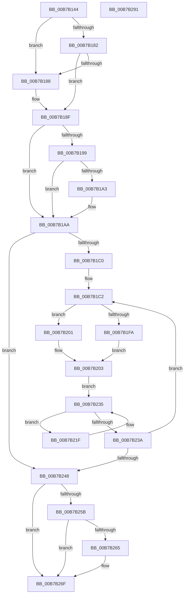

# HalpMceInit

- RVA: `0x00B7B144`–`0x00B7B292` (길이 `334` bytes)
- VA: `0x0000000140B7B144`
- 실행 섹션: `PAGELK`
- PDB 이름 있음: `예`; PDB Function 태그: `아니요`
- unwind 정보 RVA: `0x000B9860`
- 디코드: `88`개 명령, `334/334` bytes 표시
- 미해석 바이트: `0` (있으면 어셈블리에 `.byte`로 보존)

> 이 문서는 커널 이미지의 기계어와 PDB 기호를 분석해 생성했습니다. 4번과 5번은 함수 원형과 자료형을 바이너리 사용 방식에서 추정한 C 해석이며 원본 소스 복구 결과는 아닙니다.

## 1. Dependencies

- 직접 호출 지점: **8**; 고유 호출 대상: **8**
- 직접 호출자로 확인된 함수: **1**
- RIP 상대 이미지 참조: **8**

### Outgoing calls
- `0x00B7B1AF` → [KeQueryActiveProcessorCountEx](../../text/24/KeQueryActiveProcessorCountEx_function_00249EF0.md) (function, `0x00249EF0`)
- `0x00B7B203` → [KeSetSystemGroupAffinityThread](../../text/39/KeSetSystemGroupAffinityThread_function_00399140.md) (function, `0x00399140`)
- `0x00B7B208` → [HalpHvInitMcaPcrContext](../../text/4D/HalpHvInitMcaPcrContext_function_004D7D88.md) (function, `0x004D7D88`)
- `0x00B7B229` → [HalpMceInitProcessor](HalpMceInitProcessor_function_00B7B298.md) (function, `0x00B7B298`)
- `0x00B7B24D` → [KeRevertToUserGroupAffinityThread](../../text/39/KeRevertToUserGroupAffinityThread_function_00398EC0.md) (function, `0x00398EC0`)
- `0x00B7B265` → [HalpHvInitMcaStatusMsrCache](../../text/54/HalpHvInitMcaStatusMsrCache_function_0054C170.md) (function, `0x0054C170`)
- `0x00B7B26A` → [HalpHvSetMachineCheckHandlerState](../../text/54/HalpHvSetMachineCheckHandlerState_function_0054CEF8.md) (function, `0x0054CEF8`)
- `0x00B7B277` → [_security_check_cookie](../../text/6A/_security_check_cookie_function_006AC640.md) (function, `0x006AC640`)

### Direct callers
- [HalpInitializeMce](../B5/HalpInitializeMce_function_00B5BC04.md) at `0x00B5BC63`
- [HalpInitializeMce](../B5/HalpInitializeMce_function_00B5BC04.md) at `0x00B5BC89`

### Static image references
- `0x00B7B156` → RVA `0x00E0A740` (`.data`; read)
- `0x00B7B165` → RVA `0x00FC1C44` (`.data`; read)
- `0x00B7B188` → RVA `0x00E0A769` (`.data`; write)
- `0x00B7B18F` → RVA `0x00E0A769` (`.data`; read)
- `0x00B7B1A3` → RVA `0x00E0A768` (`.data`; write)
- `0x00B7B1C2` → RVA `0x00F231B0` (`.data`; read)
- `0x00B7B252` → RVA `0x00FC1C48` (`.data`; read)
- `0x00B7B25B` → RVA `0x00E0A768` (`.data`; read)

## 2. Other-region calls and transfers

- 다른 실행 섹션으로 향하는 call: **7**
  - `0x00B7B1AF` → [KeQueryActiveProcessorCountEx](../../text/24/KeQueryActiveProcessorCountEx_function_00249EF0.md) (`PAGELK` → `.text`)
  - `0x00B7B203` → [KeSetSystemGroupAffinityThread](../../text/39/KeSetSystemGroupAffinityThread_function_00399140.md) (`PAGELK` → `.text`)
  - `0x00B7B208` → [HalpHvInitMcaPcrContext](../../text/4D/HalpHvInitMcaPcrContext_function_004D7D88.md) (`PAGELK` → `.text`)
  - `0x00B7B24D` → [KeRevertToUserGroupAffinityThread](../../text/39/KeRevertToUserGroupAffinityThread_function_00398EC0.md) (`PAGELK` → `.text`)
  - `0x00B7B265` → [HalpHvInitMcaStatusMsrCache](../../text/54/HalpHvInitMcaStatusMsrCache_function_0054C170.md) (`PAGELK` → `.text`)
  - `0x00B7B26A` → [HalpHvSetMachineCheckHandlerState](../../text/54/HalpHvSetMachineCheckHandlerState_function_0054CEF8.md) (`PAGELK` → `.text`)
  - `0x00B7B277` → [_security_check_cookie](../../text/6A/_security_check_cookie_function_006AC640.md) (`PAGELK` → `.text`)
- 별도 외부 분기/꼬리 이동을 확인하지 못했습니다.

## 3. Assembly (complete function range)

```asm
00B7B144  48 89 5C 24 10                  mov qword ptr [rsp + 0x10], rbx
00B7B149  48 89 6C 24 18                  mov qword ptr [rsp + 0x18], rbp
00B7B14E  56                              push rsi
00B7B14F  57                              push rdi
00B7B150  41 56                           push r14
00B7B152  48 83 EC 50                     sub rsp, 0x50
00B7B156  48 8B 05 E3 F5 28 00            mov rax, qword ptr [rip + 0x28f5e3]
00B7B15D  48 33 C4                        xor rax, rsp
00B7B160  48 89 44 24 40                  mov qword ptr [rsp + 0x40], rax
00B7B165  8B 05 D9 6A 44 00               mov eax, dword ptr [rip + 0x446ad9]
00B7B16B  0F 57 C0                        xorps xmm0, xmm0
00B7B16E  0F 57 C9                        xorps xmm1, xmm1
00B7B171  4C 8B F1                        mov r14, rcx
00B7B174  0F 11 44 24 20                  movups xmmword ptr [rsp + 0x20], xmm0
00B7B179  0F 11 4C 24 30                  movups xmmword ptr [rsp + 0x30], xmm1
00B7B17E  A8 04                           test al, 4
00B7B180  74 06                           je 0x140b7b188
00B7B182  80 79 2A 00                     cmp byte ptr [rcx + 0x2a], 0
00B7B186  75 07                           jne 0x140b7b18f
00B7B188  C6 05 DA F5 28 00 00            mov byte ptr [rip + 0x28f5da], 0
00B7B18F  8A 05 D4 F5 28 00               mov al, byte ptr [rip + 0x28f5d4]
00B7B195  84 C0                           test al, al
00B7B197  75 11                           jne 0x140b7b1aa
00B7B199  8B 05 A5 6A 44 00               mov eax, dword ptr [rip + 0x446aa5]
00B7B19F  A8 08                           test al, 8
00B7B1A1  75 07                           jne 0x140b7b1aa
00B7B1A3  C6 05 BE F5 28 00 00            mov byte ptr [rip + 0x28f5be], 0
00B7B1AA  B9 FF FF 00 00                  mov ecx, 0xffff
00B7B1AF  E8 3C ED 6C FF                  call 0x140249ef0
00B7B1B4  33 FF                           xor edi, edi
00B7B1B6  8B E8                           mov ebp, eax
00B7B1B8  85 C0                           test eax, eax
00B7B1BA  0F 84 88 00 00 00               je 0x140b7b248
00B7B1C0  33 F6                           xor esi, esi
00B7B1C2  48 8B 0D E7 7F 3A 00            mov rcx, qword ptr [rip + 0x3a7fe7]
00B7B1C9  33 C0                           xor eax, eax
00B7B1CB  89 44 24 2A                     mov dword ptr [rsp + 0x2a], eax
00B7B1CF  66 89 44 24 2E                  mov word ptr [rsp + 0x2e], ax
00B7B1D4  8B 0C 0E                        mov ecx, dword ptr [rsi + rcx]
00B7B1D7  8B C1                           mov eax, ecx
00B7B1D9  C1 E8 06                        shr eax, 6
00B7B1DC  83 E1 3F                        and ecx, 0x3f
00B7B1DF  66 89 44 24 28                  mov word ptr [rsp + 0x28], ax
00B7B1E4  B8 01 00 00 00                  mov eax, 1
00B7B1E9  48 D3 E0                        shl rax, cl
00B7B1EC  48 8D 4C 24 20                  lea rcx, [rsp + 0x20]
00B7B1F1  48 89 44 24 20                  mov qword ptr [rsp + 0x20], rax
00B7B1F6  85 FF                           test edi, edi
00B7B1F8  75 07                           jne 0x140b7b201
00B7B1FA  48 8D 54 24 30                  lea rdx, [rsp + 0x30]
00B7B1FF  EB 02                           jmp 0x140b7b203
00B7B201  33 D2                           xor edx, edx
00B7B203  E8 38 DF 81 FF                  call 0x140399140
00B7B208  E8 7B CB 95 FF                  call 0x1404d7d88
00B7B20D  65 48 8B 04 25 18 00 00 00      mov rax, qword ptr gs:[0x18]
00B7B216  48 8B 98 D8 00 00 00            mov rbx, qword ptr [rax + 0xd8]
00B7B21D  EB 16                           jmp 0x140b7b235
00B7B21F  48 8B 93 AC 00 00 00            mov rdx, qword ptr [rbx + 0xac]
00B7B226  49 8B CE                        mov rcx, r14
00B7B229  E8 6A 00 00 00                  call 0x140b7b298
00B7B22E  48 8B 9B B8 00 00 00            mov rbx, qword ptr [rbx + 0xb8]
00B7B235  48 85 DB                        test rbx, rbx
00B7B238  75 E5                           jne 0x140b7b21f
00B7B23A  FF C7                           inc edi
00B7B23C  48 83 C6 04                     add rsi, 4
00B7B240  3B FD                           cmp edi, ebp
00B7B242  0F 82 7A FF FF FF               jb 0x140b7b1c2
00B7B248  48 8D 4C 24 30                  lea rcx, [rsp + 0x30]
00B7B24D  E8 6E DC 81 FF                  call 0x140398ec0
00B7B252  80 3D EF 69 44 00 00            cmp byte ptr [rip + 0x4469ef], 0
00B7B259  74 14                           je 0x140b7b26f
00B7B25B  8A 05 07 F5 28 00               mov al, byte ptr [rip + 0x28f507]
00B7B261  84 C0                           test al, al
00B7B263  74 0A                           je 0x140b7b26f
00B7B265  E8 06 0F 9D FF                  call 0x14054c170
00B7B26A  E8 89 1C 9D FF                  call 0x14054cef8
00B7B26F  48 8B 4C 24 40                  mov rcx, qword ptr [rsp + 0x40]
00B7B274  48 33 CC                        xor rcx, rsp
00B7B277  E8 C4 13 B3 FF                  call 0x1406ac640
00B7B27C  4C 8D 5C 24 50                  lea r11, [rsp + 0x50]
00B7B281  49 8B 5B 28                     mov rbx, qword ptr [r11 + 0x28]
00B7B285  49 8B 6B 30                     mov rbp, qword ptr [r11 + 0x30]
00B7B289  49 8B E3                        mov rsp, r11
00B7B28C  41 5E                           pop r14
00B7B28E  5F                              pop rdi
00B7B28F  5E                              pop rsi
00B7B290  C3                              ret
00B7B291  CC                              int3
```

## 4. C-style interpretation (structured pseudocode)

```c
__int64 __fastcall HalpMceInit(__int64 a1)
{
    __int64 result;
    __int64 v_rdi;
    __int64 v_rsi;
    __int64 v_rsp;
    unsigned __int64 v_stack_m18;
    unsigned __int64 v_stack_m28;
    unsigned __int64 v_stack_m38;
    unsigned __int16 v_stack_m3A;
    unsigned int v_stack_m3E;
    unsigned __int16 v_stack_m40;
    unsigned __int64 v_stack_m48;
    unsigned __int64 v_stack_p10;
    unsigned __int64 v_stack_p18;

    v_stack_p10 = v_rbx;
    v_stack_p18 = v_rbp;
    v_rsp = (v_rsp) - (80);
    result = (*(unsigned __int64 *)(v_rip + 2684387)) ^ (v_rsp);
    v_stack_m28 = result;
    v_stack_m48 = v_xmm0;
    v_stack_m38 = v_xmm1;
    if ((((unsigned __int8)((unsigned int)(*(unsigned int *)(v_rip + 4483801)))) & (4)) == 0) goto loc_00B7B188;
    if ((*(unsigned __int8 *)(a1 + 42)) == 0) {
        *(unsigned __int8 *)(v_rip + 2684378) = 0;
    }
    if ((unsigned __int8)(*(unsigned __int8 *)(v_rip + 2684372)) != 0) goto loc_00B7B1AA;
    if ((((unsigned __int8)((unsigned int)(*(unsigned int *)(v_rip + 4483749)))) & (8)) == 0) {
        *(unsigned __int8 *)(v_rip + 2684350) = 0;
    }
    result = KeQueryActiveProcessorCountEx((unsigned int)(0xFFFFULL), a2, a3, a4);
    v_rdi = 0;
    if ((unsigned int)(result) == 0) goto loc_00B7B248;
    v_rsi = 0;
loc_00B7B1C2:
    result = 0;
    v_stack_m3E = 0;
    v_stack_m3A = 0;
    result = (unsigned int)(((unsigned int)((unsigned int)((unsigned int)(*(unsigned int *)(v_rsi + *(unsigned __int64 *)(v_rip + 3833831) * 1))))) >> (6));
    a1 = (unsigned int)(((unsigned int)(*(unsigned int *)(v_rsi + *(unsigned __int64 *)(v_rip + 3833831) * 1))) & (63));
    v_stack_m40 = (unsigned __int16)(result);
    result = (1) << ((unsigned __int8)(a1));
    v_stack_m48 = result;
    if (0 != 0) goto loc_00B7B201;
    goto loc_00B7B203;
loc_00B7B201:
    a2 = 0;
loc_00B7B203:
    result = KeSetSystemGroupAffinityThread(v_stack_m48, a2, a3, a4);
    result = HalpHvInitMcaPcrContext(v_stack_m48, a2, a3, a4);
    goto loc_00B7B235;
loc_00B7B21F:
    result = HalpMceInitProcessor(a1, *(unsigned __int64 *)(*(unsigned __int64 *)(*(unsigned __int64 *)(gs_base + (0 + 24)) + 216) + 172), a3, a4);
loc_00B7B235:
    if (*(unsigned __int64 *)(*(unsigned __int64 *)(*(unsigned __int64 *)(gs_base + (0 + 24)) + 216) + 184) != 0) goto loc_00B7B21F;
    v_rdi = (unsigned int)((v_rdi) + 1);
    v_rsi = (v_rsi) + (4);
    if (((unsigned int)(v_rdi)) < ((unsigned int)((unsigned int)((unsigned int)(result))))) goto loc_00B7B1C2;
loc_00B7B248:
    result = KeRevertToUserGroupAffinityThread(v_stack_m38, *(unsigned __int64 *)(*(unsigned __int64 *)(*(unsigned __int64 *)(gs_base + (0 + 24)) + 216) + 172), a3, a4);
    if ((*(unsigned __int8 *)(v_rip + 4483567)) == 0) goto loc_00B7B26F;
    result = *(unsigned __int8 *)(v_rip + 2684167);
    if ((unsigned __int8)(*(unsigned __int8 *)(v_rip + 2684167)) != 0) {
        result = HalpHvInitMcaStatusMsrCache(v_stack_m38, *(unsigned __int64 *)(*(unsigned __int64 *)(*(unsigned __int64 *)(gs_base + (0 + 24)) + 216) + 172), a3, a4);
        result = HalpHvSetMachineCheckHandlerState(v_stack_m38, *(unsigned __int64 *)(*(unsigned __int64 *)(*(unsigned __int64 *)(gs_base + (0 + 24)) + 216) + 172), a3, a4);
    }
    a1 = (v_stack_m28) ^ (v_rsp);
    result = _security_check_cookie(a1, *(unsigned __int64 *)(*(unsigned __int64 *)(*(unsigned __int64 *)(gs_base + (0 + 24)) + 216) + 172), a3, a4);
    return result;
}
```

## 5. (Beta) C Style

```c
int64_t HalpMceInit(void *Arg1)
{
    uint8_t *arg1 = (uint8_t *)Arg1;

    int64_t result;
    int64_t local_rdi;
    int64_t local_rsi;
    int64_t local_rsp;
    uint64_t v_stack_m18;
    uint64_t v_stack_m28;
    uint64_t v_stack_m38;
    uint16_t v_stack_m3A;
    uint32_t v_stack_m3E;
    uint16_t v_stack_m40;
    uint64_t v_stack_m48;
    uint64_t v_stack_p10;
    uint64_t v_stack_p18;

    v_stack_p10 = local_rbx;
    v_stack_p18 = local_rbp;
    local_rsp = (local_rsp) - (80);
    result = (*(uint64_t *)(v_rip + 0x28F5E3)) ^ (local_rsp);
    v_stack_m28 = result;
    v_stack_m48 = v_xmm0;
    v_stack_m38 = v_xmm1;
    if ((((uint8_t)((uint32_t)(*(uint32_t *)(v_rip + 0x446AD9)))) & (4)) == 0) goto loc_00B7B188;
    if ((*(uint8_t *)(arg1 + 0x2A)) == 0) {
        *(uint8_t *)(v_rip + 0x28F5DA) = 0;
    }
    if ((uint8_t)(*(uint8_t *)(v_rip + 0x28F5D4)) != 0) goto loc_00B7B1AA;
    if ((((uint8_t)((uint32_t)(*(uint32_t *)(v_rip + 0x446AA5)))) & (8)) == 0) {
        *(uint8_t *)(v_rip + 0x28F5BE) = 0;
    }
    result = KeQueryActiveProcessorCountEx((uint32_t)(0xFFFFULL), a2, a3, a4);
    local_rdi = 0;
    if ((uint32_t)(result) == 0) goto loc_00B7B248;
    local_rsi = 0;
loc_00B7B1C2:
    result = 0;
    v_stack_m3E = 0;
    v_stack_m3A = 0;
    result = (uint32_t)(((uint32_t)((uint32_t)((uint32_t)(*(uint32_t *)(local_rsi + *(uint64_t *)(v_rip + 0x3A7FE7) * 1))))) >> (6));
    Arg1 = (uint32_t)(((uint32_t)(*(uint32_t *)(local_rsi + *(uint64_t *)(v_rip + 0x3A7FE7) * 1))) & (63));
    v_stack_m40 = (uint16_t)(result);
    result = (1) << ((uint8_t)(Arg1));
    v_stack_m48 = result;
    if (0 != 0) goto loc_00B7B201;
    goto loc_00B7B203;
loc_00B7B201:
    a2 = 0;
loc_00B7B203:
    result = KeSetSystemGroupAffinityThread(v_stack_m48, a2, a3, a4);
    result = HalpHvInitMcaPcrContext(v_stack_m48, a2, a3, a4);
    goto loc_00B7B235;
loc_00B7B21F:
    result = HalpMceInitProcessor(Arg1, *(uint64_t *)(*(uint64_t *)(*(uint64_t *)(gs_base + (0 + 0x18)) + 0xD8) + 0xAC), a3, a4);
loc_00B7B235:
    if (*(uint64_t *)(*(uint64_t *)(*(uint64_t *)(gs_base + (0 + 0x18)) + 0xD8) + 0xB8) != 0) goto loc_00B7B21F;
    local_rdi = (uint32_t)((local_rdi) + 1);
    local_rsi = (local_rsi) + (4);
    if (((uint32_t)(local_rdi)) < ((uint32_t)((uint32_t)((uint32_t)(result))))) goto loc_00B7B1C2;
loc_00B7B248:
    result = KeRevertToUserGroupAffinityThread(v_stack_m38, *(uint64_t *)(*(uint64_t *)(*(uint64_t *)(gs_base + (0 + 0x18)) + 0xD8) + 0xAC), a3, a4);
    if ((*(uint8_t *)(v_rip + 0x4469EF)) == 0) goto loc_00B7B26F;
    result = *(uint8_t *)(v_rip + 0x28F507);
    if ((uint8_t)(*(uint8_t *)(v_rip + 0x28F507)) != 0) {
        result = HalpHvInitMcaStatusMsrCache(v_stack_m38, *(uint64_t *)(*(uint64_t *)(*(uint64_t *)(gs_base + (0 + 0x18)) + 0xD8) + 0xAC), a3, a4);
        result = HalpHvSetMachineCheckHandlerState(v_stack_m38, *(uint64_t *)(*(uint64_t *)(*(uint64_t *)(gs_base + (0 + 0x18)) + 0xD8) + 0xAC), a3, a4);
    }
    Arg1 = (v_stack_m28) ^ (local_rsp);
    result = _security_check_cookie(Arg1, *(uint64_t *)(*(uint64_t *)(*(uint64_t *)(gs_base + (0 + 0x18)) + 0xD8) + 0xAC), a3, a4);
    return result;
}
```

### 관측된 메모리 오프셋

구조체 형식이 확인되지 않은 접근은 인자 기준의 오프셋으로만 기록했습니다.

| 기준 인자 | 오프셋 표현 | 폭 (bit) | 접근 |
|---|---:|---:|---|
| `Arg1` | `+ 0x2A` | `8` | `R` |

## 6. Execution-region graph

[열기: 2D/3D 그래프와 함수 탐색 컨트롤 패널](../../../control-panel.html?section=pagelk&rva=0x00B7B144&view=graph)

- 2D 그래프는 위에서 아래로 흐르고, 3D 그래프는 빈 공간을 드래그해 회전합니다. Shift+드래그는 이동, 휠은 확대·축소, 함수 노드 선택은 대상 보고서 이동입니다.

### Static fallback


