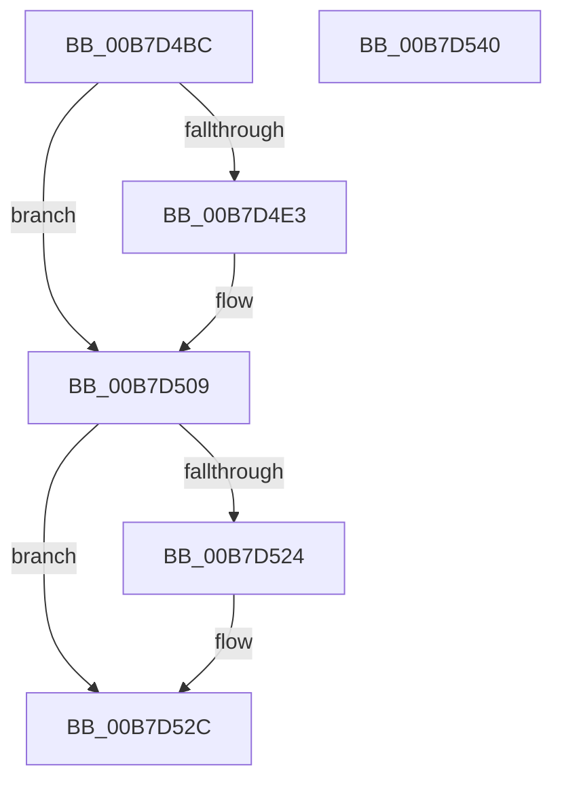

# HalpMceInitializeErrorPacket

- RVA: `0x00B7D4BC`–`0x00B7D541` (길이 `133` bytes)
- VA: `0x0000000140B7D4BC`
- 실행 섹션: `PAGELK`
- PDB 이름 있음: `예`; PDB Function 태그: `아니요`
- unwind 정보 RVA: `0x000794E0`
- 디코드: `35`개 명령, `133/133` bytes 표시
- 미해석 바이트: `0` (있으면 어셈블리에 `.byte`로 보존)

> 이 문서는 커널 이미지의 기계어와 PDB 기호를 분석해 생성했습니다. 4번과 5번은 함수 원형과 자료형을 바이너리 사용 방식에서 추정한 C 해석이며 원본 소스 복구 결과는 아닙니다.

## 1. Dependencies

- 직접 호출 지점: **5**; 고유 호출 대상: **5**
- 직접 호출자로 확인된 함수: **1**
- RIP 상대 이미지 참조: **1**

### Outgoing calls
- `0x00B7D4D6` → [HalpMmAllocCtxAlloc](../../text/3E/HalpMmAllocCtxAlloc_function_003E10B8.md) (function, `0x003E10B8`)
- `0x00B7D503` → [KeBugCheckEx](../../text/4F/KeBugCheckEx_function_004FD660.md) (function, `0x004FD660`)
- `0x00B7D50C` → [HalpMceInitializeErrorPacketContents](HalpMceInitializeErrorPacketContents_function_00B7D548.md) (function, `0x00B7D548`)
- `0x00B7D514` → [HalpGetMcaPcrContext](../../text/48/HalpGetMcaPcrContext_function_00487A38.md) (function, `0x00487A38`)
- `0x00B7D527` → [HalpMmAllocCtxFree](../../text/3E/HalpMmAllocCtxFree_function_003E1904.md) (function, `0x003E1904`)

### Direct callers
- [HalpMceInitProcessor](HalpMceInitProcessor_function_00B7B298.md) at `0x00B7B2B7`

### Static image references
- `0x00B7D4E3` → RVA `0x000239C0` (`.rdata`; read)

## 2. Other-region calls and transfers

- 다른 실행 섹션으로 향하는 call: **4**
  - `0x00B7D4D6` → [HalpMmAllocCtxAlloc](../../text/3E/HalpMmAllocCtxAlloc_function_003E10B8.md) (`PAGELK` → `.text`)
  - `0x00B7D503` → [KeBugCheckEx](../../text/4F/KeBugCheckEx_function_004FD660.md) (`PAGELK` → `.text`)
  - `0x00B7D514` → [HalpGetMcaPcrContext](../../text/48/HalpGetMcaPcrContext_function_00487A38.md) (`PAGELK` → `.text`)
  - `0x00B7D527` → [HalpMmAllocCtxFree](../../text/3E/HalpMmAllocCtxFree_function_003E1904.md) (`PAGELK` → `.text`)
- 별도 외부 분기/꼬리 이동을 확인하지 못했습니다.

## 3. Assembly (complete function range)

```asm
00B7D4BC  48 89 5C 24 08                  mov qword ptr [rsp + 8], rbx
00B7D4C1  48 89 74 24 10                  mov qword ptr [rsp + 0x10], rsi
00B7D4C6  57                              push rdi
00B7D4C7  48 83 EC 30                     sub rsp, 0x30
00B7D4CB  48 8B DA                        mov rbx, rdx
00B7D4CE  48 8B F1                        mov rsi, rcx
00B7D4D1  BA F8 04 00 00                  mov edx, 0x4f8
00B7D4D6  E8 DD 3B 86 FF                  call 0x1403e10b8
00B7D4DB  48 8B F8                        mov rdi, rax
00B7D4DE  48 85 C0                        test rax, rax
00B7D4E1  75 26                           jne 0x140b7d509
00B7D4E3  4C 8D 0D D6 64 4A FF            lea r9, [rip - 0xb59b2a]
00B7D4EA  48 C7 44 24 20 37 07 00 00      mov qword ptr [rsp + 0x20], 0x737
00B7D4F3  BA F8 04 00 00                  mov edx, 0x4f8
00B7D4F8  B9 AC 00 00 00                  mov ecx, 0xac
00B7D4FD  41 B8 00 DA 00 00               mov r8d, 0xda00
00B7D503  E8 58 01 98 FF                  call 0x1404fd660
00B7D508  CC                              int3
00B7D509  48 8B CF                        mov rcx, rdi
00B7D50C  E8 37 00 00 00                  call 0x140b7d548
00B7D511  48 8B CB                        mov rcx, rbx
00B7D514  E8 1F A5 90 FF                  call 0x140487a38
00B7D519  48 8B D8                        mov rbx, rax
00B7D51C  48 87 38                        xchg qword ptr [rax], rdi
00B7D51F  48 85 FF                        test rdi, rdi
00B7D522  74 08                           je 0x140b7d52c
00B7D524  48 8B D7                        mov rdx, rdi
00B7D527  E8 D8 43 86 FF                  call 0x1403e1904
00B7D52C  48 87 73 08                     xchg qword ptr [rbx + 8], rsi
00B7D530  48 8B 74 24 48                  mov rsi, qword ptr [rsp + 0x48]
00B7D535  48 8B 5C 24 40                  mov rbx, qword ptr [rsp + 0x40]
00B7D53A  48 83 C4 30                     add rsp, 0x30
00B7D53E  5F                              pop rdi
00B7D53F  C3                              ret
00B7D540  CC                              int3
```

## 4. C-style interpretation (structured pseudocode)

```c
__int64 __fastcall HalpMceInitializeErrorPacket(__int64 a1, __int64 a2)
{
    __int64 result;
    __int64 v_rsp;
    unsigned __int64 v_stack_m18;
    unsigned __int64 v_stack_p10;
    unsigned __int64 v_stack_p8;

    v_stack_p8 = v_rbx;
    v_stack_p10 = v_rsi;
    v_rsp = (v_rsp) - (48);
    result = HalpMmAllocCtxAlloc(a1, (unsigned int)(0x4F8ULL), a3, a4);
    if (result == 0) {
        a4 = v_rip - 11901738;
        v_stack_m18 = 0x737ULL;
        a2 = 0x4F8ULL;
        a1 = 172;
        a3 = 0xDA00ULL;
        result = KeBugCheckEx(a1, a2, a3, a4);
    }
    result = HalpMceInitializeErrorPacketContents(result, a2, a3, a4);
    result = HalpGetMcaPcrContext(a2, a2, a3, a4);
    if (result != 0) {
        a2 = result;
        result = HalpMmAllocCtxFree(a2, a2, a3, a4);
    }
    v_rsp = (v_rsp) + (48);
    return result;
}
```

## 5. (Beta) C Style

```c
int64_t HalpMceInitializeErrorPacket(int64_t Arg1, int64_t Arg2)
{
    int64_t result;
    int64_t local_rsp;
    uint64_t v_stack_m18;
    uint64_t v_stack_p10;
    uint64_t v_stack_p8;

    v_stack_p8 = local_rbx;
    v_stack_p10 = local_rsi;
    local_rsp = (local_rsp) - (48);
    result = HalpMmAllocCtxAlloc(Arg1, (uint32_t)(0x4F8ULL), a3, a4);
    if (result == 0) {
        a4 = v_rip - 11901738;
        v_stack_m18 = 0x737ULL;
        Arg2 = 0x4F8ULL;
        Arg1 = 172;
        a3 = 0xDA00ULL;
        result = KeBugCheckEx(Arg1, Arg2, a3, a4);
    }
    result = HalpMceInitializeErrorPacketContents(result, Arg2, a3, a4);
    result = HalpGetMcaPcrContext(Arg2, Arg2, a3, a4);
    if (result != 0) {
        Arg2 = result;
        result = HalpMmAllocCtxFree(Arg2, Arg2, a3, a4);
    }
    local_rsp = (local_rsp) + (48);
    return result;
}
```

## 6. Execution-region graph

[열기: 2D/3D 그래프와 함수 탐색 컨트롤 패널](../../../control-panel.html?section=pagelk&rva=0x00B7D4BC&view=graph)

- 2D 그래프는 위에서 아래로 흐르고, 3D 그래프는 빈 공간을 드래그해 회전합니다. Shift+드래그는 이동, 휠은 확대·축소, 함수 노드 선택은 대상 보고서 이동입니다.

### Static fallback


