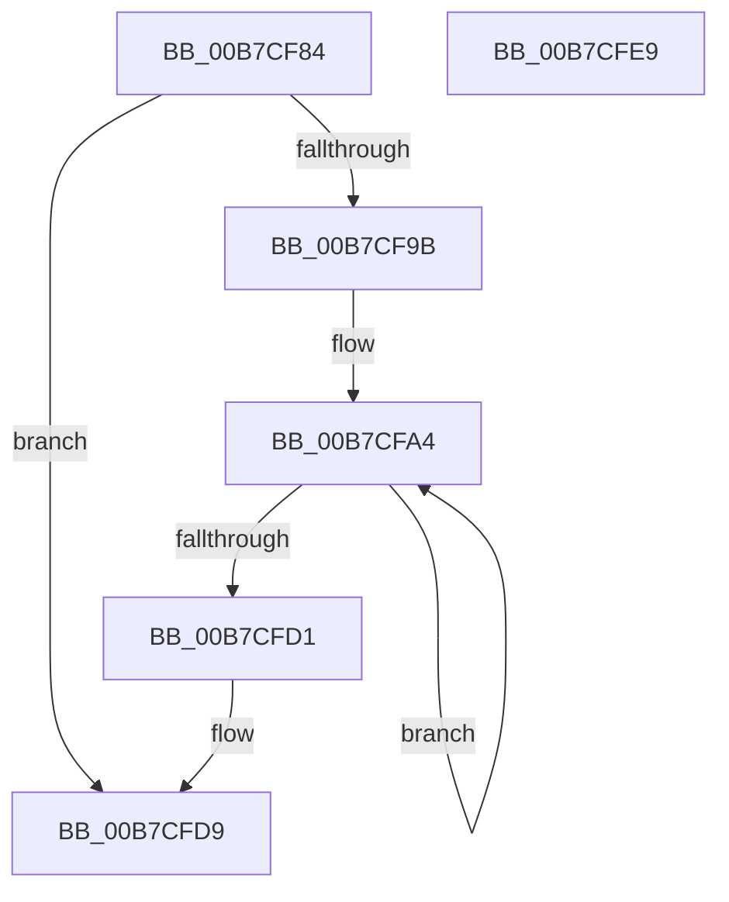

# IoFreePoDeviceNotifyList

- RVA: `0x00B7CF84`–`0x00B7CFEA` (길이 `102` bytes)
- VA: `0x0000000140B7CF84`
- 실행 섹션: `PAGELK`
- PDB 이름 있음: `예`; PDB Function 태그: `아니요`
- unwind 정보 RVA: `0x00060BC4`
- 디코드: `28`개 명령, `102/102` bytes 표시
- 미해석 바이트: `0` (있으면 어셈블리에 `.byte`로 보존)

> 이 문서는 커널 이미지의 기계어와 PDB 기호를 분석해 생성했습니다. 4번과 5번은 함수 원형과 자료형을 바이너리 사용 방식에서 추정한 C 해석이며 원본 소스 복구 결과는 아닙니다.

## 1. Dependencies

- 직접 호출 지점: **5**; 고유 호출 대상: **2**
- 직접 호출자로 확인된 함수: **2**
- RIP 상대 이미지 참조: **0**

### Outgoing calls
- `0x00B7CFA8` → [IopFreePoDeviceNotifyListHead](IopFreePoDeviceNotifyListHead_function_00B79300.md) (function, `0x00B79300`)
- `0x00B7CFB0` → [IopFreePoDeviceNotifyListHead](IopFreePoDeviceNotifyListHead_function_00B79300.md) (function, `0x00B79300`)
- `0x00B7CFB9` → [IopFreePoDeviceNotifyListHead](IopFreePoDeviceNotifyListHead_function_00B79300.md) (function, `0x00B79300`)
- `0x00B7CFC2` → [IopFreePoDeviceNotifyListHead](IopFreePoDeviceNotifyListHead_function_00B79300.md) (function, `0x00B79300`)
- `0x00B7CFD4` → [PnpUnlockDeviceActionQueue](../../text/4A/PnpUnlockDeviceActionQueue_function_004A42F4.md) (function, `0x004A42F4`)

### Direct callers
- [PoClearBroadcast](../../page/AA/PoClearBroadcast_function_00AA3CE8.md) at `0x00AA3D16`
- [PopTransitionSystemPowerStateEx](PopTransitionSystemPowerStateEx_function_00B7E8C0.md) at `0x00B7FBF8`

### Static image references
- 디코드된 RIP-relative 메모리 참조가 없습니다.

## 2. Other-region calls and transfers

- 다른 실행 섹션으로 향하는 call: **1**
  - `0x00B7CFD4` → [PnpUnlockDeviceActionQueue](../../text/4A/PnpUnlockDeviceActionQueue_function_004A42F4.md) (`PAGELK` → `.text`)
- 별도 외부 분기/꼬리 이동을 확인하지 못했습니다.

## 3. Assembly (complete function range)

```asm
00B7CF84  48 89 5C 24 08                  mov qword ptr [rsp + 8], rbx
00B7CF89  48 89 74 24 10                  mov qword ptr [rsp + 0x10], rsi
00B7CF8E  57                              push rdi
00B7CF8F  48 83 EC 20                     sub rsp, 0x20
00B7CF93  80 39 00                        cmp byte ptr [rcx], 0
00B7CF96  48 8B D9                        mov rbx, rcx
00B7CF99  74 3E                           je 0x140b7cfd9
00B7CF9B  48 8D 79 28                     lea rdi, [rcx + 0x28]
00B7CF9F  BE 05 00 00 00                  mov esi, 5
00B7CFA4  48 8D 4F F0                     lea rcx, [rdi - 0x10]
00B7CFA8  E8 53 C3 FF FF                  call 0x140b79300
00B7CFAD  48 8B CF                        mov rcx, rdi
00B7CFB0  E8 4B C3 FF FF                  call 0x140b79300
00B7CFB5  48 8D 4F 10                     lea rcx, [rdi + 0x10]
00B7CFB9  E8 42 C3 FF FF                  call 0x140b79300
00B7CFBE  48 8D 4F 20                     lea rcx, [rdi + 0x20]
00B7CFC2  E8 39 C3 FF FF                  call 0x140b79300
00B7CFC7  48 83 C7 48                     add rdi, 0x48
00B7CFCB  48 83 EE 01                     sub rsi, 1
00B7CFCF  75 D3                           jne 0x140b7cfa4
00B7CFD1  40 88 33                        mov byte ptr [rbx], sil
00B7CFD4  E8 1B 73 92 FF                  call 0x1404a42f4
00B7CFD9  48 8B 5C 24 30                  mov rbx, qword ptr [rsp + 0x30]
00B7CFDE  48 8B 74 24 38                  mov rsi, qword ptr [rsp + 0x38]
00B7CFE3  48 83 C4 20                     add rsp, 0x20
00B7CFE7  5F                              pop rdi
00B7CFE8  C3                              ret
00B7CFE9  CC                              int3
```

## 4. C-style interpretation (structured pseudocode)

```c
__int64 __fastcall IoFreePoDeviceNotifyList(__int64 a1)
{
    __int64 result;
    __int64 v_rdi;
    __int64 v_rsi;
    __int64 v_rsp;
    unsigned __int64 v_stack_p10;
    unsigned __int64 v_stack_p8;

    v_stack_p8 = v_rbx;
    v_stack_p10 = v_rsi;
    v_rsp = (v_rsp) - (32);
    if ((*(unsigned __int8 *)(a1)) == 0) goto loc_00B7CFD9;
loc_00B7CFA4:
    result = IopFreePoDeviceNotifyListHead(a1 + 40 - 16, a2, a3, a4);
    result = IopFreePoDeviceNotifyListHead(a1 + 40, a2, a3, a4);
    result = IopFreePoDeviceNotifyListHead(a1 + 40 + 16, a2, a3, a4);
    result = IopFreePoDeviceNotifyListHead(a1 + 40 + 32, a2, a3, a4);
    v_rdi = (a1 + 40) + (72);
    v_rsi = (5) - (1);
    if (condition_is_not_equal) goto loc_00B7CFA4;
    *(unsigned __int8 *)(a1) = (unsigned __int8)(v_rsi);
    result = PnpUnlockDeviceActionQueue(a1 + 40 + 32, a2, a3, a4);
loc_00B7CFD9:
    v_rsp = (v_rsp) + (32);
    return result;
}
```

## 5. (Beta) C Style

```c
int64_t IoFreePoDeviceNotifyList(void *Arg1)
{
    uint8_t *arg1 = (uint8_t *)Arg1;

    int64_t result;
    int64_t local_rdi;
    int64_t local_rsi;
    int64_t local_rsp;
    uint64_t v_stack_p10;
    uint64_t v_stack_p8;

    v_stack_p8 = local_rbx;
    v_stack_p10 = local_rsi;
    local_rsp = (local_rsp) - (32);
    if ((*(uint8_t *)(arg1)) == 0) goto loc_00B7CFD9;
loc_00B7CFA4:
    result = IopFreePoDeviceNotifyListHead(Arg1 + 40 - 16, a2, a3, a4);
    result = IopFreePoDeviceNotifyListHead(Arg1 + 40, a2, a3, a4);
    result = IopFreePoDeviceNotifyListHead(Arg1 + 40 + 16, a2, a3, a4);
    result = IopFreePoDeviceNotifyListHead(Arg1 + 40 + 32, a2, a3, a4);
    local_rdi = (Arg1 + 40) + (72);
    local_rsi = (5) - (1);
    if (condition_is_not_equal) goto loc_00B7CFA4;
    *(uint8_t *)(arg1) = (uint8_t)(local_rsi);
    result = PnpUnlockDeviceActionQueue(Arg1 + 40 + 32, a2, a3, a4);
loc_00B7CFD9:
    local_rsp = (local_rsp) + (32);
    return result;
}
```

### 관측된 메모리 오프셋

구조체 형식이 확인되지 않은 접근은 인자 기준의 오프셋으로만 기록했습니다.

| 기준 인자 | 오프셋 표현 | 폭 (bit) | 접근 |
|---|---:|---:|---|
| `Arg1` | `- 0x10` | `64` | `R` |
| `Arg1` | `+ 0x0` | `8` | `R` |
| `Arg1` | `+ 0x0` | `8` | `W` |
| `Arg1` | `+ 0x10` | `64` | `R` |
| `Arg1` | `+ 0x20` | `64` | `R` |
| `Arg1` | `+ 0x28` | `64` | `R` |

## 6. Execution-region graph

[열기: 2D/3D 그래프와 함수 탐색 컨트롤 패널](../../../control-panel.html?section=pagelk&rva=0x00B7CF84&view=graph)

- 2D 그래프는 위에서 아래로 흐르고, 3D 그래프는 빈 공간을 드래그해 회전합니다. Shift+드래그는 이동, 휠은 확대·축소, 함수 노드 선택은 대상 보고서 이동입니다.

### Static fallback


