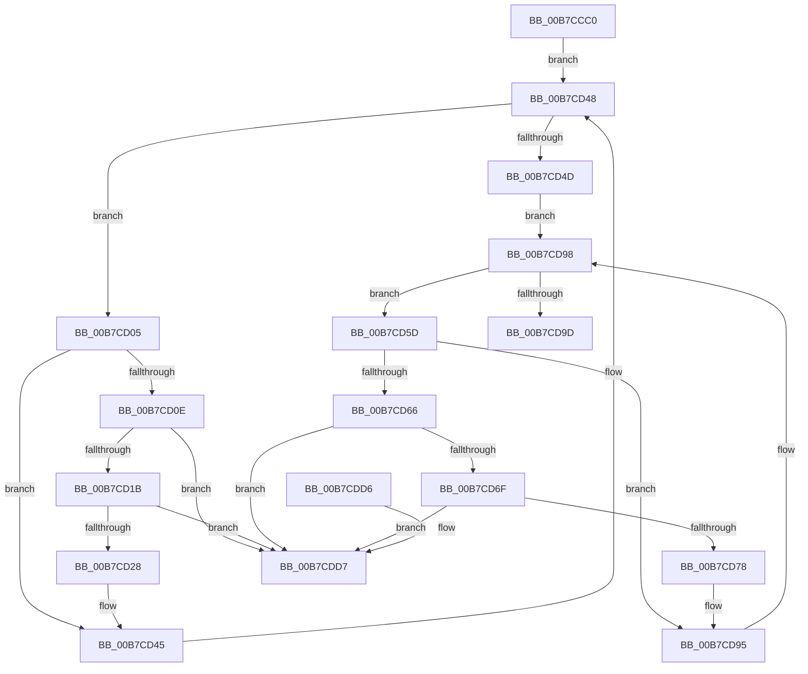

# IoUnregisterShutdownNotification

- RVA: `0x00B7CCC0`–`0x00B7CDDE` (길이 `286` bytes)
- VA: `0x0000000140B7CCC0`
- 실행 섹션: `PAGELK`
- PDB 이름 있음: `예`; PDB Function 태그: `아니요`
- unwind 정보 RVA: `0x0006B020`
- 디코드: `75`개 명령, `286/286` bytes 표시
- 미해석 바이트: `0` (있으면 어셈블리에 `.byte`로 보존)

> 이 문서는 커널 이미지의 기계어와 PDB 기호를 분석해 생성했습니다. 4번과 5번은 함수 원형과 자료형을 바이너리 사용 방식에서 추정한 C 해석이며 원본 소스 복구 결과는 아닙니다.

## 1. Dependencies

- 직접 호출 지점: **8**; 고유 호출 대상: **6**
- 직접 호출자로 확인된 함수: **2**
- RIP 상대 이미지 참조: **3**

### Outgoing calls
- `0x00B7CCE3` → [MmLockPagableSectionByHandle](../../page/A4/MmLockPagableSectionByHandle_function_00A4D1E0.md) (function, `0x00A4D1E0`)
- `0x00B7CCED` → [KeAcquireQueuedSpinLock](../../text/27/KeAcquireQueuedSpinLock_function_00273D80.md) (function, `0x00273D80`)
- `0x00B7CD36` → [ObfDereferenceObject](../../text/2F/ObfDereferenceObject_function_002F9350.md) (function, `0x002F9350`)
- `0x00B7CD40` → [ExFreePoolWithTag](../../poolcode/B8/ExFreePoolWithTag_function_00B82870.md) (function, `0x00B82870`)
- `0x00B7CD86` → [ObfDereferenceObject](../../text/2F/ObfDereferenceObject_function_002F9350.md) (function, `0x002F9350`)
- `0x00B7CD90` → [ExFreePoolWithTag](../../poolcode/B8/ExFreePoolWithTag_function_00B82870.md) (function, `0x00B82870`)
- `0x00B7CDA5` → [KeReleaseQueuedSpinLock](../../text/27/KeReleaseQueuedSpinLock_function_00272540.md) (function, `0x00272540`)
- `0x00B7CDB1` → [MmUnlockPagableImageSection](../../text/2A/MmUnlockPagableImageSection_function_002A39F0.md) (function, `0x002A39F0`)

### Direct callers
- [IoDeleteDevice](../../text/26/IoDeleteDevice_function_0026FE90.md) at `0x0026FFD3`
- [DifIoUnregisterShutdownNotificationWrapper](../../text/62/DifIoUnregisterShutdownNotificationWrapper_function_0062D430.md) at `0x0062D4F6`

### Static image references
- `0x00B7CCDC` → RVA `0x00FC6C00` (`ALMOSTRO`; read)
- `0x00B7CCF2` → RVA `0x00F8D220` (`.data`; read)
- `0x00B7CD4D` → RVA `0x00F8D460` (`.data`; read)

## 2. Other-region calls and transfers

- 다른 실행 섹션으로 향하는 call: **8**
  - `0x00B7CCE3` → [MmLockPagableSectionByHandle](../../page/A4/MmLockPagableSectionByHandle_function_00A4D1E0.md) (`PAGELK` → `PAGE`)
  - `0x00B7CCED` → [KeAcquireQueuedSpinLock](../../text/27/KeAcquireQueuedSpinLock_function_00273D80.md) (`PAGELK` → `.text`)
  - `0x00B7CD36` → [ObfDereferenceObject](../../text/2F/ObfDereferenceObject_function_002F9350.md) (`PAGELK` → `.text`)
  - `0x00B7CD40` → [ExFreePoolWithTag](../../poolcode/B8/ExFreePoolWithTag_function_00B82870.md) (`PAGELK` → `POOLCODE`)
  - `0x00B7CD86` → [ObfDereferenceObject](../../text/2F/ObfDereferenceObject_function_002F9350.md) (`PAGELK` → `.text`)
  - `0x00B7CD90` → [ExFreePoolWithTag](../../poolcode/B8/ExFreePoolWithTag_function_00B82870.md) (`PAGELK` → `POOLCODE`)
  - `0x00B7CDA5` → [KeReleaseQueuedSpinLock](../../text/27/KeReleaseQueuedSpinLock_function_00272540.md) (`PAGELK` → `.text`)
  - `0x00B7CDB1` → [MmUnlockPagableImageSection](../../text/2A/MmUnlockPagableImageSection_function_002A39F0.md) (`PAGELK` → `.text`)
- 별도 외부 분기/꼬리 이동을 확인하지 못했습니다.

## 3. Assembly (complete function range)

```asm
00B7CCC0  48 8B C4                        mov rax, rsp
00B7CCC3  48 89 58 08                     mov qword ptr [rax + 8], rbx
00B7CCC7  48 89 68 10                     mov qword ptr [rax + 0x10], rbp
00B7CCCB  48 89 70 18                     mov qword ptr [rax + 0x18], rsi
00B7CCCF  48 89 78 20                     mov qword ptr [rax + 0x20], rdi
00B7CCD3  41 56                           push r14
00B7CCD5  48 83 EC 20                     sub rsp, 0x20
00B7CCD9  48 8B F9                        mov rdi, rcx
00B7CCDC  48 8B 0D 1D 9F 44 00            mov rcx, qword ptr [rip + 0x449f1d]
00B7CCE3  E8 F8 04 ED FF                  call 0x140a4d1e0
00B7CCE8  B9 0A 00 00 00                  mov ecx, 0xa
00B7CCED  E8 8E 70 6F FF                  call 0x140273d80
00B7CCF2  48 8B 1D 27 05 41 00            mov rbx, qword ptr [rip + 0x410527]
00B7CCF9  4C 8D 35 20 05 41 00            lea r14, [rip + 0x410520]
00B7CD00  40 8A E8                        mov bpl, al
00B7CD03  EB 43                           jmp 0x140b7cd48
00B7CD05  48 8B F3                        mov rsi, rbx
00B7CD08  48 39 7B 10                     cmp qword ptr [rbx + 0x10], rdi
00B7CD0C  75 37                           jne 0x140b7cd45
00B7CD0E  48 8B 13                        mov rdx, qword ptr [rbx]
00B7CD11  48 39 5A 08                     cmp qword ptr [rdx + 8], rbx
00B7CD15  0F 85 BC 00 00 00               jne 0x140b7cdd7
00B7CD1B  48 8B 43 08                     mov rax, qword ptr [rbx + 8]
00B7CD1F  48 39 18                        cmp qword ptr [rax], rbx
00B7CD22  0F 85 AF 00 00 00               jne 0x140b7cdd7
00B7CD28  48 89 10                        mov qword ptr [rax], rdx
00B7CD2B  48 8B CF                        mov rcx, rdi
00B7CD2E  48 89 42 08                     mov qword ptr [rdx + 8], rax
00B7CD32  48 8B 5B 08                     mov rbx, qword ptr [rbx + 8]
00B7CD36  E8 15 C6 77 FF                  call 0x1402f9350
00B7CD3B  33 D2                           xor edx, edx
00B7CD3D  48 8B CE                        mov rcx, rsi
00B7CD40  E8 2B 5B 00 00                  call 0x140b82870
00B7CD45  48 8B 1B                        mov rbx, qword ptr [rbx]
00B7CD48  49 3B DE                        cmp rbx, r14
00B7CD4B  75 B8                           jne 0x140b7cd05
00B7CD4D  48 8B 1D 0C 07 41 00            mov rbx, qword ptr [rip + 0x41070c]
00B7CD54  4C 8D 35 05 07 41 00            lea r14, [rip + 0x410705]
00B7CD5B  EB 3B                           jmp 0x140b7cd98
00B7CD5D  48 8B F3                        mov rsi, rbx
00B7CD60  48 39 7B 10                     cmp qword ptr [rbx + 0x10], rdi
00B7CD64  75 2F                           jne 0x140b7cd95
00B7CD66  48 8B 03                        mov rax, qword ptr [rbx]
00B7CD69  48 39 58 08                     cmp qword ptr [rax + 8], rbx
00B7CD6D  75 68                           jne 0x140b7cdd7
00B7CD6F  48 8B 53 08                     mov rdx, qword ptr [rbx + 8]
00B7CD73  48 39 1A                        cmp qword ptr [rdx], rbx
00B7CD76  75 5F                           jne 0x140b7cdd7
00B7CD78  48 89 02                        mov qword ptr [rdx], rax
00B7CD7B  48 8B CF                        mov rcx, rdi
00B7CD7E  48 89 50 08                     mov qword ptr [rax + 8], rdx
00B7CD82  48 8B 5B 08                     mov rbx, qword ptr [rbx + 8]
00B7CD86  E8 C5 C5 77 FF                  call 0x1402f9350
00B7CD8B  33 D2                           xor edx, edx
00B7CD8D  48 8B CE                        mov rcx, rsi
00B7CD90  E8 DB 5A 00 00                  call 0x140b82870
00B7CD95  48 8B 1B                        mov rbx, qword ptr [rbx]
00B7CD98  49 3B DE                        cmp rbx, r14
00B7CD9B  75 C0                           jne 0x140b7cd5d
00B7CD9D  40 8A D5                        mov dl, bpl
00B7CDA0  B9 0A 00 00 00                  mov ecx, 0xa
00B7CDA5  E8 96 57 6F FF                  call 0x140272540
00B7CDAA  48 8B 0D 4F 9E 44 00            mov rcx, qword ptr [rip + 0x449e4f]
00B7CDB1  E8 3A 6C 72 FF                  call 0x1402a39f0
00B7CDB6  0F BA 77 30 0B                  btr dword ptr [rdi + 0x30], 0xb
00B7CDBB  48 8B 7C 24 48                  mov rdi, qword ptr [rsp + 0x48]
00B7CDC0  48 8B 5C 24 30                  mov rbx, qword ptr [rsp + 0x30]
00B7CDC5  48 8B 6C 24 38                  mov rbp, qword ptr [rsp + 0x38]
00B7CDCA  48 8B 74 24 40                  mov rsi, qword ptr [rsp + 0x40]
00B7CDCF  48 83 C4 20                     add rsp, 0x20
00B7CDD3  41 5E                           pop r14
00B7CDD5  C3                              ret
00B7CDD6  CC                              int3
00B7CDD7  B9 03 00 00 00                  mov ecx, 3
00B7CDDC  CD 29                           int 0x29
```

## 4. C-style interpretation (structured pseudocode)

```c
__int64 __fastcall IoUnregisterShutdownNotification(__int64 a1)
{
    __int64 result;
    __int64 v_rsp;
    unsigned __int64 v_stack_p10;
    unsigned __int64 v_stack_p18;
    unsigned __int64 v_stack_p20;
    unsigned __int64 v_stack_p8;

    *(unsigned __int64 *)(v_rsp + 8) = v_rbx;
    *(unsigned __int64 *)(v_rsp + 16) = v_rbp;
    *(unsigned __int64 *)(v_rsp + 24) = v_rsi;
    *(unsigned __int64 *)(v_rsp + 32) = v_rdi;
    v_rsp = (v_rsp) - (32);
    result = MmLockPagableSectionByHandle(*(unsigned __int64 *)(v_rip + 4497181), a2, a3, a4);
    result = KeAcquireQueuedSpinLock(10, a2, a3, a4);
    goto loc_00B7CD48;
loc_00B7CD05:
    if ((*(unsigned __int64 *)(*(unsigned __int64 *)(v_rip + 4261159) + 16)) != a1) goto loc_00B7CD45;
    if ((*(unsigned __int64 *)(*(unsigned __int64 *)(*(unsigned __int64 *)(v_rip + 4261159)) + 8)) != (*(unsigned __int64 *)(v_rip + 4261159))) goto loc_00B7CDD7;
    if ((*(unsigned __int64 *)(*(unsigned __int64 *)(*(unsigned __int64 *)(v_rip + 4261159) + 8))) != (*(unsigned __int64 *)(v_rip + 4261159))) goto loc_00B7CDD7;
    *(unsigned __int64 *)(*(unsigned __int64 *)(*(unsigned __int64 *)(v_rip + 4261159) + 8)) = *(unsigned __int64 *)(*(unsigned __int64 *)(v_rip + 4261159));
    *(unsigned __int64 *)(*(unsigned __int64 *)(*(unsigned __int64 *)(v_rip + 4261159)) + 8) = *(unsigned __int64 *)(*(unsigned __int64 *)(v_rip + 4261159) + 8);
    result = ObfDereferenceObject(a1, *(unsigned __int64 *)(*(unsigned __int64 *)(v_rip + 4261159)), a3, a4);
    a2 = 0;
    result = ExFreePoolWithTag(*(unsigned __int64 *)(v_rip + 4261159), a2, a3, a4);
loc_00B7CD45:
loc_00B7CD48:
    if ((*(unsigned __int64 *)(*(unsigned __int64 *)(*(unsigned __int64 *)(v_rip + 4261159) + 8))) != (v_rip + 4261152)) goto loc_00B7CD05;
    goto loc_00B7CD98;
loc_00B7CD5D:
    if ((*(unsigned __int64 *)(*(unsigned __int64 *)(v_rip + 4261644) + 16)) != a1) goto loc_00B7CD95;
    if ((*(unsigned __int64 *)(*(unsigned __int64 *)(*(unsigned __int64 *)(v_rip + 4261644)) + 8)) != (*(unsigned __int64 *)(v_rip + 4261644))) goto loc_00B7CDD7;
    if ((*(unsigned __int64 *)(*(unsigned __int64 *)(*(unsigned __int64 *)(v_rip + 4261644) + 8))) != (*(unsigned __int64 *)(v_rip + 4261644))) goto loc_00B7CDD7;
    *(unsigned __int64 *)(*(unsigned __int64 *)(*(unsigned __int64 *)(v_rip + 4261644) + 8)) = *(unsigned __int64 *)(*(unsigned __int64 *)(v_rip + 4261644));
    *(unsigned __int64 *)(*(unsigned __int64 *)(*(unsigned __int64 *)(v_rip + 4261644)) + 8) = *(unsigned __int64 *)(*(unsigned __int64 *)(v_rip + 4261644) + 8);
    result = ObfDereferenceObject(a1, *(unsigned __int64 *)(*(unsigned __int64 *)(v_rip + 4261644) + 8), a3, a4);
    a2 = 0;
    result = ExFreePoolWithTag(*(unsigned __int64 *)(v_rip + 4261644), a2, a3, a4);
loc_00B7CD95:
loc_00B7CD98:
    if ((*(unsigned __int64 *)(*(unsigned __int64 *)(*(unsigned __int64 *)(v_rip + 4261644) + 8))) != (v_rip + 4261637)) goto loc_00B7CD5D;
    result = KeReleaseQueuedSpinLock(10, (unsigned __int8)((unsigned __int8)(result)), a3, a4);
    result = MmUnlockPagableImageSection(*(unsigned __int64 *)(v_rip + 4496975), (unsigned __int8)((unsigned __int8)(result)), a3, a4);
    v_rsp = (v_rsp) + (32);
    return result;
loc_00B7CDD7:
    return result;
}
```

## 5. (Beta) C Style

```c
int64_t IoUnregisterShutdownNotification(void *Arg1)
{
    uint8_t *arg1 = (uint8_t *)Arg1;

    int64_t result;
    int64_t local_rsp;
    uint64_t v_stack_p10;
    uint64_t v_stack_p18;
    uint64_t v_stack_p20;
    uint64_t v_stack_p8;

    *(uint64_t *)(local_rsp + 0x8) = local_rbx;
    *(uint64_t *)(local_rsp + 0x10) = local_rbp;
    *(uint64_t *)(local_rsp + 0x18) = local_rsi;
    *(uint64_t *)(local_rsp + 0x20) = local_rdi;
    local_rsp = (local_rsp) - (32);
    result = MmLockPagableSectionByHandle(*(uint64_t *)(v_rip + 0x449F1D), a2, a3, a4);
    result = KeAcquireQueuedSpinLock(10, a2, a3, a4);
    goto loc_00B7CD48;
loc_00B7CD05:
    if ((*(uint64_t *)(*(uint64_t *)(v_rip + 0x410527) + 0x10)) != Arg1) goto loc_00B7CD45;
    if ((*(uint64_t *)(*(uint64_t *)(*(uint64_t *)(v_rip + 0x410527)) + 0x8)) != (*(uint64_t *)(v_rip + 0x410527))) goto loc_00B7CDD7;
    if ((*(uint64_t *)(*(uint64_t *)(*(uint64_t *)(v_rip + 0x410527) + 0x8))) != (*(uint64_t *)(v_rip + 0x410527))) goto loc_00B7CDD7;
    *(uint64_t *)(*(uint64_t *)(*(uint64_t *)(v_rip + 0x410527) + 0x8)) = *(uint64_t *)(*(uint64_t *)(v_rip + 0x410527));
    *(uint64_t *)(*(uint64_t *)(*(uint64_t *)(v_rip + 0x410527)) + 0x8) = *(uint64_t *)(*(uint64_t *)(v_rip + 0x410527) + 0x8);
    result = ObfDereferenceObject(Arg1, *(uint64_t *)(*(uint64_t *)(v_rip + 0x410527)), a3, a4);
    a2 = 0;
    result = ExFreePoolWithTag(*(uint64_t *)(v_rip + 0x410527), a2, a3, a4);
loc_00B7CD45:
loc_00B7CD48:
    if ((*(uint64_t *)(*(uint64_t *)(*(uint64_t *)(v_rip + 0x410527) + 0x8))) != (v_rip + 4261152)) goto loc_00B7CD05;
    goto loc_00B7CD98;
loc_00B7CD5D:
    if ((*(uint64_t *)(*(uint64_t *)(v_rip + 0x41070C) + 0x10)) != Arg1) goto loc_00B7CD95;
    if ((*(uint64_t *)(*(uint64_t *)(*(uint64_t *)(v_rip + 0x41070C)) + 0x8)) != (*(uint64_t *)(v_rip + 0x41070C))) goto loc_00B7CDD7;
    if ((*(uint64_t *)(*(uint64_t *)(*(uint64_t *)(v_rip + 0x41070C) + 0x8))) != (*(uint64_t *)(v_rip + 0x41070C))) goto loc_00B7CDD7;
    *(uint64_t *)(*(uint64_t *)(*(uint64_t *)(v_rip + 0x41070C) + 0x8)) = *(uint64_t *)(*(uint64_t *)(v_rip + 0x41070C));
    *(uint64_t *)(*(uint64_t *)(*(uint64_t *)(v_rip + 0x41070C)) + 0x8) = *(uint64_t *)(*(uint64_t *)(v_rip + 0x41070C) + 0x8);
    result = ObfDereferenceObject(Arg1, *(uint64_t *)(*(uint64_t *)(v_rip + 0x41070C) + 0x8), a3, a4);
    a2 = 0;
    result = ExFreePoolWithTag(*(uint64_t *)(v_rip + 0x41070C), a2, a3, a4);
loc_00B7CD95:
loc_00B7CD98:
    if ((*(uint64_t *)(*(uint64_t *)(*(uint64_t *)(v_rip + 0x41070C) + 0x8))) != (v_rip + 4261637)) goto loc_00B7CD5D;
    result = KeReleaseQueuedSpinLock(10, (uint8_t)((uint8_t)(result)), a3, a4);
    result = MmUnlockPagableImageSection(*(uint64_t *)(v_rip + 0x449E4F), (uint8_t)((uint8_t)(result)), a3, a4);
    local_rsp = (local_rsp) + (32);
    return result;
loc_00B7CDD7:
    return result;
}
```

### 관측된 메모리 오프셋

구조체 형식이 확인되지 않은 접근은 인자 기준의 오프셋으로만 기록했습니다.

| 기준 인자 | 오프셋 표현 | 폭 (bit) | 접근 |
|---|---:|---:|---|
| `Arg1` | `+ 0x30` | `32` | `R/W` |

## 6. Execution-region graph

[열기: 2D/3D 그래프와 함수 탐색 컨트롤 패널](../../../control-panel.html?section=pagelk&rva=0x00B7CCC0&view=graph)

- 2D 그래프는 위에서 아래로 흐르고, 3D 그래프는 빈 공간을 드래그해 회전합니다. Shift+드래그는 이동, 휠은 확대·축소, 함수 노드 선택은 대상 보고서 이동입니다.

### Static fallback


