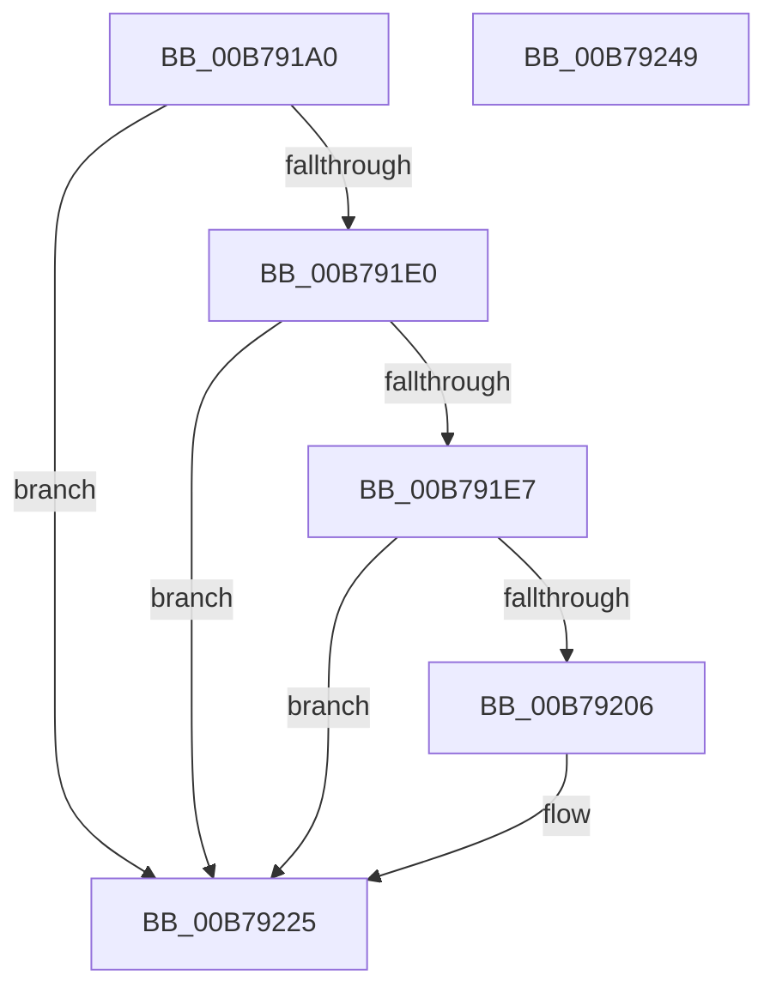

# IopCaptureObjectName

- RVA: `0x00B791A0`–`0x00B7924A` (길이 `170` bytes)
- VA: `0x0000000140B791A0`
- 실행 섹션: `PAGELK`
- PDB 이름 있음: `예`; PDB Function 태그: `아니요`
- unwind 정보 RVA: `0x000AF4C4`
- 디코드: `41`개 명령, `170/170` bytes 표시
- 미해석 바이트: `0` (있으면 어셈블리에 `.byte`로 보존)

> 이 문서는 커널 이미지의 기계어와 PDB 기호를 분석해 생성했습니다. 4번과 5번은 함수 원형과 자료형을 바이너리 사용 방식에서 추정한 C 해석이며 원본 소스 복구 결과는 아닙니다.

## 1. Dependencies

- 직접 호출 지점: **4**; 고유 호출 대상: **4**
- 직접 호출자로 확인된 함수: **1**
- RIP 상대 이미지 참조: **1**

### Outgoing calls
- `0x00B791D7` → [ObQueryNameString](../../page/8A/ObQueryNameString_function_008A7EB0.md) (function, `0x008A7EB0`)
- `0x00B791F9` → [ExAllocatePool2](../../poolcode/B8/ExAllocatePool2_function_00B820F0.md) (function, `0x00B820F0`)
- `0x00B79214` → [memcpy](../../text/6C/memcpy_function_006C6840.md) (function, `0x006C6840`)
- `0x00B79233` → [_security_check_cookie](../../text/6A/_security_check_cookie_function_006AC640.md) (function, `0x006AC640`)

### Direct callers
- [IoBuildPoDeviceNotifyList](IoBuildPoDeviceNotifyList_function_00B78B0C.md) at `0x00B78C12`
- [IoBuildPoDeviceNotifyList](IoBuildPoDeviceNotifyList_function_00B78B0C.md) at `0x00B78C1F`

### Static image references
- `0x00B791AD` → RVA `0x00E0A740` (`.data`; read)

## 2. Other-region calls and transfers

- 다른 실행 섹션으로 향하는 call: **4**
  - `0x00B791D7` → [ObQueryNameString](../../page/8A/ObQueryNameString_function_008A7EB0.md) (`PAGELK` → `PAGE`)
  - `0x00B791F9` → [ExAllocatePool2](../../poolcode/B8/ExAllocatePool2_function_00B820F0.md) (`PAGELK` → `POOLCODE`)
  - `0x00B79214` → [memcpy](../../text/6C/memcpy_function_006C6840.md) (`PAGELK` → `.text`)
  - `0x00B79233` → [_security_check_cookie](../../text/6A/_security_check_cookie_function_006AC640.md) (`PAGELK` → `.text`)
- 별도 외부 분기/꼬리 이동을 확인하지 못했습니다.

## 3. Assembly (complete function range)

```asm
00B791A0  48 89 5C 24 10                  mov qword ptr [rsp + 0x10], rbx
00B791A5  57                              push rdi
00B791A6  48 81 EC 40 02 00 00            sub rsp, 0x240
00B791AD  48 8B 05 8C 15 29 00            mov rax, qword ptr [rip + 0x29158c]
00B791B4  48 33 C4                        xor rax, rsp
00B791B7  48 89 84 24 30 02 00 00         mov qword ptr [rsp + 0x230], rax
00B791BF  33 FF                           xor edi, edi
00B791C1  4C 8D 4C 24 20                  lea r9, [rsp + 0x20]
00B791C6  41 B8 00 02 00 00               mov r8d, 0x200
00B791CC  89 7C 24 20                     mov dword ptr [rsp + 0x20], edi
00B791D0  48 8D 54 24 30                  lea rdx, [rsp + 0x30]
00B791D5  8B DF                           mov ebx, edi
00B791D7  E8 D4 EC D2 FF                  call 0x1408a7eb0
00B791DC  85 C0                           test eax, eax
00B791DE  78 45                           js 0x140b79225
00B791E0  48 39 7C 24 38                  cmp qword ptr [rsp + 0x38], rdi
00B791E5  74 3E                           je 0x140b79225
00B791E7  0F B7 54 24 30                  movzx edx, word ptr [rsp + 0x30]
00B791EC  8D 4F 40                        lea ecx, [rdi + 0x40]
00B791EF  48 83 C2 02                     add rdx, 2
00B791F3  41 B8 44 50 44 69               mov r8d, 0x69445044
00B791F9  E8 F2 8E 00 00                  call 0x140b820f0
00B791FE  48 8B D8                        mov rbx, rax
00B79201  48 85 C0                        test rax, rax
00B79204  74 1F                           je 0x140b79225
00B79206  44 0F B7 44 24 30               movzx r8d, word ptr [rsp + 0x30]
00B7920C  48 8B C8                        mov rcx, rax
00B7920F  48 8B 54 24 38                  mov rdx, qword ptr [rsp + 0x38]
00B79214  E8 27 D6 B4 FF                  call 0x1406c6840
00B79219  0F B7 4C 24 30                  movzx ecx, word ptr [rsp + 0x30]
00B7921E  48 D1 E9                        shr rcx, 1
00B79221  66 89 3C 4B                     mov word ptr [rbx + rcx*2], di
00B79225  48 8B C3                        mov rax, rbx
00B79228  48 8B 8C 24 30 02 00 00         mov rcx, qword ptr [rsp + 0x230]
00B79230  48 33 CC                        xor rcx, rsp
00B79233  E8 08 34 B3 FF                  call 0x1406ac640
00B79238  48 8B 9C 24 58 02 00 00         mov rbx, qword ptr [rsp + 0x258]
00B79240  48 81 C4 40 02 00 00            add rsp, 0x240
00B79247  5F                              pop rdi
00B79248  C3                              ret
00B79249  CC                              int3
```

## 4. C-style interpretation (structured pseudocode)

```c
__int64 __fastcall IopCaptureObjectName(void)
{
    __int64 result;
    __int64 v_rdi;
    __int64 v_rsp;
    unsigned __int64 v_stack_m18;
    unsigned __int64 v_stack_m210;
    unsigned __int64 v_stack_m218;
    unsigned __int64 v_stack_m228;
    unsigned __int64 v_stack_p10;

    v_stack_p10 = v_rbx;
    v_rsp = (v_rsp) - (576);
    result = (*(unsigned __int64 *)(v_rip + 2692492)) ^ (v_rsp);
    v_stack_m18 = result;
    v_rdi = 0;
    v_stack_m228 = 0;
    result = ObQueryNameString(a1, v_stack_m218, 512, v_stack_m228);
    if (sign_flag) goto loc_00B79225;
    if (v_stack_m210 == 0) goto loc_00B79225;
    a2 = (v_stack_m218) + (2);
    result = ExAllocatePool2(v_rdi + 64, a2, (unsigned int)(0x69445044ULL), v_stack_m228);
    if (result != 0) {
        a3 = v_stack_m218;
        a1 = result;
        a2 = v_stack_m210;
        result = memcpy(a1, a2, a3, v_stack_m228);
        a1 = v_stack_m218;
        a1 = (a1) >> (1);
        *(unsigned __int16 *)(result + a1 * 2) = 0;
    }
    a1 = (v_stack_m18) ^ (v_rsp);
    result = _security_check_cookie(a1, a2, a3, v_stack_m228);
    v_rsp = (v_rsp) + (576);
    return result;
}
```

## 5. (Beta) C Style

```c
void IopCaptureObjectName(void)
{
    int64_t result;
    int64_t local_rdi;
    int64_t local_rsp;
    uint64_t v_stack_m18;
    uint64_t v_stack_m210;
    uint64_t v_stack_m218;
    uint64_t v_stack_m228;
    uint64_t v_stack_p10;

    v_stack_p10 = local_rbx;
    local_rsp = (local_rsp) - (576);
    result = (*(uint64_t *)(v_rip + 0x29158C)) ^ (local_rsp);
    v_stack_m18 = result;
    local_rdi = 0;
    v_stack_m228 = 0;
    result = ObQueryNameString(a1, v_stack_m218, 512, v_stack_m228);
    if (sign_flag) goto loc_00B79225;
    if (v_stack_m210 == 0) goto loc_00B79225;
    a2 = (v_stack_m218) + (2);
    result = ExAllocatePool2(local_rdi + 64, a2, (uint32_t)(0x69445044ULL), v_stack_m228);
    if (result != 0) {
        a3 = v_stack_m218;
        a1 = result;
        a2 = v_stack_m210;
        result = memcpy(a1, a2, a3, v_stack_m228);
        a1 = v_stack_m218;
        a1 = (a1) >> (1);
        *(uint16_t *)(result + a1 * 2) = 0;
    }
    a1 = (v_stack_m18) ^ (local_rsp);
    result = _security_check_cookie(a1, a2, a3, v_stack_m228);
    local_rsp = (local_rsp) + (576);
    return result;
}
```

## 6. Execution-region graph

[열기: 2D/3D 그래프와 함수 탐색 컨트롤 패널](../../../control-panel.html?section=pagelk&rva=0x00B791A0&view=graph)

- 2D 그래프는 위에서 아래로 흐르고, 3D 그래프는 빈 공간을 드래그해 회전합니다. Shift+드래그는 이동, 휠은 확대·축소, 함수 노드 선택은 대상 보고서 이동입니다.

### Static fallback


