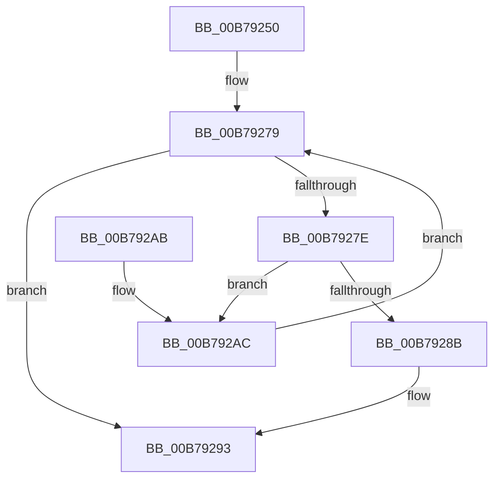

# IopCheckDeviceFlags

- RVA: `0x00B79250`–`0x00B792C6` (길이 `118` bytes)
- VA: `0x0000000140B79250`
- 실행 섹션: `PAGELK`
- PDB 이름 있음: `예`; PDB Function 태그: `아니요`
- unwind 정보 RVA: `0x00078640`
- 디코드: `34`개 명령, `118/118` bytes 표시
- 미해석 바이트: `0` (있으면 어셈블리에 `.byte`로 보존)

> 이 문서는 커널 이미지의 기계어와 PDB 기호를 분석해 생성했습니다. 4번과 5번은 함수 원형과 자료형을 바이너리 사용 방식에서 추정한 C 해석이며 원본 소스 복구 결과는 아닙니다.

## 1. Dependencies

- 직접 호출 지점: **4**; 고유 호출 대상: **3**
- 직접 호출자로 확인된 함수: **1**
- RIP 상대 이미지 참조: **0**

### Outgoing calls
- `0x00B79274` → [ObfReferenceObjectWithTag](../../text/21/ObfReferenceObjectWithTag_function_00210710.md) (function, `0x00210710`)
- `0x00B7928E` → [ObfDereferenceObjectWithTag](../../text/2F/ObfDereferenceObjectWithTag_function_002F78E0.md) (function, `0x002F78E0`)
- `0x00B792AC` → [IoGetLowerDeviceObjectWithTag](../../text/27/IoGetLowerDeviceObjectWithTag_function_00272660.md) (function, `0x00272660`)
- `0x00B792BC` → [ObfDereferenceObjectWithTag](../../text/2F/ObfDereferenceObjectWithTag_function_002F78E0.md) (function, `0x002F78E0`)

### Direct callers
- [IoBuildPoDeviceNotifyList](IoBuildPoDeviceNotifyList_function_00B78B0C.md) at `0x00B78C3D`
- [IoBuildPoDeviceNotifyList](IoBuildPoDeviceNotifyList_function_00B78B0C.md) at `0x00B79113`

### Static image references
- 디코드된 RIP-relative 메모리 참조가 없습니다.

## 2. Other-region calls and transfers

- 다른 실행 섹션으로 향하는 call: **4**
  - `0x00B79274` → [ObfReferenceObjectWithTag](../../text/21/ObfReferenceObjectWithTag_function_00210710.md) (`PAGELK` → `.text`)
  - `0x00B7928E` → [ObfDereferenceObjectWithTag](../../text/2F/ObfDereferenceObjectWithTag_function_002F78E0.md) (`PAGELK` → `.text`)
  - `0x00B792AC` → [IoGetLowerDeviceObjectWithTag](../../text/27/IoGetLowerDeviceObjectWithTag_function_00272660.md) (`PAGELK` → `.text`)
  - `0x00B792BC` → [ObfDereferenceObjectWithTag](../../text/2F/ObfDereferenceObjectWithTag_function_002F78E0.md) (`PAGELK` → `.text`)
- 별도 외부 분기/꼬리 이동을 확인하지 못했습니다.

## 3. Assembly (complete function range)

```asm
00B79250  48 89 5C 24 08                  mov qword ptr [rsp + 8], rbx
00B79255  48 89 6C 24 10                  mov qword ptr [rsp + 0x10], rbp
00B7925A  48 89 74 24 18                  mov qword ptr [rsp + 0x18], rsi
00B7925F  57                              push rdi
00B79260  48 83 EC 20                     sub rsp, 0x20
00B79264  48 8B 79 30                     mov rdi, qword ptr [rcx + 0x30]
00B79268  8B EA                           mov ebp, edx
00B7926A  48 8B CF                        mov rcx, rdi
00B7926D  33 F6                           xor esi, esi
00B7926F  BA 50 6F 50 70                  mov edx, 0x70506f50
00B79274  E8 97 74 69 FF                  call 0x140210710
00B79279  48 85 FF                        test rdi, rdi
00B7927C  74 15                           je 0x140b79293
00B7927E  BA 50 6F 50 70                  mov edx, 0x70506f50
00B79283  48 8B CF                        mov rcx, rdi
00B79286  85 6F 30                        test dword ptr [rdi + 0x30], ebp
00B79289  74 21                           je 0x140b792ac
00B7928B  40 B6 01                        mov sil, 1
00B7928E  E8 4D E6 77 FF                  call 0x1402f78e0
00B79293  48 8B 5C 24 30                  mov rbx, qword ptr [rsp + 0x30]
00B79298  40 8A C6                        mov al, sil
00B7929B  48 8B 74 24 40                  mov rsi, qword ptr [rsp + 0x40]
00B792A0  48 8B 6C 24 38                  mov rbp, qword ptr [rsp + 0x38]
00B792A5  48 83 C4 20                     add rsp, 0x20
00B792A9  5F                              pop rdi
00B792AA  C3                              ret
00B792AB  CC                              int3
00B792AC  E8 AF 93 6F FF                  call 0x140272660
00B792B1  BA 50 6F 50 70                  mov edx, 0x70506f50
00B792B6  48 8B CF                        mov rcx, rdi
00B792B9  48 8B D8                        mov rbx, rax
00B792BC  E8 1F E6 77 FF                  call 0x1402f78e0
00B792C1  48 8B FB                        mov rdi, rbx
00B792C4  EB B3                           jmp 0x140b79279
```

## 4. C-style interpretation (structured pseudocode)

```c
__int64 __fastcall IopCheckDeviceFlags(__int64 a1, int a2)
{
    __int64 result;
    __int64 v_rsi;
    __int64 v_rsp;
    unsigned __int64 v_stack_p10;
    unsigned __int64 v_stack_p18;
    unsigned __int64 v_stack_p8;

    v_stack_p8 = v_rbx;
    v_stack_p10 = v_rbp;
    v_stack_p18 = v_rsi;
    v_rsp = (v_rsp) - (32);
    v_rsi = 0;
    result = ObfReferenceObjectWithTag(*(unsigned __int64 *)(a1 + 48), (unsigned int)(0x70506F50ULL), a3, a4);
loc_00B79279:
    if (*(unsigned __int64 *)(a1 + 48) == 0) goto loc_00B79293;
    if (((*(unsigned int *)(*(unsigned __int64 *)(a1 + 48) + 48)) & ((unsigned int)((unsigned int)(a2)))) == 0) goto loc_00B792AC;
    result = ObfDereferenceObjectWithTag(*(unsigned __int64 *)(a1 + 48), (unsigned int)(0x70506F50ULL), a3, a4);
loc_00B79293:
    v_rsp = (v_rsp) + (32);
    return 1;
loc_00B792AC:
    result = IoGetLowerDeviceObjectWithTag(*(unsigned __int64 *)(a1 + 48), (unsigned int)(0x70506F50ULL), a3, a4);
    result = ObfDereferenceObjectWithTag(*(unsigned __int64 *)(a1 + 48), (unsigned int)(0x70506F50ULL), a3, a4);
    goto loc_00B79279;
}
```

## 5. (Beta) C Style

```c
int64_t IopCheckDeviceFlags(void *Arg1, int32_t Arg2)
{
    uint8_t *arg1 = (uint8_t *)Arg1;

    int64_t result;
    int64_t local_rsi;
    int64_t local_rsp;
    uint64_t v_stack_p10;
    uint64_t v_stack_p18;
    uint64_t v_stack_p8;

    v_stack_p8 = local_rbx;
    v_stack_p10 = local_rbp;
    v_stack_p18 = local_rsi;
    local_rsp = (local_rsp) - (32);
    local_rsi = 0;
    result = ObfReferenceObjectWithTag(*(uint64_t *)(arg1 + 0x30), (uint32_t)(0x70506F50ULL), a3, a4);
loc_00B79279:
    if (*(uint64_t *)(arg1 + 0x30) == 0) goto loc_00B79293;
    if (((*(uint32_t *)(*(uint64_t *)(arg1 + 0x30) + 0x30)) & ((uint32_t)((uint32_t)(Arg2)))) == 0) goto loc_00B792AC;
    result = ObfDereferenceObjectWithTag(*(uint64_t *)(arg1 + 0x30), (uint32_t)(0x70506F50ULL), a3, a4);
loc_00B79293:
    local_rsp = (local_rsp) + (32);
    return 1;
loc_00B792AC:
    result = IoGetLowerDeviceObjectWithTag(*(uint64_t *)(arg1 + 0x30), (uint32_t)(0x70506F50ULL), a3, a4);
    result = ObfDereferenceObjectWithTag(*(uint64_t *)(arg1 + 0x30), (uint32_t)(0x70506F50ULL), a3, a4);
    goto loc_00B79279;
}
```

### 관측된 메모리 오프셋

구조체 형식이 확인되지 않은 접근은 인자 기준의 오프셋으로만 기록했습니다.

| 기준 인자 | 오프셋 표현 | 폭 (bit) | 접근 |
|---|---:|---:|---|
| `Arg1` | `+ 0x30` | `64` | `R` |

## 6. Execution-region graph

[열기: 2D/3D 그래프와 함수 탐색 컨트롤 패널](../../../control-panel.html?section=pagelk&rva=0x00B79250&view=graph)

- 2D 그래프는 위에서 아래로 흐르고, 3D 그래프는 빈 공간을 드래그해 회전합니다. Shift+드래그는 이동, 휠은 확대·축소, 함수 노드 선택은 대상 보고서 이동입니다.

### Static fallback


