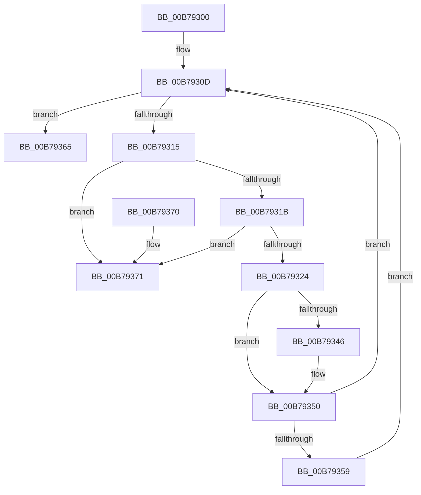

# IopFreePoDeviceNotifyListHead

- RVA: `0x00B79300`–`0x00B79378` (길이 `120` bytes)
- VA: `0x0000000140B79300`
- 실행 섹션: `PAGELK`
- PDB 이름 있음: `예`; PDB Function 태그: `아니요`
- unwind 정보 RVA: `0x0006CF28`
- 디코드: `36`개 명령, `120/120` bytes 표시
- 미해석 바이트: `0` (있으면 어셈블리에 `.byte`로 보존)

> 이 문서는 커널 이미지의 기계어와 PDB 기호를 분석해 생성했습니다. 4번과 5번은 함수 원형과 자료형을 바이너리 사용 방식에서 추정한 C 해석이며 원본 소스 복구 결과는 아닙니다.

## 1. Dependencies

- 직접 호출 지점: **4**; 고유 호출 대상: **2**
- 직접 호출자로 확인된 함수: **2**
- RIP 상대 이미지 참조: **0**

### Outgoing calls
- `0x00B7932F` → [ObfDereferenceObject](../../text/2F/ObfDereferenceObject_function_002F9350.md) (function, `0x002F9350`)
- `0x00B79338` → [ObfDereferenceObject](../../text/2F/ObfDereferenceObject_function_002F9350.md) (function, `0x002F9350`)
- `0x00B7934B` → [ExFreePoolWithTag](../../poolcode/B8/ExFreePoolWithTag_function_00B82870.md) (function, `0x00B82870`)
- `0x00B7935E` → [ExFreePoolWithTag](../../poolcode/B8/ExFreePoolWithTag_function_00B82870.md) (function, `0x00B82870`)

### Direct callers
- [IoBuildPoDeviceNotifyList](IoBuildPoDeviceNotifyList_function_00B78B0C.md) at `0x00B79099`
- [IoFreePoDeviceNotifyList](IoFreePoDeviceNotifyList_function_00B7CF84.md) at `0x00B7CFA8`
- [IoFreePoDeviceNotifyList](IoFreePoDeviceNotifyList_function_00B7CF84.md) at `0x00B7CFB0`
- [IoFreePoDeviceNotifyList](IoFreePoDeviceNotifyList_function_00B7CF84.md) at `0x00B7CFB9`
- [IoFreePoDeviceNotifyList](IoFreePoDeviceNotifyList_function_00B7CF84.md) at `0x00B7CFC2`

### Static image references
- 디코드된 RIP-relative 메모리 참조가 없습니다.

## 2. Other-region calls and transfers

- 다른 실행 섹션으로 향하는 call: **4**
  - `0x00B7932F` → [ObfDereferenceObject](../../text/2F/ObfDereferenceObject_function_002F9350.md) (`PAGELK` → `.text`)
  - `0x00B79338` → [ObfDereferenceObject](../../text/2F/ObfDereferenceObject_function_002F9350.md) (`PAGELK` → `.text`)
  - `0x00B7934B` → [ExFreePoolWithTag](../../poolcode/B8/ExFreePoolWithTag_function_00B82870.md) (`PAGELK` → `POOLCODE`)
  - `0x00B7935E` → [ExFreePoolWithTag](../../poolcode/B8/ExFreePoolWithTag_function_00B82870.md) (`PAGELK` → `POOLCODE`)
- 별도 외부 분기/꼬리 이동을 확인하지 못했습니다.

## 3. Assembly (complete function range)

```asm
00B79300  48 89 5C 24 08                  mov qword ptr [rsp + 8], rbx
00B79305  57                              push rdi
00B79306  48 83 EC 20                     sub rsp, 0x20
00B7930A  48 8B F9                        mov rdi, rcx
00B7930D  48 8B 1F                        mov rbx, qword ptr [rdi]
00B79310  48 3B DF                        cmp rbx, rdi
00B79313  74 50                           je 0x140b79365
00B79315  48 39 7B 08                     cmp qword ptr [rbx + 8], rdi
00B79319  75 56                           jne 0x140b79371
00B7931B  48 8B 03                        mov rax, qword ptr [rbx]
00B7931E  48 39 58 08                     cmp qword ptr [rax + 8], rbx
00B79322  75 4D                           jne 0x140b79371
00B79324  48 89 07                        mov qword ptr [rdi], rax
00B79327  48 89 78 08                     mov qword ptr [rax + 8], rdi
00B7932B  48 8B 4B 40                     mov rcx, qword ptr [rbx + 0x40]
00B7932F  E8 1C 00 78 FF                  call 0x1402f9350
00B79334  48 8B 4B 30                     mov rcx, qword ptr [rbx + 0x30]
00B79338  E8 13 00 78 FF                  call 0x1402f9350
00B7933D  48 8B 4B 48                     mov rcx, qword ptr [rbx + 0x48]
00B79341  48 85 C9                        test rcx, rcx
00B79344  74 0A                           je 0x140b79350
00B79346  BA 44 50 44 69                  mov edx, 0x69445044
00B7934B  E8 20 95 00 00                  call 0x140b82870
00B79350  48 8B 4B 50                     mov rcx, qword ptr [rbx + 0x50]
00B79354  48 85 C9                        test rcx, rcx
00B79357  74 B4                           je 0x140b7930d
00B79359  BA 44 50 44 69                  mov edx, 0x69445044
00B7935E  E8 0D 95 00 00                  call 0x140b82870
00B79363  EB A8                           jmp 0x140b7930d
00B79365  48 8B 5C 24 30                  mov rbx, qword ptr [rsp + 0x30]
00B7936A  48 83 C4 20                     add rsp, 0x20
00B7936E  5F                              pop rdi
00B7936F  C3                              ret
00B79370  CC                              int3
00B79371  B9 03 00 00 00                  mov ecx, 3
00B79376  CD 29                           int 0x29
```

## 4. C-style interpretation (structured pseudocode)

```c
__int64 __fastcall IopFreePoDeviceNotifyListHead(__int64 a1)
{
    __int64 result;
    __int64 v_rsp;
    unsigned __int64 v_stack_p8;

    v_stack_p8 = v_rbx;
    v_rsp = (v_rsp) - (32);
loc_00B7930D:
    if ((*(unsigned __int64 *)(a1)) == a1) goto loc_00B79365;
    if ((*(unsigned __int64 *)(*(unsigned __int64 *)(a1) + 8)) != a1) goto loc_00B79371;
    if ((*(unsigned __int64 *)(*(unsigned __int64 *)(*(unsigned __int64 *)(a1)) + 8)) != (*(unsigned __int64 *)(a1))) goto loc_00B79371;
    *(unsigned __int64 *)(a1) = *(unsigned __int64 *)(*(unsigned __int64 *)(a1));
    *(unsigned __int64 *)(*(unsigned __int64 *)(*(unsigned __int64 *)(a1)) + 8) = a1;
    result = ObfDereferenceObject(*(unsigned __int64 *)(*(unsigned __int64 *)(a1) + 64), a2, a3, a4);
    result = ObfDereferenceObject(*(unsigned __int64 *)(*(unsigned __int64 *)(a1) + 48), a2, a3, a4);
    if (*(unsigned __int64 *)(*(unsigned __int64 *)(a1) + 72) != 0) {
        a2 = 0x69445044ULL;
        result = ExFreePoolWithTag(*(unsigned __int64 *)(*(unsigned __int64 *)(a1) + 72), a2, a3, a4);
    }
    if (*(unsigned __int64 *)(*(unsigned __int64 *)(a1) + 80) == 0) goto loc_00B7930D;
    result = ExFreePoolWithTag(*(unsigned __int64 *)(*(unsigned __int64 *)(a1) + 80), (unsigned int)(0x69445044ULL), a3, a4);
    goto loc_00B7930D;
loc_00B79365:
    v_rsp = (v_rsp) + (32);
    return result;
loc_00B79371:
    return result;
}
```

## 5. (Beta) C Style

```c
int64_t IopFreePoDeviceNotifyListHead(void *Arg1)
{
    uint8_t *arg1 = (uint8_t *)Arg1;

    int64_t result;
    int64_t local_rsp;
    uint64_t v_stack_p8;

    v_stack_p8 = local_rbx;
    local_rsp = (local_rsp) - (32);
loc_00B7930D:
    if ((*(uint64_t *)(arg1)) == Arg1) goto loc_00B79365;
    if ((*(uint64_t *)(*(uint64_t *)(arg1) + 0x8)) != Arg1) goto loc_00B79371;
    if ((*(uint64_t *)(*(uint64_t *)(*(uint64_t *)(arg1)) + 0x8)) != (*(uint64_t *)(arg1))) goto loc_00B79371;
    *(uint64_t *)(arg1) = *(uint64_t *)(*(uint64_t *)(arg1));
    *(void **)(*(uint64_t *)(*(uint64_t *)(arg1)) + 0x8) = Arg1;
    result = ObfDereferenceObject(*(uint64_t *)(*(uint64_t *)(arg1) + 0x40), a2, a3, a4);
    result = ObfDereferenceObject(*(uint64_t *)(*(uint64_t *)(arg1) + 0x30), a2, a3, a4);
    if (*(uint64_t *)(*(uint64_t *)(arg1) + 0x48) != 0) {
        a2 = 0x69445044ULL;
        result = ExFreePoolWithTag(*(uint64_t *)(*(uint64_t *)(arg1) + 0x48), a2, a3, a4);
    }
    if (*(uint64_t *)(*(uint64_t *)(arg1) + 0x50) == 0) goto loc_00B7930D;
    result = ExFreePoolWithTag(*(uint64_t *)(*(uint64_t *)(arg1) + 0x50), (uint32_t)(0x69445044ULL), a3, a4);
    goto loc_00B7930D;
loc_00B79365:
    local_rsp = (local_rsp) + (32);
    return result;
loc_00B79371:
    return result;
}
```

### 관측된 메모리 오프셋

구조체 형식이 확인되지 않은 접근은 인자 기준의 오프셋으로만 기록했습니다.

| 기준 인자 | 오프셋 표현 | 폭 (bit) | 접근 |
|---|---:|---:|---|
| `Arg1` | `+ 0x0` | `64` | `R` |
| `Arg1` | `+ 0x0` | `64` | `W` |

## 6. Execution-region graph

[열기: 2D/3D 그래프와 함수 탐색 컨트롤 패널](../../../control-panel.html?section=pagelk&rva=0x00B79300&view=graph)

- 2D 그래프는 위에서 아래로 흐르고, 3D 그래프는 빈 공간을 드래그해 회전합니다. Shift+드래그는 이동, 휠은 확대·축소, 함수 노드 선택은 대상 보고서 이동입니다.

### Static fallback


