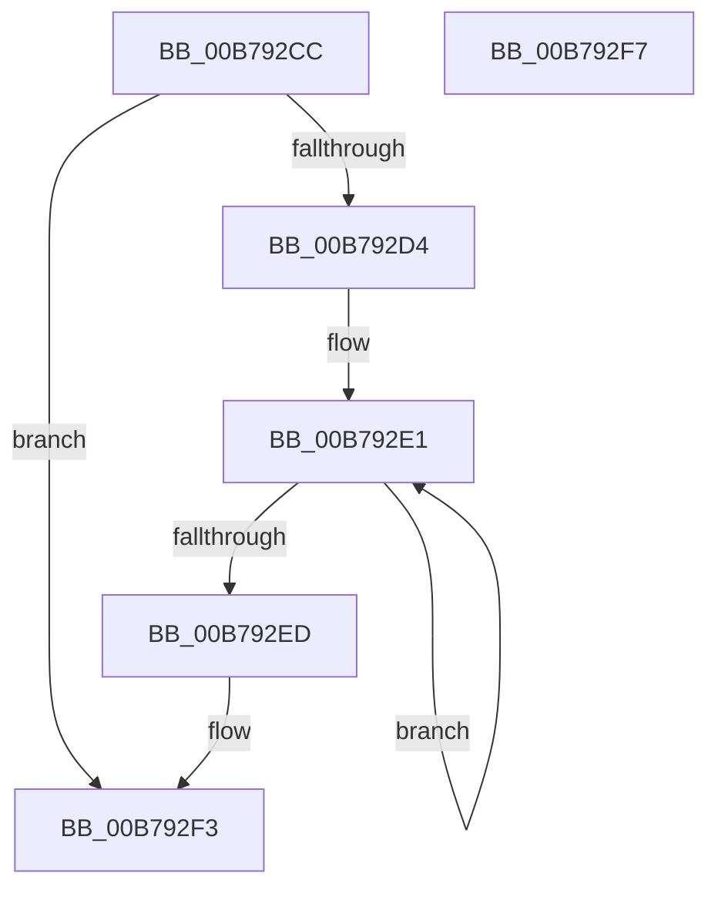

# IopIsNotifyInBroadcast

- RVA: `0x00B792CC`–`0x00B792F8` (길이 `44` bytes)
- VA: `0x0000000140B792CC`
- 실행 섹션: `PAGELK`
- PDB 이름 있음: `예`; PDB Function 태그: `아니요`
- unwind 정보 RVA: `0x000DB714`
- 디코드: `13`개 명령, `44/44` bytes 표시
- 미해석 바이트: `0` (있으면 어셈블리에 `.byte`로 보존)

> 이 문서는 커널 이미지의 기계어와 PDB 기호를 분석해 생성했습니다. 4번과 5번은 함수 원형과 자료형을 바이너리 사용 방식에서 추정한 C 해석이며 원본 소스 복구 결과는 아닙니다.

## 1. Dependencies

- 직접 호출 지점: **0**; 고유 호출 대상: **0**
- 직접 호출자로 확인된 함수: **1**
- RIP 상대 이미지 참조: **0**

### Outgoing calls
- 직접 디코드된 call 명령이 없습니다.

### Direct callers
- [IoBuildPoDeviceNotifyList](IoBuildPoDeviceNotifyList_function_00B78B0C.md) at `0x00B78FCD`
- [IoBuildPoDeviceNotifyList](IoBuildPoDeviceNotifyList_function_00B78B0C.md) at `0x00B79006`
- [IoBuildPoDeviceNotifyList](IoBuildPoDeviceNotifyList_function_00B78B0C.md) at `0x00B79083`
- [IoBuildPoDeviceNotifyList](IoBuildPoDeviceNotifyList_function_00B78B0C.md) at `0x00B79178`

### Static image references
- 디코드된 RIP-relative 메모리 참조가 없습니다.

## 2. Other-region calls and transfers

- 다른 실행 섹션으로 향하는 call: **0**
- 별도 외부 분기/꼬리 이동을 확인하지 못했습니다.

## 3. Assembly (complete function range)

```asm
00B792CC  41 B0 01                        mov r8b, 1
00B792CF  41 84 C8                        test r8b, cl
00B792D2  74 1F                           je 0x140b792f3
00B792D4  0F 0D 8A 88 00 00 00            prefetchw byte ptr [rdx + 0x88]
00B792DB  8B 82 88 00 00 00               mov eax, dword ptr [rdx + 0x88]
00B792E1  8B C8                           mov ecx, eax
00B792E3  F0 0F B1 8A 88 00 00 00         lock cmpxchg dword ptr [rdx + 0x88], ecx
00B792EB  75 F4                           jne 0x140b792e1
00B792ED  C1 E8 08                        shr eax, 8
00B792F0  44 22 C0                        and r8b, al
00B792F3  41 8A C0                        mov al, r8b
00B792F6  C3                              ret
00B792F7  CC                              int3
```

## 4. C-style interpretation (structured pseudocode)

```c
__int64 __fastcall IopIsNotifyInBroadcast(unsigned __int8 a1, __int64 a2)
{
    __int64 result;

    if (((1) & (a1)) == 0) goto loc_00B792F3;
loc_00B792E1:
    if (((1) & (a1)) != 0) goto loc_00B792E1;
    result = (unsigned int)(((unsigned int)(*(unsigned int *)(a2 + 136))) >> (8));
    a3 = (unsigned __int8)((1) & ((unsigned __int8)(result)));
loc_00B792F3:
    return (unsigned __int8)(a3);
}
```

## 5. (Beta) C Style

```c
int64_t IopIsNotifyInBroadcast(uint8_t Arg1, void *Arg2)
{
    uint8_t *arg2 = (uint8_t *)Arg2;

    int64_t result;

    if (((1) & (Arg1)) == 0) goto loc_00B792F3;
loc_00B792E1:
    if (((1) & (Arg1)) != 0) goto loc_00B792E1;
    result = (uint32_t)(((uint32_t)(*(uint32_t *)(arg2 + 0x88))) >> (8));
    a3 = (uint8_t)((1) & ((uint8_t)(result)));
loc_00B792F3:
    return (uint8_t)(a3);
}
```

### 관측된 메모리 오프셋

구조체 형식이 확인되지 않은 접근은 인자 기준의 오프셋으로만 기록했습니다.

| 기준 인자 | 오프셋 표현 | 폭 (bit) | 접근 |
|---|---:|---:|---|
| `Arg2` | `+ 0x88` | `8` | `R` |
| `Arg2` | `+ 0x88` | `32` | `R` |

## 6. Execution-region graph

[열기: 2D/3D 그래프와 함수 탐색 컨트롤 패널](../../../control-panel.html?section=pagelk&rva=0x00B792CC&view=graph)

- 2D 그래프는 위에서 아래로 흐르고, 3D 그래프는 빈 공간을 드래그해 회전합니다. Shift+드래그는 이동, 휠은 확대·축소, 함수 노드 선택은 대상 보고서 이동입니다.

### Static fallback


