# KeInitThread

- RVA: `0x00B78450`–`0x00B7899B` (길이 `1,355` bytes)
- VA: `0x0000000140B78450`
- 실행 섹션: `PAGELK`
- PDB 이름 있음: `예`; PDB Function 태그: `예`
- unwind 정보 RVA: `0x000AD894`
- 디코드: `305`개 명령, `1,355/1,355` bytes 표시
- 미해석 바이트: `0` (있으면 어셈블리에 `.byte`로 보존)

> 이 문서는 커널 이미지의 기계어와 PDB 기호를 분석해 생성했습니다. 4번과 5번은 함수 원형과 자료형을 바이너리 사용 방식에서 추정한 C 해석이며 원본 소스 복구 결과는 아닙니다.

## 1. Dependencies

- 직접 호출 지점: **12**; 고유 호출 대상: **11**
- 직접 호출자로 확인된 함수: **3**
- RIP 상대 이미지 참조: **9**

### Outgoing calls
- `0x00B785A2` → [KeInitializeApc](../../text/42/KeInitializeApc_function_00428510.md) (function, `0x00428510`)
- `0x00B785B3` → [KeInitializeEvent](../../text/40/KeInitializeEvent_function_0040DD10.md) (function, `0x0040DD10`)
- `0x00B785C2` → [KeInitializeTimer](../../text/45/KeInitializeTimer_function_0045B590.md) (function, `0x0045B590`)
- `0x00B7865C` → [KiGetIdealNodeProcessByGroup](../../text/49/KiGetIdealNodeProcessByGroup_function_00496218.md) (function, `0x00496218`)
- `0x00B786C3` → [MmCreateKernelStack](../../text/33/MmCreateKernelStack_function_00337D20.md) (function, `0x00337D20`)
- `0x00B78710` → [KeAbInitializeThreadState](../../text/45/KeAbInitializeThreadState_function_004585D4.md) (function, `0x004585D4`)
- `0x00B7874C` → [KiInitializeContextThread](../../text/3D/KiInitializeContextThread_function_003D6400.md) (function, `0x003D6400`)
- `0x00B787B8` → [KeInitializeApc](../../text/42/KeInitializeApc_function_00428510.md) (function, `0x00428510`)
- `0x00B7883C` → [KiCreateKernelShadowStack](../../page/A1/KiCreateKernelShadowStack_function_00A1DD60.md) (function, `0x00A1DD60`)
- `0x00B788EA` → [KeCopyXfdMaskToTeb](../../text/4A/KeCopyXfdMaskToTeb_function_004A6410.md) (function, `0x004A6410`)
- `0x00B78909` → [KiAllocateXStateStack](../../text/4D/KiAllocateXStateStack_function_004DD9F8.md) (function, `0x004DD9F8`)
- `0x00B7898D` → [MmDeleteKernelStack](../../text/33/MmDeleteKernelStack_function_0033A960.md) (function, `0x0033A960`)

### Direct callers
- [KiAllocatePrcbThread](../../text/5B/KiAllocatePrcbThread_function_005B9130.md) at `0x005B92DB`
- [KiInitializeAndStartInitialThread](../../text/5C/KiInitializeAndStartInitialThread_function_005C42A4.md) at `0x005C43F1`
- [PspAllocateThread](../../page/9E/PspAllocateThread_function_009EF72C.md) at `0x009EFE20`

### Static image references
- `0x00B784F0` → RVA `0x00FC6DBC` (`ALMOSTRO`; read)
- `0x00B7857D` → RVA `0x00202BC0` (`KiSchedulerApc`; read)
- `0x00B78589` → RVA `0x0049E550` (`EmpCheckErrataList`; read)
- `0x00B785C7` → RVA `0x00FC7250` (`ALMOSTRO`; read)
- `0x00B785D4` → RVA `0x00FC6F78` (`ALMOSTRO`; read)
- `0x00B786F3` → RVA `0x00FC5020` (`ALMOSTRO`; read)
- `0x00B78700` → RVA `0x01201841` (`CFGRO`; read)
- `0x00B78723` → RVA `0x00FC6B30` (`ALMOSTRO`; read)
- `0x00B7879A` → RVA `0x003C4920` (`KiUpdateTebApc`; read)

## 2. Other-region calls and transfers

- 다른 실행 섹션으로 향하는 call: **12**
  - `0x00B785A2` → [KeInitializeApc](../../text/42/KeInitializeApc_function_00428510.md) (`PAGELK` → `.text`)
  - `0x00B785B3` → [KeInitializeEvent](../../text/40/KeInitializeEvent_function_0040DD10.md) (`PAGELK` → `.text`)
  - `0x00B785C2` → [KeInitializeTimer](../../text/45/KeInitializeTimer_function_0045B590.md) (`PAGELK` → `.text`)
  - `0x00B7865C` → [KiGetIdealNodeProcessByGroup](../../text/49/KiGetIdealNodeProcessByGroup_function_00496218.md) (`PAGELK` → `.text`)
  - `0x00B786C3` → [MmCreateKernelStack](../../text/33/MmCreateKernelStack_function_00337D20.md) (`PAGELK` → `.text`)
  - `0x00B78710` → [KeAbInitializeThreadState](../../text/45/KeAbInitializeThreadState_function_004585D4.md) (`PAGELK` → `.text`)
  - `0x00B7874C` → [KiInitializeContextThread](../../text/3D/KiInitializeContextThread_function_003D6400.md) (`PAGELK` → `.text`)
  - `0x00B787B8` → [KeInitializeApc](../../text/42/KeInitializeApc_function_00428510.md) (`PAGELK` → `.text`)
  - `0x00B7883C` → [KiCreateKernelShadowStack](../../page/A1/KiCreateKernelShadowStack_function_00A1DD60.md) (`PAGELK` → `PAGE`)
  - `0x00B788EA` → [KeCopyXfdMaskToTeb](../../text/4A/KeCopyXfdMaskToTeb_function_004A6410.md) (`PAGELK` → `.text`)
  - `0x00B78909` → [KiAllocateXStateStack](../../text/4D/KiAllocateXStateStack_function_004DD9F8.md) (`PAGELK` → `.text`)
  - `0x00B7898D` → [MmDeleteKernelStack](../../text/33/MmDeleteKernelStack_function_0033A960.md) (`PAGELK` → `.text`)
- call이 아닌 외부 분기/꼬리 이동: **2**
  - `0x00B78941` → [sub_00B80710](../B8/Unknown_function_00B80710.md) (`tail-transfer`)
  - `0x00B78996` → [sub_00B80710](../B8/Unknown_function_00B80710.md) (`tail-transfer`)

## 3. Assembly (complete function range)

```asm
00B78450  48 8B C4                        mov rax, rsp
00B78453  48 89 48 08                     mov qword ptr [rax + 8], rcx
00B78457  53                              push rbx
00B78458  56                              push rsi
00B78459  57                              push rdi
00B7845A  41 54                           push r12
00B7845C  41 55                           push r13
00B7845E  41 56                           push r14
00B78460  41 57                           push r15
00B78462  48 81 EC D0 00 00 00            sub rsp, 0xd0
00B78469  4C 8B FA                        mov r15, rdx
00B7846C  48 8B F9                        mov rdi, rcx
00B7846F  33 F6                           xor esi, esi
00B78471  48 89 70 98                     mov qword ptr [rax - 0x68], rsi
00B78475  0F 57 C0                        xorps xmm0, xmm0
00B78478  F3 0F 7F 40 B0                  movdqu xmmword ptr [rax - 0x50], xmm0
00B7847D  48 89 74 24 48                  mov qword ptr [rsp + 0x48], rsi
00B78482  48 89 74 24 50                  mov qword ptr [rsp + 0x50], rsi
00B78487  40 88 B4 24 20 01 00 00         mov byte ptr [rsp + 0x120], sil
00B7848F  44 8D 76 05                     lea r14d, [rsi + 5]
00B78493  44 89 B4 24 28 01 00 00         mov dword ptr [rsp + 0x128], r14d
00B7849B  40 88 74 24 40                  mov byte ptr [rsp + 0x40], sil
00B784A0  48 8D 41 08                     lea rax, [rcx + 8]
00B784A4  48 89 40 08                     mov qword ptr [rax + 8], rax
00B784A8  48 89 00                        mov qword ptr [rax], rax
00B784AB  48 8D 81 08 03 00 00            lea rax, [rcx + 0x308]
00B784B2  48 89 40 08                     mov qword ptr [rax + 8], rax
00B784B6  48 89 00                        mov qword ptr [rax], rax
00B784B9  48 8D 81 58 01 00 00            lea rax, [rcx + 0x158]
00B784C0  8D 4E 04                        lea ecx, [rsi + 4]
00B784C3  48 89 38                        mov qword ptr [rax], rdi
00B784C6  48 8D 40 30                     lea rax, [rax + 0x30]
00B784CA  48 83 E9 01                     sub rcx, 1
00B784CE  75 F3                           jne 0x140b784c3
00B784D0  8B 4F 78                        mov ecx, dword ptr [rdi + 0x78]
00B784D3  48 8B 42 30                     mov rax, qword ptr [rdx + 0x30]
00B784D7  8B 90 88 00 00 00               mov edx, dword ptr [rax + 0x88]
00B784DD  C1 E2 02                        shl edx, 2
00B784E0  33 D1                           xor edx, ecx
00B784E2  83 E2 04                        and edx, 4
00B784E5  33 D1                           xor edx, ecx
00B784E7  81 CA 40 00 02 00               or edx, 0x20040
00B784ED  89 57 78                        mov dword ptr [rdi + 0x78], edx
00B784F0  8B 05 C6 E8 44 00               mov eax, dword ptr [rip + 0x44e8c6]
00B784F6  C1 E0 04                        shl eax, 4
00B784F9  89 47 54                        mov dword ptr [rdi + 0x54], eax
00B784FC  48 8D 87 98 00 00 00            lea rax, [rdi + 0x98]
00B78503  48 89 40 08                     mov qword ptr [rax + 8], rax
00B78507  48 89 00                        mov qword ptr [rax], rax
00B7850A  48 8D 87 A8 00 00 00            lea rax, [rdi + 0xa8]
00B78511  48 89 40 08                     mov qword ptr [rax + 8], rax
00B78515  48 89 00                        mov qword ptr [rax], rax
00B78518  49 8B 47 30                     mov rax, qword ptr [r15 + 0x30]
00B7851C  48 89 87 B8 00 00 00            mov qword ptr [rdi + 0xb8], rax
00B78523  49 8B 47 30                     mov rax, qword ptr [r15 + 0x30]
00B78527  48 89 87 20 02 00 00            mov qword ptr [rdi + 0x220], rax
00B7852E  4C 8D 67 74                     lea r12, [rdi + 0x74]
00B78532  4C 89 64 24 60                  mov qword ptr [rsp + 0x60], r12
00B78537  41 8B 14 24                     mov edx, dword ptr [r12]
00B7853B  8B C2                           mov eax, edx
00B7853D  0F BA E8 0E                     bts eax, 0xe
00B78541  0F BA F2 0E                     btr edx, 0xe
00B78545  41 F6 47 3C 02                  test byte ptr [r15 + 0x3c], 2
00B7854A  0F 44 D0                        cmove edx, eax
00B7854D  41 89 14 24                     mov dword ptr [r12], edx
00B78551  41 8B 47 3C                     mov eax, dword ptr [r15 + 0x3c]
00B78555  A8 02                           test al, 2
00B78557  0F 95 C0                        setne al
00B7855A  FE C0                           inc al
00B7855C  88 87 86 01 00 00               mov byte ptr [rdi + 0x186], al
00B78562  49 39 77 20                     cmp qword ptr [r15 + 0x20], rsi
00B78566  0F 84 9D 00 00 00               je 0x140b78609
00B7856C  48 8D 8F 88 02 00 00            lea rcx, [rdi + 0x288]
00B78573  48 89 7C 24 38                  mov qword ptr [rsp + 0x38], rdi
00B78578  40 88 74 24 30                  mov byte ptr [rsp + 0x30], sil
00B7857D  48 8D 05 3C A6 68 FF            lea rax, [rip - 0x9759c4]
00B78584  48 89 44 24 28                  mov qword ptr [rsp + 0x28], rax
00B78589  48 8D 05 C0 5F 92 FF            lea rax, [rip - 0x6da040]
00B78590  48 89 44 24 20                  mov qword ptr [rsp + 0x20], rax
00B78595  4C 8D 0D B4 5F 92 FF            lea r9, [rip - 0x6da04c]
00B7859C  45 33 C0                        xor r8d, r8d
00B7859F  48 8B D7                        mov rdx, rdi
00B785A2  E8 69 FF 8A FF                  call 0x140428510
00B785A7  48 8D 8F E0 02 00 00            lea rcx, [rdi + 0x2e0]
00B785AE  41 B0 01                        mov r8b, 1
00B785B1  33 D2                           xor edx, edx
00B785B3  E8 58 57 89 FF                  call 0x14040dd10
00B785B8  48 8D 9F 00 01 00 00            lea rbx, [rdi + 0x100]
00B785BF  48 8B CB                        mov rcx, rbx
00B785C2  E8 C9 2F 8E FF                  call 0x14045b590
00B785C7  48 8B 15 82 EC 44 00            mov rdx, qword ptr [rip + 0x44ec82]
00B785CE  48 0F CA                        bswap rdx
00B785D1  48 33 D3                        xor rdx, rbx
00B785D4  48 8B 05 9D E9 44 00            mov rax, qword ptr [rip + 0x44e99d]
00B785DB  8B C8                           mov ecx, eax
00B785DD  48 D3 CA                        ror rdx, cl
00B785E0  48 33 D0                        xor rdx, rax
00B785E3  48 89 53 30                     mov qword ptr [rbx + 0x30], rdx
00B785E7  48 8D 87 D0 01 00 00            lea rax, [rdi + 0x1d0]
00B785EE  C7 40 10 01 04 02 01            mov dword ptr [rax + 0x10], 0x1020401
00B785F5  48 83 C3 08                     add rbx, 8
00B785F9  48 8B 0B                        mov rcx, qword ptr [rbx]
00B785FC  48 39 59 08                     cmp qword ptr [rcx + 8], rbx
00B78600  74 20                           je 0x140b78622
00B78602  B9 03 00 00 00                  mov ecx, 3
00B78607  CD 29                           int 0x29
00B78609  41 8B 47 3C                     mov eax, dword ptr [r15 + 0x3c]
00B7860D  A8 10                           test al, 0x10
00B7860F  0F 85 13 03 00 00               jne 0x140b78928
00B78615  0F BA EA 0A                     bts edx, 0xa
00B78619  41 89 14 24                     mov dword ptr [r12], edx
00B7861D  E9 4A FF FF FF                  jmp 0x140b7856c
00B78622  48 89 08                        mov qword ptr [rax], rcx
00B78625  48 89 58 08                     mov qword ptr [rax + 8], rbx
00B78629  48 89 41 08                     mov qword ptr [rcx + 8], rax
00B7862D  48 89 03                        mov qword ptr [rbx], rax
00B78630  49 8B 47 28                     mov rax, qword ptr [r15 + 0x28]
00B78634  48 89 87 F0 00 00 00            mov qword ptr [rdi + 0xf0], rax
00B7863B  C6 07 06                        mov byte ptr [rdi], 6
00B7863E  65 48 8B 04 25 88 01 00 00      mov rax, qword ptr gs:[0x188]
00B78647  0F B7 90 48 02 00 00            movzx edx, word ptr [rax + 0x248]
00B7864E  41 39 77 38                     cmp dword ptr [r15 + 0x38], esi
00B78652  0F 85 53 02 00 00               jne 0x140b788ab
00B78658  49 8B 4F 30                     mov rcx, qword ptr [r15 + 0x30]
00B7865C  E8 B7 DB 91 FF                  call 0x140496218
00B78661  44 0F B7 E8                     movzx r13d, ax
00B78665  BB 01 00 00 00                  mov ebx, 1
00B7866A  41 8B 47 3C                     mov eax, dword ptr [r15 + 0x3c]
00B7866E  A8 02                           test al, 2
00B78670  4C 8B D6                        mov r10, rsi
00B78673  4C 0F 44 D7                     cmove r10, rdi
00B78677  4C 89 54 24 58                  mov qword ptr [rsp + 0x58], r10
00B7867C  40 88 B4 24 18 01 00 00         mov byte ptr [rsp + 0x118], sil
00B78684  49 8B 17                        mov rdx, qword ptr [r15]
00B78687  48 85 D2                        test rdx, rdx
00B7868A  75 5F                           jne 0x140b786eb
00B7868C  89 74 24 74                     mov dword ptr [rsp + 0x74], esi
00B78690  0F 57 C0                        xorps xmm0, xmm0
00B78693  F3 0F 7F 84 24 80 00 00 00      movdqu xmmword ptr [rsp + 0x80], xmm0
00B7869C  48 89 B4 24 90 00 00 00         mov qword ptr [rsp + 0x90], rsi
00B786A4  C7 44 24 68 08 00 00 00         mov dword ptr [rsp + 0x68], 8
00B786AC  44 89 74 24 6C                  mov dword ptr [rsp + 0x6c], r14d
00B786B1  41 0F B7 C5                     movzx eax, r13w
00B786B5  89 44 24 70                     mov dword ptr [rsp + 0x70], eax
00B786B9  4C 89 54 24 78                  mov qword ptr [rsp + 0x78], r10
00B786BE  48 8D 4C 24 68                  lea rcx, [rsp + 0x68]
00B786C3  E8 58 F6 7B FF                  call 0x140337d20
00B786C8  8B D8                           mov ebx, eax
00B786CA  85 C0                           test eax, eax
00B786CC  0F 88 ED 00 00 00               js 0x140b787bf
00B786D2  48 8B 94 24 80 00 00 00         mov rdx, qword ptr [rsp + 0x80]
00B786DA  BB 01 00 00 00                  mov ebx, 1
00B786DF  88 9C 24 18 01 00 00            mov byte ptr [rsp + 0x118], bl
00B786E6  4C 8B 54 24 58                  mov r10, qword ptr [rsp + 0x58]
00B786EB  48 89 57 28                     mov qword ptr [rdi + 0x28], rdx
00B786EF  48 89 57 38                     mov qword ptr [rdi + 0x38], rdx
00B786F3  8B 05 27 C9 44 00               mov eax, dword ptr [rip + 0x44c927]
00B786F9  48 2B D0                        sub rdx, rax
00B786FC  48 89 57 30                     mov qword ptr [rdi + 0x30], rdx
00B78700  40 38 35 3A 91 68 00            cmp byte ptr [rip + 0x68913a], sil
00B78707  0F 85 D0 00 00 00               jne 0x140b787dd
00B7870D  48 8B CF                        mov rcx, rdi
00B78710  E8 BF FE 8D FF                  call 0x1404585d4
00B78715  48 89 9F 70 03 00 00            mov qword ptr [rdi + 0x370], rbx
00B7871C  48 89 9F F0 03 00 00            mov qword ptr [rdi + 0x3f0], rbx
00B78723  48 0F BA 25 04 E4 44 00 37      bt qword ptr [rip + 0x44e404], 0x37
00B7872C  0F 82 8C 01 00 00               jb 0x140b788be
00B78732  8B 44 24 40                     mov eax, dword ptr [rsp + 0x40]
00B78736  84 C0                           test al, al
00B78738  0F 85 C4 01 00 00               jne 0x140b78902
00B7873E  41 8B 47 3C                     mov eax, dword ptr [r15 + 0x3c]
00B78742  A8 04                           test al, 4
00B78744  75 28                           jne 0x140b7876e
00B78746  49 8B D7                        mov rdx, r15
00B78749  48 8B CF                        mov rcx, rdi
00B7874C  E8 AF DC 85 FF                  call 0x1403d6400
00B78751  EB 1B                           jmp 0x140b7876e
00B78753  8B D8                           mov ebx, eax
00B78755  33 F6                           xor esi, esi
00B78757  48 8B BC 24 10 01 00 00         mov rdi, qword ptr [rsp + 0x110]
00B7875F  44 8B B4 24 28 01 00 00         mov r14d, dword ptr [rsp + 0x128]
00B78767  4C 8B 64 24 60                  mov r12, qword ptr [rsp + 0x60]
00B7876C  EB 51                           jmp 0x140b787bf
00B7876E  41 8B 04 24                     mov eax, dword ptr [r12]
00B78772  25 00 04 00 00                  and eax, 0x400
00B78777  F7 D8                           neg eax
00B78779  1B C9                           sbb ecx, ecx
00B7877B  F7 D1                           not ecx
00B7877D  81 E1 AA AA AA AA               and ecx, 0xaaaaaaaa
00B78783  89 8F 4C 04 00 00               mov dword ptr [rdi + 0x44c], ecx
00B78789  48 8D 8F 20 07 00 00            lea rcx, [rdi + 0x720]
00B78790  48 89 7C 24 38                  mov qword ptr [rsp + 0x38], rdi
00B78795  40 88 74 24 30                  mov byte ptr [rsp + 0x30], sil
00B7879A  48 8D 05 7F C1 84 FF            lea rax, [rip - 0x7b3e81]
00B787A1  48 89 44 24 28                  mov qword ptr [rsp + 0x28], rax
00B787A6  48 89 74 24 20                  mov qword ptr [rsp + 0x20], rsi
00B787AB  4C 8D 0D 9E 5D 92 FF            lea r9, [rip - 0x6da262]
00B787B2  45 33 C0                        xor r8d, r8d
00B787B5  48 8B D7                        mov rdx, rdi
00B787B8  E8 53 FD 8A FF                  call 0x140428510
00B787BD  8B DE                           mov ebx, esi
00B787BF  85 DB                           test ebx, ebx
00B787C1  0F 88 72 01 00 00               js 0x140b78939
00B787C7  8B C3                           mov eax, ebx
00B787C9  48 81 C4 D0 00 00 00            add rsp, 0xd0
00B787D0  41 5F                           pop r15
00B787D2  41 5E                           pop r14
00B787D4  41 5D                           pop r13
00B787D6  41 5C                           pop r12
00B787D8  5F                              pop rdi
00B787D9  5E                              pop rsi
00B787DA  5B                              pop rbx
00B787DB  C3                              ret
00B787DC  CC                              int3
00B787DD  41 8B 0C 24                     mov ecx, dword ptr [r12]
00B787E1  8B C1                           mov eax, ecx
00B787E3  0F BA E8 16                     bts eax, 0x16
00B787E7  41 89 04 24                     mov dword ptr [r12], eax
00B787EB  41 8B 47 3C                     mov eax, dword ptr [r15 + 0x3c]
00B787EF  84 C3                           test bl, al
00B787F1  0F 85 16 FF FF FF               jne 0x140b7870d
00B787F7  A8 08                           test al, 8
00B787F9  0F 85 1E 01 00 00               jne 0x140b7891d
00B787FF  0F BA E1 0A                     bt ecx, 0xa
00B78803  0F 82 28 01 00 00               jb 0x140b78931
00B78809  44 8B F1                        mov r14d, ecx
00B7880C  41 C1 EE 08                     shr r14d, 8
00B78810  44 23 F3                        and r14d, ebx
00B78813  44 89 B4 24 28 01 00 00         mov dword ptr [rsp + 0x128], r14d
00B7881B  45 0F B7 CD                     movzx r9d, r13w
00B7881F  48 8D 44 24 48                  lea rax, [rsp + 0x48]
00B78824  48 89 44 24 28                  mov qword ptr [rsp + 0x28], rax
00B78829  48 8D 44 24 50                  lea rax, [rsp + 0x50]
00B7882E  48 89 44 24 20                  mov qword ptr [rsp + 0x20], rax
00B78833  45 33 C0                        xor r8d, r8d
00B78836  41 8B D6                        mov edx, r14d
00B78839  49 8B CA                        mov rcx, r10
00B7883C  E8 1F 55 EA FF                  call 0x140a1dd60
00B78841  8B D8                           mov ebx, eax
00B78843  85 C0                           test eax, eax
00B78845  0F 88 74 FF FF FF               js 0x140b787bf
00B7884B  BB 01 00 00 00                  mov ebx, 1
00B78850  88 9C 24 20 01 00 00            mov byte ptr [rsp + 0x120], bl
00B78857  48 8B 44 24 48                  mov rax, qword ptr [rsp + 0x48]
00B7885C  48 89 87 08 04 00 00            mov qword ptr [rdi + 0x408], rax
00B78863  48 83 C0 08                     add rax, 8
00B78867  48 89 87 10 04 00 00            mov qword ptr [rdi + 0x410], rax
00B7886E  48 8B 44 24 50                  mov rax, qword ptr [rsp + 0x50]
00B78873  48 89 87 18 04 00 00            mov qword ptr [rdi + 0x418], rax
00B7887A  48 8B 8F 20 04 00 00            mov rcx, qword ptr [rdi + 0x420]
00B78881  48 8D 90 00 D0 FF FF            lea rdx, [rax - 0x3000]
00B78888  48 33 D1                        xor rdx, rcx
00B7888B  48 81 E2 00 F0 FF FF            and rdx, 0xfffffffffffff000
00B78892  48 83 E1 F8                     and rcx, 0xfffffffffffffff8
00B78896  48 33 D1                        xor rdx, rcx
00B78899  41 8B C6                        mov eax, r14d
00B7889C  48 0B D0                        or rdx, rax
00B7889F  48 89 97 20 04 00 00            mov qword ptr [rdi + 0x420], rdx
00B788A6  E9 62 FE FF FF                  jmp 0x140b7870d
00B788AB  45 0F B7 6F 38                  movzx r13d, word ptr [r15 + 0x38]
00B788B0  BB 01 00 00 00                  mov ebx, 1
00B788B5  66 44 2B EB                     sub r13w, bx
00B788B9  E9 AC FD FF FF                  jmp 0x140b7866a
00B788BE  49 8B 47 40                     mov rax, qword ptr [r15 + 0x40]
00B788C2  48 F7 D0                        not rax
00B788C5  48 B9 D8 03 00 00 80 F7 FF FF   movabs rcx, 0xfffff780000003d8
00B788CF  23 01                           and eax, dword ptr [rcx]
00B788D1  25 00 00 04 00                  and eax, 0x40000
00B788D6  48 89 87 28 04 00 00            mov qword ptr [rdi + 0x428], rax
00B788DD  41 F7 04 24 00 04 00 00         test dword ptr [r12], 0x400
00B788E5  75 08                           jne 0x140b788ef
00B788E7  48 8B CF                        mov rcx, rdi
00B788EA  E8 21 DB 92 FF                  call 0x1404a6410
00B788EF  8B 44 24 40                     mov eax, dword ptr [rsp + 0x40]
00B788F3  0F B6 C0                        movzx eax, al
00B788F6  49 39 77 40                     cmp qword ptr [r15 + 0x40], rsi
00B788FA  0F 45 C3                        cmovne eax, ebx
00B788FD  E9 34 FE FF FF                  jmp 0x140b78736
00B78902  41 0F B7 D5                     movzx edx, r13w
00B78906  48 8B CF                        mov rcx, rdi
00B78909  E8 EA 50 96 FF                  call 0x1404dd9f8
00B7890E  8B D8                           mov ebx, eax
00B78910  85 C0                           test eax, eax
00B78912  0F 89 26 FE FF FF               jns 0x140b7873e
00B78918  E9 A2 FE FF FF                  jmp 0x140b787bf
00B7891D  41 BE 02 00 00 00               mov r14d, 2
00B78923  E9 EB FE FF FF                  jmp 0x140b78813
00B78928  0F BA EA 08                     bts edx, 8
00B7892C  E9 E8 FC FF FF                  jmp 0x140b78619
00B78931  44 8B F3                        mov r14d, ebx
00B78934  E9 DA FE FF FF                  jmp 0x140b78813
00B78939  40 38 B4 24 18 01 00 00         cmp byte ptr [rsp + 0x118], sil
00B78941  0F 84 C9 7D 00 00               je 0x140b80710
00B78947  48 89 B4 24 A0 00 00 00         mov qword ptr [rsp + 0xa0], rsi
00B7894F  0F 57 C0                        xorps xmm0, xmm0
00B78952  F3 0F 7F 84 24 B8 00 00 00      movdqu xmmword ptr [rsp + 0xb8], xmm0
00B7895B  C7 84 24 98 00 00 00 02 00 00 00  mov dword ptr [rsp + 0x98], 2
00B78966  C7 84 24 9C 00 00 00 05 00 00 00  mov dword ptr [rsp + 0x9c], 5
00B78971  48 8B 47 38                     mov rax, qword ptr [rdi + 0x38]
00B78975  48 89 84 24 B0 00 00 00         mov qword ptr [rsp + 0xb0], rax
00B7897D  48 89 BC 24 A8 00 00 00         mov qword ptr [rsp + 0xa8], rdi
00B78985  48 8D 8C 24 98 00 00 00         lea rcx, [rsp + 0x98]
00B7898D  E8 CE 1F 7C FF                  call 0x14033a960
00B78992  48 89 77 28                     mov qword ptr [rdi + 0x28], rsi
00B78996  E9 75 7D 00 00                  jmp 0x140b80710
```

## 4. C-style interpretation (structured pseudocode)

```c
__int64 __fastcall KeInitThread(__int64 a1, __int64 a2, int a3)
{
    __int64 result;
    __int64 v_r10;
    __int64 v_r13;
    __int64 v_r14;
    __int64 v_rbx;
    __int64 v_rsi;
    __int64 v_rsp;
    unsigned __int64 v_stack_m78;
    unsigned __int64 v_stack_m88;
    unsigned __int64 v_stack_m90;
    unsigned int v_stack_m94;
    unsigned int v_stack_m98;
    unsigned int v_stack_m9C;
    unsigned int v_stack_mA0;
    unsigned __int64 v_stack_mA8;
    unsigned __int64 v_stack_mB0;
    unsigned __int64 v_stack_mB8;
    unsigned __int64 v_stack_mC0;
    unsigned __int8 v_stack_mC8;
    unsigned __int64 v_stack_mD0;
    unsigned __int8 v_stack_mD8;
    unsigned __int64 v_stack_mE0;
    unsigned __int64 v_stack_mE8;
    unsigned __int8 v_stack_p10;
    unsigned __int8 v_stack_p118;
    unsigned __int8 v_stack_p120;
    unsigned int v_stack_p128;
    unsigned __int8 v_stack_p18;
    unsigned int v_stack_p20;
    unsigned __int64 v_stack_p28;
    unsigned int v_stack_p40;
    unsigned __int64 v_stack_p48;
    unsigned __int64 v_stack_p50;
    unsigned __int64 v_stack_p8;
    unsigned int v_stack_p98;
    unsigned int v_stack_p9C;
    unsigned __int64 v_stack_pA0;
    unsigned __int64 v_stack_pA8;
    unsigned __int64 v_stack_pB0;
    unsigned __int64 v_stack_pB8;

    *(unsigned __int64 *)(v_rsp + 8) = a1;
    v_rsp = (v_rsp) - (208);
    v_rsi = 0;
    *(unsigned __int64 *)(v_rsp - 104) = 0;
    *(unsigned __int64 *)(v_rsp - 80) = v_xmm0;
    v_stack_mC0 = 0;
    v_stack_mB8 = 0;
    v_stack_p18 = 0;
    v_stack_p20 = (unsigned int)(v_rsi + 5);
    v_stack_mC8 = 0;
    *(unsigned __int64 *)(a1 + 8 + 8) = a1 + 8;
    *(unsigned __int64 *)(a1 + 8) = a1 + 8;
    *(unsigned __int64 *)(a1 + 776 + 8) = a1 + 776;
    *(unsigned __int64 *)(a1 + 776) = a1 + 776;
loc_00B784C3:
    *(unsigned __int64 *)(a1 + 344) = a1;
    a1 = (v_rsi + 4) - (1);
    if (condition_is_not_equal) goto loc_00B784C3;
    a2 = (unsigned int)(((unsigned int)(*(unsigned int *)(*(unsigned __int64 *)(a2 + 48) + 136))) << (2));
    a2 = (unsigned int)((a2) ^ ((unsigned int)((unsigned int)(*(unsigned int *)(a1 + 120)))));
    a2 = (unsigned int)((a2) & (4));
    a2 = (unsigned int)((a2) ^ ((unsigned int)((unsigned int)(*(unsigned int *)(a1 + 120)))));
    a2 = (unsigned int)((a2) | (0x20040ULL));
    *(unsigned int *)(a1 + 120) = (unsigned int)(a2);
    result = (unsigned int)(((unsigned int)(*(unsigned int *)(v_rip + 4516038))) << (4));
    *(unsigned int *)(a1 + 84) = (unsigned int)(result);
    *(unsigned __int64 *)(a1 + 152 + 8) = a1 + 152;
    *(unsigned __int64 *)(a1 + 152) = a1 + 152;
    *(unsigned __int64 *)(a1 + 168 + 8) = a1 + 168;
    *(unsigned __int64 *)(a1 + 168) = a1 + 168;
    *(unsigned __int64 *)(a1 + 184) = *(unsigned __int64 *)(a2 + 48);
    *(unsigned __int64 *)(a1 + 544) = *(unsigned __int64 *)(a2 + 48);
    v_stack_mA8 = a1 + 116;
    a2 = (unsigned int)(*(unsigned int *)(a1 + 116));
    if (((*(unsigned __int8 *)(a2 + 60)) & (2)) == 0) { a2 = (unsigned int)((unsigned int)((unsigned int)((unsigned int)(*(unsigned int *)(a1 + 116))))); }
    *(unsigned int *)(a1 + 116) = (unsigned int)(a2);
    result = ((((unsigned __int8)((unsigned int)(*(unsigned int *)(a2 + 60)))) & (2)) != 0) ? 1 : 0;
    result = (unsigned __int8)((result) + 1);
    *(unsigned __int8 *)(a1 + 390) = (unsigned __int8)(result);
    if ((*(unsigned __int64 *)(a2 + 32)) == 0) goto loc_00B78609;
loc_00B7856C:
    v_stack_mD0 = a1;
    v_stack_mD8 = 0;
    v_stack_mE0 = v_rip - 9918916;
    v_stack_mE8 = v_rip - 7184448;
    a3 = 0;
    result = KeInitializeApc(a1 + 648, a1, a3, v_rip - 7184460);
    a2 = 0;
    result = KeInitializeEvent(a1 + 736, a2, 1, v_rip - 7184460);
    result = KeInitializeTimer(a1 + 256, a2, 1, v_rip - 7184460);
    a2 = (*(unsigned __int64 *)(v_rip + 4516994)) ^ (a1 + 256);
    a2 = (a2) ^ (*(unsigned __int64 *)(v_rip + 4516253));
    *(unsigned __int64 *)(a1 + 256 + 48) = a2;
    *(unsigned int *)(a1 + 464 + 16) = 0x1020401ULL;
    v_rbx = (a1 + 256) + (8);
    if ((*(unsigned __int64 *)(*(unsigned __int64 *)(v_rbx) + 8)) == v_rbx) goto loc_00B78622;
loc_00B78609:
    if ((((unsigned __int8)((unsigned int)(*(unsigned int *)(a2 + 60)))) & (16)) != 0) goto loc_00B78928;
loc_00B78619:
    *(unsigned int *)(a1 + 116) = (unsigned int)(a2);
    goto loc_00B7856C;
loc_00B78622:
    *(unsigned __int64 *)((unsigned int)(*(unsigned int *)(a2 + 60))) = 3;
    *(unsigned __int64 *)((unsigned int)(*(unsigned int *)(a2 + 60)) + 8) = v_rbx;
    *(unsigned __int64 *)(3 + 8) = (unsigned int)(*(unsigned int *)(a2 + 60));
    *(unsigned __int64 *)(v_rbx) = (unsigned int)(*(unsigned int *)(a2 + 60));
    *(unsigned __int64 *)(a1 + 240) = *(unsigned __int64 *)(a2 + 40);
    *(unsigned __int8 *)(a1) = 6;
    if ((*(unsigned int *)(a2 + 56)) != 0) goto loc_00B788AB;
    result = KiGetIdealNodeProcessByGroup(*(unsigned __int64 *)(a2 + 48), *(unsigned __int16 *)(*(unsigned __int64 *)(gs_base + (0 + 392)) + 584), 1, v_rip - 7184460);
loc_00B7866A:
    v_r10 = 0;
    if ((((unsigned __int8)((unsigned int)(*(unsigned int *)(a2 + 60)))) & (2)) == 0) { v_r10 = a1; }
    v_stack_mB0 = v_r10;
    v_stack_p10 = 0;
    if (*(unsigned __int64 *)(a2) != 0) goto loc_00B786EB;
    v_stack_m94 = 0;
    v_stack_m88 = v_xmm0;
    v_stack_m78 = 0;
    v_stack_mA0 = 8;
    v_stack_m9C = (unsigned int)(v_rsi + 5);
    v_stack_m98 = (unsigned int)((unsigned __int16)((unsigned __int16)(result)));
    v_stack_m90 = v_r10;
    result = MmCreateKernelStack(v_stack_mA0, *(unsigned __int64 *)(a2), 1, v_rip - 7184460);
    if (sign_flag) goto loc_00B787BF;
    v_stack_p10 = 1;
loc_00B786EB:
    *(unsigned __int64 *)(a1 + 40) = v_stack_m88;
    *(unsigned __int64 *)(a1 + 56) = v_stack_m88;
    a2 = (v_stack_m88) - ((unsigned int)(*(unsigned int *)(v_rip + 4507943)));
    *(unsigned __int64 *)(a1 + 48) = a2;
    if ((*(unsigned __int8 *)(v_rip + 6852922)) != 0) goto loc_00B787DD;
loc_00B7870D:
    result = KeAbInitializeThreadState(a1, a2, 1, v_rip - 7184460);
    *(unsigned __int64 *)(a1 + 880) = 1;
    *(unsigned __int64 *)(a1 + 1008) = 1;
    if ((*(unsigned __int8 *)(v_rip + 6852922)) < 0) goto loc_00B788BE;
loc_00B78736:
    if ((unsigned __int8)((unsigned int)(v_stack_mC8)) != 0) goto loc_00B78902;
loc_00B7873E:
    if ((((unsigned __int8)((unsigned int)(*(unsigned int *)(a2 + 60)))) & (4)) != 0) goto loc_00B7876E;
    result = KiInitializeContextThread(a1, a2, 1, v_rip - 7184460);
    goto loc_00B7876E;
loc_00B7876E:
    result = (unsigned int)(((unsigned int)(*(unsigned int *)(a1 + 116))) & (0x400ULL));
    result = (unsigned int)(-(result));
    a1 = (unsigned int)(~(a1));
    a1 = (unsigned int)((a1) & (0xAAAAAAAAULL));
    *(unsigned int *)(a1 + 1100) = (unsigned int)(a1);
    v_stack_mD0 = a1;
    v_stack_mD8 = 0;
    v_stack_mE0 = v_rip - 8076929;
    v_stack_mE8 = 0;
    a3 = 0;
    result = KeInitializeApc(a1 + 1824, a1, a3, v_rip - 7184994);
loc_00B787BF:
    if (sign_flag) goto loc_00B78939;
    v_rsp = (v_rsp) + (208);
    return 0;
loc_00B787DD:
    *(unsigned int *)(a1 + 116) = (unsigned int)((unsigned int)((unsigned int)((unsigned int)(*(unsigned int *)(a1 + 116)))));
    if (((0) & ((unsigned __int8)((unsigned int)(*(unsigned int *)(a2 + 60))))) != 0) goto loc_00B7870D;
    if ((((unsigned __int8)((unsigned int)(*(unsigned int *)(a2 + 60)))) & (8)) != 0) goto loc_00B7891D;
    if (condition_is_below) goto loc_00B78931;
    v_r14 = (unsigned int)(((unsigned int)((unsigned int)((unsigned int)(*(unsigned int *)(a1 + 116))))) >> (8));
    v_r14 = (unsigned int)((v_r14) & (0));
loc_00B78813:
    v_stack_p128 = (unsigned int)(v_r14);
    v_stack_p28 = v_stack_p48;
    v_stack_p20 = v_stack_p50;
    a3 = 0;
    result = KiCreateKernelShadowStack(v_stack_mB0, (unsigned int)((unsigned int)(v_r14)), a3, (unsigned __int16)((unsigned __int16)(result)));
    if (sign_flag) goto loc_00B787BF;
    v_stack_p120 = 1;
    *(unsigned __int64 *)(a1 + 1032) = v_stack_p48;
    result = (v_stack_p48) + (8);
    *(unsigned __int64 *)(a1 + 1040) = result;
    *(unsigned __int64 *)(a1 + 1048) = v_stack_p50;
    a2 = (v_stack_p50 - 12288) ^ (*(unsigned __int64 *)(a1 + 1056));
    a2 = (a2) & (0xFFFFFFFFFFFFF000ULL);
    a1 = (*(unsigned __int64 *)(a1 + 1056)) & (-8);
    a2 = (a2) ^ (a1);
    a2 = (a2) | ((unsigned int)((unsigned int)(v_r14)));
    *(unsigned __int64 *)(a1 + 1056) = a2;
    goto loc_00B7870D;
loc_00B788AB:
    v_r13 = (unsigned __int16)((*(unsigned __int16 *)(a2 + 56)) - (1));
    goto loc_00B7866A;
loc_00B788BE:
    result = ~(*(unsigned __int64 *)(a2 + 64));
    result = (unsigned int)((result) & (*(unsigned int *)(a1)));
    result = (unsigned int)((result) & (0x40000ULL));
    *(unsigned __int64 *)(a1 + 1064) = result;
    if (((*(unsigned int *)(a1 + 116)) & (0x400ULL)) == 0) {
        a1 = a1;
        result = KeCopyXfdMaskToTeb(a1, a2, a3, (unsigned __int16)((unsigned __int16)(result)));
    }
    result = (unsigned __int8)((unsigned int)(v_stack_p40));
    if ((*(unsigned __int64 *)(a2 + 64)) != 0) { result = 1; }
    goto loc_00B78736;
loc_00B78902:
    result = KiAllocateXStateStack(a1, (unsigned __int16)(v_r13), a3, (unsigned __int16)((unsigned __int16)(result)));
    if (!sign_flag) goto loc_00B7873E;
    goto loc_00B787BF;
loc_00B7891D:
    goto loc_00B78813;
loc_00B78928:
    goto loc_00B78619;
loc_00B78931:
    goto loc_00B78813;
loc_00B78939:
    v_stack_pA0 = 0;
    v_stack_pB8 = v_xmm0;
    v_stack_p98 = 2;
    v_stack_p9C = 5;
    v_stack_pB0 = *(unsigned __int64 *)(a1 + 56);
    v_stack_pA8 = a1;
    result = MmDeleteKernelStack(v_stack_p98, (unsigned __int16)(v_r13), a3, (unsigned __int16)((unsigned __int16)(result)));
    *(unsigned __int64 *)(a1 + 40) = 0;
}
```

## 5. (Beta) C Style

```c
int64_t KeInitThread(void *Arg1, void *Arg2, int32_t Arg3)
{
    uint8_t *arg1 = (uint8_t *)Arg1;
    uint8_t *arg2 = (uint8_t *)Arg2;

    int64_t result;
    int64_t local_r10;
    int64_t local_r13;
    int64_t local_r14;
    int64_t local_rbx;
    int64_t local_rsi;
    int64_t local_rsp;
    uint64_t v_stack_m78;
    uint64_t v_stack_m88;
    uint64_t v_stack_m90;
    uint32_t v_stack_m94;
    uint32_t v_stack_m98;
    uint32_t v_stack_m9C;
    uint32_t v_stack_mA0;
    uint64_t v_stack_mA8;
    uint64_t v_stack_mB0;
    uint64_t v_stack_mB8;
    uint64_t v_stack_mC0;
    uint8_t v_stack_mC8;
    uint64_t v_stack_mD0;
    uint8_t v_stack_mD8;
    uint64_t v_stack_mE0;
    uint64_t v_stack_mE8;
    uint8_t v_stack_p10;
    uint8_t v_stack_p118;
    uint8_t v_stack_p120;
    uint32_t v_stack_p128;
    uint8_t v_stack_p18;
    uint32_t v_stack_p20;
    uint64_t v_stack_p28;
    uint32_t v_stack_p40;
    uint64_t v_stack_p48;
    uint64_t v_stack_p50;
    uint64_t v_stack_p8;
    uint32_t v_stack_p98;
    uint32_t v_stack_p9C;
    uint64_t v_stack_pA0;
    uint64_t v_stack_pA8;
    uint64_t v_stack_pB0;
    uint64_t v_stack_pB8;

    *(void **)(local_rsp + 0x8) = Arg1;
    local_rsp = (local_rsp) - (208);
    local_rsi = 0;
    *(uint64_t *)(local_rsp - 0x68) = 0;
    *(uint64_t *)(local_rsp - 0x50) = v_xmm0;
    v_stack_mC0 = 0;
    v_stack_mB8 = 0;
    v_stack_p18 = 0;
    v_stack_p20 = (uint32_t)(local_rsi + 5);
    v_stack_mC8 = 0;
    *(void **)(arg1 + 0x8 + 0x8) = Arg1 + 8;
    *(void **)(arg1 + 0x8) = Arg1 + 8;
    *(void **)(arg1 + 0x308 + 0x8) = Arg1 + 776;
    *(void **)(arg1 + 0x308) = Arg1 + 776;
loc_00B784C3:
    *(void **)(arg1 + 0x158) = Arg1;
    Arg1 = (local_rsi + 4) - (1);
    if (condition_is_not_equal) goto loc_00B784C3;
    Arg2 = (uint32_t)(((uint32_t)(*(uint32_t *)(*(uint64_t *)(arg2 + 0x30) + 0x88))) << (2));
    Arg2 = (uint32_t)((Arg2) ^ ((uint32_t)((uint32_t)(*(uint32_t *)(arg1 + 0x78)))));
    Arg2 = (uint32_t)((Arg2) & (4));
    Arg2 = (uint32_t)((Arg2) ^ ((uint32_t)((uint32_t)(*(uint32_t *)(arg1 + 0x78)))));
    Arg2 = (uint32_t)((Arg2) | (0x20040ULL));
    *(uint32_t *)(arg1 + 0x78) = (uint32_t)(Arg2);
    result = (uint32_t)(((uint32_t)(*(uint32_t *)(v_rip + 0x44E8C6))) << (4));
    *(uint32_t *)(arg1 + 0x54) = (uint32_t)(result);
    *(void **)(arg1 + 0x98 + 0x8) = Arg1 + 152;
    *(void **)(arg1 + 0x98) = Arg1 + 152;
    *(void **)(arg1 + 0xA8 + 0x8) = Arg1 + 168;
    *(void **)(arg1 + 0xA8) = Arg1 + 168;
    *(uint64_t *)(arg1 + 0xB8) = *(uint64_t *)(arg2 + 0x30);
    *(uint64_t *)(arg1 + 0x220) = *(uint64_t *)(arg2 + 0x30);
    v_stack_mA8 = Arg1 + 116;
    Arg2 = (uint32_t)(*(uint32_t *)(arg1 + 0x74));
    if (((*(uint8_t *)(arg2 + 0x3C)) & (2)) == 0) { Arg2 = (uint32_t)((uint32_t)((uint32_t)((uint32_t)(*(uint32_t *)(arg1 + 0x74))))); }
    *(uint32_t *)(arg1 + 0x74) = (uint32_t)(Arg2);
    result = ((((uint8_t)((uint32_t)(*(uint32_t *)(arg2 + 0x3C)))) & (2)) != 0) ? 1 : 0;
    result = (uint8_t)((result) + 1);
    *(uint8_t *)(arg1 + 0x186) = (uint8_t)(result);
    if ((*(uint64_t *)(arg2 + 0x20)) == 0) goto loc_00B78609;
loc_00B7856C:
    v_stack_mD0 = Arg1;
    v_stack_mD8 = 0;
    v_stack_mE0 = v_rip - 9918916;
    v_stack_mE8 = v_rip - 7184448;
    Arg3 = 0;
    result = KeInitializeApc(Arg1 + 648, Arg1, Arg3, v_rip - 7184460);
    Arg2 = 0;
    result = KeInitializeEvent(Arg1 + 736, Arg2, 1, v_rip - 7184460);
    result = KeInitializeTimer(Arg1 + 256, Arg2, 1, v_rip - 7184460);
    Arg2 = (*(uint64_t *)(v_rip + 0x44EC82)) ^ (Arg1 + 256);
    Arg2 = (Arg2) ^ (*(uint64_t *)(v_rip + 0x44E99D));
    *(void **)(arg1 + 0x100 + 0x30) = Arg2;
    *(uint32_t *)(arg1 + 0x1D0 + 0x10) = 0x1020401ULL;
    local_rbx = (Arg1 + 256) + (8);
    if ((*(uint64_t *)(*(uint64_t *)(local_rbx) + 0x8)) == local_rbx) goto loc_00B78622;
loc_00B78609:
    if ((((uint8_t)((uint32_t)(*(uint32_t *)(arg2 + 0x3C)))) & (16)) != 0) goto loc_00B78928;
loc_00B78619:
    *(uint32_t *)(arg1 + 0x74) = (uint32_t)(Arg2);
    goto loc_00B7856C;
loc_00B78622:
    *(uint64_t *)((uint32_t)(*(uint32_t *)(arg2 + 0x3C))) = 3;
    *(uint64_t *)((uint32_t)(*(uint32_t *)(arg2 + 0x3C)) + 0x8) = local_rbx;
    *(uint64_t *)(3 + 0x8) = (uint32_t)(*(uint32_t *)(arg2 + 0x3C));
    *(uint64_t *)(local_rbx) = (uint32_t)(*(uint32_t *)(arg2 + 0x3C));
    *(uint64_t *)(arg1 + 0xF0) = *(uint64_t *)(arg2 + 0x28);
    *(uint8_t *)(arg1) = 6;
    if ((*(uint32_t *)(arg2 + 0x38)) != 0) goto loc_00B788AB;
    result = KiGetIdealNodeProcessByGroup(*(uint64_t *)(arg2 + 0x30), *(uint16_t *)(*(uint64_t *)(gs_base + (0 + 0x188)) + 0x248), 1, v_rip - 7184460);
loc_00B7866A:
    local_r10 = 0;
    if ((((uint8_t)((uint32_t)(*(uint32_t *)(arg2 + 0x3C)))) & (2)) == 0) { local_r10 = Arg1; }
    v_stack_mB0 = local_r10;
    v_stack_p10 = 0;
    if (*(uint64_t *)(arg2) != 0) goto loc_00B786EB;
    v_stack_m94 = 0;
    v_stack_m88 = v_xmm0;
    v_stack_m78 = 0;
    v_stack_mA0 = 8;
    v_stack_m9C = (uint32_t)(local_rsi + 5);
    v_stack_m98 = (uint32_t)((uint16_t)((uint16_t)(result)));
    v_stack_m90 = local_r10;
    result = MmCreateKernelStack(v_stack_mA0, *(uint64_t *)(arg2), 1, v_rip - 7184460);
    if (sign_flag) goto loc_00B787BF;
    v_stack_p10 = 1;
loc_00B786EB:
    *(uint64_t *)(arg1 + 0x28) = v_stack_m88;
    *(uint64_t *)(arg1 + 0x38) = v_stack_m88;
    Arg2 = (v_stack_m88) - ((uint32_t)(*(uint32_t *)(v_rip + 0x44C927)));
    *(void **)(arg1 + 0x30) = Arg2;
    if ((*(uint8_t *)(v_rip + 0x68913A)) != 0) goto loc_00B787DD;
loc_00B7870D:
    result = KeAbInitializeThreadState(Arg1, Arg2, 1, v_rip - 7184460);
    *(uint64_t *)(arg1 + 0x370) = 1;
    *(uint64_t *)(arg1 + 0x3F0) = 1;
    if ((*(uint8_t *)(v_rip + 0x68913A)) < 0) goto loc_00B788BE;
loc_00B78736:
    if ((uint8_t)((uint32_t)(v_stack_mC8)) != 0) goto loc_00B78902;
loc_00B7873E:
    if ((((uint8_t)((uint32_t)(*(uint32_t *)(arg2 + 0x3C)))) & (4)) != 0) goto loc_00B7876E;
    result = KiInitializeContextThread(Arg1, Arg2, 1, v_rip - 7184460);
    goto loc_00B7876E;
loc_00B7876E:
    result = (uint32_t)(((uint32_t)(*(uint32_t *)(arg1 + 0x74))) & (0x400ULL));
    result = (uint32_t)(-(result));
    Arg1 = (uint32_t)(~(Arg1));
    Arg1 = (uint32_t)((Arg1) & (0xAAAAAAAAULL));
    *(uint32_t *)(arg1 + 0x44C) = (uint32_t)(Arg1);
    v_stack_mD0 = Arg1;
    v_stack_mD8 = 0;
    v_stack_mE0 = v_rip - 8076929;
    v_stack_mE8 = 0;
    Arg3 = 0;
    result = KeInitializeApc(Arg1 + 1824, Arg1, Arg3, v_rip - 7184994);
loc_00B787BF:
    if (sign_flag) goto loc_00B78939;
    local_rsp = (local_rsp) + (208);
    return 0;
loc_00B787DD:
    *(uint32_t *)(arg1 + 0x74) = (uint32_t)((uint32_t)((uint32_t)((uint32_t)(*(uint32_t *)(arg1 + 0x74)))));
    if (((0) & ((uint8_t)((uint32_t)(*(uint32_t *)(arg2 + 0x3C))))) != 0) goto loc_00B7870D;
    if ((((uint8_t)((uint32_t)(*(uint32_t *)(arg2 + 0x3C)))) & (8)) != 0) goto loc_00B7891D;
    if (condition_is_below) goto loc_00B78931;
    local_r14 = (uint32_t)(((uint32_t)((uint32_t)((uint32_t)(*(uint32_t *)(arg1 + 0x74))))) >> (8));
    local_r14 = (uint32_t)((local_r14) & (0));
loc_00B78813:
    v_stack_p128 = (uint32_t)(local_r14);
    v_stack_p28 = v_stack_p48;
    v_stack_p20 = v_stack_p50;
    Arg3 = 0;
    result = KiCreateKernelShadowStack(v_stack_mB0, (uint32_t)((uint32_t)(local_r14)), Arg3, (uint16_t)((uint16_t)(result)));
    if (sign_flag) goto loc_00B787BF;
    v_stack_p120 = 1;
    *(uint64_t *)(arg1 + 0x408) = v_stack_p48;
    result = (v_stack_p48) + (8);
    *(uint64_t *)(arg1 + 0x410) = result;
    *(uint64_t *)(arg1 + 0x418) = v_stack_p50;
    Arg2 = (v_stack_p50 - 12288) ^ (*(uint64_t *)(arg1 + 0x420));
    Arg2 = (Arg2) & (0xFFFFFFFFFFFFF000ULL);
    Arg1 = (*(uint64_t *)(arg1 + 0x420)) & (-8);
    Arg2 = (Arg2) ^ (Arg1);
    Arg2 = (Arg2) | ((uint32_t)((uint32_t)(local_r14)));
    *(void **)(arg1 + 0x420) = Arg2;
    goto loc_00B7870D;
loc_00B788AB:
    local_r13 = (uint16_t)((*(uint16_t *)(arg2 + 0x38)) - (1));
    goto loc_00B7866A;
loc_00B788BE:
    result = ~(*(uint64_t *)(arg2 + 0x40));
    result = (uint32_t)((result) & (*(uint32_t *)(arg1)));
    result = (uint32_t)((result) & (0x40000ULL));
    *(uint64_t *)(arg1 + 0x428) = result;
    if (((*(uint32_t *)(arg1 + 0x74)) & (0x400ULL)) == 0) {
        Arg1 = Arg1;
        result = KeCopyXfdMaskToTeb(Arg1, Arg2, Arg3, (uint16_t)((uint16_t)(result)));
    }
    result = (uint8_t)((uint32_t)(v_stack_p40));
    if ((*(uint64_t *)(arg2 + 0x40)) != 0) { result = 1; }
    goto loc_00B78736;
loc_00B78902:
    result = KiAllocateXStateStack(Arg1, (uint16_t)(local_r13), Arg3, (uint16_t)((uint16_t)(result)));
    if (!sign_flag) goto loc_00B7873E;
    goto loc_00B787BF;
loc_00B7891D:
    goto loc_00B78813;
loc_00B78928:
    goto loc_00B78619;
loc_00B78931:
    goto loc_00B78813;
loc_00B78939:
    v_stack_pA0 = 0;
    v_stack_pB8 = v_xmm0;
    v_stack_p98 = 2;
    v_stack_p9C = 5;
    v_stack_pB0 = *(uint64_t *)(arg1 + 0x38);
    v_stack_pA8 = Arg1;
    result = MmDeleteKernelStack(v_stack_p98, (uint16_t)(local_r13), Arg3, (uint16_t)((uint16_t)(result)));
    *(uint64_t *)(arg1 + 0x28) = 0;
}
```

### 관측된 메모리 오프셋

구조체 형식이 확인되지 않은 접근은 인자 기준의 오프셋으로만 기록했습니다.

| 기준 인자 | 오프셋 표현 | 폭 (bit) | 접근 |
|---|---:|---:|---|
| `Arg1` | `+ 0x0` | `8` | `W` |
| `Arg1` | `+ 0x0` | `32` | `R` |
| `Arg1` | `+ 0x0` | `32` | `W` |
| `Arg1` | `+ 0x0` | `64` | `R` |
| `Arg1` | `+ 0x0` | `64` | `W` |
| `Arg1` | `+ 0x8` | `64` | `R` |
| `Arg1` | `+ 0x8` | `64` | `W` |
| `Arg1` | `+ 0x10` | `32` | `W` |
| `Arg1` | `+ 0x28` | `64` | `W` |
| `Arg1` | `+ 0x30` | `64` | `R` |
| `Arg1` | `+ 0x30` | `64` | `W` |
| `Arg1` | `+ 0x38` | `64` | `R` |
| `Arg1` | `+ 0x38` | `64` | `W` |
| `Arg1` | `+ 0x54` | `32` | `W` |
| `Arg1` | `+ 0x74` | `64` | `R` |
| `Arg1` | `+ 0x78` | `32` | `R` |
| `Arg1` | `+ 0x78` | `32` | `W` |
| `Arg1` | `+ 0x98` | `64` | `R` |
| `Arg1` | `+ 0xA8` | `64` | `R` |
| `Arg1` | `+ 0xB8` | `64` | `W` |
| `Arg1` | `+ 0xF0` | `64` | `W` |
| `Arg1` | `+ 0x100` | `64` | `R` |
| `Arg1` | `+ 0x158` | `64` | `R` |
| `Arg1` | `+ 0x186` | `8` | `W` |
| `Arg1` | `+ 0x1D0` | `64` | `R` |
| `Arg1` | `+ 0x220` | `64` | `W` |
| `Arg1` | `+ 0x288` | `64` | `R` |
| `Arg1` | `+ 0x2E0` | `64` | `R` |
| `Arg1` | `+ 0x308` | `64` | `R` |
| `Arg1` | `+ 0x370` | `64` | `W` |
| `Arg1` | `+ 0x3F0` | `64` | `W` |
| `Arg1` | `+ 0x408` | `64` | `W` |

추가 오프셋 16개는 표에서 생략했습니다.

## 6. Execution-region graph

[열기: 2D/3D 그래프와 함수 탐색 컨트롤 패널](../../../control-panel.html?section=pagelk&rva=0x00B78450&view=graph)

- 2D 그래프는 위에서 아래로 흐르고, 3D 그래프는 빈 공간을 드래그해 회전합니다. Shift+드래그는 이동, 휠은 확대·축소, 함수 노드 선택은 대상 보고서 이동입니다.

### Static fallback

```mermaid
flowchart TD
  bb_00B78450[BB_00B78450]
  bb_00B784C3[BB_00B784C3]
  bb_00B784D0[BB_00B784D0]
  bb_00B7856C[BB_00B7856C]
  bb_00B78602[BB_00B78602]
  bb_00B78609[BB_00B78609]
  bb_00B78615[BB_00B78615]
  bb_00B78619[BB_00B78619]
  bb_00B78622[BB_00B78622]
  bb_00B78658[BB_00B78658]
  bb_00B7866A[BB_00B7866A]
  bb_00B7868C[BB_00B7868C]
  bb_00B786D2[BB_00B786D2]
  bb_00B786EB[BB_00B786EB]
  bb_00B7870D[BB_00B7870D]
  bb_00B78732[BB_00B78732]
  bb_00B78736[BB_00B78736]
  bb_00B7873E[BB_00B7873E]
  bb_00B78746[BB_00B78746]
  bb_00B78753[BB_00B78753]
  bb_00B7876E[BB_00B7876E]
  bb_00B787BF[BB_00B787BF]
  bb_00B787C7[BB_00B787C7]
  bb_00B787DC[BB_00B787DC]
  bb_00B787DD[BB_00B787DD]
  bb_00B787F7[BB_00B787F7]
  bb_00B787FF[BB_00B787FF]
  bb_00B78809[BB_00B78809]
  bb_00B78813[BB_00B78813]
  bb_00B7884B[BB_00B7884B]
  bb_00B788AB[BB_00B788AB]
  bb_00B788BE[BB_00B788BE]
  bb_00B788E7[BB_00B788E7]
  bb_00B788EF[BB_00B788EF]
  bb_00B78902[BB_00B78902]
  bb_00B78918[BB_00B78918]
  bb_00B7891D[BB_00B7891D]
  bb_00B78928[BB_00B78928]
  bb_00B78931[BB_00B78931]
  bb_00B78939[BB_00B78939]
  bb_00B78947[BB_00B78947]
  bb_00B78450 -->|flow| bb_00B784C3
  bb_00B784C3 -->|branch| bb_00B784C3
  bb_00B784C3 -->|fallthrough| bb_00B784D0
  bb_00B784D0 -->|branch| bb_00B78609
  bb_00B784D0 -->|fallthrough| bb_00B7856C
  bb_00B7856C -->|branch| bb_00B78622
  bb_00B7856C -->|fallthrough| bb_00B78602
  bb_00B78602 -->|flow| bb_00B78609
  bb_00B78609 -->|branch| bb_00B78928
  bb_00B78609 -->|fallthrough| bb_00B78615
  bb_00B78615 -->|flow| bb_00B78619
  bb_00B78619 -->|branch| bb_00B7856C
  bb_00B78622 -->|branch| bb_00B788AB
  bb_00B78622 -->|fallthrough| bb_00B78658
  bb_00B78658 -->|flow| bb_00B7866A
  bb_00B7866A -->|branch| bb_00B786EB
  bb_00B7866A -->|fallthrough| bb_00B7868C
  bb_00B7868C -->|branch| bb_00B787BF
  bb_00B7868C -->|fallthrough| bb_00B786D2
  bb_00B786D2 -->|flow| bb_00B786EB
  bb_00B786EB -->|branch| bb_00B787DD
  bb_00B786EB -->|fallthrough| bb_00B7870D
  bb_00B7870D -->|branch| bb_00B788BE
  bb_00B7870D -->|fallthrough| bb_00B78732
  bb_00B78732 -->|flow| bb_00B78736
  bb_00B78736 -->|branch| bb_00B78902
  bb_00B78736 -->|fallthrough| bb_00B7873E
  bb_00B7873E -->|branch| bb_00B7876E
  bb_00B7873E -->|fallthrough| bb_00B78746
  bb_00B78746 -->|branch| bb_00B7876E
  bb_00B78753 -->|branch| bb_00B787BF
  bb_00B7876E -->|flow| bb_00B787BF
  bb_00B787BF -->|branch| bb_00B78939
  bb_00B787BF -->|fallthrough| bb_00B787C7
  bb_00B787DC -->|flow| bb_00B787DD
  bb_00B787DD -->|branch| bb_00B7870D
  bb_00B787DD -->|fallthrough| bb_00B787F7
  bb_00B787F7 -->|branch| bb_00B7891D
  bb_00B787F7 -->|fallthrough| bb_00B787FF
  bb_00B787FF -->|branch| bb_00B78931
  bb_00B787FF -->|fallthrough| bb_00B78809
  bb_00B78809 -->|flow| bb_00B78813
  bb_00B78813 -->|branch| bb_00B787BF
  bb_00B78813 -->|fallthrough| bb_00B7884B
  bb_00B7884B -->|branch| bb_00B7870D
  bb_00B788AB -->|branch| bb_00B7866A
  bb_00B788BE -->|branch| bb_00B788EF
  bb_00B788BE -->|fallthrough| bb_00B788E7
  bb_00B788E7 -->|flow| bb_00B788EF
  bb_00B788EF -->|branch| bb_00B78736
  bb_00B78902 -->|branch| bb_00B7873E
  bb_00B78902 -->|fallthrough| bb_00B78918
  bb_00B78918 -->|branch| bb_00B787BF
  bb_00B7891D -->|branch| bb_00B78813
  bb_00B78928 -->|branch| bb_00B78619
  bb_00B78931 -->|branch| bb_00B78813
  bb_00B78939 -->|fallthrough| bb_00B78947
```


