# KeLoadMTRR

- RVA: `0x00B7DDA0`–`0x00B7DF97` (길이 `503` bytes)
- VA: `0x0000000140B7DDA0`
- 실행 섹션: `PAGELK`
- PDB 이름 있음: `예`; PDB Function 태그: `아니요`
- unwind 정보 RVA: `0x000BE58C`
- 디코드: `134`개 명령, `503/503` bytes 표시
- 미해석 바이트: `0` (있으면 어셈블리에 `.byte`로 보존)

> 이 문서는 커널 이미지의 기계어와 PDB 기호를 분석해 생성했습니다. 4번과 5번은 함수 원형과 자료형을 바이너리 사용 방식에서 추정한 C 해석이며 원본 소스 복구 결과는 아닙니다.

## 1. Dependencies

- 직접 호출 지점: **10**; 고유 호출 대상: **8**
- 직접 호출자로 확인된 함수: **2**
- RIP 상대 이미지 참조: **7**

### Outgoing calls
- `0x00B7DDDB` → [KiCompareVarMtrr](../B6/KiCompareVarMtrr_function_00B67CEC.md) (function, `0x00B67CEC`)
- `0x00B7DDFA` → [KiReadFixedMtrr](../B6/KiReadFixedMtrr_function_00B67E2C.md) (function, `0x00B67E2C`)
- `0x00B7DE32` → [KeDisableInterrupts](../../text/21/KeDisableInterrupts_function_00217BE0.md) (function, `0x00217BE0`)
- `0x00B7DE3D` → [KiLockStepExecution](../B6/KiLockStepExecution_function_00B67DB8.md) (function, `0x00B67DB8`)
- `0x00B7DE73` → [KeFlushCurrentTbImmediately](../../text/4B/KeFlushCurrentTbImmediately_function_004B7F20.md) (function, `0x004B7F20`)
- `0x00B7DEF8` → [KiWriteFixedMtrr](../B6/KiWriteFixedMtrr_function_00B67F88.md) (function, `0x00B67F88`)
- `0x00B7DF15` → [KeFlushCurrentTbImmediately](../../text/4B/KeFlushCurrentTbImmediately_function_004B7F20.md) (function, `0x004B7F20`)
- `0x00B7DF29` → [KiLockStepExecution](../B6/KiLockStepExecution_function_00B67DB8.md) (function, `0x00B67DB8`)
- `0x00B7DF62` → [KiRemoveSystemWorkPriorityKick](../../text/26/KiRemoveSystemWorkPriorityKick_function_002631D0.md) (function, `0x002631D0`)
- `0x00B7DF75` → [_security_check_cookie](../../text/6A/_security_check_cookie_function_006AC640.md) (function, `0x006AC640`)

### Direct callers
- [HalpPostSleepMP](../B5/HalpPostSleepMP_function_00B5ECC4.md) at `0x00B5EE4F`
- [KiLoadMTRRTarget](../B6/KiLoadMTRRTarget_function_00B67DA0.md) at `0x00B67DA4`

### Static image references
- `0x00B7DDB9` → RVA `0x00E0A740` (`.data`; read)
- `0x00B7DDCB` → RVA `0x00F10EF0` (`.data`; read)
- `0x00B7DDE4` → RVA `0x00F10F0C` (`.data`; write)
- `0x00B7DDEB` → RVA `0x00F10F00` (`.data`; read)
- `0x00B7DE78` → RVA `0x00F10EE0` (`.data`; read)
- `0x00B7DE95` → RVA `0x00F10EE8` (`.data`; read)
- `0x00B7DEAD` → RVA `0x00F10EF8` (`.data`; read)

## 2. Other-region calls and transfers

- 다른 실행 섹션으로 향하는 call: **5**
  - `0x00B7DE32` → [KeDisableInterrupts](../../text/21/KeDisableInterrupts_function_00217BE0.md) (`PAGELK` → `.text`)
  - `0x00B7DE73` → [KeFlushCurrentTbImmediately](../../text/4B/KeFlushCurrentTbImmediately_function_004B7F20.md) (`PAGELK` → `.text`)
  - `0x00B7DF15` → [KeFlushCurrentTbImmediately](../../text/4B/KeFlushCurrentTbImmediately_function_004B7F20.md) (`PAGELK` → `.text`)
  - `0x00B7DF62` → [KiRemoveSystemWorkPriorityKick](../../text/26/KiRemoveSystemWorkPriorityKick_function_002631D0.md) (`PAGELK` → `.text`)
  - `0x00B7DF75` → [_security_check_cookie](../../text/6A/_security_check_cookie_function_006AC640.md) (`PAGELK` → `.text`)
- 별도 외부 분기/꼬리 이동을 확인하지 못했습니다.

## 3. Assembly (complete function range)

```asm
00B7DDA0  48 89 5C 24 10                  mov qword ptr [rsp + 0x10], rbx
00B7DDA5  48 89 6C 24 18                  mov qword ptr [rsp + 0x18], rbp
00B7DDAA  56                              push rsi
00B7DDAB  57                              push rdi
00B7DDAC  41 54                           push r12
00B7DDAE  41 56                           push r14
00B7DDB0  41 57                           push r15
00B7DDB2  48 81 EC 90 00 00 00            sub rsp, 0x90
00B7DDB9  48 8B 05 80 C9 28 00            mov rax, qword ptr [rip + 0x28c980]
00B7DDC0  48 33 C4                        xor rax, rsp
00B7DDC3  48 89 84 24 80 00 00 00         mov qword ptr [rsp + 0x80], rax
00B7DDCB  80 3D 1E 31 39 00 00            cmp byte ptr [rip + 0x39311e], 0
00B7DDD2  48 8B E9                        mov rbp, rcx
00B7DDD5  0F 84 8D 01 00 00               je 0x140b7df68
00B7DDDB  E8 0C 9F FE FF                  call 0x140b67cec
00B7DDE0  84 C0                           test al, al
00B7DDE2  75 07                           jne 0x140b7ddeb
00B7DDE4  C6 05 21 31 39 00 01            mov byte ptr [rip + 0x393121], 1
00B7DDEB  48 83 3D 0D 31 39 00 00         cmp qword ptr [rip + 0x39310d], 0
00B7DDF3  74 3D                           je 0x140b7de32
00B7DDF5  48 8D 4C 24 20                  lea rcx, [rsp + 0x20]
00B7DDFA  E8 2D A0 FE FF                  call 0x140b67e2c
00B7DDFF  65 48 8B 04 25 20 00 00 00      mov rax, qword ptr gs:[0x20]
00B7DE08  4C 8B 05 F1 30 39 00            mov r8, qword ptr [rip + 0x3930f1]
00B7DE0F  83 78 24 00                     cmp dword ptr [rax + 0x24], 0
00B7DE13  75 1D                           jne 0x140b7de32
00B7DE15  33 D2                           xor edx, edx
00B7DE17  83 FA 0B                        cmp edx, 0xb
00B7DE1A  73 16                           jae 0x140b7de32
00B7DE1C  48 8B 44 D4 20                  mov rax, qword ptr [rsp + rdx*8 + 0x20]
00B7DE21  49 39 04 D0                     cmp qword ptr [r8 + rdx*8], rax
00B7DE25  75 04                           jne 0x140b7de2b
00B7DE27  FF C2                           inc edx
00B7DE29  EB EC                           jmp 0x140b7de17
00B7DE2B  C6 05 DA 30 39 00 01            mov byte ptr [rip + 0x3930da], 1
00B7DE32  E8 A9 9D 69 FF                  call 0x140217be0
00B7DE37  48 8B CD                        mov rcx, rbp
00B7DE3A  44 8A F8                        mov r15b, al
00B7DE3D  E8 76 9F FE FF                  call 0x140b67db8
00B7DE42  41 0F 20 C6                     mov r14, cr0
00B7DE46  49 8B CE                        mov rcx, r14
00B7DE49  48 0F BA F1 1D                  btr rcx, 0x1d
00B7DE4E  48 0F BA E9 1E                  bts rcx, 0x1e
00B7DE53  0F 22 C1                        mov cr0, rcx
00B7DE56  0F 09                           wbinvd
00B7DE58  0F 20 E7                        mov rdi, cr4
00B7DE5B  48 8B F7                        mov rsi, rdi
00B7DE5E  81 E6 80 00 00 00               and esi, 0x80
00B7DE64  74 0D                           je 0x140b7de73
00B7DE66  48 8B C7                        mov rax, rdi
00B7DE69  48 0F BA F0 07                  btr rax, 7
00B7DE6E  0F 22 E0                        mov cr4, rax
00B7DE71  EB 05                           jmp 0x140b7de78
00B7DE73  E8 A8 A0 93 FF                  call 0x1404b7f20
00B7DE78  48 8B 1D 61 30 39 00            mov rbx, qword ptr [rip + 0x393061]
00B7DE7F  B9 FF 02 00 00                  mov ecx, 0x2ff
00B7DE84  48 0F BA F3 0B                  btr rbx, 0xb
00B7DE89  48 8B D3                        mov rdx, rbx
00B7DE8C  48 8B C3                        mov rax, rbx
00B7DE8F  48 C1 EA 20                     shr rdx, 0x20
00B7DE93  0F 30                           wrmsr
00B7DE95  4C 8B 1D 4C 30 39 00            mov r11, qword ptr [rip + 0x39304c]
00B7DE9C  45 33 E4                        xor r12d, r12d
00B7DE9F  45 84 DB                        test r11b, r11b
00B7DEA2  74 48                           je 0x140b7deec
00B7DEA4  45 33 C9                        xor r9d, r9d
00B7DEA7  41 BA 01 02 00 00               mov r10d, 0x201
00B7DEAD  4C 8B 05 44 30 39 00            mov r8, qword ptr [rip + 0x393044]
00B7DEB4  41 8D 4A FF                     lea ecx, [r10 - 1]
00B7DEB8  4D 03 C9                        add r9, r9
00B7DEBB  4B 8B 14 C8                     mov rdx, qword ptr [r8 + r9*8]
00B7DEBF  48 8B C2                        mov rax, rdx
00B7DEC2  48 C1 EA 20                     shr rdx, 0x20
00B7DEC6  0F 30                           wrmsr
00B7DEC8  4B 8B 54 C8 08                  mov rdx, qword ptr [r8 + r9*8 + 8]
00B7DECD  41 8B CA                        mov ecx, r10d
00B7DED0  48 8B C2                        mov rax, rdx
00B7DED3  48 C1 EA 20                     shr rdx, 0x20
00B7DED7  0F 30                           wrmsr
00B7DED9  41 FF C4                        inc r12d
00B7DEDC  41 0F B6 C3                     movzx eax, r11b
00B7DEE0  45 8B CC                        mov r9d, r12d
00B7DEE3  41 83 C2 02                     add r10d, 2
00B7DEE7  4C 3B C8                        cmp r9, rax
00B7DEEA  72 C1                           jb 0x140b7dead
00B7DEEC  48 8B 0D 0D 30 39 00            mov rcx, qword ptr [rip + 0x39300d]
00B7DEF3  48 85 C9                        test rcx, rcx
00B7DEF6  74 05                           je 0x140b7defd
00B7DEF8  E8 8B A0 FE FF                  call 0x140b67f88
00B7DEFD  48 0F BA EB 0B                  bts rbx, 0xb
00B7DF02  B9 FF 02 00 00                  mov ecx, 0x2ff
00B7DF07  48 8B D3                        mov rdx, rbx
00B7DF0A  48 8B C3                        mov rax, rbx
00B7DF0D  48 C1 EA 20                     shr rdx, 0x20
00B7DF11  0F 30                           wrmsr
00B7DF13  0F 09                           wbinvd
00B7DF15  E8 06 A0 93 FF                  call 0x1404b7f20
00B7DF1A  41 0F 22 C6                     mov cr0, r14
00B7DF1E  48 85 F6                        test rsi, rsi
00B7DF21  74 03                           je 0x140b7df26
00B7DF23  0F 22 E7                        mov cr4, rdi
00B7DF26  48 8B CD                        mov rcx, rbp
00B7DF29  E8 8A 9E FE FF                  call 0x140b67db8
00B7DF2E  45 84 FF                        test r15b, r15b
00B7DF31  74 35                           je 0x140b7df68
00B7DF33  65 48 8B 0C 25 20 00 00 00      mov rcx, qword ptr gs:[0x20]
00B7DF3C  4C 8B 81 B8 8E 00 00            mov r8, qword ptr [rcx + 0x8eb8]
00B7DF43  4D 85 C0                        test r8, r8
00B7DF46  74 1F                           je 0x140b7df67
00B7DF48  41 0F 0D 08                     prefetchw byte ptr [r8]
00B7DF4C  41 8B 00                        mov eax, dword ptr [r8]
00B7DF4F  8B D0                           mov edx, eax
00B7DF51  0F BA F2 15                     btr edx, 0x15
00B7DF55  F0 41 0F B1 10                  lock cmpxchg dword ptr [r8], edx
00B7DF5A  75 F3                           jne 0x140b7df4f
00B7DF5C  0F BA E0 15                     bt eax, 0x15
00B7DF60  73 05                           jae 0x140b7df67
00B7DF62  E8 69 52 6E FF                  call 0x1402631d0
00B7DF67  FB                              sti
00B7DF68  33 C0                           xor eax, eax
00B7DF6A  48 8B 8C 24 80 00 00 00         mov rcx, qword ptr [rsp + 0x80]
00B7DF72  48 33 CC                        xor rcx, rsp
00B7DF75  E8 C6 E6 B2 FF                  call 0x1406ac640
00B7DF7A  4C 8D 9C 24 90 00 00 00         lea r11, [rsp + 0x90]
00B7DF82  49 8B 5B 38                     mov rbx, qword ptr [r11 + 0x38]
00B7DF86  49 8B 6B 40                     mov rbp, qword ptr [r11 + 0x40]
00B7DF8A  49 8B E3                        mov rsp, r11
00B7DF8D  41 5F                           pop r15
00B7DF8F  41 5E                           pop r14
00B7DF91  41 5C                           pop r12
00B7DF93  5F                              pop rdi
00B7DF94  5E                              pop rsi
00B7DF95  C3                              ret
00B7DF96  CC                              int3
```

## 4. C-style interpretation (structured pseudocode)

```c
__int64 __fastcall KeLoadMTRR(__int64 a1, int a2, __int64 a3, int a4)
{
    __int64 result;
    __int64 v_cr4;
    __int64 v_r10;
    __int64 v_r12;
    __int64 v_rsi;
    __int64 v_rsp;
    unsigned __int64 v_stack_m28;
    unsigned __int64 v_stack_m38;
    unsigned __int64 v_stack_m98;
    unsigned __int64 v_stack_p10;
    unsigned __int64 v_stack_p18;

    v_stack_p10 = v_rbx;
    v_stack_p18 = v_rbp;
    v_rsp = (v_rsp) - (144);
    result = (*(unsigned __int64 *)(v_rip + 2673024)) ^ (v_rsp);
    v_stack_m38 = result;
    if ((*(unsigned __int8 *)(v_rip + 3748126)) == 0) goto loc_00B7DF68;
    result = KiCompareVarMtrr(a1, a2, a3, a4);
    if ((unsigned __int8)(result) == 0) {
        *(unsigned __int8 *)(v_rip + 3748129) = 1;
    }
    if ((*(unsigned __int64 *)(v_rip + 3748109)) == 0) goto loc_00B7DE32;
    result = KiReadFixedMtrr(v_stack_m98, a2, a3, a4);
    if ((*(unsigned int *)(*(unsigned __int64 *)(gs_base + (0 + 32)) + 36)) != 0) goto loc_00B7DE32;
    a2 = 0;
loc_00B7DE17:
    if (0 >= 11) goto loc_00B7DE32;
    if ((*(unsigned __int64 *)(*(unsigned __int64 *)(v_rip + 3748081) + a2 * 8)) != (*(unsigned __int64 *)(v_rsp + a2 * 8 + 32))) goto loc_00B7DE2B;
    a2 = (unsigned int)((a2) + 1);
    goto loc_00B7DE17;
loc_00B7DE2B:
    *(unsigned __int8 *)(v_rip + 3748058) = 1;
loc_00B7DE32:
    result = KeDisableInterrupts(v_stack_m98, a2, *(unsigned __int64 *)(v_rip + 3748081), a4);
    result = KiLockStepExecution(a1, a2, *(unsigned __int64 *)(v_rip + 3748081), a4);
    v_rsi = (unsigned int)((v_cr4) & (128));
    if (condition_is_equal) goto loc_00B7DE73;
    goto loc_00B7DE78;
loc_00B7DE73:
    result = KeFlushCurrentTbImmediately(v_cr0, a2, *(unsigned __int64 *)(v_rip + 3748081), a4);
loc_00B7DE78:
    a2 = (*(unsigned __int64 *)(v_rip + 3747937)) >> (32);
    v_r12 = 0;
    if ((unsigned __int8)(*(unsigned __int64 *)(v_rip + 3747916)) == 0) goto loc_00B7DEEC;
    a4 = 0;
loc_00B7DEAD:
    a4 = (a4) + (0);
    a2 = (*(unsigned __int64 *)(*(unsigned __int64 *)(v_rip + 3747908) + a4 * 8)) >> (32);
    a2 = (*(unsigned __int64 *)(*(unsigned __int64 *)(v_rip + 3747908) + a4 * 8 + 8)) >> (32);
    v_r12 = (unsigned int)((v_r12) + 1);
    v_r10 = (unsigned int)((513) + (2));
    if (((unsigned int)((unsigned int)(v_r12))) < ((unsigned __int8)(*(unsigned __int64 *)(v_rip + 3747916)))) goto loc_00B7DEAD;
loc_00B7DEEC:
    result = (unsigned __int8)(*(unsigned __int64 *)(v_rip + 3747916));
    if (*(unsigned __int64 *)(v_rip + 3747853) != 0) {
        result = KiWriteFixedMtrr(*(unsigned __int64 *)(v_rip + 3747853), a2, *(unsigned __int64 *)(v_rip + 3747908), (unsigned int)((unsigned int)(v_r12)));
    }
    a2 = (*(unsigned __int64 *)(v_rip + 3747937)) >> (32);
    result = KeFlushCurrentTbImmediately(767, a2, *(unsigned __int64 *)(v_rip + 3747908), (unsigned int)((unsigned int)(v_r12)));
    if (v_rsi != 0) {
        v_cr4 = v_cr4;
    }
    result = KiLockStepExecution(a1, a2, *(unsigned __int64 *)(v_rip + 3747908), (unsigned int)((unsigned int)(v_r12)));
    if ((unsigned __int8)((unsigned __int8)(result)) == 0) goto loc_00B7DF68;
    if (*(unsigned __int64 *)(*(unsigned __int64 *)(gs_base + (0 + 32)) + 36536) == 0) goto loc_00B7DF67;
loc_00B7DF4F:
    if (*(unsigned __int64 *)(*(unsigned __int64 *)(gs_base + (0 + 32)) + 36536) != 0) goto loc_00B7DF4F;
    result = (unsigned int)(*(unsigned int *)(*(unsigned __int64 *)(*(unsigned __int64 *)(gs_base + (0 + 32)) + 36536)));
    if (!(condition_is_above_or_equal)) {
        result = KiRemoveSystemWorkPriorityKick(*(unsigned __int64 *)(gs_base + (0 + 32)), (unsigned int)((unsigned int)((unsigned int)(*(unsigned int *)(*(unsigned __int64 *)(*(unsigned __int64 *)(gs_base + (0 + 32)) + 36536))))), *(unsigned __int64 *)(*(unsigned __int64 *)(gs_base + (0 + 32)) + 36536), (unsigned int)((unsigned int)(v_r12)));
    }
loc_00B7DF68:
    result = 0;
    a1 = (v_stack_m38) ^ (v_rsp);
    result = _security_check_cookie(a1, (unsigned int)((unsigned int)((unsigned int)(*(unsigned int *)(*(unsigned __int64 *)(*(unsigned __int64 *)(gs_base + (0 + 32)) + 36536))))), *(unsigned __int64 *)(*(unsigned __int64 *)(gs_base + (0 + 32)) + 36536), (unsigned int)((unsigned int)(v_r12)));
    return result;
}
```

## 5. (Beta) C Style

```c
int64_t KeLoadMTRR(int64_t Arg1, int32_t Arg2, int64_t Arg3, int32_t Arg4)
{
    int64_t result;
    int64_t v_cr4;
    int64_t local_r10;
    int64_t local_r12;
    int64_t local_rsi;
    int64_t local_rsp;
    uint64_t v_stack_m28;
    uint64_t v_stack_m38;
    uint64_t v_stack_m98;
    uint64_t v_stack_p10;
    uint64_t v_stack_p18;

    v_stack_p10 = local_rbx;
    v_stack_p18 = local_rbp;
    local_rsp = (local_rsp) - (144);
    result = (*(uint64_t *)(v_rip + 0x28C980)) ^ (local_rsp);
    v_stack_m38 = result;
    if ((*(uint8_t *)(v_rip + 0x39311E)) == 0) goto loc_00B7DF68;
    result = KiCompareVarMtrr(Arg1, Arg2, Arg3, Arg4);
    if ((uint8_t)(result) == 0) {
        *(uint8_t *)(v_rip + 0x393121) = 1;
    }
    if ((*(uint64_t *)(v_rip + 0x39310D)) == 0) goto loc_00B7DE32;
    result = KiReadFixedMtrr(v_stack_m98, Arg2, Arg3, Arg4);
    if ((*(uint32_t *)(*(uint64_t *)(gs_base + (0 + 0x20)) + 0x24)) != 0) goto loc_00B7DE32;
    Arg2 = 0;
loc_00B7DE17:
    if (0 >= 11) goto loc_00B7DE32;
    if ((*(uint64_t *)(*(uint64_t *)(v_rip + 0x3930F1) + Arg2 * 8)) != (*(uint64_t *)(local_rsp + Arg2 * 8 + 0x20))) goto loc_00B7DE2B;
    Arg2 = (uint32_t)((Arg2) + 1);
    goto loc_00B7DE17;
loc_00B7DE2B:
    *(uint8_t *)(v_rip + 0x3930DA) = 1;
loc_00B7DE32:
    result = KeDisableInterrupts(v_stack_m98, Arg2, *(uint64_t *)(v_rip + 0x3930F1), Arg4);
    result = KiLockStepExecution(Arg1, Arg2, *(uint64_t *)(v_rip + 0x3930F1), Arg4);
    local_rsi = (uint32_t)((v_cr4) & (128));
    if (condition_is_equal) goto loc_00B7DE73;
    goto loc_00B7DE78;
loc_00B7DE73:
    result = KeFlushCurrentTbImmediately(v_cr0, Arg2, *(uint64_t *)(v_rip + 0x3930F1), Arg4);
loc_00B7DE78:
    Arg2 = (*(uint64_t *)(v_rip + 0x393061)) >> (32);
    local_r12 = 0;
    if ((uint8_t)(*(uint64_t *)(v_rip + 0x39304C)) == 0) goto loc_00B7DEEC;
    Arg4 = 0;
loc_00B7DEAD:
    Arg4 = (Arg4) + (0);
    Arg2 = (*(uint64_t *)(*(uint64_t *)(v_rip + 0x393044) + Arg4 * 8)) >> (32);
    Arg2 = (*(uint64_t *)(*(uint64_t *)(v_rip + 0x393044) + Arg4 * 8 + 0x8)) >> (32);
    local_r12 = (uint32_t)((local_r12) + 1);
    local_r10 = (uint32_t)((513) + (2));
    if (((uint32_t)((uint32_t)(local_r12))) < ((uint8_t)(*(uint64_t *)(v_rip + 0x39304C)))) goto loc_00B7DEAD;
loc_00B7DEEC:
    result = (uint8_t)(*(uint64_t *)(v_rip + 0x39304C));
    if (*(uint64_t *)(v_rip + 0x39300D) != 0) {
        result = KiWriteFixedMtrr(*(uint64_t *)(v_rip + 0x39300D), Arg2, *(uint64_t *)(v_rip + 0x393044), (uint32_t)((uint32_t)(local_r12)));
    }
    Arg2 = (*(uint64_t *)(v_rip + 0x393061)) >> (32);
    result = KeFlushCurrentTbImmediately(767, Arg2, *(uint64_t *)(v_rip + 0x393044), (uint32_t)((uint32_t)(local_r12)));
    if (local_rsi != 0) {
        v_cr4 = v_cr4;
    }
    result = KiLockStepExecution(Arg1, Arg2, *(uint64_t *)(v_rip + 0x393044), (uint32_t)((uint32_t)(local_r12)));
    if ((uint8_t)((uint8_t)(result)) == 0) goto loc_00B7DF68;
    if (*(uint64_t *)(*(uint64_t *)(gs_base + (0 + 0x20)) + 0x8EB8) == 0) goto loc_00B7DF67;
loc_00B7DF4F:
    if (*(uint64_t *)(*(uint64_t *)(gs_base + (0 + 0x20)) + 0x8EB8) != 0) goto loc_00B7DF4F;
    result = (uint32_t)(*(uint32_t *)(*(uint64_t *)(*(uint64_t *)(gs_base + (0 + 0x20)) + 0x8EB8)));
    if (!(condition_is_above_or_equal)) {
        result = KiRemoveSystemWorkPriorityKick(*(uint64_t *)(gs_base + (0 + 0x20)), (uint32_t)((uint32_t)((uint32_t)(*(uint32_t *)(*(uint64_t *)(*(uint64_t *)(gs_base + (0 + 0x20)) + 0x8EB8))))), *(uint64_t *)(*(uint64_t *)(gs_base + (0 + 0x20)) + 0x8EB8), (uint32_t)((uint32_t)(local_r12)));
    }
loc_00B7DF68:
    result = 0;
    Arg1 = (v_stack_m38) ^ (local_rsp);
    result = _security_check_cookie(Arg1, (uint32_t)((uint32_t)((uint32_t)(*(uint32_t *)(*(uint64_t *)(*(uint64_t *)(gs_base + (0 + 0x20)) + 0x8EB8))))), *(uint64_t *)(*(uint64_t *)(gs_base + (0 + 0x20)) + 0x8EB8), (uint32_t)((uint32_t)(local_r12)));
    return result;
}
```

## 6. Execution-region graph

[열기: 2D/3D 그래프와 함수 탐색 컨트롤 패널](../../../control-panel.html?section=pagelk&rva=0x00B7DDA0&view=graph)

- 2D 그래프는 위에서 아래로 흐르고, 3D 그래프는 빈 공간을 드래그해 회전합니다. Shift+드래그는 이동, 휠은 확대·축소, 함수 노드 선택은 대상 보고서 이동입니다.

### Static fallback

```mermaid
flowchart TD
  bb_00B7DDA0[BB_00B7DDA0]
  bb_00B7DDDB[BB_00B7DDDB]
  bb_00B7DDE4[BB_00B7DDE4]
  bb_00B7DDEB[BB_00B7DDEB]
  bb_00B7DDF5[BB_00B7DDF5]
  bb_00B7DE15[BB_00B7DE15]
  bb_00B7DE17[BB_00B7DE17]
  bb_00B7DE1C[BB_00B7DE1C]
  bb_00B7DE27[BB_00B7DE27]
  bb_00B7DE2B[BB_00B7DE2B]
  bb_00B7DE32[BB_00B7DE32]
  bb_00B7DE66[BB_00B7DE66]
  bb_00B7DE73[BB_00B7DE73]
  bb_00B7DE78[BB_00B7DE78]
  bb_00B7DEA4[BB_00B7DEA4]
  bb_00B7DEAD[BB_00B7DEAD]
  bb_00B7DEEC[BB_00B7DEEC]
  bb_00B7DEF8[BB_00B7DEF8]
  bb_00B7DEFD[BB_00B7DEFD]
  bb_00B7DF23[BB_00B7DF23]
  bb_00B7DF26[BB_00B7DF26]
  bb_00B7DF33[BB_00B7DF33]
  bb_00B7DF48[BB_00B7DF48]
  bb_00B7DF4F[BB_00B7DF4F]
  bb_00B7DF5C[BB_00B7DF5C]
  bb_00B7DF62[BB_00B7DF62]
  bb_00B7DF67[BB_00B7DF67]
  bb_00B7DF68[BB_00B7DF68]
  bb_00B7DF96[BB_00B7DF96]
  bb_00B7DDA0 -->|branch| bb_00B7DF68
  bb_00B7DDA0 -->|fallthrough| bb_00B7DDDB
  bb_00B7DDDB -->|branch| bb_00B7DDEB
  bb_00B7DDDB -->|fallthrough| bb_00B7DDE4
  bb_00B7DDE4 -->|flow| bb_00B7DDEB
  bb_00B7DDEB -->|branch| bb_00B7DE32
  bb_00B7DDEB -->|fallthrough| bb_00B7DDF5
  bb_00B7DDF5 -->|branch| bb_00B7DE32
  bb_00B7DDF5 -->|fallthrough| bb_00B7DE15
  bb_00B7DE15 -->|flow| bb_00B7DE17
  bb_00B7DE17 -->|branch| bb_00B7DE32
  bb_00B7DE17 -->|fallthrough| bb_00B7DE1C
  bb_00B7DE1C -->|branch| bb_00B7DE2B
  bb_00B7DE1C -->|fallthrough| bb_00B7DE27
  bb_00B7DE27 -->|branch| bb_00B7DE17
  bb_00B7DE2B -->|flow| bb_00B7DE32
  bb_00B7DE32 -->|branch| bb_00B7DE73
  bb_00B7DE32 -->|fallthrough| bb_00B7DE66
  bb_00B7DE66 -->|branch| bb_00B7DE78
  bb_00B7DE73 -->|flow| bb_00B7DE78
  bb_00B7DE78 -->|branch| bb_00B7DEEC
  bb_00B7DE78 -->|fallthrough| bb_00B7DEA4
  bb_00B7DEA4 -->|flow| bb_00B7DEAD
  bb_00B7DEAD -->|branch| bb_00B7DEAD
  bb_00B7DEAD -->|fallthrough| bb_00B7DEEC
  bb_00B7DEEC -->|branch| bb_00B7DEFD
  bb_00B7DEEC -->|fallthrough| bb_00B7DEF8
  bb_00B7DEF8 -->|flow| bb_00B7DEFD
  bb_00B7DEFD -->|branch| bb_00B7DF26
  bb_00B7DEFD -->|fallthrough| bb_00B7DF23
  bb_00B7DF23 -->|flow| bb_00B7DF26
  bb_00B7DF26 -->|branch| bb_00B7DF68
  bb_00B7DF26 -->|fallthrough| bb_00B7DF33
  bb_00B7DF33 -->|branch| bb_00B7DF67
  bb_00B7DF33 -->|fallthrough| bb_00B7DF48
  bb_00B7DF48 -->|flow| bb_00B7DF4F
  bb_00B7DF4F -->|branch| bb_00B7DF4F
  bb_00B7DF4F -->|fallthrough| bb_00B7DF5C
  bb_00B7DF5C -->|branch| bb_00B7DF67
  bb_00B7DF5C -->|fallthrough| bb_00B7DF62
  bb_00B7DF62 -->|flow| bb_00B7DF67
  bb_00B7DF67 -->|flow| bb_00B7DF68
```


