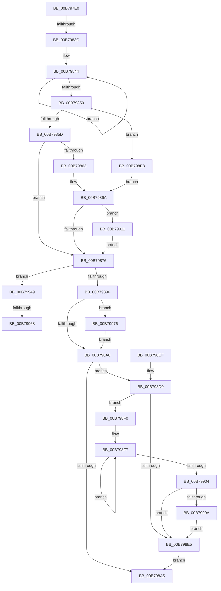

# KiCalibrateTimeAdjustment

- RVA: `0x00B797E0`–`0x00B79989` (길이 `425` bytes)
- VA: `0x0000000140B797E0`
- 실행 섹션: `PAGELK`
- PDB 이름 있음: `예`; PDB Function 태그: `예`
- unwind 정보 RVA: `0x000B8CA4`
- 디코드: `106`개 명령, `425/425` bytes 표시
- 미해석 바이트: `0` (있으면 어셈블리에 `.byte`로 보존)

> 이 문서는 커널 이미지의 기계어와 PDB 기호를 분석해 생성했습니다. 4번과 5번은 함수 원형과 자료형을 바이너리 사용 방식에서 추정한 C 해석이며 원본 소스 복구 결과는 아닙니다.

## 1. Dependencies

- 직접 호출 지점: **10**; 고유 호출 대상: **10**
- 직접 호출자로 확인된 함수: **0**
- RIP 상대 이미지 참조: **4**

### Outgoing calls
- `0x00B7983C` → [KeDisableInterrupts](../../text/21/KeDisableInterrupts_function_00217BE0.md) (function, `0x00217BE0`)
- `0x00B79844` → [KiPollFreezeExecution](../../text/4F/KiPollFreezeExecution_function_004FC0CC.md) (function, `0x004FC0CC`)
- `0x00B798AC` → [_security_check_cookie](../../text/6A/_security_check_cookie_function_006AC640.md) (function, `0x006AC640`)
- `0x00B7990A` → [KiRemoveSystemWorkPriorityKick](../../text/26/KiRemoveSystemWorkPriorityKick_function_002631D0.md) (function, `0x002631D0`)
- `0x00B7992C` → [KeRemoveQueueDpc](../../text/46/KeRemoveQueueDpc_function_0046CDA0.md) (function, `0x0046CDA0`)
- `0x00B7993F` → [KeInsertQueueDpc](../../text/20/KeInsertQueueDpc_function_00207C50.md) (function, `0x00207C50`)
- `0x00B79951` → [HalCalibratePerformanceCounter](../../text/53/HalCalibratePerformanceCounter_function_0053C010.md) (function, `0x0053C010`)
- `0x00B79956` → [KeRebaselineInterruptTime](../../text/4E/KeRebaselineInterruptTime_function_004E34CC.md) (function, `0x004E34CC`)
- `0x00B7996B` → [KiRebaselineProcessorStartCycles](../../text/5B/KiRebaselineProcessorStartCycles_function_005B20EC.md) (function, `0x005B20EC`)
- `0x00B7997F` → [KiUpdateSystemTime](../../text/4B/KiUpdateSystemTime_function_004B1570.md) (function, `0x004B1570`)

### Direct callers
- 이 함수 시작 RVA로 연결되는 직접 call은 확인되지 않았습니다. 간접 호출은 완전히 역산할 수 없습니다.

### Static image references
- `0x00B797FF` → RVA `0x00E0A740` (`.data`; read)
- `0x00B79823` → RVA `0x00FC5008` (`ALMOSTRO`; read)
- `0x00B79850` → RVA `0x00FC5030` (`ALMOSTRO`; read)
- `0x00B79863` → RVA `0x00FC8C40` (`ALMOSTRO`; read)

## 2. Other-region calls and transfers

- 다른 실행 섹션으로 향하는 call: **10**
  - `0x00B7983C` → [KeDisableInterrupts](../../text/21/KeDisableInterrupts_function_00217BE0.md) (`PAGELK` → `.text`)
  - `0x00B79844` → [KiPollFreezeExecution](../../text/4F/KiPollFreezeExecution_function_004FC0CC.md) (`PAGELK` → `.text`)
  - `0x00B798AC` → [_security_check_cookie](../../text/6A/_security_check_cookie_function_006AC640.md) (`PAGELK` → `.text`)
  - `0x00B7990A` → [KiRemoveSystemWorkPriorityKick](../../text/26/KiRemoveSystemWorkPriorityKick_function_002631D0.md) (`PAGELK` → `.text`)
  - `0x00B7992C` → [KeRemoveQueueDpc](../../text/46/KeRemoveQueueDpc_function_0046CDA0.md) (`PAGELK` → `.text`)
  - `0x00B7993F` → [KeInsertQueueDpc](../../text/20/KeInsertQueueDpc_function_00207C50.md) (`PAGELK` → `.text`)
  - `0x00B79951` → [HalCalibratePerformanceCounter](../../text/53/HalCalibratePerformanceCounter_function_0053C010.md) (`PAGELK` → `.text`)
  - `0x00B79956` → [KeRebaselineInterruptTime](../../text/4E/KeRebaselineInterruptTime_function_004E34CC.md) (`PAGELK` → `.text`)
  - `0x00B7996B` → [KiRebaselineProcessorStartCycles](../../text/5B/KiRebaselineProcessorStartCycles_function_005B20EC.md) (`PAGELK` → `.text`)
  - `0x00B7997F` → [KiUpdateSystemTime](../../text/4B/KiUpdateSystemTime_function_004B1570.md) (`PAGELK` → `.text`)
- call이 아닌 외부 분기/꼬리 이동: **3**
  - `0x00B79836` → [sub_00B80868](../B8/Unknown_function_00B80868.md) (`tail-transfer`)
  - `0x00B79962` → [sub_00B80868 + 0x186](../B8/Unknown_function_00B80868.md) (`tail-transfer`)
  - `0x00B79971` → [sub_00B80868 + 0x186](../B8/Unknown_function_00B80868.md) (`tail-transfer`)

## 3. Assembly (complete function range)

```asm
00B797E0  48 89 5C 24 10                  mov qword ptr [rsp + 0x10], rbx
00B797E5  48 89 74 24 18                  mov qword ptr [rsp + 0x18], rsi
00B797EA  48 89 7C 24 20                  mov qword ptr [rsp + 0x20], rdi
00B797EF  55                              push rbp
00B797F0  41 54                           push r12
00B797F2  41 55                           push r13
00B797F4  41 56                           push r14
00B797F6  41 57                           push r15
00B797F8  48 8B EC                        mov rbp, rsp
00B797FB  48 83 EC 70                     sub rsp, 0x70
00B797FF  48 8B 05 3A 0F 29 00            mov rax, qword ptr [rip + 0x290f3a]
00B79806  48 33 C4                        xor rax, rsp
00B79809  48 89 45 F0                     mov qword ptr [rbp - 0x10], rax
00B7980D  45 33 ED                        xor r13d, r13d
00B79810  48 8B F1                        mov rsi, rcx
00B79813  4C 89 6D D0                     mov qword ptr [rbp - 0x30], r13
00B79817  65 4C 8B 34 25 20 00 00 00      mov r14, qword ptr gs:[0x20]
00B79820  8B 41 04                        mov eax, dword ptr [rcx + 4]
00B79823  4C 8B 25 DE B7 44 00            mov r12, qword ptr [rip + 0x44b7de]
00B7982A  4C 89 6D C0                     mov qword ptr [rbp - 0x40], r13
00B7982E  4C 89 6D C8                     mov qword ptr [rbp - 0x38], r13
00B79832  41 39 46 24                     cmp dword ptr [r14 + 0x24], eax
00B79836  0F 84 2C 70 00 00               je 0x140b80868
00B7983C  E8 9F E3 69 FF                  call 0x140217be0
00B79841  44 8A F8                        mov r15b, al
00B79844  E8 83 28 98 FF                  call 0x1404fc0cc
00B79849  8B 4E 1C                        mov ecx, dword ptr [rsi + 0x1c]
00B7984C  85 C9                           test ecx, ecx
00B7984E  75 F4                           jne 0x140b79844
00B79850  44 39 2D D9 B7 44 00            cmp dword ptr [rip + 0x44b7d9], r13d
00B79857  0F 84 8B 00 00 00               je 0x140b798e8
00B7985D  45 38 6E 21                     cmp byte ptr [r14 + 0x21], r13b
00B79861  74 13                           je 0x140b79876
00B79863  48 8B 05 D6 F3 44 00            mov rax, qword ptr [rip + 0x44f3d6]
00B7986A  48 05 00 41 00 00               add rax, 0x4100
00B79870  0F 85 9B 00 00 00               jne 0x140b79911
00B79876  48 B8 20 03 00 00 80 F7 FF FF   movabs rax, 0xfffff78000000320
00B79880  8B 00                           mov eax, dword ptr [rax]
00B79882  41 89 86 C0 38 00 00            mov dword ptr [r14 + 0x38c0], eax
00B79889  48 8B 5E 08                     mov rbx, qword ptr [rsi + 8]
00B7988D  44 38 2E                        cmp byte ptr [rsi], r13b
00B79890  0F 85 B3 00 00 00               jne 0x140b79949
00B79896  45 38 6E 21                     cmp byte ptr [r14 + 0x21], r13b
00B7989A  0F 85 D6 00 00 00               jne 0x140b79976
00B798A0  45 84 FF                        test r15b, r15b
00B798A3  75 2B                           jne 0x140b798d0
00B798A5  48 8B 4D F0                     mov rcx, qword ptr [rbp - 0x10]
00B798A9  48 33 CC                        xor rcx, rsp
00B798AC  E8 8F 2D B3 FF                  call 0x1406ac640
00B798B1  4C 8D 5C 24 70                  lea r11, [rsp + 0x70]
00B798B6  49 8B 5B 38                     mov rbx, qword ptr [r11 + 0x38]
00B798BA  49 8B 73 40                     mov rsi, qword ptr [r11 + 0x40]
00B798BE  49 8B 7B 48                     mov rdi, qword ptr [r11 + 0x48]
00B798C2  49 8B E3                        mov rsp, r11
00B798C5  41 5F                           pop r15
00B798C7  41 5E                           pop r14
00B798C9  41 5D                           pop r13
00B798CB  41 5C                           pop r12
00B798CD  5D                              pop rbp
00B798CE  C3                              ret
00B798CF  CC                              int3
00B798D0  65 48 8B 0C 25 20 00 00 00      mov rcx, qword ptr gs:[0x20]
00B798D9  4C 8B 81 B8 8E 00 00            mov r8, qword ptr [rcx + 0x8eb8]
00B798E0  4D 85 C0                        test r8, r8
00B798E3  75 0B                           jne 0x140b798f0
00B798E5  FB                              sti
00B798E6  EB BD                           jmp 0x140b798a5
00B798E8  49 8B C6                        mov rax, r14
00B798EB  E9 7A FF FF FF                  jmp 0x140b7986a
00B798F0  41 0F 0D 08                     prefetchw byte ptr [r8]
00B798F4  41 8B 00                        mov eax, dword ptr [r8]
00B798F7  8B D0                           mov edx, eax
00B798F9  0F BA F2 15                     btr edx, 0x15
00B798FD  F0 41 0F B1 10                  lock cmpxchg dword ptr [r8], edx
00B79902  75 F3                           jne 0x140b798f7
00B79904  0F BA E0 15                     bt eax, 0x15
00B79908  73 DB                           jae 0x140b798e5
00B7990A  E8 C1 98 6E FF                  call 0x1402631d0
00B7990F  EB D4                           jmp 0x140b798e5
00B79911  48 BB 08 00 00 00 80 F7 FF FF   movabs rbx, 0xfffff78000000008
00B7991B  49 8D BE F0 83 00 00            lea rdi, [r14 + 0x83f0]
00B79922  48 8B CF                        mov rcx, rdi
00B79925  48 8B 1B                        mov rbx, qword ptr [rbx]
00B79928  48 C1 EB 12                     shr rbx, 0x12
00B7992C  E8 6F 34 8F FF                  call 0x14046cda0
00B79931  81 C3 00 FF FF FF               add ebx, 0xffffff00
00B79937  45 33 C0                        xor r8d, r8d
00B7993A  8B D3                           mov edx, ebx
00B7993C  48 8B CF                        mov rcx, rdi
00B7993F  E8 0C E3 68 FF                  call 0x140207c50
00B79944  E9 2D FF FF FF                  jmp 0x140b79876
00B79949  48 8B 56 10                     mov rdx, qword ptr [rsi + 0x10]
00B7994D  48 8D 4E 18                     lea rcx, [rsi + 0x18]
00B79951  E8 BA 26 9C FF                  call 0x14053c010
00B79956  E8 71 9B 96 FF                  call 0x1404e34cc
00B7995B  45 38 AE DC 86 00 00            cmp byte ptr [r14 + 0x86dc], r13b
00B79962  0F 84 86 70 00 00               je 0x140b809ee
00B79968  49 8B CE                        mov rcx, r14
00B7996B  E8 7C 87 A3 FF                  call 0x1405b20ec
00B79970  90                              nop
00B79971  E9 78 70 00 00                  jmp 0x140b809ee
00B79976  33 D2                           xor edx, edx
00B79978  48 8B CB                        mov rcx, rbx
00B7997B  44 8D 42 03                     lea r8d, [rdx + 3]
00B7997F  E8 EC 7B 93 FF                  call 0x1404b1570
00B79984  E9 17 FF FF FF                  jmp 0x140b798a0
```

## 4. C-style interpretation (structured pseudocode)

```c
__int64 __fastcall KiCalibrateTimeAdjustment(__int64 a1)
{
    __int64 result;
    __int64 v_r13;
    __int64 v_rbx;
    __int64 v_rsp;
    unsigned __int64 v_stack_m28;
    unsigned __int64 v_stack_m38;
    unsigned __int64 v_stack_m58;
    unsigned __int64 v_stack_m60;
    unsigned __int64 v_stack_m68;
    unsigned __int64 v_stack_p10;
    unsigned __int64 v_stack_p18;
    unsigned __int64 v_stack_p20;

    v_stack_p10 = v_rbx;
    v_stack_p18 = v_rsi;
    v_stack_p20 = v_rdi;
    v_rsp = (v_rsp) - (112);
    result = (*(unsigned __int64 *)(v_rip + 2690874)) ^ (v_rsp);
    v_stack_m38 = result;
    v_r13 = 0;
    v_stack_m58 = 0;
    v_stack_m68 = 0;
    v_stack_m60 = 0;
    result = KeDisableInterrupts(a1, a2, a3, a4);
loc_00B79844:
    result = KiPollFreezeExecution(a1, a2, a3, a4);
    if ((unsigned int)((unsigned int)(*(unsigned int *)(a1 + 28))) != 0) goto loc_00B79844;
    if ((*(unsigned int *)(v_rip + 4503513)) == 0) goto loc_00B798E8;
    if ((*(unsigned __int8 *)(*(unsigned __int64 *)(gs_base + (0 + 32)) + 33)) == 0) goto loc_00B79876;
loc_00B7986A:
    result = (*(unsigned __int64 *)(v_rip + 4518870)) + (0x4100ULL);
    if (condition_is_not_equal) goto loc_00B79911;
loc_00B79876:
    *(unsigned int *)(*(unsigned __int64 *)(gs_base + (0 + 32)) + 14528) = (unsigned int)((unsigned int)(*(unsigned int *)(result)));
    if ((*(unsigned __int8 *)(a1)) != 0) goto loc_00B79949;
    if ((*(unsigned __int8 *)(*(unsigned __int64 *)(gs_base + (0 + 32)) + 33)) != 0) goto loc_00B79976;
loc_00B798A0:
    if ((unsigned __int8)((unsigned __int8)(result)) != 0) goto loc_00B798D0;
loc_00B798A5:
    a1 = (v_stack_m38) ^ (v_rsp);
    result = _security_check_cookie(a1, a2, a3, a4);
    return result;
loc_00B798D0:
    if (*(unsigned __int64 *)(*(unsigned __int64 *)(gs_base + (0 + 32)) + 36536) != 0) goto loc_00B798F0;
loc_00B798E5:
    goto loc_00B798A5;
loc_00B798E8:
    goto loc_00B7986A;
loc_00B798F0:
loc_00B798F7:
    if (*(unsigned __int64 *)(*(unsigned __int64 *)(gs_base + (0 + 32)) + 36536) != 0) goto loc_00B798F7;
    if (condition_is_above_or_equal) goto loc_00B798E5;
    result = KiRemoveSystemWorkPriorityKick(*(unsigned __int64 *)(gs_base + (0 + 32)), (unsigned int)((unsigned int)((unsigned int)(*(unsigned int *)(*(unsigned __int64 *)(*(unsigned __int64 *)(gs_base + (0 + 32)) + 36536))))), *(unsigned __int64 *)(*(unsigned __int64 *)(gs_base + (0 + 32)) + 36536), a4);
    goto loc_00B798E5;
loc_00B79911:
    v_rbx = (*(unsigned __int64 *)(*(unsigned __int64 *)(v_stack_m28 + 56))) >> (18);
    result = KeRemoveQueueDpc(*(unsigned __int64 *)(gs_base + (0 + 32)) + 33776, (unsigned int)((unsigned int)((unsigned int)(*(unsigned int *)(*(unsigned __int64 *)(*(unsigned __int64 *)(gs_base + (0 + 32)) + 36536))))), *(unsigned __int64 *)(*(unsigned __int64 *)(gs_base + (0 + 32)) + 36536), a4);
    v_rbx = (unsigned int)((v_rbx) + (0xFFFFFF00ULL));
    a3 = 0;
    result = KeInsertQueueDpc(*(unsigned __int64 *)(gs_base + (0 + 32)) + 33776, (unsigned int)((unsigned int)(v_rbx)), a3, a4);
    goto loc_00B79876;
loc_00B79949:
    result = HalCalibratePerformanceCounter(*(unsigned __int64 *)(v_stack_m28 + 64) + 24, *(unsigned __int64 *)(*(unsigned __int64 *)(v_stack_m28 + 64) + 16), a3, a4);
    result = KeRebaselineInterruptTime(*(unsigned __int64 *)(v_stack_m28 + 64) + 24, *(unsigned __int64 *)(*(unsigned __int64 *)(v_stack_m28 + 64) + 16), a3, a4);
    result = KiRebaselineProcessorStartCycles(*(unsigned __int64 *)(gs_base + (0 + 32)), *(unsigned __int64 *)(*(unsigned __int64 *)(v_stack_m28 + 64) + 16), a3, a4);
loc_00B79976:
    a2 = 0;
    result = KiUpdateSystemTime(v_rbx, a2, a2 + 3, a4);
    goto loc_00B798A0;
}
```

## 5. (Beta) C Style

```c
int64_t KiCalibrateTimeAdjustment(void *Arg1)
{
    uint8_t *arg1 = (uint8_t *)Arg1;

    int64_t result;
    int64_t local_r13;
    int64_t local_rbx;
    int64_t local_rsp;
    uint64_t v_stack_m28;
    uint64_t v_stack_m38;
    uint64_t v_stack_m58;
    uint64_t v_stack_m60;
    uint64_t v_stack_m68;
    uint64_t v_stack_p10;
    uint64_t v_stack_p18;
    uint64_t v_stack_p20;

    v_stack_p10 = local_rbx;
    v_stack_p18 = local_rsi;
    v_stack_p20 = local_rdi;
    local_rsp = (local_rsp) - (112);
    result = (*(uint64_t *)(v_rip + 0x290F3A)) ^ (local_rsp);
    v_stack_m38 = result;
    local_r13 = 0;
    v_stack_m58 = 0;
    v_stack_m68 = 0;
    v_stack_m60 = 0;
    result = KeDisableInterrupts(Arg1, a2, a3, a4);
loc_00B79844:
    result = KiPollFreezeExecution(Arg1, a2, a3, a4);
    if ((uint32_t)((uint32_t)(*(uint32_t *)(arg1 + 0x1C))) != 0) goto loc_00B79844;
    if ((*(uint32_t *)(v_rip + 0x44B7D9)) == 0) goto loc_00B798E8;
    if ((*(uint8_t *)(*(uint64_t *)(gs_base + (0 + 0x20)) + 0x21)) == 0) goto loc_00B79876;
loc_00B7986A:
    result = (*(uint64_t *)(v_rip + 0x44F3D6)) + (0x4100ULL);
    if (condition_is_not_equal) goto loc_00B79911;
loc_00B79876:
    *(uint32_t *)(*(uint64_t *)(gs_base + (0 + 0x20)) + 0x38C0) = (uint32_t)((uint32_t)(*(uint32_t *)(result)));
    if ((*(uint8_t *)(arg1)) != 0) goto loc_00B79949;
    if ((*(uint8_t *)(*(uint64_t *)(gs_base + (0 + 0x20)) + 0x21)) != 0) goto loc_00B79976;
loc_00B798A0:
    if ((uint8_t)((uint8_t)(result)) != 0) goto loc_00B798D0;
loc_00B798A5:
    Arg1 = (v_stack_m38) ^ (local_rsp);
    result = _security_check_cookie(Arg1, a2, a3, a4);
    return result;
loc_00B798D0:
    if (*(uint64_t *)(*(uint64_t *)(gs_base + (0 + 0x20)) + 0x8EB8) != 0) goto loc_00B798F0;
loc_00B798E5:
    goto loc_00B798A5;
loc_00B798E8:
    goto loc_00B7986A;
loc_00B798F0:
loc_00B798F7:
    if (*(uint64_t *)(*(uint64_t *)(gs_base + (0 + 0x20)) + 0x8EB8) != 0) goto loc_00B798F7;
    if (condition_is_above_or_equal) goto loc_00B798E5;
    result = KiRemoveSystemWorkPriorityKick(*(uint64_t *)(gs_base + (0 + 0x20)), (uint32_t)((uint32_t)((uint32_t)(*(uint32_t *)(*(uint64_t *)(*(uint64_t *)(gs_base + (0 + 0x20)) + 0x8EB8))))), *(uint64_t *)(*(uint64_t *)(gs_base + (0 + 0x20)) + 0x8EB8), a4);
    goto loc_00B798E5;
loc_00B79911:
    local_rbx = (*(uint64_t *)(*(uint64_t *)(v_stack_m28 + 0x38))) >> (18);
    result = KeRemoveQueueDpc(*(uint64_t *)(gs_base + (0 + 0x20)) + 33776, (uint32_t)((uint32_t)((uint32_t)(*(uint32_t *)(*(uint64_t *)(*(uint64_t *)(gs_base + (0 + 0x20)) + 0x8EB8))))), *(uint64_t *)(*(uint64_t *)(gs_base + (0 + 0x20)) + 0x8EB8), a4);
    local_rbx = (uint32_t)((local_rbx) + (0xFFFFFF00ULL));
    a3 = 0;
    result = KeInsertQueueDpc(*(uint64_t *)(gs_base + (0 + 0x20)) + 33776, (uint32_t)((uint32_t)(local_rbx)), a3, a4);
    goto loc_00B79876;
loc_00B79949:
    result = HalCalibratePerformanceCounter(*(uint64_t *)(v_stack_m28 + 0x40) + 24, *(uint64_t *)(*(uint64_t *)(v_stack_m28 + 0x40) + 0x10), a3, a4);
    result = KeRebaselineInterruptTime(*(uint64_t *)(v_stack_m28 + 0x40) + 24, *(uint64_t *)(*(uint64_t *)(v_stack_m28 + 0x40) + 0x10), a3, a4);
    result = KiRebaselineProcessorStartCycles(*(uint64_t *)(gs_base + (0 + 0x20)), *(uint64_t *)(*(uint64_t *)(v_stack_m28 + 0x40) + 0x10), a3, a4);
loc_00B79976:
    a2 = 0;
    result = KiUpdateSystemTime(local_rbx, a2, a2 + 3, a4);
    goto loc_00B798A0;
}
```

### 관측된 메모리 오프셋

구조체 형식이 확인되지 않은 접근은 인자 기준의 오프셋으로만 기록했습니다.

| 기준 인자 | 오프셋 표현 | 폭 (bit) | 접근 |
|---|---:|---:|---|
| `Arg1` | `+ 0x0` | `8` | `R` |
| `Arg1` | `+ 0x4` | `32` | `R` |
| `Arg1` | `+ 0x8` | `64` | `R` |
| `Arg1` | `+ 0x10` | `64` | `R` |
| `Arg1` | `+ 0x18` | `64` | `R` |
| `Arg1` | `+ 0x1C` | `32` | `R` |

## 6. Execution-region graph

[열기: 2D/3D 그래프와 함수 탐색 컨트롤 패널](../../../control-panel.html?section=pagelk&rva=0x00B797E0&view=graph)

- 2D 그래프는 위에서 아래로 흐르고, 3D 그래프는 빈 공간을 드래그해 회전합니다. Shift+드래그는 이동, 휠은 확대·축소, 함수 노드 선택은 대상 보고서 이동입니다.

### Static fallback


