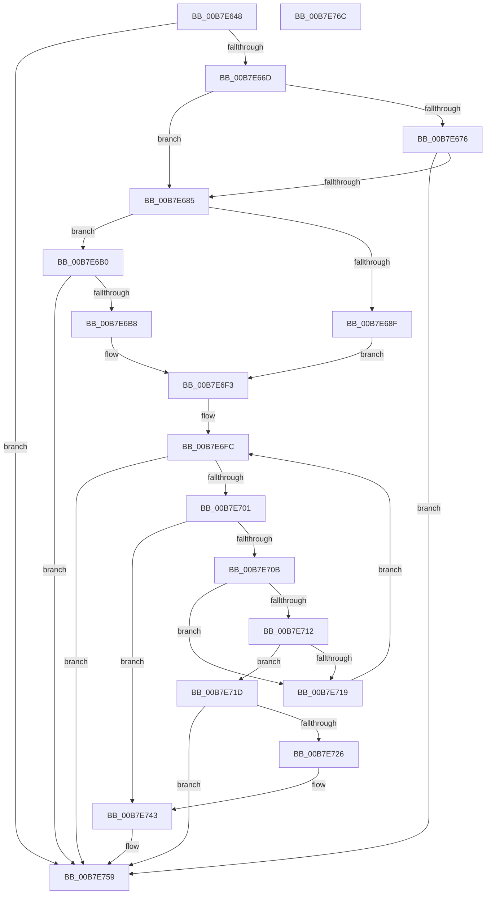

# KiCheckMicrocode

- RVA: `0x00B7E648`–`0x00B7E76D` (길이 `293` bytes)
- VA: `0x0000000140B7E648`
- 실행 섹션: `PAGELK`
- PDB 이름 있음: `예`; PDB Function 태그: `아니요`
- unwind 정보 RVA: `0x000606C0`
- 디코드: `83`개 명령, `293/293` bytes 표시
- 미해석 바이트: `0` (있으면 어셈블리에 `.byte`로 보존)

> 이 문서는 커널 이미지의 기계어와 PDB 기호를 분석해 생성했습니다. 4번과 5번은 함수 원형과 자료형을 바이너리 사용 방식에서 추정한 C 해석이며 원본 소스 복구 결과는 아닙니다.

## 1. Dependencies

- 직접 호출 지점: **2**; 고유 호출 대상: **2**
- 직접 호출자로 확인된 함수: **2**
- RIP 상대 이미지 참조: **5**

### Outgoing calls
- `0x00B7E73D` → [KeBugCheckEx](../../text/4F/KeBugCheckEx_function_004FD660.md) (function, `0x004FD660`)
- `0x00B7E761` → [_security_check_cookie](../../text/6A/_security_check_cookie_function_006AC640.md) (function, `0x006AC640`)

### Direct callers
- [KiRestoreFeatureBits](../../text/4D/KiRestoreFeatureBits_function_004D4D18.md) at `0x004D4E17`
- [KiInitializeKernel](../B6/KiInitializeKernel_function_00B68D20.md) at `0x00B68DF5`

### Static image references
- `0x00B7E64E` → RVA `0x00E0A740` (`.data`; read)
- `0x00B7E65D` → RVA `0x00FC6E78` (`ALMOSTRO`; read)
- `0x00B7E66D` → RVA `0x00FC6E74` (`ALMOSTRO`; read)
- `0x00B7E676` → RVA `0x00FC6FDC` (`ALMOSTRO`; read)
- `0x00B7E6F5` → RVA `0x00FC75A0` (`ALMOSTRO`; read)

## 2. Other-region calls and transfers

- 다른 실행 섹션으로 향하는 call: **2**
  - `0x00B7E73D` → [KeBugCheckEx](../../text/4F/KeBugCheckEx_function_004FD660.md) (`PAGELK` → `.text`)
  - `0x00B7E761` → [_security_check_cookie](../../text/6A/_security_check_cookie_function_006AC640.md) (`PAGELK` → `.text`)
- 별도 외부 분기/꼬리 이동을 확인하지 못했습니다.

## 3. Assembly (complete function range)

```asm
00B7E648  40 53                           push rbx
00B7E64A  48 83 EC 50                     sub rsp, 0x50
00B7E64E  48 8B 05 EB C0 28 00            mov rax, qword ptr [rip + 0x28c0eb]
00B7E655  48 33 C4                        xor rax, rsp
00B7E658  48 89 44 24 40                  mov qword ptr [rsp + 0x40], rax
00B7E65D  83 3D 14 88 44 00 00            cmp dword ptr [rip + 0x448814], 0
00B7E664  4C 8B C1                        mov r8, rcx
00B7E667  0F 84 EC 00 00 00               je 0x140b7e759
00B7E66D  83 3D 00 88 44 00 00            cmp dword ptr [rip + 0x448800], 0
00B7E674  74 0F                           je 0x140b7e685
00B7E676  8B 05 60 89 44 00               mov eax, dword ptr [rip + 0x448960]
00B7E67C  39 41 24                        cmp dword ptr [rcx + 0x24], eax
00B7E67F  0F 83 D4 00 00 00               jae 0x140b7e759
00B7E685  8A 81 8D 00 00 00               mov al, byte ptr [rcx + 0x8d]
00B7E68B  3C 01                           cmp al, 1
00B7E68D  75 21                           jne 0x140b7e6b0
00B7E68F  B9 8B 00 00 00                  mov ecx, 0x8b
00B7E694  0F 32                           rdmsr
00B7E696  48 C1 E2 20                     shl rdx, 0x20
00B7E69A  45 33 DB                        xor r11d, r11d
00B7E69D  48 0B C2                        or rax, rdx
00B7E6A0  4C 8B C8                        mov r9, rax
00B7E6A3  33 C9                           xor ecx, ecx
00B7E6A5  41 8D 43 01                     lea eax, [r11 + 1]
00B7E6A9  0F A2                           cpuid
00B7E6AB  44 8B D0                        mov r10d, eax
00B7E6AE  EB 43                           jmp 0x140b7e6f3
00B7E6B0  3C 02                           cmp al, 2
00B7E6B2  0F 85 A1 00 00 00               jne 0x140b7e759
00B7E6B8  33 C0                           xor eax, eax
00B7E6BA  B9 8B 00 00 00                  mov ecx, 0x8b
00B7E6BF  33 D2                           xor edx, edx
00B7E6C1  0F 30                           wrmsr
00B7E6C3  33 C9                           xor ecx, ecx
00B7E6C5  8D 42 01                        lea eax, [rdx + 1]
00B7E6C8  0F A2                           cpuid
00B7E6CA  44 8B D0                        mov r10d, eax
00B7E6CD  B9 8B 00 00 00                  mov ecx, 0x8b
00B7E6D2  0F 32                           rdmsr
00B7E6D4  48 C1 E2 20                     shl rdx, 0x20
00B7E6D8  B9 17 00 00 00                  mov ecx, 0x17
00B7E6DD  48 0B C2                        or rax, rdx
00B7E6E0  48 C1 E8 20                     shr rax, 0x20
00B7E6E4  44 8B C8                        mov r9d, eax
00B7E6E7  0F 32                           rdmsr
00B7E6E9  48 C1 E2 20                     shl rdx, 0x20
00B7E6ED  48 0B C2                        or rax, rdx
00B7E6F0  4C 8B D8                        mov r11, rax
00B7E6F3  33 DB                           xor ebx, ebx
00B7E6F5  48 8D 05 A4 8E 44 00            lea rax, [rip + 0x448ea4]
00B7E6FC  83 FB 04                        cmp ebx, 4
00B7E6FF  73 58                           jae 0x140b7e759
00B7E701  48 8D 14 5B                     lea rdx, [rbx + rbx*2]
00B7E705  83 3C D0 00                     cmp dword ptr [rax + rdx*8], 0
00B7E709  74 38                           je 0x140b7e743
00B7E70B  44 39 54 D0 04                  cmp dword ptr [rax + rdx*8 + 4], r10d
00B7E710  75 07                           jne 0x140b7e719
00B7E712  4C 39 5C D0 08                  cmp qword ptr [rax + rdx*8 + 8], r11
00B7E717  74 04                           je 0x140b7e71d
00B7E719  FF C3                           inc ebx
00B7E71B  EB DF                           jmp 0x140b7e6fc
00B7E71D  8B 4C D0 10                     mov ecx, dword ptr [rax + rdx*8 + 0x10]
00B7E721  41 3B C9                        cmp ecx, r9d
00B7E724  74 33                           je 0x140b7e759
00B7E726  41 8B 40 24                     mov eax, dword ptr [r8 + 0x24]
00B7E72A  44 8B C1                        mov r8d, ecx
00B7E72D  B9 7E 01 00 00                  mov ecx, 0x17e
00B7E732  45 8B C9                        mov r9d, r9d
00B7E735  41 8B D2                        mov edx, r10d
00B7E738  48 89 44 24 20                  mov qword ptr [rsp + 0x20], rax
00B7E73D  E8 1E EF 97 FF                  call 0x1404fd660
00B7E742  CC                              int3
00B7E743  C7 04 D0 01 00 00 00            mov dword ptr [rax + rdx*8], 1
00B7E74A  44 89 54 D0 04                  mov dword ptr [rax + rdx*8 + 4], r10d
00B7E74F  4C 89 5C D0 08                  mov qword ptr [rax + rdx*8 + 8], r11
00B7E754  44 89 4C D0 10                  mov dword ptr [rax + rdx*8 + 0x10], r9d
00B7E759  48 8B 4C 24 40                  mov rcx, qword ptr [rsp + 0x40]
00B7E75E  48 33 CC                        xor rcx, rsp
00B7E761  E8 DA DE B2 FF                  call 0x1406ac640
00B7E766  48 83 C4 50                     add rsp, 0x50
00B7E76A  5B                              pop rbx
00B7E76B  C3                              ret
00B7E76C  CC                              int3
```

## 4. C-style interpretation (structured pseudocode)

```c
__int64 __fastcall KiCheckMicrocode(__int64 a1, __int64 a2)
{
    __int64 result;
    __int64 v_r11;
    __int64 v_rbx;
    __int64 v_rsp;
    unsigned __int64 v_stack_m18;
    unsigned __int64 v_stack_m38;

    v_rsp = (v_rsp) - (80);
    result = (*(unsigned __int64 *)(v_rip + 2670827)) ^ (v_rsp);
    v_stack_m18 = result;
    if ((*(unsigned int *)(v_rip + 4491284)) == 0) goto loc_00B7E759;
    if ((*(unsigned int *)(v_rip + 4491264)) == 0) goto loc_00B7E685;
    if ((*(unsigned int *)(a1 + 36)) >= ((unsigned int)((unsigned int)(*(unsigned int *)(v_rip + 4491616))))) goto loc_00B7E759;
loc_00B7E685:
    if (((unsigned __int8)(*(unsigned __int8 *)(a1 + 141))) != 1) goto loc_00B7E6B0;
    a2 = (a2) << (32);
    v_r11 = 0;
    result = (*(unsigned __int8 *)(a1 + 141)) | (a2);
    a1 = 0;
    goto loc_00B7E6F3;
loc_00B7E6B0:
    if (((unsigned __int8)(v_r11 + 1)) != 2) goto loc_00B7E759;
    result = 0;
    a2 = 0;
    a1 = 0;
    a2 = (a2) << (32);
    result = (a2 + 1) | (a2);
    result = (result) >> (32);
    a2 = (a2) << (32);
    result = (result) | (a2);
loc_00B7E6F3:
    v_rbx = 0;
loc_00B7E6FC:
    if (0 >= 4) goto loc_00B7E759;
    if ((*(unsigned int *)(v_rip + 4492964 + v_rbx + v_rbx * 2 * 8)) == 0) goto loc_00B7E743;
    if ((*(unsigned int *)(v_rip + 4492964 + v_rbx + v_rbx * 2 * 8 + 4)) != ((unsigned int)((unsigned int)((unsigned int)(a2 + 1))))) goto loc_00B7E719;
    if ((*(unsigned __int64 *)(v_rip + 4492964 + v_rbx + v_rbx * 2 * 8 + 8)) == result) goto loc_00B7E71D;
loc_00B7E719:
    v_rbx = (unsigned int)((v_rbx) + 1);
    goto loc_00B7E6FC;
loc_00B7E71D:
    if (((unsigned int)((unsigned int)(*(unsigned int *)(v_rip + 4492964 + v_rbx + v_rbx * 2 * 8 + 16)))) == ((unsigned int)((unsigned int)((unsigned int)(result))))) goto loc_00B7E759;
    v_stack_m38 = (unsigned int)(*(unsigned int *)(a1 + 36));
    result = KeBugCheckEx(382, (unsigned int)((unsigned int)((unsigned int)((unsigned int)(a2 + 1)))), (unsigned int)((unsigned int)((unsigned int)(*(unsigned int *)(v_rip + 4492964 + v_rbx + v_rbx * 2 * 8 + 16)))), (unsigned int)((unsigned int)((unsigned int)((unsigned int)(result)))));
loc_00B7E743:
    *(unsigned int *)(result + (unsigned int)((unsigned int)((unsigned int)((unsigned int)(a2 + 1)))) * 8) = 1;
    *(unsigned int *)(result + (unsigned int)((unsigned int)((unsigned int)((unsigned int)(a2 + 1)))) * 8 + 4) = (unsigned int)((unsigned int)((unsigned int)(a2 + 1)));
    *(unsigned __int64 *)(result + (unsigned int)((unsigned int)((unsigned int)((unsigned int)(a2 + 1)))) * 8 + 8) = result;
    *(unsigned int *)(result + (unsigned int)((unsigned int)((unsigned int)((unsigned int)(a2 + 1)))) * 8 + 16) = (unsigned int)((unsigned int)((unsigned int)((unsigned int)((unsigned int)(result)))));
loc_00B7E759:
    a1 = (v_stack_m18) ^ (v_rsp);
    result = _security_check_cookie(a1, (unsigned int)((unsigned int)((unsigned int)((unsigned int)(a2 + 1)))), (unsigned int)((unsigned int)((unsigned int)(*(unsigned int *)(v_rip + 4492964 + v_rbx + v_rbx * 2 * 8 + 16)))), (unsigned int)((unsigned int)((unsigned int)((unsigned int)(result)))));
    v_rsp = (v_rsp) + (80);
    return result;
}
```

## 5. (Beta) C Style

```c
int64_t KiCheckMicrocode(void *Arg1, int64_t Arg2)
{
    uint8_t *arg1 = (uint8_t *)Arg1;

    int64_t result;
    int64_t local_r11;
    int64_t local_rbx;
    int64_t local_rsp;
    uint64_t v_stack_m18;
    uint64_t v_stack_m38;

    local_rsp = (local_rsp) - (80);
    result = (*(uint64_t *)(v_rip + 0x28C0EB)) ^ (local_rsp);
    v_stack_m18 = result;
    if ((*(uint32_t *)(v_rip + 0x448814)) == 0) goto loc_00B7E759;
    if ((*(uint32_t *)(v_rip + 0x448800)) == 0) goto loc_00B7E685;
    if ((*(uint32_t *)(arg1 + 0x24)) >= ((uint32_t)((uint32_t)(*(uint32_t *)(v_rip + 0x448960))))) goto loc_00B7E759;
loc_00B7E685:
    if (((uint8_t)(*(uint8_t *)(arg1 + 0x8D))) != 1) goto loc_00B7E6B0;
    Arg2 = (Arg2) << (32);
    local_r11 = 0;
    result = (*(uint8_t *)(arg1 + 0x8D)) | (Arg2);
    Arg1 = 0;
    goto loc_00B7E6F3;
loc_00B7E6B0:
    if (((uint8_t)(local_r11 + 1)) != 2) goto loc_00B7E759;
    result = 0;
    Arg2 = 0;
    Arg1 = 0;
    Arg2 = (Arg2) << (32);
    result = (Arg2 + 1) | (Arg2);
    result = (result) >> (32);
    Arg2 = (Arg2) << (32);
    result = (result) | (Arg2);
loc_00B7E6F3:
    local_rbx = 0;
loc_00B7E6FC:
    if (0 >= 4) goto loc_00B7E759;
    if ((*(uint32_t *)(v_rip + 0x448EA4 + local_rbx + local_rbx * 2 * 8)) == 0) goto loc_00B7E743;
    if ((*(uint32_t *)(v_rip + 0x448EA4 + local_rbx + local_rbx * 2 * 8 + 0x4)) != ((uint32_t)((uint32_t)((uint32_t)(Arg2 + 1))))) goto loc_00B7E719;
    if ((*(uint64_t *)(v_rip + 0x448EA4 + local_rbx + local_rbx * 2 * 8 + 0x8)) == result) goto loc_00B7E71D;
loc_00B7E719:
    local_rbx = (uint32_t)((local_rbx) + 1);
    goto loc_00B7E6FC;
loc_00B7E71D:
    if (((uint32_t)((uint32_t)(*(uint32_t *)(v_rip + 0x448EA4 + local_rbx + local_rbx * 2 * 8 + 0x10)))) == ((uint32_t)((uint32_t)((uint32_t)(result))))) goto loc_00B7E759;
    v_stack_m38 = (uint32_t)(*(uint32_t *)(arg1 + 0x24));
    result = KeBugCheckEx(382, (uint32_t)((uint32_t)((uint32_t)((uint32_t)(Arg2 + 1)))), (uint32_t)((uint32_t)((uint32_t)(*(uint32_t *)(v_rip + 0x448EA4 + local_rbx + local_rbx * 2 * 8 + 0x10)))), (uint32_t)((uint32_t)((uint32_t)((uint32_t)(result)))));
loc_00B7E743:
    *(uint32_t *)(result + (uint32_t)((uint32_t)((uint32_t)((uint32_t)(Arg2 + 0x1)))) * 8) = 1;
    *(uint32_t *)(result + (uint32_t)((uint32_t)((uint32_t)((uint32_t)(Arg2 + 0x1)))) * 8 + 0x4) = (uint32_t)((uint32_t)((uint32_t)(Arg2 + 1)));
    *(uint64_t *)(result + (uint32_t)((uint32_t)((uint32_t)((uint32_t)(Arg2 + 0x1)))) * 8 + 0x8) = result;
    *(uint32_t *)(result + (uint32_t)((uint32_t)((uint32_t)((uint32_t)(Arg2 + 0x1)))) * 8 + 0x10) = (uint32_t)((uint32_t)((uint32_t)((uint32_t)((uint32_t)(result)))));
loc_00B7E759:
    Arg1 = (v_stack_m18) ^ (local_rsp);
    result = _security_check_cookie(Arg1, (uint32_t)((uint32_t)((uint32_t)((uint32_t)(Arg2 + 1)))), (uint32_t)((uint32_t)((uint32_t)(*(uint32_t *)(v_rip + 0x448EA4 + local_rbx + local_rbx * 2 * 8 + 0x10)))), (uint32_t)((uint32_t)((uint32_t)((uint32_t)(result)))));
    local_rsp = (local_rsp) + (80);
    return result;
}
```

### 관측된 메모리 오프셋

구조체 형식이 확인되지 않은 접근은 인자 기준의 오프셋으로만 기록했습니다.

| 기준 인자 | 오프셋 표현 | 폭 (bit) | 접근 |
|---|---:|---:|---|
| `Arg1` | `+ 0x24` | `32` | `R` |
| `Arg1` | `+ 0x8D` | `8` | `R` |

## 6. Execution-region graph

[열기: 2D/3D 그래프와 함수 탐색 컨트롤 패널](../../../control-panel.html?section=pagelk&rva=0x00B7E648&view=graph)

- 2D 그래프는 위에서 아래로 흐르고, 3D 그래프는 빈 공간을 드래그해 회전합니다. Shift+드래그는 이동, 휠은 확대·축소, 함수 노드 선택은 대상 보고서 이동입니다.

### Static fallback


