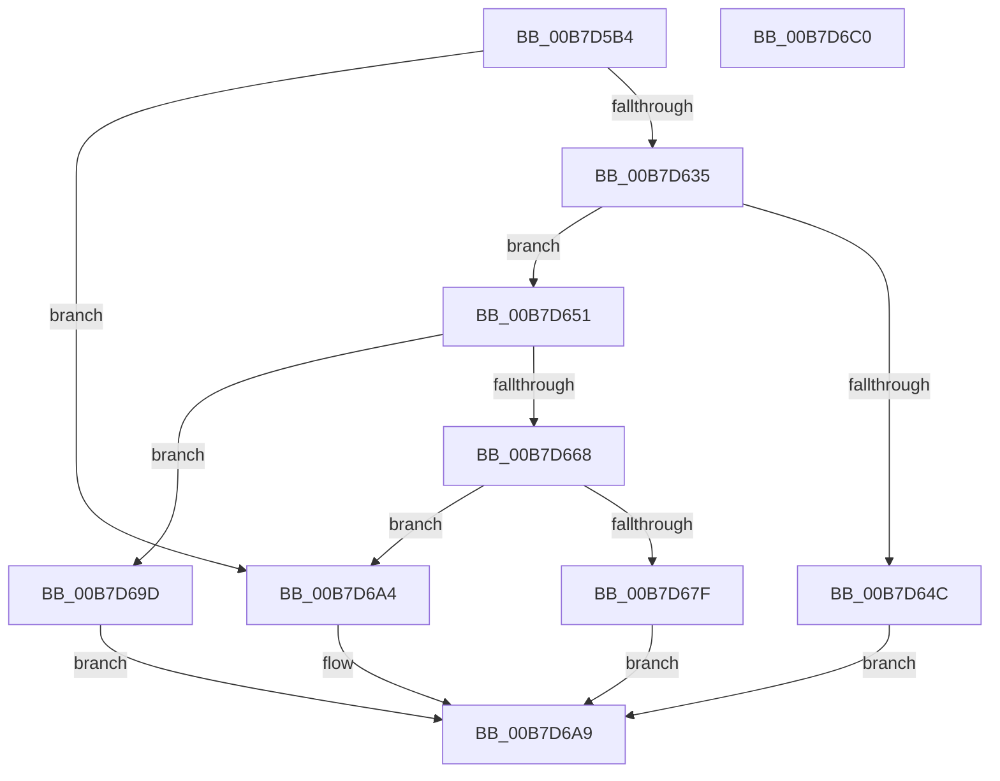

# KiGetCpuVendor

- RVA: `0x00B7D5B4`–`0x00B7D6C1` (길이 `269` bytes)
- VA: `0x0000000140B7D5B4`
- 실행 섹션: `PAGELK`
- PDB 이름 있음: `예`; PDB Function 태그: `아니요`
- unwind 정보 RVA: `0x000BDBF4`
- 디코드: `70`개 명령, `269/269` bytes 표시
- 미해석 바이트: `0` (있으면 어셈블리에 `.byte`로 보존)

> 이 문서는 커널 이미지의 기계어와 PDB 기호를 분석해 생성했습니다. 4번과 5번은 함수 원형과 자료형을 바이너리 사용 방식에서 추정한 C 해석이며 원본 소스 복구 결과는 아닙니다.

## 1. Dependencies

- 직접 호출 지점: **6**; 고유 호출 대상: **2**
- 직접 호출자로 확인된 함수: **11**
- RIP 상대 이미지 참조: **6**

### Outgoing calls
- `0x00B7D62C` → [strncmp](../../text/6C/strncmp_function_006C6720.md) (function, `0x006C6720`)
- `0x00B7D643` → [strncmp](../../text/6C/strncmp_function_006C6720.md) (function, `0x006C6720`)
- `0x00B7D65F` → [strncmp](../../text/6C/strncmp_function_006C6720.md) (function, `0x006C6720`)
- `0x00B7D676` → [strncmp](../../text/6C/strncmp_function_006C6720.md) (function, `0x006C6720`)
- `0x00B7D68D` → [strncmp](../../text/6C/strncmp_function_006C6720.md) (function, `0x006C6720`)
- `0x00B7D6B0` → [_security_check_cookie](../../text/6A/_security_check_cookie_function_006AC640.md) (function, `0x006AC640`)

### Direct callers
- [HvlpProcessIommu](../../text/4D/HvlpProcessIommu_function_004DE458.md) at `0x004DE497`
- [KiGetIptInfo](../../text/5B/KiGetIptInfo_function_005B9D38.md) at `0x005B9D68`
- [EtwpAddMicroarchitecturalPmcToPmcGroup](../../page/7B/EtwpAddMicroarchitecturalPmcToPmcGroup_function_007B5228.md) at `0x007B536B`
- [EtwpAddMicroarchitecturalPmcToRegistry](../../page/7B/EtwpAddMicroarchitecturalPmcToRegistry_function_007B5558.md) at `0x007B55C7`
- [EtwpLoadMicroarchitecturalProfileGroup](../../page/7B/EtwpLoadMicroarchitecturalProfileGroup_function_007B6F74.md) at `0x007B702A`
- [EtwpLoadMicroarchitecturalProfileSource](../../page/7B/EtwpLoadMicroarchitecturalProfileSource_function_007B7288.md) at `0x007B75BB`
- [EtwpRemoveMicroarchitecturalPmcFromRegistry](../../page/7B/EtwpRemoveMicroarchitecturalPmcFromRegistry_function_007B7ACC.md) at `0x007B7AF1`
- [sub_00B3C988](../../page/B3/Unknown_function_00B3C988.md) at `0x00B3D14F`
- [KiIsNXSupported](../B6/KiIsNXSupported_function_00B66C98.md) at `0x00B66CC2`
- [PopIsMktmeEnabled](../B6/PopIsMktmeEnabled_function_00B6E054.md) at `0x00B6E070`
- [KiInitializeNxSupportDiscard](../../init/C3/KiInitializeNxSupportDiscard_function_00C39888.md) at `0x00C399BB`

### Static image references
- `0x00B7D5C1` → RVA `0x00E0A740` (`.data`; read)
- `0x00B7D5F8` → RVA `0x00B7FCE0` (` ?? ::OKHAJAOM::`string'`; read)
- `0x00B7D638` → RVA `0x00B7FCD0` (` ?? ::OKHAJAOM::`string'`; read)
- `0x00B7D654` → RVA `0x00B7FCB0` (` ?? ::OKHAJAOM::`string'`; read)
- `0x00B7D66B` → RVA `0x00B7FCA0` (` ?? ::OKHAJAOM::`string'`; read)
- `0x00B7D682` → RVA `0x00B7FCC0` (` ?? ::OKHAJAOM::`string'`; read)

## 2. Other-region calls and transfers

- 다른 실행 섹션으로 향하는 call: **6**
  - `0x00B7D62C` → [strncmp](../../text/6C/strncmp_function_006C6720.md) (`PAGELK` → `.text`)
  - `0x00B7D643` → [strncmp](../../text/6C/strncmp_function_006C6720.md) (`PAGELK` → `.text`)
  - `0x00B7D65F` → [strncmp](../../text/6C/strncmp_function_006C6720.md) (`PAGELK` → `.text`)
  - `0x00B7D676` → [strncmp](../../text/6C/strncmp_function_006C6720.md) (`PAGELK` → `.text`)
  - `0x00B7D68D` → [strncmp](../../text/6C/strncmp_function_006C6720.md) (`PAGELK` → `.text`)
  - `0x00B7D6B0` → [_security_check_cookie](../../text/6A/_security_check_cookie_function_006AC640.md) (`PAGELK` → `.text`)
- 별도 외부 분기/꼬리 이동을 확인하지 못했습니다.

## 3. Assembly (complete function range)

```asm
00B7D5B4  48 89 5C 24 08                  mov qword ptr [rsp + 8], rbx
00B7D5B9  55                              push rbp
00B7D5BA  48 8B EC                        mov rbp, rsp
00B7D5BD  48 83 EC 40                     sub rsp, 0x40
00B7D5C1  48 8B 05 78 D1 28 00            mov rax, qword ptr [rip + 0x28d178]
00B7D5C8  48 33 C4                        xor rax, rsp
00B7D5CB  48 89 45 F0                     mov qword ptr [rbp - 0x10], rax
00B7D5CF  0F 57 C0                        xorps xmm0, xmm0
00B7D5D2  33 C0                           xor eax, eax
00B7D5D4  0F 11 45 E0                     movups xmmword ptr [rbp - 0x20], xmm0
00B7D5D8  65 4C 8B 04 25 20 00 00 00      mov r8, qword ptr gs:[0x20]
00B7D5E1  33 C9                           xor ecx, ecx
00B7D5E3  0F A2                           cpuid
00B7D5E5  41 C6 80 90 8F 00 00 00         mov byte ptr [r8 + 0x8f90], 0
00B7D5ED  89 5D E4                        mov dword ptr [rbp - 0x1c], ebx
00B7D5F0  BB 0C 00 00 00                  mov ebx, 0xc
00B7D5F5  89 55 E8                        mov dword ptr [rbp - 0x18], edx
00B7D5F8  48 8D 15 E1 26 00 00            lea rdx, [rip + 0x26e1]
00B7D5FF  F2 0F 10 45 E4                  movsd xmm0, qword ptr [rbp - 0x1c]
00B7D604  89 4D EC                        mov dword ptr [rbp - 0x14], ecx
00B7D607  48 8D 4D E4                     lea rcx, [rbp - 0x1c]
00B7D60B  89 45 E0                        mov dword ptr [rbp - 0x20], eax
00B7D60E  F2 41 0F 11 80 90 8F 00 00      movsd qword ptr [r8 + 0x8f90], xmm0
00B7D617  8B 45 EC                        mov eax, dword ptr [rbp - 0x14]
00B7D61A  41 89 80 98 8F 00 00            mov dword ptr [r8 + 0x8f98], eax
00B7D621  41 C6 80 9C 8F 00 00 00         mov byte ptr [r8 + 0x8f9c], 0
00B7D629  44 8B C3                        mov r8d, ebx
00B7D62C  E8 EF 90 B4 FF                  call 0x1406c6720
00B7D631  85 C0                           test eax, eax
00B7D633  74 6F                           je 0x140b7d6a4
00B7D635  44 8B C3                        mov r8d, ebx
00B7D638  48 8D 15 91 26 00 00            lea rdx, [rip + 0x2691]
00B7D63F  48 8D 4D E4                     lea rcx, [rbp - 0x1c]
00B7D643  E8 D8 90 B4 FF                  call 0x1406c6720
00B7D648  85 C0                           test eax, eax
00B7D64A  75 05                           jne 0x140b7d651
00B7D64C  8D 43 F6                        lea eax, [rbx - 0xa]
00B7D64F  EB 58                           jmp 0x140b7d6a9
00B7D651  4C 8B C3                        mov r8, rbx
00B7D654  48 8D 15 55 26 00 00            lea rdx, [rip + 0x2655]
00B7D65B  48 8D 4D E4                     lea rcx, [rbp - 0x1c]
00B7D65F  E8 BC 90 B4 FF                  call 0x1406c6720
00B7D664  85 C0                           test eax, eax
00B7D666  74 35                           je 0x140b7d69d
00B7D668  4C 8B C3                        mov r8, rbx
00B7D66B  48 8D 15 2E 26 00 00            lea rdx, [rip + 0x262e]
00B7D672  48 8D 4D E4                     lea rcx, [rbp - 0x1c]
00B7D676  E8 A5 90 B4 FF                  call 0x1406c6720
00B7D67B  85 C0                           test eax, eax
00B7D67D  74 25                           je 0x140b7d6a4
00B7D67F  4C 8B C3                        mov r8, rbx
00B7D682  48 8D 15 37 26 00 00            lea rdx, [rip + 0x2637]
00B7D689  48 8D 4D E4                     lea rcx, [rbp - 0x1c]
00B7D68D  E8 8E 90 B4 FF                  call 0x1406c6720
00B7D692  F7 D8                           neg eax
00B7D694  1B C0                           sbb eax, eax
00B7D696  F7 D0                           not eax
00B7D698  83 E0 03                        and eax, 3
00B7D69B  EB 0C                           jmp 0x140b7d6a9
00B7D69D  B8 03 00 00 00                  mov eax, 3
00B7D6A2  EB 05                           jmp 0x140b7d6a9
00B7D6A4  B8 01 00 00 00                  mov eax, 1
00B7D6A9  48 8B 4D F0                     mov rcx, qword ptr [rbp - 0x10]
00B7D6AD  48 33 CC                        xor rcx, rsp
00B7D6B0  E8 8B EF B2 FF                  call 0x1406ac640
00B7D6B5  48 8B 5C 24 50                  mov rbx, qword ptr [rsp + 0x50]
00B7D6BA  48 83 C4 40                     add rsp, 0x40
00B7D6BE  5D                              pop rbp
00B7D6BF  C3                              ret
00B7D6C0  CC                              int3
```

## 4. C-style interpretation (structured pseudocode)

```c
__int64 __fastcall KiGetCpuVendor(int a1, int a2)
{
    __int64 result;
    __int64 v_rsp;
    unsigned __int64 v_stack_m18;
    unsigned int v_stack_m1C;
    unsigned int v_stack_m20;
    unsigned int v_stack_m24;
    unsigned __int64 v_stack_m28;
    unsigned __int64 v_stack_p8;

    v_stack_p8 = v_rbx;
    v_rsp = (v_rsp) - (64);
    result = (*(unsigned __int64 *)(v_rip + 2675064)) ^ (v_rsp);
    v_stack_m18 = result;
    result = 0;
    v_stack_m28 = v_xmm0;
    a1 = 0;
    *(unsigned __int8 *)(*(unsigned __int64 *)(gs_base + (0 + 32)) + 36752) = 0;
    v_stack_m24 = (unsigned int)(v_rbx);
    v_stack_m20 = a2;
    v_stack_m1C = 0;
    v_stack_m28 = 0;
    *(unsigned __int64 *)(*(unsigned __int64 *)(gs_base + (0 + 32)) + 36752) = v_xmm0;
    *(unsigned int *)(*(unsigned __int64 *)(gs_base + (0 + 32)) + 36760) = (unsigned int)((unsigned int)(v_stack_m1C));
    *(unsigned __int8 *)(*(unsigned __int64 *)(gs_base + (0 + 32)) + 36764) = 0;
    result = strncmp(v_stack_m24, v_rip + 9953, 12, a4);
    if ((unsigned int)(result) == 0) goto loc_00B7D6A4;
    result = strncmp(v_stack_m24, v_rip + 9873, 12, a4);
    if ((unsigned int)(result) != 0) goto loc_00B7D651;
    goto loc_00B7D6A9;
loc_00B7D651:
    result = strncmp(v_stack_m24, v_rip + 9813, 12, a4);
    if ((unsigned int)(result) == 0) goto loc_00B7D69D;
    result = strncmp(v_stack_m24, v_rip + 9774, 12, a4);
    if ((unsigned int)(result) == 0) goto loc_00B7D6A4;
    result = strncmp(v_stack_m24, v_rip + 9783, 12, a4);
    result = (unsigned int)(-(result));
    result = (unsigned int)(~(result));
    result = (unsigned int)((result) & (3));
    goto loc_00B7D6A9;
loc_00B7D69D:
    goto loc_00B7D6A9;
loc_00B7D6A4:
loc_00B7D6A9:
    a1 = (v_stack_m18) ^ (v_rsp);
    result = _security_check_cookie(a1, v_rip + 9783, 12, a4);
    v_rsp = (v_rsp) + (64);
    return result;
}
```

## 5. (Beta) C Style

```c
int64_t KiGetCpuVendor(int32_t Arg1, int32_t Arg2)
{
    int64_t result;
    int64_t local_rsp;
    uint64_t v_stack_m18;
    uint32_t v_stack_m1C;
    uint32_t v_stack_m20;
    uint32_t v_stack_m24;
    uint64_t v_stack_m28;
    uint64_t v_stack_p8;

    v_stack_p8 = local_rbx;
    local_rsp = (local_rsp) - (64);
    result = (*(uint64_t *)(v_rip + 0x28D178)) ^ (local_rsp);
    v_stack_m18 = result;
    result = 0;
    v_stack_m28 = v_xmm0;
    Arg1 = 0;
    *(uint8_t *)(*(uint64_t *)(gs_base + (0 + 0x20)) + 0x8F90) = 0;
    v_stack_m24 = (uint32_t)(local_rbx);
    v_stack_m20 = Arg2;
    v_stack_m1C = 0;
    v_stack_m28 = 0;
    *(uint64_t *)(*(uint64_t *)(gs_base + (0 + 0x20)) + 0x8F90) = v_xmm0;
    *(uint32_t *)(*(uint64_t *)(gs_base + (0 + 0x20)) + 0x8F98) = (uint32_t)((uint32_t)(v_stack_m1C));
    *(uint8_t *)(*(uint64_t *)(gs_base + (0 + 0x20)) + 0x8F9C) = 0;
    result = strncmp(v_stack_m24, v_rip + 9953, 12, a4);
    if ((uint32_t)(result) == 0) goto loc_00B7D6A4;
    result = strncmp(v_stack_m24, v_rip + 9873, 12, a4);
    if ((uint32_t)(result) != 0) goto loc_00B7D651;
    goto loc_00B7D6A9;
loc_00B7D651:
    result = strncmp(v_stack_m24, v_rip + 9813, 12, a4);
    if ((uint32_t)(result) == 0) goto loc_00B7D69D;
    result = strncmp(v_stack_m24, v_rip + 9774, 12, a4);
    if ((uint32_t)(result) == 0) goto loc_00B7D6A4;
    result = strncmp(v_stack_m24, v_rip + 9783, 12, a4);
    result = (uint32_t)(-(result));
    result = (uint32_t)(~(result));
    result = (uint32_t)((result) & (3));
    goto loc_00B7D6A9;
loc_00B7D69D:
    goto loc_00B7D6A9;
loc_00B7D6A4:
loc_00B7D6A9:
    Arg1 = (v_stack_m18) ^ (local_rsp);
    result = _security_check_cookie(Arg1, v_rip + 9783, 12, a4);
    local_rsp = (local_rsp) + (64);
    return result;
}
```

## 6. Execution-region graph

[열기: 2D/3D 그래프와 함수 탐색 컨트롤 패널](../../../control-panel.html?section=pagelk&rva=0x00B7D5B4&view=graph)

- 2D 그래프는 위에서 아래로 흐르고, 3D 그래프는 빈 공간을 드래그해 회전합니다. Shift+드래그는 이동, 휠은 확대·축소, 함수 노드 선택은 대상 보고서 이동입니다.

### Static fallback


