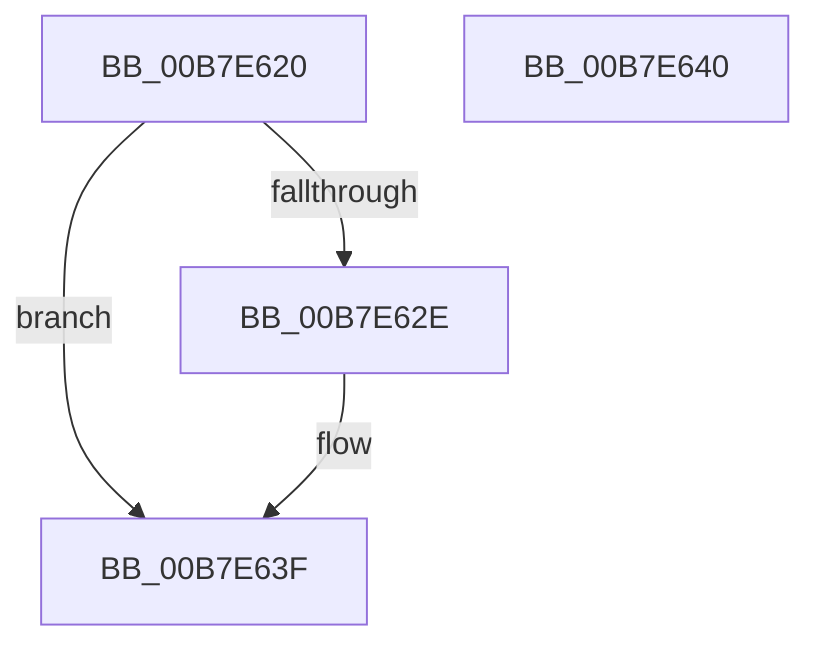

# KiSaveXSaveSupport

- RVA: `0x00B7E620`–`0x00B7E641` (길이 `33` bytes)
- VA: `0x0000000140B7E620`
- 실행 섹션: `PAGELK`
- PDB 이름 있음: `예`; PDB Function 태그: `아니요`
- unwind 정보 RVA: `0x000DB714`
- 디코드: `10`개 명령, `33/33` bytes 표시
- 미해석 바이트: `0` (있으면 어셈블리에 `.byte`로 보존)

> 이 문서는 커널 이미지의 기계어와 PDB 기호를 분석해 생성했습니다. 4번과 5번은 함수 원형과 자료형을 바이너리 사용 방식에서 추정한 C 해석이며 원본 소스 복구 결과는 아닙니다.

## 1. Dependencies

- 직접 호출 지점: **0**; 고유 호출 대상: **0**
- 직접 호출자로 확인된 함수: **1**
- RIP 상대 이미지 참조: **1**

### Outgoing calls
- 직접 디코드된 call 명령이 없습니다.

### Direct callers
- [KeSaveProcessorSpecificFeatures](../../text/4F/KeSaveProcessorSpecificFeatures_function_004FAFBC.md) at `0x004FAFC0`

### Static image references
- `0x00B7E620` → RVA `0x00FC6B30` (`ALMOSTRO`; read)

## 2. Other-region calls and transfers

- 다른 실행 섹션으로 향하는 call: **0**
- 별도 외부 분기/꼬리 이동을 확인하지 못했습니다.

## 3. Assembly (complete function range)

```asm
00B7E620  48 0F BA 25 07 85 44 00 37      bt qword ptr [rip + 0x448507], 0x37
00B7E629  4C 8B C1                        mov r8, rcx
00B7E62C  73 11                           jae 0x140b7e63f
00B7E62E  B9 C4 01 00 00                  mov ecx, 0x1c4
00B7E633  0F 32                           rdmsr
00B7E635  48 C1 E2 20                     shl rdx, 0x20
00B7E639  48 0B C2                        or rax, rdx
00B7E63C  49 89 00                        mov qword ptr [r8], rax
00B7E63F  C3                              ret
00B7E640  CC                              int3
```

## 4. C-style interpretation (structured pseudocode)

```c
__int64 __fastcall KiSaveXSaveSupport(__int64 a1, __int64 a2)
{
    __int64 result;

    if (!(condition_is_above_or_equal)) {
        a1 = 452;
        a2 = (a2) << (32);
        result = (result) | (a2);
        *(unsigned __int64 *)(a1) = result;
    }
    return result;
}
```

## 5. (Beta) C Style

```c
int64_t KiSaveXSaveSupport(void *Arg1, int64_t Arg2)
{
    uint8_t *arg1 = (uint8_t *)Arg1;

    int64_t result;

    if (!(condition_is_above_or_equal)) {
        Arg1 = 452;
        Arg2 = (Arg2) << (32);
        result = (result) | (Arg2);
        *(uint64_t *)(arg1) = result;
    }
    return result;
}
```

### 관측된 메모리 오프셋

구조체 형식이 확인되지 않은 접근은 인자 기준의 오프셋으로만 기록했습니다.

| 기준 인자 | 오프셋 표현 | 폭 (bit) | 접근 |
|---|---:|---:|---|
| `Arg1` | `+ 0x0` | `64` | `W` |

## 6. Execution-region graph

[열기: 2D/3D 그래프와 함수 탐색 컨트롤 패널](../../../control-panel.html?section=pagelk&rva=0x00B7E620&view=graph)

- 2D 그래프는 위에서 아래로 흐르고, 3D 그래프는 빈 공간을 드래그해 회전합니다. Shift+드래그는 이동, 휠은 확대·축소, 함수 노드 선택은 대상 보고서 이동입니다.

### Static fallback


