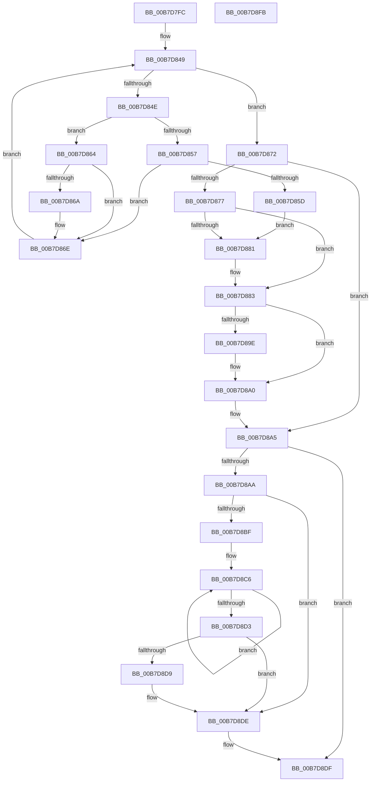

# KiSetPageAttributesTable

- RVA: `0x00B7D7FC`–`0x00B7D8FC` (길이 `256` bytes)
- VA: `0x0000000140B7D7FC`
- 실행 섹션: `PAGELK`
- PDB 이름 있음: `예`; PDB Function 태그: `아니요`
- unwind 정보 RVA: `0x000BDEDC`
- 디코드: `74`개 명령, `256/256` bytes 표시
- 미해석 바이트: `0` (있으면 어셈블리에 `.byte`로 보존)

> 이 문서는 커널 이미지의 기계어와 PDB 기호를 분석해 생성했습니다. 4번과 5번은 함수 원형과 자료형을 바이너리 사용 방식에서 추정한 C 해석이며 원본 소스 복구 결과는 아닙니다.

## 1. Dependencies

- 직접 호출 지점: **5**; 고유 호출 대상: **4**
- 직접 호출자로 확인된 함수: **2**
- RIP 상대 이미지 참조: **1**

### Outgoing calls
- `0x00B7D82D` → [KeDisableInterrupts](../../text/21/KeDisableInterrupts_function_00217BE0.md) (function, `0x00217BE0`)
- `0x00B7D883` → [KeFlushCurrentTbImmediately](../../text/4B/KeFlushCurrentTbImmediately_function_004B7F20.md) (function, `0x004B7F20`)
- `0x00B7D8A0` → [KeFlushCurrentTbImmediately](../../text/4B/KeFlushCurrentTbImmediately_function_004B7F20.md) (function, `0x004B7F20`)
- `0x00B7D8D9` → [KiRemoveSystemWorkPriorityKick](../../text/26/KiRemoveSystemWorkPriorityKick_function_002631D0.md) (function, `0x002631D0`)
- `0x00B7D8E6` → [_security_check_cookie](../../text/6A/_security_check_cookie_function_006AC640.md) (function, `0x006AC640`)

### Direct callers
- [KeRestoreProcessorSpecificFeatures](../../text/4D/KeRestoreProcessorSpecificFeatures_function_004D4C90.md) at `0x004D4CAC`
- [KiInitializeKernel](../B6/KiInitializeKernel_function_00B68D20.md) at `0x00B68E8F`
- [KiInitializeKernel](../B6/KiInitializeKernel_function_00B68D20.md) at `0x00B68F96`

### Static image references
- `0x00B7D80E` → RVA `0x00E0A740` (`.data`; read)

## 2. Other-region calls and transfers

- 다른 실행 섹션으로 향하는 call: **5**
  - `0x00B7D82D` → [KeDisableInterrupts](../../text/21/KeDisableInterrupts_function_00217BE0.md) (`PAGELK` → `.text`)
  - `0x00B7D883` → [KeFlushCurrentTbImmediately](../../text/4B/KeFlushCurrentTbImmediately_function_004B7F20.md) (`PAGELK` → `.text`)
  - `0x00B7D8A0` → [KeFlushCurrentTbImmediately](../../text/4B/KeFlushCurrentTbImmediately_function_004B7F20.md) (`PAGELK` → `.text`)
  - `0x00B7D8D9` → [KiRemoveSystemWorkPriorityKick](../../text/26/KiRemoveSystemWorkPriorityKick_function_002631D0.md) (`PAGELK` → `.text`)
  - `0x00B7D8E6` → [_security_check_cookie](../../text/6A/_security_check_cookie_function_006AC640.md) (`PAGELK` → `.text`)
- 별도 외부 분기/꼬리 이동을 확인하지 못했습니다.

## 3. Assembly (complete function range)

```asm
00B7D7FC  48 89 5C 24 08                  mov qword ptr [rsp + 8], rbx
00B7D801  48 89 7C 24 10                  mov qword ptr [rsp + 0x10], rdi
00B7D806  55                              push rbp
00B7D807  48 8B EC                        mov rbp, rsp
00B7D80A  48 83 EC 40                     sub rsp, 0x40
00B7D80E  48 8B 05 2B CF 28 00            mov rax, qword ptr [rip + 0x28cf2b]
00B7D815  48 33 C4                        xor rax, rsp
00B7D818  48 89 45 F0                     mov qword ptr [rbp - 0x10], rax
00B7D81C  45 33 C0                        xor r8d, r8d
00B7D81F  C7 45 E0 06 01 07 00            mov dword ptr [rbp - 0x20], 0x70106
00B7D826  C7 45 E4 06 01 07 00            mov dword ptr [rbp - 0x1c], 0x70106
00B7D82D  E8 AE A3 69 FF                  call 0x140217be0
00B7D832  40 8A F8                        mov dil, al
00B7D835  B9 77 02 00 00                  mov ecx, 0x277
00B7D83A  0F 32                           rdmsr
00B7D83C  48 C1 E2 20                     shl rdx, 0x20
00B7D840  48 0B C2                        or rax, rdx
00B7D843  48 89 45 E8                     mov qword ptr [rbp - 0x18], rax
00B7D847  33 C9                           xor ecx, ecx
00B7D849  83 F9 08                        cmp ecx, 8
00B7D84C  73 24                           jae 0x140b7d872
00B7D84E  8A 54 0D E8                     mov dl, byte ptr [rbp + rcx - 0x18]
00B7D852  80 FA 06                        cmp dl, 6
00B7D855  75 0D                           jne 0x140b7d864
00B7D857  38 54 0D E0                     cmp byte ptr [rbp + rcx - 0x20], dl
00B7D85B  74 11                           je 0x140b7d86e
00B7D85D  BB 02 00 00 00                  mov ebx, 2
00B7D862  EB 1D                           jmp 0x140b7d881
00B7D864  3A 54 0D E0                     cmp dl, byte ptr [rbp + rcx - 0x20]
00B7D868  74 04                           je 0x140b7d86e
00B7D86A  41 83 C8 01                     or r8d, 1
00B7D86E  FF C1                           inc ecx
00B7D870  EB D7                           jmp 0x140b7d849
00B7D872  45 85 C0                        test r8d, r8d
00B7D875  74 2E                           je 0x140b7d8a5
00B7D877  BB 02 00 00 00                  mov ebx, 2
00B7D87C  41 23 D8                        and ebx, r8d
00B7D87F  74 02                           je 0x140b7d883
00B7D881  0F 09                           wbinvd
00B7D883  E8 98 A6 93 FF                  call 0x1404b7f20
00B7D888  48 8B 55 E0                     mov rdx, qword ptr [rbp - 0x20]
00B7D88C  B9 77 02 00 00                  mov ecx, 0x277
00B7D891  48 8B C2                        mov rax, rdx
00B7D894  48 C1 EA 20                     shr rdx, 0x20
00B7D898  0F 30                           wrmsr
00B7D89A  85 DB                           test ebx, ebx
00B7D89C  74 02                           je 0x140b7d8a0
00B7D89E  0F 09                           wbinvd
00B7D8A0  E8 7B A6 93 FF                  call 0x1404b7f20
00B7D8A5  40 84 FF                        test dil, dil
00B7D8A8  74 35                           je 0x140b7d8df
00B7D8AA  65 48 8B 0C 25 20 00 00 00      mov rcx, qword ptr gs:[0x20]
00B7D8B3  4C 8B 81 B8 8E 00 00            mov r8, qword ptr [rcx + 0x8eb8]
00B7D8BA  4D 85 C0                        test r8, r8
00B7D8BD  74 1F                           je 0x140b7d8de
00B7D8BF  41 0F 0D 08                     prefetchw byte ptr [r8]
00B7D8C3  41 8B 00                        mov eax, dword ptr [r8]
00B7D8C6  8B D0                           mov edx, eax
00B7D8C8  0F BA F2 15                     btr edx, 0x15
00B7D8CC  F0 41 0F B1 10                  lock cmpxchg dword ptr [r8], edx
00B7D8D1  75 F3                           jne 0x140b7d8c6
00B7D8D3  0F BA E0 15                     bt eax, 0x15
00B7D8D7  73 05                           jae 0x140b7d8de
00B7D8D9  E8 F2 58 6E FF                  call 0x1402631d0
00B7D8DE  FB                              sti
00B7D8DF  48 8B 4D F0                     mov rcx, qword ptr [rbp - 0x10]
00B7D8E3  48 33 CC                        xor rcx, rsp
00B7D8E6  E8 55 ED B2 FF                  call 0x1406ac640
00B7D8EB  48 8B 5C 24 50                  mov rbx, qword ptr [rsp + 0x50]
00B7D8F0  48 8B 7C 24 58                  mov rdi, qword ptr [rsp + 0x58]
00B7D8F5  48 83 C4 40                     add rsp, 0x40
00B7D8F9  5D                              pop rbp
00B7D8FA  C3                              ret
00B7D8FB  CC                              int3
```

## 4. C-style interpretation (structured pseudocode)

```c
__int64 __fastcall KiSetPageAttributesTable(__int64 a1, __int64 a2, int a3)
{
    __int64 result;
    __int64 v_rbx;
    __int64 v_rsp;
    unsigned __int64 v_stack_m18;
    unsigned __int64 v_stack_m20;
    unsigned int v_stack_m24;
    unsigned int v_stack_m28;
    unsigned __int64 v_stack_p10;
    unsigned __int64 v_stack_p8;

    v_stack_p8 = v_rbx;
    v_stack_p10 = v_rdi;
    v_rsp = (v_rsp) - (64);
    result = (*(unsigned __int64 *)(v_rip + 2674475)) ^ (v_rsp);
    v_stack_m18 = result;
    a3 = 0;
    v_stack_m28 = 0x70106ULL;
    v_stack_m24 = 0x70106ULL;
    result = KeDisableInterrupts(a1, a2, a3, a4);
    a2 = (a2) << (32);
    result = (result) | (a2);
    v_stack_m20 = result;
    a1 = 0;
loc_00B7D849:
    if (0 >= 8) goto loc_00B7D872;
    if (((unsigned __int8)(*(unsigned __int8 *)(v_rsp + a1 * 1 - 24))) != 6) goto loc_00B7D864;
    if ((*(unsigned __int8 *)(v_rsp + a1 * 1 - 32)) == ((unsigned __int8)(*(unsigned __int8 *)(v_rsp + a1 * 1 - 24)))) goto loc_00B7D86E;
    goto loc_00B7D881;
loc_00B7D864:
    if (((unsigned __int8)(*(unsigned __int8 *)(v_rsp + a1 * 1 - 24))) != (*(unsigned __int8 *)(v_rsp + a1 * 1 - 32))) {
        a3 = (unsigned int)((a3) | (1));
    }
    a1 = (unsigned int)((a1) + 1);
    goto loc_00B7D849;
loc_00B7D872:
    if (a3 == 0) goto loc_00B7D8A5;
    v_rbx = (unsigned int)((2) & (a3));
    if (!(condition_is_equal)) {
    }
    result = KeFlushCurrentTbImmediately(a1, *(unsigned __int8 *)(v_rsp + a1 * 1 - 24), a3, a4);
    a2 = (v_stack_m28) >> (32);
    if ((unsigned int)(v_rbx) != 0) {
    }
    result = KeFlushCurrentTbImmediately(631, a2, a3, a4);
loc_00B7D8A5:
    if ((unsigned __int8)((unsigned __int8)(result)) == 0) goto loc_00B7D8DF;
    if (*(unsigned __int64 *)(*(unsigned __int64 *)(gs_base + (0 + 32)) + 36536) == 0) goto loc_00B7D8DE;
loc_00B7D8C6:
    if (*(unsigned __int64 *)(*(unsigned __int64 *)(gs_base + (0 + 32)) + 36536) != 0) goto loc_00B7D8C6;
    result = (unsigned int)(*(unsigned int *)(*(unsigned __int64 *)(*(unsigned __int64 *)(gs_base + (0 + 32)) + 36536)));
    if (!(condition_is_above_or_equal)) {
        result = KiRemoveSystemWorkPriorityKick(*(unsigned __int64 *)(gs_base + (0 + 32)), (unsigned int)((unsigned int)((unsigned int)(*(unsigned int *)(*(unsigned __int64 *)(*(unsigned __int64 *)(gs_base + (0 + 32)) + 36536))))), *(unsigned __int64 *)(*(unsigned __int64 *)(gs_base + (0 + 32)) + 36536), a4);
    }
loc_00B7D8DF:
    a1 = (v_stack_m18) ^ (v_rsp);
    result = _security_check_cookie(a1, (unsigned int)((unsigned int)((unsigned int)(*(unsigned int *)(*(unsigned __int64 *)(*(unsigned __int64 *)(gs_base + (0 + 32)) + 36536))))), *(unsigned __int64 *)(*(unsigned __int64 *)(gs_base + (0 + 32)) + 36536), a4);
    v_rsp = (v_rsp) + (64);
    return result;
}
```

## 5. (Beta) C Style

```c
int64_t KiSetPageAttributesTable(int64_t Arg1, int64_t Arg2, int32_t Arg3)
{
    int64_t result;
    int64_t local_rbx;
    int64_t local_rsp;
    uint64_t v_stack_m18;
    uint64_t v_stack_m20;
    uint32_t v_stack_m24;
    uint32_t v_stack_m28;
    uint64_t v_stack_p10;
    uint64_t v_stack_p8;

    v_stack_p8 = local_rbx;
    v_stack_p10 = local_rdi;
    local_rsp = (local_rsp) - (64);
    result = (*(uint64_t *)(v_rip + 0x28CF2B)) ^ (local_rsp);
    v_stack_m18 = result;
    Arg3 = 0;
    v_stack_m28 = 0x70106ULL;
    v_stack_m24 = 0x70106ULL;
    result = KeDisableInterrupts(Arg1, Arg2, Arg3, a4);
    Arg2 = (Arg2) << (32);
    result = (result) | (Arg2);
    v_stack_m20 = result;
    Arg1 = 0;
loc_00B7D849:
    if (0 >= 8) goto loc_00B7D872;
    if (((uint8_t)(*(uint8_t *)(local_rsp + Arg1 * 1 - 0x18))) != 6) goto loc_00B7D864;
    if ((*(uint8_t *)(local_rsp + Arg1 * 1 - 0x20)) == ((uint8_t)(*(uint8_t *)(local_rsp + Arg1 * 1 - 0x18)))) goto loc_00B7D86E;
    goto loc_00B7D881;
loc_00B7D864:
    if (((uint8_t)(*(uint8_t *)(local_rsp + Arg1 * 1 - 0x18))) != (*(uint8_t *)(local_rsp + Arg1 * 1 - 0x20))) {
        Arg3 = (uint32_t)((Arg3) | (1));
    }
    Arg1 = (uint32_t)((Arg1) + 1);
    goto loc_00B7D849;
loc_00B7D872:
    if (Arg3 == 0) goto loc_00B7D8A5;
    local_rbx = (uint32_t)((2) & (Arg3));
    if (!(condition_is_equal)) {
    }
    result = KeFlushCurrentTbImmediately(Arg1, *(uint8_t *)(local_rsp + Arg1 * 1 - 0x18), Arg3, a4);
    Arg2 = (v_stack_m28) >> (32);
    if ((uint32_t)(local_rbx) != 0) {
    }
    result = KeFlushCurrentTbImmediately(631, Arg2, Arg3, a4);
loc_00B7D8A5:
    if ((uint8_t)((uint8_t)(result)) == 0) goto loc_00B7D8DF;
    if (*(uint64_t *)(*(uint64_t *)(gs_base + (0 + 0x20)) + 0x8EB8) == 0) goto loc_00B7D8DE;
loc_00B7D8C6:
    if (*(uint64_t *)(*(uint64_t *)(gs_base + (0 + 0x20)) + 0x8EB8) != 0) goto loc_00B7D8C6;
    result = (uint32_t)(*(uint32_t *)(*(uint64_t *)(*(uint64_t *)(gs_base + (0 + 0x20)) + 0x8EB8)));
    if (!(condition_is_above_or_equal)) {
        result = KiRemoveSystemWorkPriorityKick(*(uint64_t *)(gs_base + (0 + 0x20)), (uint32_t)((uint32_t)((uint32_t)(*(uint32_t *)(*(uint64_t *)(*(uint64_t *)(gs_base + (0 + 0x20)) + 0x8EB8))))), *(uint64_t *)(*(uint64_t *)(gs_base + (0 + 0x20)) + 0x8EB8), a4);
    }
loc_00B7D8DF:
    Arg1 = (v_stack_m18) ^ (local_rsp);
    result = _security_check_cookie(Arg1, (uint32_t)((uint32_t)((uint32_t)(*(uint32_t *)(*(uint64_t *)(*(uint64_t *)(gs_base + (0 + 0x20)) + 0x8EB8))))), *(uint64_t *)(*(uint64_t *)(gs_base + (0 + 0x20)) + 0x8EB8), a4);
    local_rsp = (local_rsp) + (64);
    return result;
}
```

## 6. Execution-region graph

[열기: 2D/3D 그래프와 함수 탐색 컨트롤 패널](../../../control-panel.html?section=pagelk&rva=0x00B7D7FC&view=graph)

- 2D 그래프는 위에서 아래로 흐르고, 3D 그래프는 빈 공간을 드래그해 회전합니다. Shift+드래그는 이동, 휠은 확대·축소, 함수 노드 선택은 대상 보고서 이동입니다.

### Static fallback


