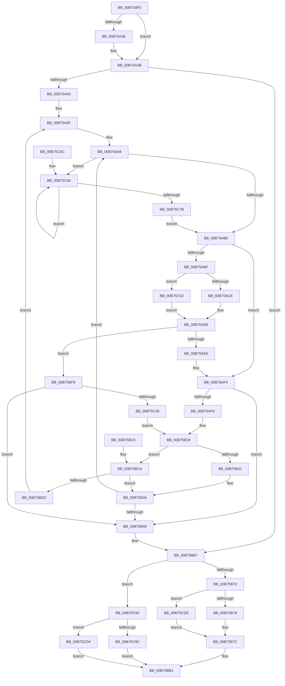

# LZNT1CompressChunk

- RVA: `0x00B759F0`–`0x00B75CE6` (길이 `758` bytes)
- VA: `0x0000000140B759F0`
- 실행 섹션: `PAGELK`
- PDB 이름 있음: `예`; PDB Function 태그: `아니요`
- unwind 정보 RVA: `0x0008A018`
- 디코드: `185`개 명령, `758/758` bytes 표시
- 미해석 바이트: `0` (있으면 어셈블리에 `.byte`로 보존)

> 이 문서는 커널 이미지의 기계어와 PDB 기호를 분석해 생성했습니다. 4번과 5번은 함수 원형과 자료형을 바이너리 사용 방식에서 추정한 C 해석이며 원본 소스 복구 결과는 아닙니다.

## 1. Dependencies

- 직접 호출 지점: **3**; 고유 호출 대상: **3**
- 직접 호출자로 확인된 함수: **1**
- RIP 상대 이미지 참조: **3**

### Outgoing calls
- `0x00B75AD1` → [guard_dispatch_icall](../../text/6B/guard_dispatch_icall_function_006BAAD0.md) (function, `0x006BAAD0`)
- `0x00B75C52` → [LZNT1FindMatchStandard](LZNT1FindMatchStandard_function_00B75CF0.md) (function, `0x00B75CF0`)
- `0x00B75CA2` → [memcpy](../../text/6C/memcpy_function_006C6840.md) (function, `0x006C6840`)

### Direct callers
- [RtlCompressBufferLZNT1](RtlCompressBufferLZNT1_function_00B758E0.md) at `0x00B7595A`

### Static image references
- `0x00B75A21` → RVA `0x00B813A0` (`LZNT1Formats`; read)
- `0x00B75A98` → RVA `0x00B813AC` (`PAGELK`; read)
- `0x00B75A9F` → RVA `0x00B75CF0` (`LZNT1FindMatchStandard`; read)

## 2. Other-region calls and transfers

- 다른 실행 섹션으로 향하는 call: **2**
  - `0x00B75AD1` → [guard_dispatch_icall](../../text/6B/guard_dispatch_icall_function_006BAAD0.md) (`PAGELK` → `.text`)
  - `0x00B75CA2` → [memcpy](../../text/6C/memcpy_function_006C6840.md) (`PAGELK` → `.text`)
- 별도 외부 분기/꼬리 이동을 확인하지 못했습니다.

## 3. Assembly (complete function range)

```asm
00B759F0  48 89 5C 24 08                  mov qword ptr [rsp + 8], rbx
00B759F5  4C 89 4C 24 20                  mov qword ptr [rsp + 0x20], r9
00B759FA  55                              push rbp
00B759FB  56                              push rsi
00B759FC  57                              push rdi
00B759FD  41 54                           push r12
00B759FF  41 55                           push r13
00B75A01  41 56                           push r14
00B75A03  41 57                           push r15
00B75A05  48 83 EC 40                     sub rsp, 0x40
00B75A09  49 8B E8                        mov rbp, r8
00B75A0C  48 8D 82 00 10 00 00            lea rax, [rdx + 0x1000]
00B75A13  45 32 C0                        xor r8b, r8b
00B75A16  4D 8B E1                        mov r12, r9
00B75A19  44 88 84 24 88 00 00 00         mov byte ptr [rsp + 0x88], r8b
00B75A21  4C 8D 0D 78 B9 00 00            lea r9, [rip + 0xb978]
00B75A28  4C 89 4C 24 28                  mov qword ptr [rsp + 0x28], r9
00B75A2D  4C 8B EA                        mov r13, rdx
00B75A30  4C 8B F1                        mov r14, rcx
00B75A33  48 3B C5                        cmp rax, rbp
00B75A36  73 03                           jae 0x140b75a3b
00B75A38  48 8B E8                        mov rbp, rax
00B75A3B  48 8B 8C 24 B0 00 00 00         mov rcx, qword ptr [rsp + 0xb0]
00B75A43  49 8D 84 24 FF 0F 00 00         lea rax, [r12 + 0xfff]
00B75A4B  48 8B 94 24 A0 00 00 00         mov rdx, qword ptr [rsp + 0xa0]
00B75A53  4D 8D 5C 24 02                  lea r11, [r12 + 2]
00B75A58  48 3B C2                        cmp rax, rdx
00B75A5B  4C 89 5C 24 38                  mov qword ptr [rsp + 0x38], r11
00B75A60  49 8B DD                        mov rbx, r13
00B75A63  49 8D 7B 01                     lea rdi, [r11 + 1]
00B75A67  48 0F 42 D0                     cmovb rdx, rax
00B75A6B  4C 89 29                        mov qword ptr [rcx], r13
00B75A6E  45 33 D2                        xor r10d, r10d
00B75A71  48 89 54 24 20                  mov qword ptr [rsp + 0x20], rdx
00B75A76  40 32 F6                        xor sil, sil
00B75A79  48 89 69 08                     mov qword ptr [rcx + 8], rbp
00B75A7D  C7 41 10 02 10 00 00            mov dword ptr [rcx + 0x10], 0x1002
00B75A84  45 8B FA                        mov r15d, r10d
00B75A87  49 8B C3                        mov rax, r11
00B75A8A  4C 3B ED                        cmp r13, rbp
00B75A8D  0F 83 D4 00 00 00               jae 0x140b75b67
00B75A93  4C 89 5C 24 30                  mov qword ptr [rsp + 0x30], r11
00B75A98  4C 8D 25 0D B9 00 00            lea r12, [rip + 0xb90d]
00B75A9F  4C 8D 15 4A 02 00 00            lea r10, [rip + 0x24a]
00B75AA6  41 8B 04 24                     mov eax, dword ptr [r12]
00B75AAA  49 03 C5                        add rax, r13
00B75AAD  48 3B C3                        cmp rax, rbx
00B75AB0  0F 82 AA 01 00 00               jb 0x140b75c60
00B75AB6  48 8D 43 03                     lea rax, [rbx + 3]
00B75ABA  48 3B C5                        cmp rax, rbp
00B75ABD  77 35                           ja 0x140b75af4
00B75ABF  48 8B D1                        mov rdx, rcx
00B75AC2  48 8B CB                        mov rcx, rbx
00B75AC5  4D 3B F2                        cmp r14, r10
00B75AC8  0F 84 84 01 00 00               je 0x140b75c52
00B75ACE  49 8B C6                        mov rax, r14
00B75AD1  E8 FA 4F B4 FF                  call 0x1406baad0
00B75AD6  48 8B 54 24 20                  mov rdx, qword ptr [rsp + 0x20]
00B75ADB  44 8B C0                        mov r8d, eax
00B75ADE  85 C0                           test eax, eax
00B75AE0  0F 85 13 01 00 00               jne 0x140b75bf9
00B75AE6  44 0F B6 84 24 88 00 00 00      movzx r8d, byte ptr [rsp + 0x88]
00B75AEF  4C 8B 4C 24 28                  mov r9, qword ptr [rsp + 0x28]
00B75AF4  48 3B FA                        cmp rdi, rdx
00B75AF7  73 50                           jae 0x140b75b49
00B75AF9  0F B6 03                        movzx eax, byte ptr [rbx]
00B75AFC  44 0A C0                        or r8b, al
00B75AFF  88 07                           mov byte ptr [rdi], al
00B75B01  B8 01 00 00 00                  mov eax, 1
00B75B06  40 0F B6 F6                     movzx esi, sil
00B75B0A  8B C8                           mov ecx, eax
00B75B0C  44 88 84 24 88 00 00 00         mov byte ptr [rsp + 0x88], r8b
00B75B14  44 0F B3 FE                     btr esi, r15d
00B75B18  48 03 CF                        add rcx, rdi
00B75B1B  48 03 C3                        add rax, rbx
00B75B1E  41 FF C7                        inc r15d
00B75B21  48 8B F9                        mov rdi, rcx
00B75B24  48 8B D8                        mov rbx, rax
00B75B27  41 83 E7 07                     and r15d, 7
00B75B2B  0F 84 99 00 00 00               je 0x140b75bca
00B75B31  48 3B C5                        cmp rax, rbp
00B75B34  48 8B 8C 24 B0 00 00 00         mov rcx, qword ptr [rsp + 0xb0]
00B75B3C  4C 8D 15 AD 01 00 00            lea r10, [rip + 0x1ad]
00B75B43  0F 82 5D FF FF FF               jb 0x140b75aa6
00B75B49  48 8B 44 24 30                  mov rax, qword ptr [rsp + 0x30]
00B75B4E  45 33 D2                        xor r10d, r10d
00B75B51  44 0F B6 84 24 88 00 00 00      movzx r8d, byte ptr [rsp + 0x88]
00B75B5A  4C 8B A4 24 98 00 00 00         mov r12, qword ptr [rsp + 0x98]
00B75B62  4C 8B 5C 24 38                  mov r11, qword ptr [rsp + 0x38]
00B75B67  48 3B DD                        cmp rbx, rbp
00B75B6A  0F 82 15 01 00 00               jb 0x140b75c85
00B75B70  48 3B C2                        cmp rax, rdx
00B75B73  0F 83 65 01 00 00               jae 0x140b75cde
00B75B79  40 88 30                        mov byte ptr [rax], sil
00B75B7C  48 8B 84 24 A8 00 00 00         mov rax, qword ptr [rsp + 0xa8]
00B75B84  41 2B FC                        sub edi, r12d
00B75B87  89 38                           mov dword ptr [rax], edi
00B75B89  66 83 EF 03                     sub di, 3
00B75B8D  B8 FF 0F 00 00                  mov eax, 0xfff
00B75B92  66 23 F8                        and di, ax
00B75B95  B8 00 B0 00 00                  mov eax, 0xb000
00B75B9A  66 0B F8                        or di, ax
00B75B9D  B8 17 01 00 00                  mov eax, 0x117
00B75BA2  45 84 C0                        test r8b, r8b
00B75BA5  66 41 89 3C 24                  mov word ptr [r12], di
00B75BAA  44 0F 44 D0                     cmove r10d, eax
00B75BAE  41 8B C2                        mov eax, r10d
00B75BB1  48 8B 9C 24 80 00 00 00         mov rbx, qword ptr [rsp + 0x80]
00B75BB9  48 83 C4 40                     add rsp, 0x40
00B75BBD  41 5F                           pop r15
00B75BBF  41 5E                           pop r14
00B75BC1  41 5D                           pop r13
00B75BC3  41 5C                           pop r12
00B75BC5  5F                              pop rdi
00B75BC6  5E                              pop rsi
00B75BC7  5D                              pop rbp
00B75BC8  C3                              ret
00B75BC9  CC                              int3
00B75BCA  48 3B C5                        cmp rax, rbp
00B75BCD  0F 83 61 FF FF FF               jae 0x140b75b34
00B75BD3  48 8B 44 24 30                  mov rax, qword ptr [rsp + 0x30]
00B75BD8  48 8D 79 01                     lea rdi, [rcx + 1]
00B75BDC  48 8B 54 24 20                  mov rdx, qword ptr [rsp + 0x20]
00B75BE1  48 89 4C 24 30                  mov qword ptr [rsp + 0x30], rcx
00B75BE6  48 8B 8C 24 B0 00 00 00         mov rcx, qword ptr [rsp + 0xb0]
00B75BEE  40 88 30                        mov byte ptr [rax], sil
00B75BF1  40 32 F6                        xor sil, sil
00B75BF4  E9 A6 FE FF FF                  jmp 0x140b75a9f
00B75BF9  48 8D 47 01                     lea rax, [rdi + 1]
00B75BFD  48 3B C2                        cmp rax, rdx
00B75C00  0F 83 43 FF FF FF               jae 0x140b75b49
00B75C06  48 8B 84 24 B0 00 00 00         mov rax, qword ptr [rsp + 0xb0]
00B75C0E  0F B7 D3                        movzx edx, bx
00B75C11  4C 8B 4C 24 28                  mov r9, qword ptr [rsp + 0x28]
00B75C16  40 0F B6 F6                     movzx esi, sil
00B75C1A  66 2B 50 18                     sub dx, word ptr [rax + 0x18]
00B75C1E  41 8D 40 FD                     lea eax, [r8 - 3]
00B75C22  41 0F B6 49 10                  movzx ecx, byte ptr [r9 + 0x10]
00B75C27  66 FF CA                        dec dx
00B75C2A  66 D3 E2                        shl dx, cl
00B75C2D  B9 02 00 00 00                  mov ecx, 2
00B75C32  66 0B D0                        or dx, ax
00B75C35  49 63 C0                        movsxd rax, r8d
00B75C38  44 0F B6 84 24 88 00 00 00      movzx r8d, byte ptr [rsp + 0x88]
00B75C41  44 0F AB FE                     bts esi, r15d
00B75C45  66 89 17                        mov word ptr [rdi], dx
00B75C48  48 8B 54 24 20                  mov rdx, qword ptr [rsp + 0x20]
00B75C4D  E9 C6 FE FF FF                  jmp 0x140b75b18
00B75C52  E8 99 00 00 00                  call 0x140b75cf0
00B75C57  E9 7A FE FF FF                  jmp 0x140b75ad6
00B75C5C  0F 1F 40 00                     nop dword ptr [rax]
00B75C60  41 8B 41 1C                     mov eax, dword ptr [r9 + 0x1c]
00B75C64  49 83 C1 14                     add r9, 0x14
00B75C68  89 41 10                        mov dword ptr [rcx + 0x10], eax
00B75C6B  4D 8D 61 0C                     lea r12, [r9 + 0xc]
00B75C6F  41 8B 04 24                     mov eax, dword ptr [r12]
00B75C73  49 03 C5                        add rax, r13
00B75C76  48 3B C3                        cmp rax, rbx
00B75C79  72 E5                           jb 0x140b75c60
00B75C7B  4C 89 4C 24 28                  mov qword ptr [rsp + 0x28], r9
00B75C80  E9 31 FE FF FF                  jmp 0x140b75ab6
00B75C85  41 2B ED                        sub ebp, r13d
00B75C88  44 8B C5                        mov r8d, ebp
00B75C8B  48 8D 45 02                     lea rax, [rbp + 2]
00B75C8F  49 03 C4                        add rax, r12
00B75C92  48 3B 84 24 A0 00 00 00         cmp rax, qword ptr [rsp + 0xa0]
00B75C9A  77 38                           ja 0x140b75cd4
00B75C9C  49 8B D5                        mov rdx, r13
00B75C9F  49 8B CB                        mov rcx, r11
00B75CA2  E8 99 0B B5 FF                  call 0x1406c6840
00B75CA7  48 8B 84 24 A8 00 00 00         mov rax, qword ptr [rsp + 0xa8]
00B75CAF  8D 4D 02                        lea ecx, [rbp + 2]
00B75CB2  89 08                           mov dword ptr [rax], ecx
00B75CB4  66 83 E9 03                     sub cx, 3
00B75CB8  B8 FF 0F 00 00                  mov eax, 0xfff
00B75CBD  66 23 C8                        and cx, ax
00B75CC0  B8 00 30 00 00                  mov eax, 0x3000
00B75CC5  66 0B C8                        or cx, ax
00B75CC8  66 41 89 0C 24                  mov word ptr [r12], cx
00B75CCD  33 C0                           xor eax, eax
00B75CCF  E9 DD FE FF FF                  jmp 0x140b75bb1
00B75CD4  B8 23 00 00 C0                  mov eax, 0xc0000023
00B75CD9  E9 D3 FE FF FF                  jmp 0x140b75bb1
00B75CDE  48 FF CF                        dec rdi
00B75CE1  E9 96 FE FF FF                  jmp 0x140b75b7c
```

## 4. C-style interpretation (structured pseudocode)

```c
__int64 __fastcall LZNT1CompressChunk(__int64 a1, __int64 a2, __int64 a3, __int64 a4, __int64 a5, __int64 a6, __int64 a7)
{
    __int64 result;
    __int64 v_r10;
    __int64 v_r15;
    __int64 v_rbp;
    __int64 v_rdi;
    __int64 v_rsi;
    __int64 v_rsp;
    unsigned __int64 v_stack_m40;
    unsigned __int64 v_stack_m48;
    unsigned __int64 v_stack_m50;
    unsigned __int64 v_stack_m58;
    unsigned __int8 v_stack_p10;
    unsigned __int64 v_stack_p20;
    unsigned __int64 v_stack_p28;
    unsigned __int64 v_stack_p30;
    unsigned __int64 v_stack_p8;
    unsigned __int8 v_stack_p88;

    v_stack_p8 = v_rbx;
    v_stack_p20 = a4;
    v_rsp = (v_rsp) - (64);
    a3 = 0;
    v_stack_p10 = 0;
    v_stack_m50 = v_rip + 47480;
    v_rbp = a3;
    if ((a2 + 4096) < 0) {
        v_rbp = a2 + 4096;
    }
    v_stack_m40 = a4 + 2;
    if ((a4 + 4095) < a5) { a5 = a4 + 4095; }
    *(unsigned __int64 *)(a7) = a2;
    v_r10 = 0;
    v_stack_m58 = a5;
    v_rsi = 0;
    *(unsigned __int64 *)(a7 + 8) = v_rbp;
    *(unsigned int *)(a7 + 16) = 0x1002ULL;
    if (a2 >= v_rbp) goto loc_00B75B67;
    v_stack_m48 = a4 + 2;
loc_00B75A9F:
loc_00B75AA6:
    result = ((unsigned int)(*(unsigned int *)(v_rip + 47373))) + (a2);
    if (result < a2) goto loc_00B75C60;
loc_00B75AB6:
    if ((a2 + 3) > v_rbp) goto loc_00B75AF4;
    if (a1 == (v_rip + 586)) goto loc_00B75C52;
    result = guard_dispatch_icall(a2, a7, a3, v_rip + 47480);
loc_00B75AD6:
    if ((unsigned int)(result) != 0) goto loc_00B75BF9;
loc_00B75AF4:
    if ((a4 + 2 + 1) >= v_stack_m58) goto loc_00B75B49;
    a3 = (unsigned __int8)((v_stack_p10) | ((unsigned __int8)(*(unsigned __int8 *)(a2))));
    *(unsigned __int8 *)(a4 + 2 + 1) = (unsigned __int8)(*(unsigned __int8 *)(a2));
    v_stack_p10 = (unsigned __int8)(a3);
loc_00B75B18:
    a1 = (1) + (a4 + 2 + 1);
    result = (1) + (a2);
    v_r15 = (unsigned int)((0) + 1);
    v_r15 = (unsigned int)((v_r15) & (7));
    if (condition_is_equal) goto loc_00B75BCA;
loc_00B75B34:
    if (result < v_rbp) goto loc_00B75AA6;
loc_00B75B49:
    v_r10 = 0;
loc_00B75B67:
    if (result < v_rbp) goto loc_00B75C85;
    if (v_stack_m48 >= v_stack_m58) goto loc_00B75CDE;
    *(unsigned __int8 *)(v_stack_m48) = 0;
loc_00B75B7C:
    v_rdi = (unsigned int)((a1) - ((unsigned int)(v_stack_p20)));
    *(unsigned int *)(a6) = (unsigned int)(v_rdi);
    v_rdi = (unsigned __int16)((v_rdi) - (3));
    v_rdi = (unsigned __int16)((v_rdi) & ((unsigned __int16)((unsigned int)(0xFFFULL))));
    v_rdi = (unsigned __int16)((v_rdi) | ((unsigned __int16)((unsigned int)(0xB000ULL))));
    *(unsigned __int16 *)(v_stack_p20) = (unsigned __int16)(v_rdi);
    if ((unsigned __int8)(v_stack_p10) == 0) { v_r10 = 279; }
loc_00B75BB1:
    v_rsp = (v_rsp) + (64);
    return (unsigned int)((unsigned int)(v_r10));
loc_00B75BCA:
    if (((unsigned int)((unsigned int)(v_r10))) >= v_rbp) goto loc_00B75B34;
    v_stack_p30 = a7;
    *(unsigned __int8 *)(v_stack_p30) = 0;
    v_rsi = 0;
    goto loc_00B75A9F;
loc_00B75BF9:
    if ((a7 + 1 + 1) >= v_stack_p20) goto loc_00B75B49;
    a2 = (unsigned __int16)(((unsigned __int16)(v_stack_p8)) - (*(unsigned __int16 *)(a7 + 24)));
    a2 = (unsigned __int16)((a2) - 1);
    a2 = (unsigned __int16)((a2) << ((unsigned __int8)(*(unsigned __int8 *)(v_stack_p28 + 16))));
    a2 = (unsigned __int16)((a2) | ((unsigned __int16)(v_stack_p10 - 3)));
    *(unsigned __int16 *)(a7 + 1) = (unsigned __int16)(a2);
    goto loc_00B75B18;
loc_00B75C52:
    result = LZNT1FindMatchStandard(2, v_stack_p20, v_stack_p88, v_stack_p28);
    goto loc_00B75AD6;
loc_00B75C60:
    a4 = (v_stack_p28) + (20);
    *(unsigned int *)(2 + 16) = (unsigned int)((unsigned int)(*(unsigned int *)(v_stack_p28 + 28)));
    result = ((unsigned int)(*(unsigned int *)(a4 + 12))) + (a2);
    if (result < v_stack_p8) goto loc_00B75C60;
    v_stack_p28 = a4;
    goto loc_00B75AB6;
loc_00B75C85:
    v_rbp = (unsigned int)((v_rbp) - ((unsigned int)(a2)));
    result = (v_rbp + 2) + (a4 + 12);
    if (result > a5) goto loc_00B75CD4;
    result = memcpy(v_stack_m40, a2, (unsigned int)((unsigned int)(v_rbp)), a4);
    *(unsigned int *)(a6) = (unsigned int)(v_rbp + 2);
    a1 = (unsigned __int16)((v_rbp + 2) - (3));
    a1 = (unsigned __int16)((a1) & ((unsigned __int16)((unsigned int)(0xFFFULL))));
    a1 = (unsigned __int16)((a1) | ((unsigned __int16)((unsigned int)(0x3000ULL))));
    *(unsigned __int16 *)(a4 + 12) = (unsigned __int16)(a1);
    result = 0;
    goto loc_00B75BB1;
loc_00B75CD4:
    goto loc_00B75BB1;
loc_00B75CDE:
    v_rdi = (a7 + 1) - 1;
    goto loc_00B75B7C;
}
```

## 5. (Beta) C Style

```c
int64_t LZNT1CompressChunk(int64_t Arg1, void *Arg2, int64_t Arg3, void *Arg4, int64_t Arg5, void *Arg6, void *Arg7)
{
    uint8_t *arg2 = (uint8_t *)Arg2;
    uint8_t *arg4 = (uint8_t *)Arg4;
    uint8_t *arg6 = (uint8_t *)Arg6;
    uint8_t *arg7 = (uint8_t *)Arg7;

    int64_t result;
    int64_t local_r10;
    int64_t local_r15;
    int64_t local_rbp;
    int64_t local_rdi;
    int64_t local_rsi;
    int64_t local_rsp;
    uint64_t v_stack_m40;
    uint64_t v_stack_m48;
    uint64_t v_stack_m50;
    uint64_t v_stack_m58;
    uint8_t v_stack_p10;
    uint64_t v_stack_p20;
    uint64_t v_stack_p28;
    uint64_t v_stack_p30;
    uint64_t v_stack_p8;
    uint8_t v_stack_p88;

    v_stack_p8 = local_rbx;
    v_stack_p20 = Arg4;
    local_rsp = (local_rsp) - (64);
    Arg3 = 0;
    v_stack_p10 = 0;
    v_stack_m50 = v_rip + 47480;
    local_rbp = Arg3;
    if ((Arg2 + 4096) < 0) {
        local_rbp = Arg2 + 4096;
    }
    v_stack_m40 = Arg4 + 2;
    if ((Arg4 + 4095) < Arg5) { Arg5 = Arg4 + 4095; }
    *(void **)(arg7) = Arg2;
    local_r10 = 0;
    v_stack_m58 = Arg5;
    local_rsi = 0;
    *(uint64_t *)(arg7 + 0x8) = local_rbp;
    *(uint32_t *)(arg7 + 0x10) = 0x1002ULL;
    if (Arg2 >= local_rbp) goto loc_00B75B67;
    v_stack_m48 = Arg4 + 2;
loc_00B75A9F:
loc_00B75AA6:
    result = ((uint32_t)(*(uint32_t *)(v_rip + 0xB90D))) + (Arg2);
    if (result < Arg2) goto loc_00B75C60;
loc_00B75AB6:
    if ((Arg2 + 3) > local_rbp) goto loc_00B75AF4;
    if (Arg1 == (v_rip + 586)) goto loc_00B75C52;
    result = guard_dispatch_icall(Arg2, Arg7, Arg3, v_rip + 47480);
loc_00B75AD6:
    if ((uint32_t)(result) != 0) goto loc_00B75BF9;
loc_00B75AF4:
    if ((Arg4 + 2 + 1) >= v_stack_m58) goto loc_00B75B49;
    Arg3 = (uint8_t)((v_stack_p10) | ((uint8_t)(*(uint8_t *)(arg2))));
    *(uint8_t *)(arg4 + 0x2 + 0x1) = (uint8_t)(*(uint8_t *)(arg2));
    v_stack_p10 = (uint8_t)(Arg3);
loc_00B75B18:
    Arg1 = (1) + (Arg4 + 2 + 1);
    result = (1) + (Arg2);
    local_r15 = (uint32_t)((0) + 1);
    local_r15 = (uint32_t)((local_r15) & (7));
    if (condition_is_equal) goto loc_00B75BCA;
loc_00B75B34:
    if (result < local_rbp) goto loc_00B75AA6;
loc_00B75B49:
    local_r10 = 0;
loc_00B75B67:
    if (result < local_rbp) goto loc_00B75C85;
    if (v_stack_m48 >= v_stack_m58) goto loc_00B75CDE;
    *(uint8_t *)(v_stack_m48) = 0;
loc_00B75B7C:
    local_rdi = (uint32_t)((Arg1) - ((uint32_t)(v_stack_p20)));
    *(uint32_t *)(arg6) = (uint32_t)(local_rdi);
    local_rdi = (uint16_t)((local_rdi) - (3));
    local_rdi = (uint16_t)((local_rdi) & ((uint16_t)((uint32_t)(0xFFFULL))));
    local_rdi = (uint16_t)((local_rdi) | ((uint16_t)((uint32_t)(0xB000ULL))));
    *(uint16_t *)(v_stack_p20) = (uint16_t)(local_rdi);
    if ((uint8_t)(v_stack_p10) == 0) { local_r10 = 279; }
loc_00B75BB1:
    local_rsp = (local_rsp) + (64);
    return (uint32_t)((uint32_t)(local_r10));
loc_00B75BCA:
    if (((uint32_t)((uint32_t)(local_r10))) >= local_rbp) goto loc_00B75B34;
    v_stack_p30 = Arg7;
    *(uint8_t *)(v_stack_p30) = 0;
    local_rsi = 0;
    goto loc_00B75A9F;
loc_00B75BF9:
    if ((Arg7 + 1 + 1) >= v_stack_p20) goto loc_00B75B49;
    Arg2 = (uint16_t)(((uint16_t)(v_stack_p8)) - (*(uint16_t *)(arg7 + 0x18)));
    Arg2 = (uint16_t)((Arg2) - 1);
    Arg2 = (uint16_t)((Arg2) << ((uint8_t)(*(uint8_t *)(v_stack_p28 + 0x10))));
    Arg2 = (uint16_t)((Arg2) | ((uint16_t)(v_stack_p10 - 3)));
    *(uint16_t *)(arg7 + 0x1) = (uint16_t)(Arg2);
    goto loc_00B75B18;
loc_00B75C52:
    result = LZNT1FindMatchStandard(2, v_stack_p20, v_stack_p88, v_stack_p28);
    goto loc_00B75AD6;
loc_00B75C60:
    Arg4 = (v_stack_p28) + (20);
    *(uint32_t *)(2 + 0x10) = (uint32_t)((uint32_t)(*(uint32_t *)(v_stack_p28 + 0x1C)));
    result = ((uint32_t)(*(uint32_t *)(arg4 + 0xC))) + (Arg2);
    if (result < v_stack_p8) goto loc_00B75C60;
    v_stack_p28 = Arg4;
    goto loc_00B75AB6;
loc_00B75C85:
    local_rbp = (uint32_t)((local_rbp) - ((uint32_t)(Arg2)));
    result = (local_rbp + 2) + (Arg4 + 12);
    if (result > Arg5) goto loc_00B75CD4;
    result = memcpy(v_stack_m40, Arg2, (uint32_t)((uint32_t)(local_rbp)), Arg4);
    *(uint32_t *)(arg6) = (uint32_t)(local_rbp + 2);
    Arg1 = (uint16_t)((local_rbp + 2) - (3));
    Arg1 = (uint16_t)((Arg1) & ((uint16_t)((uint32_t)(0xFFFULL))));
    Arg1 = (uint16_t)((Arg1) | ((uint16_t)((uint32_t)(0x3000ULL))));
    *(uint16_t *)(arg4 + 0xC) = (uint16_t)(Arg1);
    result = 0;
    goto loc_00B75BB1;
loc_00B75CD4:
    goto loc_00B75BB1;
loc_00B75CDE:
    local_rdi = (Arg7 + 1) - 1;
    goto loc_00B75B7C;
}
```

### 관측된 메모리 오프셋

구조체 형식이 확인되지 않은 접근은 인자 기준의 오프셋으로만 기록했습니다.

| 기준 인자 | 오프셋 표현 | 폭 (bit) | 접근 |
|---|---:|---:|---|
| `Arg2` | `+ 0x1000` | `64` | `R` |
| `Arg4` | `+ 0x1` | `64` | `R` |
| `Arg4` | `+ 0x2` | `64` | `R` |
| `Arg4` | `+ 0xFFF` | `64` | `R` |
| `Arg6` | `+ 0x0` | `32` | `W` |
| `Arg7` | `+ 0x0` | `64` | `W` |
| `Arg7` | `+ 0x8` | `64` | `W` |
| `Arg7` | `+ 0x10` | `32` | `W` |
| `Arg7` | `+ 0x18` | `16` | `R` |

## 6. Execution-region graph

[열기: 2D/3D 그래프와 함수 탐색 컨트롤 패널](../../../control-panel.html?section=pagelk&rva=0x00B759F0&view=graph)

- 2D 그래프는 위에서 아래로 흐르고, 3D 그래프는 빈 공간을 드래그해 회전합니다. Shift+드래그는 이동, 휠은 확대·축소, 함수 노드 선택은 대상 보고서 이동입니다.

### Static fallback


