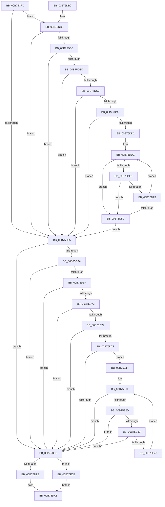

# LZNT1FindMatchStandard

- RVA: `0x00B75CF0`–`0x00B75E4A` (길이 `346` bytes)
- VA: `0x0000000140B75CF0`
- 실행 섹션: `PAGELK`
- PDB 이름 있음: `예`; PDB Function 태그: `아니요`
- unwind 정보 RVA: `0x0008A034`
- 디코드: `113`개 명령, `346/346` bytes 표시
- 미해석 바이트: `0` (있으면 어셈블리에 `.byte`로 보존)

> 이 문서는 커널 이미지의 기계어와 PDB 기호를 분석해 생성했습니다. 4번과 5번은 함수 원형과 자료형을 바이너리 사용 방식에서 추정한 C 해석이며 원본 소스 복구 결과는 아닙니다.

## 1. Dependencies

- 직접 호출 지점: **0**; 고유 호출 대상: **0**
- 직접 호출자로 확인된 함수: **1**
- RIP 상대 이미지 참조: **0**

### Outgoing calls
- 직접 디코드된 call 명령이 없습니다.

### Direct callers
- [LZNT1CompressChunk](LZNT1CompressChunk_function_00B759F0.md) at `0x00B75C52`

### Static image references
- 디코드된 RIP-relative 메모리 참조가 없습니다.

## 2. Other-region calls and transfers

- 다른 실행 섹션으로 향하는 call: **0**
- 별도 외부 분기/꼬리 이동을 확인하지 못했습니다.

## 3. Assembly (complete function range)

```asm
00B75CF0  48 89 5C 24 20                  mov qword ptr [rsp + 0x20], rbx
00B75CF5  55                              push rbp
00B75CF6  56                              push rsi
00B75CF7  57                              push rdi
00B75CF8  41 54                           push r12
00B75CFA  41 55                           push r13
00B75CFC  41 56                           push r14
00B75CFE  41 57                           push r15
00B75D00  0F B6 19                        movzx ebx, byte ptr [rcx]
00B75D03  4C 8B C9                        mov r9, rcx
00B75D06  0F B6 79 01                     movzx edi, byte ptr [rcx + 1]
00B75D0A  8B C3                           mov eax, ebx
00B75D0C  0F B6 69 02                     movzx ebp, byte ptr [rcx + 2]
00B75D10  4C 8B DA                        mov r11, rdx
00B75D13  4C 8B 32                        mov r14, qword ptr [rdx]
00B75D16  4C 8B 6A 08                     mov r13, qword ptr [rdx + 8]
00B75D1A  8B 72 10                        mov esi, dword ptr [rdx + 0x10]
00B75D1D  C1 E0 04                        shl eax, 4
00B75D20  33 C7                           xor eax, edi
00B75D22  4C 89 6C 24 40                  mov qword ptr [rsp + 0x40], r13
00B75D27  C1 E0 04                        shl eax, 4
00B75D2A  33 C5                           xor eax, ebp
00B75D2C  69 C0 5F 9E FF FF               imul eax, eax, 0xffff9e5f
00B75D32  C1 F8 04                        sar eax, 4
00B75D35  25 FF 0F 00 00                  and eax, 0xfff
00B75D3A  8B C8                           mov ecx, eax
00B75D3C  48 03 C9                        add rcx, rcx
00B75D3F  4C 8D 78 02                     lea r15, [rax + 2]
00B75D43  49 C1 E7 04                     shl r15, 4
00B75D47  4C 03 FA                        add r15, rdx
00B75D4A  4D 8D 24 CB                     lea r12, [r11 + rcx*8]
00B75D4E  49 8B 4C CB 28                  mov rcx, qword ptr [r11 + rcx*8 + 0x28]
00B75D53  33 D2                           xor edx, edx
00B75D55  4C 89 7C 24 50                  mov qword ptr [rsp + 0x50], r15
00B75D5A  44 8B D2                        mov r10d, edx
00B75D5D  4D 8B 07                        mov r8, qword ptr [r15]
00B75D60  4D 3B C6                        cmp r8, r14
00B75D63  73 4E                           jae 0x140b75db3
00B75D65  49 3B CE                        cmp rcx, r14
00B75D68  72 24                           jb 0x140b75d8e
00B75D6A  49 3B C9                        cmp rcx, r9
00B75D6D  73 1F                           jae 0x140b75d8e
00B75D6F  38 19                           cmp byte ptr [rcx], bl
00B75D71  75 1B                           jne 0x140b75d8e
00B75D73  40 38 79 01                     cmp byte ptr [rcx + 1], dil
00B75D77  75 15                           jne 0x140b75d8e
00B75D79  40 38 69 02                     cmp byte ptr [rcx + 2], bpl
00B75D7D  75 0F                           jne 0x140b75d8e
00B75D7F  41 BA 03 00 00 00               mov r10d, 3
00B75D85  41 3B F2                        cmp esi, r10d
00B75D88  0F 87 86 00 00 00               ja 0x140b75e14
00B75D8E  4D 89 44 24 28                  mov qword ptr [r12 + 0x28], r8
00B75D93  4D 89 0F                        mov qword ptr [r15], r9
00B75D96  41 3B D2                        cmp edx, r10d
00B75D99  72 70                           jb 0x140b75e0b
00B75D9B  4D 89 43 18                     mov qword ptr [r11 + 0x18], r8
00B75D9F  8B C2                           mov eax, edx
00B75DA1  48 8B 5C 24 58                  mov rbx, qword ptr [rsp + 0x58]
00B75DA6  41 5F                           pop r15
00B75DA8  41 5E                           pop r14
00B75DAA  41 5D                           pop r13
00B75DAC  41 5C                           pop r12
00B75DAE  5F                              pop rdi
00B75DAF  5E                              pop rsi
00B75DB0  5D                              pop rbp
00B75DB1  C3                              ret
00B75DB2  CC                              int3
00B75DB3  4D 3B C1                        cmp r8, r9
00B75DB6  73 AD                           jae 0x140b75d65
00B75DB8  41 38 18                        cmp byte ptr [r8], bl
00B75DBB  75 A8                           jne 0x140b75d65
00B75DBD  41 38 78 01                     cmp byte ptr [r8 + 1], dil
00B75DC1  75 A2                           jne 0x140b75d65
00B75DC3  41 38 68 02                     cmp byte ptr [r8 + 2], bpl
00B75DC7  75 9C                           jne 0x140b75d65
00B75DC9  BA 03 00 00 00                  mov edx, 3
00B75DCE  3B F2                           cmp esi, edx
00B75DD0  76 93                           jbe 0x140b75d65
00B75DD2  4D 8B F8                        mov r15, r8
00B75DD5  4D 8D 69 03                     lea r13, [r9 + 3]
00B75DD9  4D 2B F9                        sub r15, r9
00B75DDC  8B C2                           mov eax, edx
00B75DDE  49 03 C1                        add rax, r9
00B75DE1  48 3B 44 24 40                  cmp rax, qword ptr [rsp + 0x40]
00B75DE6  73 14                           jae 0x140b75dfc
00B75DE8  43 0F B6 04 2F                  movzx eax, byte ptr [r15 + r13]
00B75DED  41 38 45 00                     cmp byte ptr [r13], al
00B75DF1  75 09                           jne 0x140b75dfc
00B75DF3  FF C2                           inc edx
00B75DF5  49 FF C5                        inc r13
00B75DF8  3B D6                           cmp edx, esi
00B75DFA  72 E0                           jb 0x140b75ddc
00B75DFC  4C 8B 7C 24 50                  mov r15, qword ptr [rsp + 0x50]
00B75E01  4C 8B 6C 24 40                  mov r13, qword ptr [rsp + 0x40]
00B75E06  E9 5A FF FF FF                  jmp 0x140b75d65
00B75E0B  49 89 4B 18                     mov qword ptr [r11 + 0x18], rcx
00B75E0F  41 8B C2                        mov eax, r10d
00B75E12  EB 8D                           jmp 0x140b75da1
00B75E14  48 8B F9                        mov rdi, rcx
00B75E17  49 8D 59 03                     lea rbx, [r9 + 3]
00B75E1B  49 2B F9                        sub rdi, r9
00B75E1E  41 8B C2                        mov eax, r10d
00B75E21  49 03 C1                        add rax, r9
00B75E24  49 3B C5                        cmp rax, r13
00B75E27  0F 83 61 FF FF FF               jae 0x140b75d8e
00B75E2D  0F B6 04 1F                     movzx eax, byte ptr [rdi + rbx]
00B75E31  38 03                           cmp byte ptr [rbx], al
00B75E33  0F 85 55 FF FF FF               jne 0x140b75d8e
00B75E39  41 FF C2                        inc r10d
00B75E3C  48 FF C3                        inc rbx
00B75E3F  44 3B D6                        cmp r10d, esi
00B75E42  0F 83 46 FF FF FF               jae 0x140b75d8e
00B75E48  EB D4                           jmp 0x140b75e1e
```

## 4. C-style interpretation (structured pseudocode)

```c
__int64 __fastcall LZNT1FindMatchStandard(__int64 a1, __int64 a2)
{
    __int64 result;
    __int64 v_r10;
    __int64 v_r13;
    __int64 v_r15;
    __int64 v_rbx;
    __int64 v_rdi;
    unsigned __int64 v_stack_p18;
    unsigned __int64 v_stack_p20;
    unsigned __int64 v_stack_p40;
    unsigned __int64 v_stack_p50;
    unsigned __int64 v_stack_p8;

    v_stack_p20 = v_rbx;
    result = (unsigned int)(((unsigned int)((unsigned int)(*(unsigned __int8 *)(a1)))) << (4));
    result = (unsigned int)((result) ^ ((unsigned int)(*(unsigned __int8 *)(a1 + 1))));
    v_stack_p8 = *(unsigned __int64 *)(a2 + 8);
    result = (unsigned int)((result) << (4));
    result = (unsigned int)((result) ^ ((unsigned int)(*(unsigned __int8 *)(a1 + 2))));
    result = (unsigned int)((result) * ((unsigned int)(result)));
    result = (unsigned int)((result) >> (4));
    result = (unsigned int)((result) & (0xFFFULL));
    a1 = ((unsigned int)((unsigned int)(result))) + ((unsigned int)((unsigned int)(result)));
    v_r15 = (result + 2) << (4);
    v_r15 = (v_r15) + (a2);
    a2 = 0;
    v_stack_p18 = v_r15;
    if ((*(unsigned __int64 *)(v_r15)) >= (*(unsigned __int64 *)(a2))) goto loc_00B75DB3;
loc_00B75D65:
    if ((*(unsigned __int64 *)(a2 + a1 * 8 + 40)) < (*(unsigned __int64 *)(a2))) goto loc_00B75D8E;
    if ((*(unsigned __int64 *)(a2 + a1 * 8 + 40)) >= a1) goto loc_00B75D8E;
    if ((*(unsigned __int8 *)(*(unsigned __int64 *)(a2 + a1 * 8 + 40))) != ((unsigned __int8)(*(unsigned __int8 *)(a1)))) goto loc_00B75D8E;
    if ((*(unsigned __int8 *)(*(unsigned __int64 *)(a2 + a1 * 8 + 40) + 1)) != ((unsigned __int8)(*(unsigned __int8 *)(a1 + 1)))) goto loc_00B75D8E;
    if ((*(unsigned __int8 *)(*(unsigned __int64 *)(a2 + a1 * 8 + 40) + 2)) != ((unsigned __int8)(*(unsigned __int8 *)(a1 + 2)))) goto loc_00B75D8E;
    if (((unsigned int)((unsigned int)(*(unsigned int *)(a2 + 16)))) > 3) goto loc_00B75E14;
loc_00B75D8E:
    *(unsigned __int64 *)(a2 + a1 * 8 + 40) = *(unsigned __int64 *)(v_r15);
    *(unsigned __int64 *)(v_r15) = a1;
    if (0 < 3) goto loc_00B75E0B;
    *(unsigned __int64 *)(a2 + 24) = *(unsigned __int64 *)(v_r15);
loc_00B75DA1:
    return 0;
loc_00B75DB3:
    if ((*(unsigned __int64 *)(v_r15)) >= a1) goto loc_00B75D65;
    if ((*(unsigned __int8 *)(*(unsigned __int64 *)(v_r15))) != ((unsigned __int8)(v_stack_p20))) goto loc_00B75D65;
    if ((*(unsigned __int8 *)(*(unsigned __int64 *)(v_r15) + 1)) != ((unsigned __int8)(*(unsigned __int8 *)(a1 + 1)))) goto loc_00B75D65;
    if ((*(unsigned __int8 *)(*(unsigned __int64 *)(v_r15) + 2)) != ((unsigned __int8)(*(unsigned __int8 *)(a1 + 2)))) goto loc_00B75D65;
    if (((unsigned int)((unsigned int)(*(unsigned int *)(a2 + 16)))) <= 3) goto loc_00B75D65;
    v_r15 = (*(unsigned __int64 *)(v_r15)) - (a1);
loc_00B75DDC:
    result = (3) + (a1);
    if (result >= v_stack_p40) goto loc_00B75DFC;
    if ((*(unsigned __int8 *)(a1 + 3)) != ((unsigned __int8)(*(unsigned __int8 *)(v_r15 + a1 + 3 * 1)))) goto loc_00B75DFC;
    a2 = (unsigned int)((3) + 1);
    v_r13 = (a1 + 3) + 1;
    if (((unsigned int)(a2)) < ((unsigned int)((unsigned int)(*(unsigned int *)(a2 + 16))))) goto loc_00B75DDC;
loc_00B75DFC:
    goto loc_00B75D65;
loc_00B75E0B:
    *(unsigned __int64 *)(a2 + 24) = *(unsigned __int64 *)(a2 + a1 * 8 + 40);
    goto loc_00B75DA1;
loc_00B75E14:
    v_rdi = (*(unsigned __int64 *)(a2 + a1 * 8 + 40)) - (a1);
loc_00B75E1E:
    result = (3) + (a1);
    if (result >= v_stack_p40) goto loc_00B75D8E;
    if ((*(unsigned __int8 *)(a1 + 3)) != ((unsigned __int8)(*(unsigned __int8 *)(v_rdi + a1 + 3 * 1)))) goto loc_00B75D8E;
    v_r10 = (unsigned int)((3) + 1);
    v_rbx = (a1 + 3) + 1;
    if (((unsigned int)(v_r10)) >= ((unsigned int)((unsigned int)(*(unsigned int *)(a2 + 16))))) goto loc_00B75D8E;
    goto loc_00B75E1E;
}
```

## 5. (Beta) C Style

```c
int64_t LZNT1FindMatchStandard(void *Arg1, void *Arg2)
{
    uint8_t *arg1 = (uint8_t *)Arg1;
    uint8_t *arg2 = (uint8_t *)Arg2;

    int64_t result;
    int64_t local_r10;
    int64_t local_r13;
    int64_t local_r15;
    int64_t local_rbx;
    int64_t local_rdi;
    uint64_t v_stack_p18;
    uint64_t v_stack_p20;
    uint64_t v_stack_p40;
    uint64_t v_stack_p50;
    uint64_t v_stack_p8;

    v_stack_p20 = local_rbx;
    result = (uint32_t)(((uint32_t)((uint32_t)(*(uint8_t *)(arg1)))) << (4));
    result = (uint32_t)((result) ^ ((uint32_t)(*(uint8_t *)(arg1 + 0x1))));
    v_stack_p8 = *(uint64_t *)(arg2 + 0x8);
    result = (uint32_t)((result) << (4));
    result = (uint32_t)((result) ^ ((uint32_t)(*(uint8_t *)(arg1 + 0x2))));
    result = (uint32_t)((result) * ((uint32_t)(result)));
    result = (uint32_t)((result) >> (4));
    result = (uint32_t)((result) & (0xFFFULL));
    Arg1 = ((uint32_t)((uint32_t)(result))) + ((uint32_t)((uint32_t)(result)));
    local_r15 = (result + 2) << (4);
    local_r15 = (local_r15) + (Arg2);
    Arg2 = 0;
    v_stack_p18 = local_r15;
    if ((*(uint64_t *)(local_r15)) >= (*(uint64_t *)(arg2))) goto loc_00B75DB3;
loc_00B75D65:
    if ((*(uint64_t *)(arg2 + arg1 * 8 + 0x28)) < (*(uint64_t *)(arg2))) goto loc_00B75D8E;
    if ((*(uint64_t *)(arg2 + arg1 * 8 + 0x28)) >= Arg1) goto loc_00B75D8E;
    if ((*(uint8_t *)(*(uint64_t *)(arg2 + arg1 * 8 + 0x28))) != ((uint8_t)(*(uint8_t *)(arg1)))) goto loc_00B75D8E;
    if ((*(uint8_t *)(*(uint64_t *)(arg2 + arg1 * 8 + 0x28) + 0x1)) != ((uint8_t)(*(uint8_t *)(arg1 + 0x1)))) goto loc_00B75D8E;
    if ((*(uint8_t *)(*(uint64_t *)(arg2 + arg1 * 8 + 0x28) + 0x2)) != ((uint8_t)(*(uint8_t *)(arg1 + 0x2)))) goto loc_00B75D8E;
    if (((uint32_t)((uint32_t)(*(uint32_t *)(arg2 + 0x10)))) > 3) goto loc_00B75E14;
loc_00B75D8E:
    *(uint64_t *)(arg2 + arg1 * 8 + 0x28) = *(uint64_t *)(local_r15);
    *(void **)(local_r15) = Arg1;
    if (0 < 3) goto loc_00B75E0B;
    *(uint64_t *)(arg2 + 0x18) = *(uint64_t *)(local_r15);
loc_00B75DA1:
    return 0;
loc_00B75DB3:
    if ((*(uint64_t *)(local_r15)) >= Arg1) goto loc_00B75D65;
    if ((*(uint8_t *)(*(uint64_t *)(local_r15))) != ((uint8_t)(v_stack_p20))) goto loc_00B75D65;
    if ((*(uint8_t *)(*(uint64_t *)(local_r15) + 0x1)) != ((uint8_t)(*(uint8_t *)(arg1 + 0x1)))) goto loc_00B75D65;
    if ((*(uint8_t *)(*(uint64_t *)(local_r15) + 0x2)) != ((uint8_t)(*(uint8_t *)(arg1 + 0x2)))) goto loc_00B75D65;
    if (((uint32_t)((uint32_t)(*(uint32_t *)(arg2 + 0x10)))) <= 3) goto loc_00B75D65;
    local_r15 = (*(uint64_t *)(local_r15)) - (Arg1);
loc_00B75DDC:
    result = (3) + (Arg1);
    if (result >= v_stack_p40) goto loc_00B75DFC;
    if ((*(uint8_t *)(arg1 + 0x3)) != ((uint8_t)(*(uint8_t *)(local_r15 + arg1 + 0x3 * 1)))) goto loc_00B75DFC;
    Arg2 = (uint32_t)((3) + 1);
    local_r13 = (Arg1 + 3) + 1;
    if (((uint32_t)(Arg2)) < ((uint32_t)((uint32_t)(*(uint32_t *)(arg2 + 0x10))))) goto loc_00B75DDC;
loc_00B75DFC:
    goto loc_00B75D65;
loc_00B75E0B:
    *(uint64_t *)(arg2 + 0x18) = *(uint64_t *)(arg2 + arg1 * 8 + 0x28);
    goto loc_00B75DA1;
loc_00B75E14:
    local_rdi = (*(uint64_t *)(arg2 + arg1 * 8 + 0x28)) - (Arg1);
loc_00B75E1E:
    result = (3) + (Arg1);
    if (result >= v_stack_p40) goto loc_00B75D8E;
    if ((*(uint8_t *)(arg1 + 0x3)) != ((uint8_t)(*(uint8_t *)(local_rdi + arg1 + 0x3 * 1)))) goto loc_00B75D8E;
    local_r10 = (uint32_t)((3) + 1);
    local_rbx = (Arg1 + 3) + 1;
    if (((uint32_t)(local_r10)) >= ((uint32_t)((uint32_t)(*(uint32_t *)(arg2 + 0x10))))) goto loc_00B75D8E;
    goto loc_00B75E1E;
}
```

### 관측된 메모리 오프셋

구조체 형식이 확인되지 않은 접근은 인자 기준의 오프셋으로만 기록했습니다.

| 기준 인자 | 오프셋 표현 | 폭 (bit) | 접근 |
|---|---:|---:|---|
| `Arg1` | `+ 0x0` | `8` | `R` |
| `Arg1` | `+ 0x1` | `8` | `R` |
| `Arg1` | `+ 0x2` | `8` | `R` |
| `Arg1` | `+ 0x3` | `64` | `R` |
| `Arg2` | `+ 0x0` | `64` | `R` |
| `Arg2` | `+ 0x0 + rcx*8` | `64` | `R` |
| `Arg2` | `+ 0x8` | `64` | `R` |
| `Arg2` | `+ 0x10` | `32` | `R` |
| `Arg2` | `+ 0x18` | `64` | `W` |
| `Arg2` | `+ 0x28` | `64` | `W` |
| `Arg2` | `+ 0x28 + rcx*8` | `64` | `R` |

## 6. Execution-region graph

[열기: 2D/3D 그래프와 함수 탐색 컨트롤 패널](../../../control-panel.html?section=pagelk&rva=0x00B75CF0&view=graph)

- 2D 그래프는 위에서 아래로 흐르고, 3D 그래프는 빈 공간을 드래그해 회전합니다. Shift+드래그는 이동, 휠은 확대·축소, 함수 노드 선택은 대상 보고서 이동입니다.

### Static fallback


