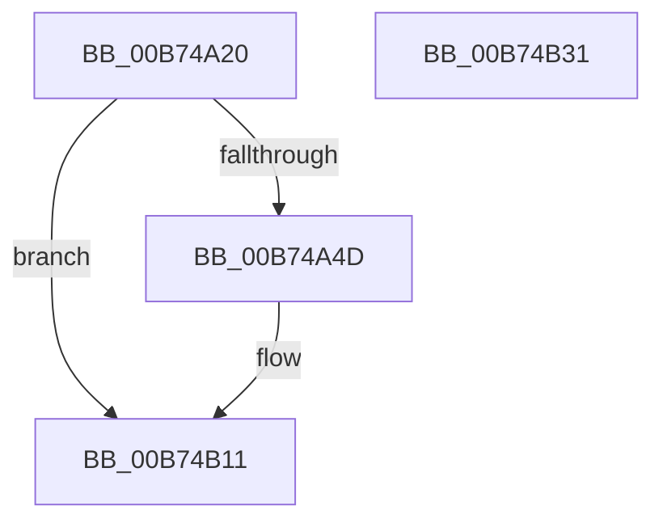

# MiApplyImageHotPatchDpc

- RVA: `0x00B74A20`–`0x00B74B32` (길이 `274` bytes)
- VA: `0x0000000140B74A20`
- 실행 섹션: `PAGELK`
- PDB 이름 있음: `예`; PDB Function 태그: `아니요`
- unwind 정보 RVA: `0x000D8554`
- 디코드: `58`개 명령, `274/274` bytes 표시
- 미해석 바이트: `0` (있으면 어셈블리에 `.byte`로 보존)

> 이 문서는 커널 이미지의 기계어와 PDB 기호를 분석해 생성했습니다. 4번과 5번은 함수 원형과 자료형을 바이너리 사용 방식에서 추정한 C 해석이며 원본 소스 복구 결과는 아닙니다.

## 1. Dependencies

- 직접 호출 지점: **3**; 고유 호출 대상: **2**
- 직접 호출자로 확인된 함수: **0**
- RIP 상대 이미지 참조: **0**

### Outgoing calls
- `0x00B74A3E` → [KeSignalCallDpcSynchronize](../../text/43/KeSignalCallDpcSynchronize_function_0043DFA0.md) (function, `0x0043DFA0`)
- `0x00B74B09` → [RtlApplyHotPatch](RtlApplyHotPatch_function_00B7528C.md) (function, `0x00B7528C`)
- `0x00B74B14` → [KeSignalCallDpcSynchronize](../../text/43/KeSignalCallDpcSynchronize_function_0043DFA0.md) (function, `0x0043DFA0`)

### Direct callers
- 이 함수 시작 RVA로 연결되는 직접 call은 확인되지 않았습니다. 간접 호출은 완전히 역산할 수 없습니다.

### Static image references
- 디코드된 RIP-relative 메모리 참조가 없습니다.

## 2. Other-region calls and transfers

- 다른 실행 섹션으로 향하는 call: **2**
  - `0x00B74A3E` → [KeSignalCallDpcSynchronize](../../text/43/KeSignalCallDpcSynchronize_function_0043DFA0.md) (`PAGELK` → `.text`)
  - `0x00B74B14` → [KeSignalCallDpcSynchronize](../../text/43/KeSignalCallDpcSynchronize_function_0043DFA0.md) (`PAGELK` → `.text`)
- 별도 외부 분기/꼬리 이동을 확인하지 못했습니다.

## 3. Assembly (complete function range)

```asm
00B74A20  48 89 5C 24 08                  mov qword ptr [rsp + 8], rbx
00B74A25  48 89 74 24 10                  mov qword ptr [rsp + 0x10], rsi
00B74A2A  57                              push rdi
00B74A2B  48 81 EC F0 00 00 00            sub rsp, 0xf0
00B74A32  49 8B C9                        mov rcx, r9
00B74A35  49 8B F9                        mov rdi, r9
00B74A38  49 8B D8                        mov rbx, r8
00B74A3B  48 8B F2                        mov rsi, rdx
00B74A3E  E8 5D 95 8C FF                  call 0x14043dfa0
00B74A43  33 D2                           xor edx, edx
00B74A45  85 C0                           test eax, eax
00B74A47  0F 84 C4 00 00 00               je 0x140b74b11
00B74A4D  48 8B 0E                        mov rcx, qword ptr [rsi]
00B74A50  4C 8D 5E 28                     lea r11, [rsi + 0x28]
00B74A54  48 8B 46 20                     mov rax, qword ptr [rsi + 0x20]
00B74A58  4C 8B 56 08                     mov r10, qword ptr [rsi + 8]
00B74A5C  48 89 94 24 C0 00 00 00         mov qword ptr [rsp + 0xc0], rdx
00B74A64  44 8B 49 24                     mov r9d, dword ptr [rcx + 0x24]
00B74A68  4C 8B 41 50                     mov r8, qword ptr [rcx + 0x50]
00B74A6C  48 89 84 24 B8 00 00 00         mov qword ptr [rsp + 0xb8], rax
00B74A74  48 8B 41 28                     mov rax, qword ptr [rcx + 0x28]
00B74A78  48 89 84 24 B0 00 00 00         mov qword ptr [rsp + 0xb0], rax
00B74A80  0F B7 81 88 00 00 00            movzx eax, word ptr [rcx + 0x88]
00B74A87  66 89 84 24 A8 00 00 00         mov word ptr [rsp + 0xa8], ax
00B74A8F  48 8B 46 18                     mov rax, qword ptr [rsi + 0x18]
00B74A93  C7 84 24 A0 00 00 00 01 00 00 00  mov dword ptr [rsp + 0xa0], 1
00B74A9E  48 89 84 24 98 00 00 00         mov qword ptr [rsp + 0x98], rax
00B74AA6  48 8B 46 10                     mov rax, qword ptr [rsi + 0x10]
00B74AAA  48 89 84 24 90 00 00 00         mov qword ptr [rsp + 0x90], rax
00B74AB2  49 8B 42 08                     mov rax, qword ptr [r10 + 8]
00B74AB6  89 94 24 88 00 00 00            mov dword ptr [rsp + 0x88], edx
00B74ABD  48 89 94 24 80 00 00 00         mov qword ptr [rsp + 0x80], rdx
00B74AC5  48 89 54 24 70                  mov qword ptr [rsp + 0x70], rdx
00B74ACA  89 54 24 68                     mov dword ptr [rsp + 0x68], edx
00B74ACE  48 89 54 24 60                  mov qword ptr [rsp + 0x60], rdx
00B74AD3  48 89 44 24 58                  mov qword ptr [rsp + 0x58], rax
00B74AD8  49 8B 42 48                     mov rax, qword ptr [r10 + 0x48]
00B74ADC  48 89 44 24 50                  mov qword ptr [rsp + 0x50], rax
00B74AE1  8B 81 98 00 00 00               mov eax, dword ptr [rcx + 0x98]
00B74AE7  48 89 54 24 40                  mov qword ptr [rsp + 0x40], rdx
00B74AEC  48 8B 51 08                     mov rdx, qword ptr [rcx + 8]
00B74AF0  89 44 24 38                     mov dword ptr [rsp + 0x38], eax
00B74AF4  48 8B 81 90 00 00 00            mov rax, qword ptr [rcx + 0x90]
00B74AFB  48 8B 49 48                     mov rcx, qword ptr [rcx + 0x48]
00B74AFF  48 89 44 24 30                  mov qword ptr [rsp + 0x30], rax
00B74B04  4C 89 5C 24 20                  mov qword ptr [rsp + 0x20], r11
00B74B09  E8 7E 07 00 00                  call 0x140b7528c
00B74B0E  89 46 2C                        mov dword ptr [rsi + 0x2c], eax
00B74B11  48 8B CF                        mov rcx, rdi
00B74B14  E8 87 94 8C FF                  call 0x14043dfa0
00B74B19  F0 FF 0B                        lock dec dword ptr [rbx]
00B74B1C  4C 8D 9C 24 F0 00 00 00         lea r11, [rsp + 0xf0]
00B74B24  49 8B 5B 10                     mov rbx, qword ptr [r11 + 0x10]
00B74B28  49 8B 73 18                     mov rsi, qword ptr [r11 + 0x18]
00B74B2C  49 8B E3                        mov rsp, r11
00B74B2F  5F                              pop rdi
00B74B30  C3                              ret
00B74B31  CC                              int3
```

## 4. C-style interpretation (structured pseudocode)

```c
__int64 __fastcall MiApplyImageHotPatchDpc(__int64 a1, __int64 a2, __int64 a3, __int64 a4)
{
    __int64 result;
    __int64 v_r10;
    __int64 v_r11;
    __int64 v_rsp;
    unsigned __int64 v_stack_m38;
    unsigned __int64 v_stack_m40;
    unsigned __int64 v_stack_m48;
    unsigned __int16 v_stack_m50;
    unsigned int v_stack_m58;
    unsigned __int64 v_stack_m60;
    unsigned __int64 v_stack_m68;
    unsigned int v_stack_m70;
    unsigned __int64 v_stack_m78;
    unsigned __int64 v_stack_m8;
    unsigned __int64 v_stack_m88;
    unsigned int v_stack_m90;
    unsigned __int64 v_stack_m98;
    unsigned __int64 v_stack_mA0;
    unsigned __int64 v_stack_mA8;
    unsigned __int64 v_stack_mB8;
    unsigned int v_stack_mC0;
    unsigned __int64 v_stack_mC8;
    unsigned __int64 v_stack_mD8;
    unsigned __int64 v_stack_p10;
    unsigned __int64 v_stack_p8;

    v_stack_p8 = v_rbx;
    v_stack_p10 = v_rsi;
    v_rsp = (v_rsp) - (240);
    result = KeSignalCallDpcSynchronize(a4, a2, a3, a4);
    a2 = 0;
    if ((unsigned int)(result) != 0) {
        a1 = *(unsigned __int64 *)(a2);
        v_r11 = a2 + 40;
        result = *(unsigned __int64 *)(a2 + 32);
        v_r10 = *(unsigned __int64 *)(a2 + 8);
        v_stack_m38 = 0;
        a4 = *(unsigned int *)(a1 + 36);
        a3 = *(unsigned __int64 *)(a1 + 80);
        v_stack_m40 = result;
        result = *(unsigned __int64 *)(a1 + 40);
        v_stack_m48 = result;
        result = *(unsigned __int16 *)(a1 + 136);
        v_stack_m50 = (unsigned __int16)(result);
        result = *(unsigned __int64 *)(a2 + 24);
        v_stack_m58 = 1;
        v_stack_m60 = result;
        result = *(unsigned __int64 *)(a2 + 16);
        v_stack_m68 = result;
        result = *(unsigned __int64 *)(v_r10 + 8);
        v_stack_m70 = 0;
        v_stack_m78 = 0;
        v_stack_m88 = 0;
        v_stack_m90 = 0;
        v_stack_m98 = 0;
        v_stack_mA0 = result;
        result = *(unsigned __int64 *)(v_r10 + 72);
        v_stack_mA8 = result;
        result = *(unsigned int *)(a1 + 152);
        v_stack_mB8 = 0;
        a2 = *(unsigned __int64 *)(a1 + 8);
        v_stack_mC0 = (unsigned int)(result);
        result = *(unsigned __int64 *)(a1 + 144);
        a1 = *(unsigned __int64 *)(a1 + 72);
        v_stack_mC8 = result;
        v_stack_mD8 = v_r11;
        result = RtlApplyHotPatch(a1, a2, a3, a4);
        *(unsigned int *)(a2 + 44) = (unsigned int)(result);
    }
    result = KeSignalCallDpcSynchronize(a4, a2, a3, a4);
    return result;
}
```

## 5. (Beta) C Style

```c
int64_t MiApplyImageHotPatchDpc(int64_t Arg1, void *Arg2, void *Arg3, int64_t Arg4)
{
    uint8_t *arg2 = (uint8_t *)Arg2;
    uint8_t *arg3 = (uint8_t *)Arg3;

    int64_t result;
    int64_t local_r10;
    int64_t local_r11;
    int64_t local_rsp;
    uint64_t v_stack_m38;
    uint64_t v_stack_m40;
    uint64_t v_stack_m48;
    uint16_t v_stack_m50;
    uint32_t v_stack_m58;
    uint64_t v_stack_m60;
    uint64_t v_stack_m68;
    uint32_t v_stack_m70;
    uint64_t v_stack_m78;
    uint64_t v_stack_m8;
    uint64_t v_stack_m88;
    uint32_t v_stack_m90;
    uint64_t v_stack_m98;
    uint64_t v_stack_mA0;
    uint64_t v_stack_mA8;
    uint64_t v_stack_mB8;
    uint32_t v_stack_mC0;
    uint64_t v_stack_mC8;
    uint64_t v_stack_mD8;
    uint64_t v_stack_p10;
    uint64_t v_stack_p8;

    v_stack_p8 = local_rbx;
    v_stack_p10 = local_rsi;
    local_rsp = (local_rsp) - (240);
    result = KeSignalCallDpcSynchronize(Arg4, Arg2, Arg3, Arg4);
    Arg2 = 0;
    if ((uint32_t)(result) != 0) {
        Arg1 = *(uint64_t *)(arg2);
        local_r11 = Arg2 + 40;
        result = *(uint64_t *)(arg2 + 0x20);
        local_r10 = *(uint64_t *)(arg2 + 0x8);
        v_stack_m38 = 0;
        Arg4 = *(uint32_t *)(Arg1 + 0x24);
        Arg3 = *(uint64_t *)(Arg1 + 0x50);
        v_stack_m40 = result;
        result = *(uint64_t *)(Arg1 + 0x28);
        v_stack_m48 = result;
        result = *(uint16_t *)(Arg1 + 0x88);
        v_stack_m50 = (uint16_t)(result);
        result = *(uint64_t *)(arg2 + 0x18);
        v_stack_m58 = 1;
        v_stack_m60 = result;
        result = *(uint64_t *)(arg2 + 0x10);
        v_stack_m68 = result;
        result = *(uint64_t *)(local_r10 + 0x8);
        v_stack_m70 = 0;
        v_stack_m78 = 0;
        v_stack_m88 = 0;
        v_stack_m90 = 0;
        v_stack_m98 = 0;
        v_stack_mA0 = result;
        result = *(uint64_t *)(local_r10 + 0x48);
        v_stack_mA8 = result;
        result = *(uint32_t *)(Arg1 + 0x98);
        v_stack_mB8 = 0;
        Arg2 = *(uint64_t *)(Arg1 + 0x8);
        v_stack_mC0 = (uint32_t)(result);
        result = *(uint64_t *)(Arg1 + 0x90);
        Arg1 = *(uint64_t *)(Arg1 + 0x48);
        v_stack_mC8 = result;
        v_stack_mD8 = local_r11;
        result = RtlApplyHotPatch(Arg1, Arg2, Arg3, Arg4);
        *(uint32_t *)(arg2 + 0x2C) = (uint32_t)(result);
    }
    result = KeSignalCallDpcSynchronize(Arg4, Arg2, Arg3, Arg4);
    return result;
}
```

### 관측된 메모리 오프셋

구조체 형식이 확인되지 않은 접근은 인자 기준의 오프셋으로만 기록했습니다.

| 기준 인자 | 오프셋 표현 | 폭 (bit) | 접근 |
|---|---:|---:|---|
| `Arg2` | `+ 0x0` | `64` | `R` |
| `Arg2` | `+ 0x8` | `64` | `R` |
| `Arg2` | `+ 0x10` | `64` | `R` |
| `Arg2` | `+ 0x18` | `64` | `R` |
| `Arg2` | `+ 0x20` | `64` | `R` |
| `Arg2` | `+ 0x28` | `64` | `R` |
| `Arg2` | `+ 0x2C` | `32` | `W` |
| `Arg3` | `+ 0x0` | `32` | `R/W` |

## 6. Execution-region graph

[열기: 2D/3D 그래프와 함수 탐색 컨트롤 패널](../../../control-panel.html?section=pagelk&rva=0x00B74A20&view=graph)

- 2D 그래프는 위에서 아래로 흐르고, 3D 그래프는 빈 공간을 드래그해 회전합니다. Shift+드래그는 이동, 휠은 확대·축소, 함수 노드 선택은 대상 보고서 이동입니다.

### Static fallback


