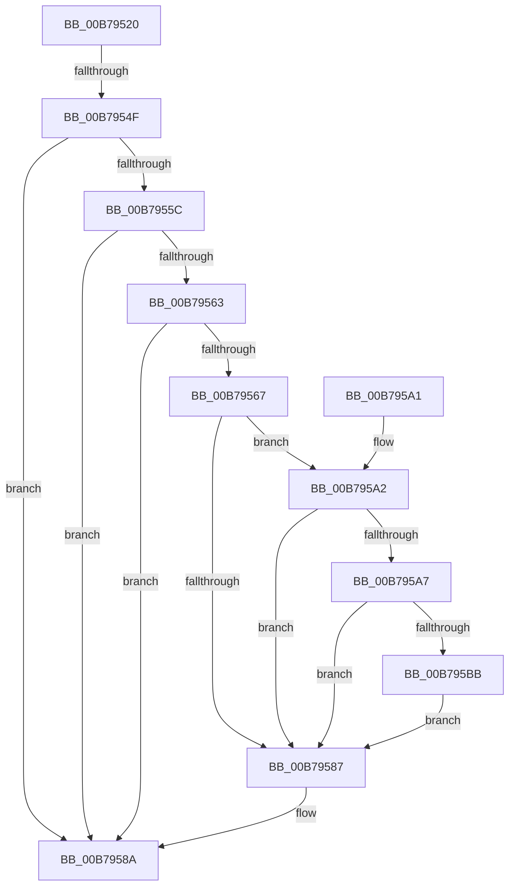

# MiConvertHiberPhasePte

- RVA: `0x00B79520`–`0x00B795CE` (길이 `174` bytes)
- VA: `0x0000000140B79520`
- 실행 섹션: `PAGELK`
- PDB 이름 있음: `예`; PDB Function 태그: `예`
- unwind 정보 RVA: `0x000B410C`
- 디코드: `46`개 명령, `174/174` bytes 표시
- 미해석 바이트: `0` (있으면 어셈블리에 `.byte`로 보존)

> 이 문서는 커널 이미지의 기계어와 PDB 기호를 분석해 생성했습니다. 4번과 5번은 함수 원형과 자료형을 바이너리 사용 방식에서 추정한 C 해석이며 원본 소스 복구 결과는 아닙니다.

## 1. Dependencies

- 직접 호출 지점: **3**; 고유 호출 대상: **3**
- 직접 호출자로 확인된 함수: **0**
- RIP 상대 이미지 참조: **1**

### Outgoing calls
- `0x00B79553` → [MI_READ_PTE_LOCK_FREE](../../text/28/MI_READ_PTE_LOCK_FREE_function_002828A0.md) (function, `0x002828A0`)
- `0x00B795B1` → [MiGetPteAddress](../../text/43/MiGetPteAddress_function_0043E130.md) (function, `0x0043E130`)
- `0x00B795C7` → [MiCheckLinearProtectedPteAccessedBit](../../text/29/MiCheckLinearProtectedPteAccessedBit_function_00292D80.md) (function, `0x00292D80`)

### Direct callers
- 이 함수 시작 RVA로 연결되는 직접 call은 확인되지 않았습니다. 간접 호출은 완전히 역산할 수 없습니다.

### Static image references
- `0x00B79577` → RVA `0x00FC6A88` (`ALMOSTRO`; read)

## 2. Other-region calls and transfers

- 다른 실행 섹션으로 향하는 call: **3**
  - `0x00B79553` → [MI_READ_PTE_LOCK_FREE](../../text/28/MI_READ_PTE_LOCK_FREE_function_002828A0.md) (`PAGELK` → `.text`)
  - `0x00B795B1` → [MiGetPteAddress](../../text/43/MiGetPteAddress_function_0043E130.md) (`PAGELK` → `.text`)
  - `0x00B795C7` → [MiCheckLinearProtectedPteAccessedBit](../../text/29/MiCheckLinearProtectedPteAccessedBit_function_00292D80.md) (`PAGELK` → `.text`)
- call이 아닌 외부 분기/꼬리 이동: **1**
  - `0x00B79549` → [sub_00B8079E](../B8/Unknown_function_00B8079E.md) (`tail-transfer`)

## 3. Assembly (complete function range)

```asm
00B79520  48 8B C4                        mov rax, rsp
00B79523  48 89 58 10                     mov qword ptr [rax + 0x10], rbx
00B79527  48 89 68 18                     mov qword ptr [rax + 0x18], rbp
00B7952B  48 89 70 20                     mov qword ptr [rax + 0x20], rsi
00B7952F  57                              push rdi
00B79530  48 83 EC 20                     sub rsp, 0x20
00B79534  48 8B 1A                        mov rbx, qword ptr [rdx]
00B79537  48 8B FA                        mov rdi, rdx
00B7953A  48 83 B9 B8 00 00 00 00         cmp qword ptr [rcx + 0xb8], 0
00B79542  48 8B E9                        mov rbp, rcx
00B79545  48 89 58 08                     mov qword ptr [rax + 8], rbx
00B79549  0F 85 4F 72 00 00               jne 0x140b8079e
00B7954F  48 8D 48 08                     lea rcx, [rax + 8]
00B79553  E8 48 93 70 FF                  call 0x1402828a0
00B79558  A8 01                           test al, 1
00B7955A  75 2E                           jne 0x140b7958a
00B7955C  48 0F BA E0 0A                  bt rax, 0xa
00B79561  73 27                           jae 0x140b7958a
00B79563  A8 04                           test al, 4
00B79565  74 23                           je 0x140b7958a
00B79567  48 8B 5C 24 30                  mov rbx, qword ptr [rsp + 0x30]
00B7956C  48 81 E3 FB FB FF FF            and rbx, 0xfffffffffffffbfb
00B79573  48 83 CB 01                     or rbx, 1
00B79577  48 0F BA 25 08 D5 44 00 24      bt qword ptr [rip + 0x44d508], 0x24
00B79580  48 89 5C 24 30                  mov qword ptr [rsp + 0x30], rbx
00B79585  72 1B                           jb 0x140b795a2
00B79587  48 89 1F                        mov qword ptr [rdi], rbx
00B7958A  48 8B 5C 24 38                  mov rbx, qword ptr [rsp + 0x38]
00B7958F  33 C0                           xor eax, eax
00B79591  48 8B 6C 24 40                  mov rbp, qword ptr [rsp + 0x40]
00B79596  48 8B 74 24 48                  mov rsi, qword ptr [rsp + 0x48]
00B7959B  48 83 C4 20                     add rsp, 0x20
00B7959F  5F                              pop rdi
00B795A0  C3                              ret
00B795A1  CC                              int3
00B795A2  F6 C3 20                        test bl, 0x20
00B795A5  75 E0                           jne 0x140b79587
00B795A7  48 B9 00 00 00 00 00 80 FF FF   movabs rcx, 0xffff800000000000
00B795B1  E8 7A 4B 8C FF                  call 0x14043e130
00B795B6  48 3B F8                        cmp rdi, rax
00B795B9  72 CC                           jb 0x140b79587
00B795BB  41 B8 80 00 00 00               mov r8d, 0x80
00B795C1  48 8B D3                        mov rdx, rbx
00B795C4  48 8B CF                        mov rcx, rdi
00B795C7  E8 B4 97 71 FF                  call 0x140292d80
00B795CC  EB B9                           jmp 0x140b79587
```

## 4. C-style interpretation (structured pseudocode)

```c
__int64 __fastcall MiConvertHiberPhasePte(__int64 a1, __int64 a2)
{
    __int64 result;
    __int64 v_rbx;
    __int64 v_rsp;
    unsigned __int64 v_stack_p10;
    unsigned __int64 v_stack_p18;
    unsigned __int64 v_stack_p20;
    unsigned __int64 v_stack_p8;

    *(unsigned __int64 *)(v_rsp + 16) = v_rbx;
    *(unsigned __int64 *)(v_rsp + 24) = v_rbp;
    *(unsigned __int64 *)(v_rsp + 32) = v_rsi;
    v_rsp = (v_rsp) - (32);
    *(unsigned __int64 *)(v_rsp + 8) = *(unsigned __int64 *)(a2);
    result = MI_READ_PTE_LOCK_FREE(v_rsp + 8, a2, a3, a4);
    if ((((unsigned __int8)(result)) & (1)) != 0) goto loc_00B7958A;
    if (condition_is_above_or_equal) goto loc_00B7958A;
    if ((((unsigned __int8)(result)) & (4)) == 0) goto loc_00B7958A;
    v_rbx = (v_stack_p8) & (0xFFFFFFFFFFFFFBFBULL);
    v_rbx = (v_rbx) | (1);
    v_stack_p8 = v_rbx;
    if (condition_is_below) goto loc_00B795A2;
loc_00B79587:
    *(unsigned __int64 *)(a2) = v_rbx;
loc_00B7958A:
    result = 0;
    v_rsp = (v_rsp) + (32);
    return result;
loc_00B795A2:
    if ((((unsigned __int8)(v_stack_p10)) & (32)) != 0) goto loc_00B79587;
    result = MiGetPteAddress(v_rsp + 8, a2, a3, a4);
    if (a2 < result) goto loc_00B79587;
    result = MiCheckLinearProtectedPteAccessedBit(a2, v_stack_p10, 128, a4);
    goto loc_00B79587;
}
```

## 5. (Beta) C Style

```c
int64_t MiConvertHiberPhasePte(void *Arg1, void *Arg2)
{
    uint8_t *arg1 = (uint8_t *)Arg1;
    uint8_t *arg2 = (uint8_t *)Arg2;

    int64_t result;
    int64_t local_rbx;
    int64_t local_rsp;
    uint64_t v_stack_p10;
    uint64_t v_stack_p18;
    uint64_t v_stack_p20;
    uint64_t v_stack_p8;

    *(uint64_t *)(local_rsp + 0x10) = local_rbx;
    *(uint64_t *)(local_rsp + 0x18) = local_rbp;
    *(uint64_t *)(local_rsp + 0x20) = local_rsi;
    local_rsp = (local_rsp) - (32);
    *(uint64_t *)(local_rsp + 0x8) = *(uint64_t *)(arg2);
    result = MI_READ_PTE_LOCK_FREE(local_rsp + 8, Arg2, a3, a4);
    if ((((uint8_t)(result)) & (1)) != 0) goto loc_00B7958A;
    if (condition_is_above_or_equal) goto loc_00B7958A;
    if ((((uint8_t)(result)) & (4)) == 0) goto loc_00B7958A;
    local_rbx = (v_stack_p8) & (0xFFFFFFFFFFFFFBFBULL);
    local_rbx = (local_rbx) | (1);
    v_stack_p8 = local_rbx;
    if (condition_is_below) goto loc_00B795A2;
loc_00B79587:
    *(uint64_t *)(arg2) = local_rbx;
loc_00B7958A:
    result = 0;
    local_rsp = (local_rsp) + (32);
    return result;
loc_00B795A2:
    if ((((uint8_t)(v_stack_p10)) & (32)) != 0) goto loc_00B79587;
    result = MiGetPteAddress(local_rsp + 8, Arg2, a3, a4);
    if (Arg2 < result) goto loc_00B79587;
    result = MiCheckLinearProtectedPteAccessedBit(Arg2, v_stack_p10, 128, a4);
    goto loc_00B79587;
}
```

### 관측된 메모리 오프셋

구조체 형식이 확인되지 않은 접근은 인자 기준의 오프셋으로만 기록했습니다.

| 기준 인자 | 오프셋 표현 | 폭 (bit) | 접근 |
|---|---:|---:|---|
| `Arg1` | `+ 0xB8` | `64` | `R` |
| `Arg2` | `+ 0x0` | `64` | `R` |

## 6. Execution-region graph

[열기: 2D/3D 그래프와 함수 탐색 컨트롤 패널](../../../control-panel.html?section=pagelk&rva=0x00B79520&view=graph)

- 2D 그래프는 위에서 아래로 흐르고, 3D 그래프는 빈 공간을 드래그해 회전합니다. Shift+드래그는 이동, 휠은 확대·축소, 함수 노드 선택은 대상 보고서 이동입니다.

### Static fallback


