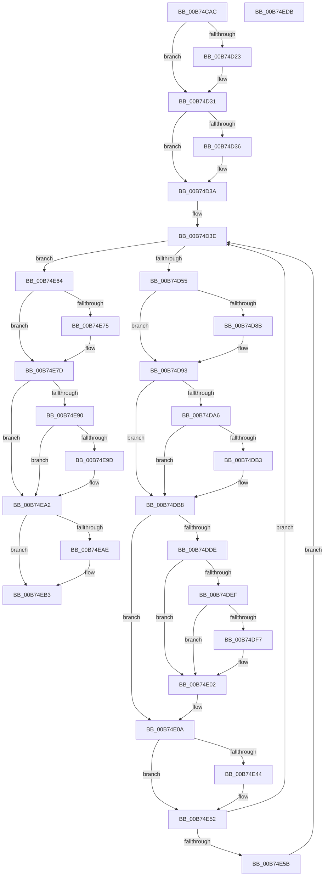

# MiDeleteAllHardwareEnclaves

- RVA: `0x00B74CAC`–`0x00B74EDC` (길이 `560` bytes)
- VA: `0x0000000140B74CAC`
- 실행 섹션: `PAGELK`
- PDB 이름 있음: `예`; PDB Function 태그: `아니요`
- unwind 정보 RVA: `0x000D88CC`
- 디코드: `144`개 명령, `560/560` bytes 표시
- 미해석 바이트: `0` (있으면 어셈블리에 `.byte`로 보존)

> 이 문서는 커널 이미지의 기계어와 PDB 기호를 분석해 생성했습니다. 4번과 5번은 함수 원형과 자료형을 바이너리 사용 방식에서 추정한 C 해석이며 원본 소스 복구 결과는 아닙니다.

## 1. Dependencies

- 직접 호출 지점: **20**; 고유 호출 대상: **15**
- 직접 호출자로 확인된 함수: **2**
- RIP 상대 이미지 참조: **6**

### Outgoing calls
- `0x00B74CF6` → [ExWaitForRundownProtectionRelease](../../text/2A/ExWaitForRundownProtectionRelease_function_002A4CB0.md) (function, `0x002A4CB0`)
- `0x00B74D12` → [KeAbPreAcquire](../../text/21/KeAbPreAcquire_function_00210230.md) (function, `0x00210230`)
- `0x00B74D2C` → [ExfAcquirePushLockExclusiveEx](../../text/20/ExfAcquirePushLockExclusiveEx_function_0020FC90.md) (function, `0x0020FC90`)
- `0x00B74D61` → [ObfReferenceObjectWithTag](../../text/21/ObfReferenceObjectWithTag_function_00210710.md) (function, `0x00210710`)
- `0x00B74D8E` → [ExfTryToWakePushLock](../../text/26/ExfTryToWakePushLock_function_00265DD0.md) (function, `0x00265DD0`)
- `0x00B74D96` → [KeAbPostRelease](../../text/2E/KeAbPostRelease_function_002E1600.md) (function, `0x002E1600`)
- `0x00B74DB3` → [KiCheckForKernelApcDelivery](../../text/2E/KiCheckForKernelApcDelivery_function_002E2C80.md) (function, `0x002E2C80`)
- `0x00B74DC2` → [KiStackAttachProcess](../../text/21/KiStackAttachProcess_function_00216820.md) (function, `0x00216820`)
- `0x00B74DD1` → [MiObtainReferencedVadEx](../../text/31/MiObtainReferencedVadEx_function_00316690.md) (function, `0x00316690`)
- `0x00B74DFD` → [MiDeleteEnclavePages](MiDeleteEnclavePages_function_00B7E228.md) (function, `0x00B7E228`)
- `0x00B74E05` → [MiUnlockAndDereferenceVad](../../text/31/MiUnlockAndDereferenceVad_function_00316E60.md) (function, `0x00316E60`)
- `0x00B74E11` → [KiUnstackDetachProcess](../../text/21/KiUnstackDetachProcess_function_00217D30.md) (function, `0x00217D30`)
- `0x00B74E1E` → [ObfDereferenceObjectWithTag](../../text/2F/ObfDereferenceObjectWithTag_function_002F78E0.md) (function, `0x002F78E0`)
- `0x00B74E33` → [KeAbPreAcquire](../../text/21/KeAbPreAcquire_function_00210230.md) (function, `0x00210230`)
- `0x00B74E4D` → [ExfAcquirePushLockExclusiveEx](../../text/20/ExfAcquirePushLockExclusiveEx_function_0020FC90.md) (function, `0x0020FC90`)
- `0x00B74E78` → [ExfTryToWakePushLock](../../text/26/ExfTryToWakePushLock_function_00265DD0.md) (function, `0x00265DD0`)
- `0x00B74E80` → [KeAbPostRelease](../../text/2E/KeAbPostRelease_function_002E1600.md) (function, `0x002E1600`)
- `0x00B74E9D` → [KiCheckForKernelApcDelivery](../../text/2E/KiCheckForKernelApcDelivery_function_002E2C80.md) (function, `0x002E2C80`)
- `0x00B74EAE` → [KeRemoveEnclavePage](../../text/36/KeRemoveEnclavePage_function_00368C90.md) (function, `0x00368C90`)
- `0x00B74EBB` → [_security_check_cookie](../../text/6A/_security_check_cookie_function_006AC640.md) (function, `0x006AC640`)

### Direct callers
- [ExRebootSystemForRecovery](../../text/65/ExRebootSystemForRecovery_function_00655924.md) at `0x006559B5`
- [MiShutdownSystem](MiShutdownSystem_function_00B73934.md) at `0x00B73A4D`

### Static image references
- `0x00B74CC5` → RVA `0x00E0A740` (`.data`; read)
- `0x00B74CD7` → RVA `0x00E375F8` (`.data`; read)
- `0x00B74D02` → RVA `0x00E375F0` (`.data`; read)
- `0x00B74D3E` → RVA `0x00E375E0` (`.data`; read)
- `0x00B74D7C` → RVA `0x00E375F0` (`.data`; read/write)
- `0x00B74EA2` → RVA `0x00E375C0` (`.data`; read)

## 2. Other-region calls and transfers

- 다른 실행 섹션으로 향하는 call: **19**
  - `0x00B74CF6` → [ExWaitForRundownProtectionRelease](../../text/2A/ExWaitForRundownProtectionRelease_function_002A4CB0.md) (`PAGELK` → `.text`)
  - `0x00B74D12` → [KeAbPreAcquire](../../text/21/KeAbPreAcquire_function_00210230.md) (`PAGELK` → `.text`)
  - `0x00B74D2C` → [ExfAcquirePushLockExclusiveEx](../../text/20/ExfAcquirePushLockExclusiveEx_function_0020FC90.md) (`PAGELK` → `.text`)
  - `0x00B74D61` → [ObfReferenceObjectWithTag](../../text/21/ObfReferenceObjectWithTag_function_00210710.md) (`PAGELK` → `.text`)
  - `0x00B74D8E` → [ExfTryToWakePushLock](../../text/26/ExfTryToWakePushLock_function_00265DD0.md) (`PAGELK` → `.text`)
  - `0x00B74D96` → [KeAbPostRelease](../../text/2E/KeAbPostRelease_function_002E1600.md) (`PAGELK` → `.text`)
  - `0x00B74DB3` → [KiCheckForKernelApcDelivery](../../text/2E/KiCheckForKernelApcDelivery_function_002E2C80.md) (`PAGELK` → `.text`)
  - `0x00B74DC2` → [KiStackAttachProcess](../../text/21/KiStackAttachProcess_function_00216820.md) (`PAGELK` → `.text`)
  - `0x00B74DD1` → [MiObtainReferencedVadEx](../../text/31/MiObtainReferencedVadEx_function_00316690.md) (`PAGELK` → `.text`)
  - `0x00B74E05` → [MiUnlockAndDereferenceVad](../../text/31/MiUnlockAndDereferenceVad_function_00316E60.md) (`PAGELK` → `.text`)
  - `0x00B74E11` → [KiUnstackDetachProcess](../../text/21/KiUnstackDetachProcess_function_00217D30.md) (`PAGELK` → `.text`)
  - `0x00B74E1E` → [ObfDereferenceObjectWithTag](../../text/2F/ObfDereferenceObjectWithTag_function_002F78E0.md) (`PAGELK` → `.text`)
  - `0x00B74E33` → [KeAbPreAcquire](../../text/21/KeAbPreAcquire_function_00210230.md) (`PAGELK` → `.text`)
  - `0x00B74E4D` → [ExfAcquirePushLockExclusiveEx](../../text/20/ExfAcquirePushLockExclusiveEx_function_0020FC90.md) (`PAGELK` → `.text`)
  - `0x00B74E78` → [ExfTryToWakePushLock](../../text/26/ExfTryToWakePushLock_function_00265DD0.md) (`PAGELK` → `.text`)
  - `0x00B74E80` → [KeAbPostRelease](../../text/2E/KeAbPostRelease_function_002E1600.md) (`PAGELK` → `.text`)
  - `0x00B74E9D` → [KiCheckForKernelApcDelivery](../../text/2E/KiCheckForKernelApcDelivery_function_002E2C80.md) (`PAGELK` → `.text`)
  - `0x00B74EAE` → [KeRemoveEnclavePage](../../text/36/KeRemoveEnclavePage_function_00368C90.md) (`PAGELK` → `.text`)
  - `0x00B74EBB` → [_security_check_cookie](../../text/6A/_security_check_cookie_function_006AC640.md) (`PAGELK` → `.text`)
- 별도 외부 분기/꼬리 이동을 확인하지 못했습니다.

## 3. Assembly (complete function range)

```asm
00B74CAC  48 89 5C 24 08                  mov qword ptr [rsp + 8], rbx
00B74CB1  48 89 74 24 10                  mov qword ptr [rsp + 0x10], rsi
00B74CB6  48 89 7C 24 18                  mov qword ptr [rsp + 0x18], rdi
00B74CBB  41 54                           push r12
00B74CBD  41 56                           push r14
00B74CBF  41 57                           push r15
00B74CC1  48 83 EC 60                     sub rsp, 0x60
00B74CC5  48 8B 05 74 5A 29 00            mov rax, qword ptr [rip + 0x295a74]
00B74CCC  48 33 C4                        xor rax, rsp
00B74CCF  48 89 44 24 58                  mov qword ptr [rsp + 0x58], rax
00B74CD4  0F 57 C0                        xorps xmm0, xmm0
00B74CD7  48 8D 0D 1A 29 2C 00            lea rcx, [rip + 0x2c291a]
00B74CDE  0F 11 44 24 28                  movups xmmword ptr [rsp + 0x28], xmm0
00B74CE3  0F 11 44 24 38                  movups xmmword ptr [rsp + 0x38], xmm0
00B74CE8  0F 11 44 24 48                  movups xmmword ptr [rsp + 0x48], xmm0
00B74CED  65 48 8B 3C 25 88 01 00 00      mov rdi, qword ptr gs:[0x188]
00B74CF6  E8 B5 FF 72 FF                  call 0x1402a4cb0
00B74CFB  66 FF 8F E6 01 00 00            dec word ptr [rdi + 0x1e6]
00B74D02  4C 8D 25 E7 28 2C 00            lea r12, [rip + 0x2c28e7]
00B74D09  49 8B CC                        mov rcx, r12
00B74D0C  45 33 C0                        xor r8d, r8d
00B74D0F  33 D2                           xor edx, edx
00B74D11  90                              nop
00B74D12  E8 19 B5 69 FF                  call 0x140210230
00B74D17  F0 49 0F BA 2C 24 00            lock bts qword ptr [r12], 0
00B74D1E  48 8B D8                        mov rbx, rax
00B74D21  73 0E                           jae 0x140b74d31
00B74D23  4D 8B C4                        mov r8, r12
00B74D26  48 8B D0                        mov rdx, rax
00B74D29  49 8B CC                        mov rcx, r12
00B74D2C  E8 5F AF 69 FF                  call 0x14020fc90
00B74D31  48 85 DB                        test rbx, rbx
00B74D34  74 04                           je 0x140b74d3a
00B74D36  C6 43 0A 01                     mov byte ptr [rbx + 0xa], 1
00B74D3A  48 83 CB FF                     or rbx, 0xffffffffffffffff
00B74D3E  48 8B 35 9B 28 2C 00            mov rsi, qword ptr [rip + 0x2c289b]
00B74D45  48 8D 05 94 28 2C 00            lea rax, [rip + 0x2c2894]
00B74D4C  48 3B F0                        cmp rsi, rax
00B74D4F  0F 84 0F 01 00 00               je 0x140b74e64
00B74D55  4C 8B 7E F8                     mov r15, qword ptr [rsi - 8]
00B74D59  BA 4D 6D 56 6D                  mov edx, 0x6d566d4d
00B74D5E  49 8B CF                        mov rcx, r15
00B74D61  E8 AA B9 69 FF                  call 0x140210710
00B74D66  8B 46 98                        mov eax, dword ptr [rsi - 0x68]
00B74D69  44 0F B6 76 A0                  movzx r14d, byte ptr [rsi - 0x60]
00B74D6E  49 C1 E6 20                     shl r14, 0x20
00B74D72  4C 0B F0                        or r14, rax
00B74D75  48 8B C3                        mov rax, rbx
00B74D78  49 C1 E6 0C                     shl r14, 0xc
00B74D7C  F0 48 0F C1 05 6B 28 2C 00      lock xadd qword ptr [rip + 0x2c286b], rax
00B74D85  24 06                           and al, 6
00B74D87  3C 02                           cmp al, 2
00B74D89  75 08                           jne 0x140b74d93
00B74D8B  49 8B CC                        mov rcx, r12
00B74D8E  E8 3D 10 6F FF                  call 0x140265dd0
00B74D93  49 8B CC                        mov rcx, r12
00B74D96  E8 65 C8 76 FF                  call 0x1402e1600
00B74D9B  90                              nop
00B74D9C  66 83 87 E6 01 00 00 01         add word ptr [rdi + 0x1e6], 1
00B74DA4  75 12                           jne 0x140b74db8
00B74DA6  48 8D 87 98 00 00 00            lea rax, [rdi + 0x98]
00B74DAD  90                              nop
00B74DAE  48 39 00                        cmp qword ptr [rax], rax
00B74DB1  74 05                           je 0x140b74db8
00B74DB3  E8 C8 DE 76 FF                  call 0x1402e2c80
00B74DB8  4C 8D 44 24 28                  lea r8, [rsp + 0x28]
00B74DBD  33 D2                           xor edx, edx
00B74DBF  49 8B CF                        mov rcx, r15
00B74DC2  E8 59 1A 6A FF                  call 0x140216820
00B74DC7  4C 8D 44 24 20                  lea r8, [rsp + 0x20]
00B74DCC  33 D2                           xor edx, edx
00B74DCE  49 8B CE                        mov rcx, r14
00B74DD1  E8 BA 18 7A FF                  call 0x140316690
00B74DD6  48 8B F0                        mov rsi, rax
00B74DD9  48 85 C0                        test rax, rax
00B74DDC  74 2C                           je 0x140b74e0a
00B74DDE  8B 48 30                        mov ecx, dword ptr [rax + 0x30]
00B74DE1  81 E1 00 00 20 0C               and ecx, 0xc200000
00B74DE7  81 F9 00 00 20 08               cmp ecx, 0x8200000
00B74DED  75 13                           jne 0x140b74e02
00B74DEF  8B 48 40                        mov ecx, dword ptr [rax + 0x40]
00B74DF2  F6 C1 01                        test cl, 1
00B74DF5  74 0B                           je 0x140b74e02
00B74DF7  48 8B D0                        mov rdx, rax
00B74DFA  49 8B CF                        mov rcx, r15
00B74DFD  E8 26 94 00 00                  call 0x140b7e228
00B74E02  48 8B CE                        mov rcx, rsi
00B74E05  E8 56 20 7A FF                  call 0x140316e60
00B74E0A  33 D2                           xor edx, edx
00B74E0C  48 8D 4C 24 28                  lea rcx, [rsp + 0x28]
00B74E11  E8 1A 2F 6A FF                  call 0x140217d30
00B74E16  BA 4D 6D 56 6D                  mov edx, 0x6d566d4d
00B74E1B  49 8B CF                        mov rcx, r15
00B74E1E  E8 BD 2A 78 FF                  call 0x1402f78e0
00B74E23  66 01 9F E6 01 00 00            add word ptr [rdi + 0x1e6], bx
00B74E2A  45 33 C0                        xor r8d, r8d
00B74E2D  33 D2                           xor edx, edx
00B74E2F  49 8B CC                        mov rcx, r12
00B74E32  90                              nop
00B74E33  E8 F8 B3 69 FF                  call 0x140210230
00B74E38  F0 49 0F BA 2C 24 00            lock bts qword ptr [r12], 0
00B74E3F  48 8B F0                        mov rsi, rax
00B74E42  73 0E                           jae 0x140b74e52
00B74E44  4D 8B C4                        mov r8, r12
00B74E47  48 8B D0                        mov rdx, rax
00B74E4A  49 8B CC                        mov rcx, r12
00B74E4D  E8 3E AE 69 FF                  call 0x14020fc90
00B74E52  48 85 F6                        test rsi, rsi
00B74E55  0F 84 E3 FE FF FF               je 0x140b74d3e
00B74E5B  C6 46 0A 01                     mov byte ptr [rsi + 0xa], 1
00B74E5F  E9 DA FE FF FF                  jmp 0x140b74d3e
00B74E64  F0 48 0F C1 1D 83 27 2C 00      lock xadd qword ptr [rip + 0x2c2783], rbx
00B74E6D  80 E3 06                        and bl, 6
00B74E70  80 FB 02                        cmp bl, 2
00B74E73  75 08                           jne 0x140b74e7d
00B74E75  49 8B CC                        mov rcx, r12
00B74E78  E8 53 0F 6F FF                  call 0x140265dd0
00B74E7D  49 8B CC                        mov rcx, r12
00B74E80  E8 7B C7 76 FF                  call 0x1402e1600
00B74E85  90                              nop
00B74E86  66 83 87 E6 01 00 00 01         add word ptr [rdi + 0x1e6], 1
00B74E8E  75 12                           jne 0x140b74ea2
00B74E90  48 8D 87 98 00 00 00            lea rax, [rdi + 0x98]
00B74E97  90                              nop
00B74E98  48 39 00                        cmp qword ptr [rax], rax
00B74E9B  74 05                           je 0x140b74ea2
00B74E9D  E8 DE DD 76 FF                  call 0x1402e2c80
00B74EA2  48 8B 0D 17 27 2C 00            mov rcx, qword ptr [rip + 0x2c2717]
00B74EA9  48 85 C9                        test rcx, rcx
00B74EAC  74 05                           je 0x140b74eb3
00B74EAE  E8 DD 3D 7F FF                  call 0x140368c90
00B74EB3  48 8B 4C 24 58                  mov rcx, qword ptr [rsp + 0x58]
00B74EB8  48 33 CC                        xor rcx, rsp
00B74EBB  E8 80 77 B3 FF                  call 0x1406ac640
00B74EC0  4C 8D 5C 24 60                  lea r11, [rsp + 0x60]
00B74EC5  49 8B 5B 20                     mov rbx, qword ptr [r11 + 0x20]
00B74EC9  49 8B 73 28                     mov rsi, qword ptr [r11 + 0x28]
00B74ECD  49 8B 7B 30                     mov rdi, qword ptr [r11 + 0x30]
00B74ED1  49 8B E3                        mov rsp, r11
00B74ED4  41 5F                           pop r15
00B74ED6  41 5E                           pop r14
00B74ED8  41 5C                           pop r12
00B74EDA  C3                              ret
00B74EDB  CC                              int3
```

## 4. C-style interpretation (structured pseudocode)

```c
__int64 __fastcall MiDeleteAllHardwareEnclaves(__int64 a1, int a2, int a3)
{
    __int64 result;
    __int64 v_r14;
    __int64 v_rbx;
    __int64 v_rsp;
    unsigned __int64 v_stack_m18;
    unsigned __int64 v_stack_m20;
    unsigned __int64 v_stack_m30;
    unsigned __int64 v_stack_m40;
    unsigned __int64 v_stack_m50;
    unsigned __int64 v_stack_m58;
    unsigned __int64 v_stack_p10;
    unsigned __int64 v_stack_p18;
    unsigned __int64 v_stack_p8;

    v_stack_p8 = v_rbx;
    v_stack_p10 = v_rsi;
    v_stack_p18 = v_rdi;
    v_rsp = (v_rsp) - (96);
    result = (*(unsigned __int64 *)(v_rip + 2710132)) ^ (v_rsp);
    v_stack_m20 = result;
    v_stack_m50 = v_xmm0;
    v_stack_m40 = v_xmm0;
    v_stack_m30 = v_xmm0;
    result = ExWaitForRundownProtectionRelease(v_rip + 2894106, a2, a3, a4);
    a3 = 0;
    a2 = 0;
    result = KeAbPreAcquire(v_rip + 2894055, a2, a3, a4);
    if (!(condition_is_above_or_equal)) {
        a3 = v_rip + 2894055;
        a2 = result;
        a1 = v_rip + 2894055;
        result = ExfAcquirePushLockExclusiveEx(a1, a2, a3, a4);
    }
    if (result != 0) {
        *(unsigned __int8 *)(result + 10) = 1;
    }
    v_rbx = (result) | (-1);
loc_00B74D3E:
    if ((*(unsigned __int64 *)(v_rip + 2893979)) == (v_rip + 2893972)) goto loc_00B74E64;
    result = ObfReferenceObjectWithTag(*(unsigned __int64 *)(*(unsigned __int64 *)(v_rip + 2893979) - 8), (unsigned int)(0x6D566D4DULL), a3, a4);
    v_r14 = (*(unsigned __int8 *)(*(unsigned __int64 *)(v_rip + 2893979) - 96)) << (32);
    v_r14 = (v_r14) | ((unsigned int)(*(unsigned int *)(*(unsigned __int64 *)(v_rip + 2893979) - 104)));
    v_r14 = (v_r14) << (12);
    result = (unsigned __int8)((v_rbx) & (6));
    if (((unsigned __int8)(result)) == 2) {
        a1 = v_rip + 2894055;
        result = ExfTryToWakePushLock(a1, (unsigned int)(0x6D566D4DULL), a3, a4);
    }
    result = KeAbPostRelease(v_rip + 2894055, (unsigned int)(0x6D566D4DULL), a3, a4);
    if (((unsigned __int8)(result)) != 2) goto loc_00B74DB8;
    result = *(unsigned __int64 *)(gs_base + (0 + 392)) + 152;
    if ((*(unsigned __int64 *)(*(unsigned __int64 *)(gs_base + (0 + 392)) + 152)) != (*(unsigned __int64 *)(gs_base + (0 + 392)) + 152)) {
        result = KiCheckForKernelApcDelivery(v_rip + 2894055, (unsigned int)(0x6D566D4DULL), a3, a4);
    }
    a2 = 0;
    result = KiStackAttachProcess(*(unsigned __int64 *)(*(unsigned __int64 *)(v_rip + 2893979) - 8), a2, v_stack_m50, a4);
    a2 = 0;
    result = MiObtainReferencedVadEx(v_r14, a2, v_stack_m58, a4);
    if (result == 0) goto loc_00B74E0A;
    a1 = (unsigned int)(((unsigned int)(*(unsigned int *)(result + 48))) & (0xC200000ULL));
    if (((unsigned int)(a1)) != 0x8200000ULL) goto loc_00B74E02;
    if ((((unsigned __int8)((unsigned int)(*(unsigned int *)(result + 64)))) & (1)) != 0) {
        a2 = result;
        a1 = *(unsigned __int64 *)(*(unsigned __int64 *)(v_rip + 2893979) - 8);
        result = MiDeleteEnclavePages(a1, a2, v_stack_m58, a4);
    }
    result = MiUnlockAndDereferenceVad(result, a2, v_stack_m58, a4);
loc_00B74E0A:
    a2 = 0;
    result = KiUnstackDetachProcess(v_stack_m50, a2, v_stack_m58, a4);
    result = ObfDereferenceObjectWithTag(*(unsigned __int64 *)(*(unsigned __int64 *)(v_rip + 2893979) - 8), (unsigned int)(0x6D566D4DULL), v_stack_m58, a4);
    a3 = 0;
    a2 = 0;
    result = KeAbPreAcquire(v_rip + 2894055, a2, a3, a4);
    if (!(condition_is_above_or_equal)) {
        a3 = v_rip + 2894055;
        a2 = result;
        a1 = v_rip + 2894055;
        result = ExfAcquirePushLockExclusiveEx(a1, a2, a3, a4);
    }
    if (result == 0) goto loc_00B74D3E;
    *(unsigned __int8 *)(result + 10) = 1;
    goto loc_00B74D3E;
loc_00B74E64:
    v_rbx = (unsigned __int8)((v_rbx) & (6));
    if (((unsigned __int8)(v_rbx)) == 2) {
        a1 = v_rip + 2894055;
        result = ExfTryToWakePushLock(a1, a2, a3, a4);
    }
    result = KeAbPostRelease(v_rip + 2894055, a2, a3, a4);
    if (((unsigned __int8)(v_rbx)) != 2) goto loc_00B74EA2;
    result = *(unsigned __int64 *)(gs_base + (0 + 392)) + 152;
    if ((*(unsigned __int64 *)(*(unsigned __int64 *)(gs_base + (0 + 392)) + 152)) != (*(unsigned __int64 *)(gs_base + (0 + 392)) + 152)) {
        result = KiCheckForKernelApcDelivery(v_rip + 2894055, a2, a3, a4);
    }
    if (*(unsigned __int64 *)(v_rip + 2893591) != 0) {
        result = KeRemoveEnclavePage(*(unsigned __int64 *)(v_rip + 2893591), a2, a3, a4);
    }
    a1 = (v_stack_m20) ^ (v_rsp);
    result = _security_check_cookie(a1, a2, a3, a4);
    return result;
}
```

## 5. (Beta) C Style

```c
int64_t MiDeleteAllHardwareEnclaves(int64_t Arg1, int32_t Arg2, int32_t Arg3)
{
    int64_t result;
    int64_t local_r14;
    int64_t local_rbx;
    int64_t local_rsp;
    uint64_t v_stack_m18;
    uint64_t v_stack_m20;
    uint64_t v_stack_m30;
    uint64_t v_stack_m40;
    uint64_t v_stack_m50;
    uint64_t v_stack_m58;
    uint64_t v_stack_p10;
    uint64_t v_stack_p18;
    uint64_t v_stack_p8;

    v_stack_p8 = local_rbx;
    v_stack_p10 = local_rsi;
    v_stack_p18 = local_rdi;
    local_rsp = (local_rsp) - (96);
    result = (*(uint64_t *)(v_rip + 0x295A74)) ^ (local_rsp);
    v_stack_m20 = result;
    v_stack_m50 = v_xmm0;
    v_stack_m40 = v_xmm0;
    v_stack_m30 = v_xmm0;
    result = ExWaitForRundownProtectionRelease(v_rip + 2894106, Arg2, Arg3, a4);
    Arg3 = 0;
    Arg2 = 0;
    result = KeAbPreAcquire(v_rip + 2894055, Arg2, Arg3, a4);
    if (!(condition_is_above_or_equal)) {
        Arg3 = v_rip + 2894055;
        Arg2 = result;
        Arg1 = v_rip + 2894055;
        result = ExfAcquirePushLockExclusiveEx(Arg1, Arg2, Arg3, a4);
    }
    if (result != 0) {
        *(uint8_t *)(result + 0xA) = 1;
    }
    local_rbx = (result) | (-1);
loc_00B74D3E:
    if ((*(uint64_t *)(v_rip + 0x2C289B)) == (v_rip + 2893972)) goto loc_00B74E64;
    result = ObfReferenceObjectWithTag(*(uint64_t *)(*(uint64_t *)(v_rip + 0x2C289B) - 0x8), (uint32_t)(0x6D566D4DULL), Arg3, a4);
    local_r14 = (*(uint8_t *)(*(uint64_t *)(v_rip + 0x2C289B) - 0x60)) << (32);
    local_r14 = (local_r14) | ((uint32_t)(*(uint32_t *)(*(uint64_t *)(v_rip + 0x2C289B) - 0x68)));
    local_r14 = (local_r14) << (12);
    result = (uint8_t)((local_rbx) & (6));
    if (((uint8_t)(result)) == 2) {
        Arg1 = v_rip + 2894055;
        result = ExfTryToWakePushLock(Arg1, (uint32_t)(0x6D566D4DULL), Arg3, a4);
    }
    result = KeAbPostRelease(v_rip + 2894055, (uint32_t)(0x6D566D4DULL), Arg3, a4);
    if (((uint8_t)(result)) != 2) goto loc_00B74DB8;
    result = *(uint64_t *)(gs_base + (0 + 0x188)) + 152;
    if ((*(uint64_t *)(*(uint64_t *)(gs_base + (0 + 0x188)) + 0x98)) != (*(uint64_t *)(gs_base + (0 + 0x188)) + 152)) {
        result = KiCheckForKernelApcDelivery(v_rip + 2894055, (uint32_t)(0x6D566D4DULL), Arg3, a4);
    }
    Arg2 = 0;
    result = KiStackAttachProcess(*(uint64_t *)(*(uint64_t *)(v_rip + 0x2C289B) - 0x8), Arg2, v_stack_m50, a4);
    Arg2 = 0;
    result = MiObtainReferencedVadEx(local_r14, Arg2, v_stack_m58, a4);
    if (result == 0) goto loc_00B74E0A;
    Arg1 = (uint32_t)(((uint32_t)(*(uint32_t *)(result + 0x30))) & (0xC200000ULL));
    if (((uint32_t)(Arg1)) != 0x8200000ULL) goto loc_00B74E02;
    if ((((uint8_t)((uint32_t)(*(uint32_t *)(result + 0x40)))) & (1)) != 0) {
        Arg2 = result;
        Arg1 = *(uint64_t *)(*(uint64_t *)(v_rip + 0x2C289B) - 0x8);
        result = MiDeleteEnclavePages(Arg1, Arg2, v_stack_m58, a4);
    }
    result = MiUnlockAndDereferenceVad(result, Arg2, v_stack_m58, a4);
loc_00B74E0A:
    Arg2 = 0;
    result = KiUnstackDetachProcess(v_stack_m50, Arg2, v_stack_m58, a4);
    result = ObfDereferenceObjectWithTag(*(uint64_t *)(*(uint64_t *)(v_rip + 0x2C289B) - 0x8), (uint32_t)(0x6D566D4DULL), v_stack_m58, a4);
    Arg3 = 0;
    Arg2 = 0;
    result = KeAbPreAcquire(v_rip + 2894055, Arg2, Arg3, a4);
    if (!(condition_is_above_or_equal)) {
        Arg3 = v_rip + 2894055;
        Arg2 = result;
        Arg1 = v_rip + 2894055;
        result = ExfAcquirePushLockExclusiveEx(Arg1, Arg2, Arg3, a4);
    }
    if (result == 0) goto loc_00B74D3E;
    *(uint8_t *)(result + 0xA) = 1;
    goto loc_00B74D3E;
loc_00B74E64:
    local_rbx = (uint8_t)((local_rbx) & (6));
    if (((uint8_t)(local_rbx)) == 2) {
        Arg1 = v_rip + 2894055;
        result = ExfTryToWakePushLock(Arg1, Arg2, Arg3, a4);
    }
    result = KeAbPostRelease(v_rip + 2894055, Arg2, Arg3, a4);
    if (((uint8_t)(local_rbx)) != 2) goto loc_00B74EA2;
    result = *(uint64_t *)(gs_base + (0 + 0x188)) + 152;
    if ((*(uint64_t *)(*(uint64_t *)(gs_base + (0 + 0x188)) + 0x98)) != (*(uint64_t *)(gs_base + (0 + 0x188)) + 152)) {
        result = KiCheckForKernelApcDelivery(v_rip + 2894055, Arg2, Arg3, a4);
    }
    if (*(uint64_t *)(v_rip + 0x2C2717) != 0) {
        result = KeRemoveEnclavePage(*(uint64_t *)(v_rip + 0x2C2717), Arg2, Arg3, a4);
    }
    Arg1 = (v_stack_m20) ^ (local_rsp);
    result = _security_check_cookie(Arg1, Arg2, Arg3, a4);
    return result;
}
```

## 6. Execution-region graph

[열기: 2D/3D 그래프와 함수 탐색 컨트롤 패널](../../../control-panel.html?section=pagelk&rva=0x00B74CAC&view=graph)

- 2D 그래프는 위에서 아래로 흐르고, 3D 그래프는 빈 공간을 드래그해 회전합니다. Shift+드래그는 이동, 휠은 확대·축소, 함수 노드 선택은 대상 보고서 이동입니다.

### Static fallback


