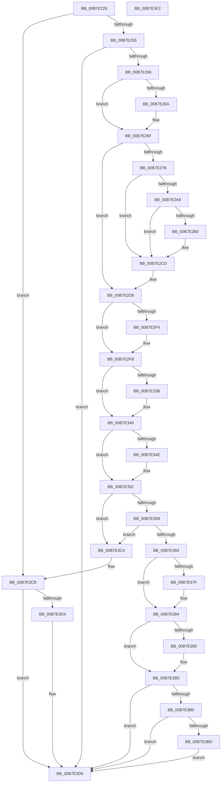

# MiDeleteEnclavePages

- RVA: `0x00B7E228`–`0x00B7E3F3` (길이 `459` bytes)
- VA: `0x0000000140B7E228`
- 실행 섹션: `PAGELK`
- PDB 이름 있음: `예`; PDB Function 태그: `아니요`
- unwind 정보 RVA: `0x00084C9C`
- 디코드: `121`개 명령, `459/459` bytes 표시
- 미해석 바이트: `0` (있으면 어셈블리에 `.byte`로 보존)

> 이 문서는 커널 이미지의 기계어와 PDB 기호를 분석해 생성했습니다. 4번과 5번은 함수 원형과 자료형을 바이너리 사용 방식에서 추정한 C 해석이며 원본 소스 복구 결과는 아닙니다.

## 1. Dependencies

- 직접 호출 지점: **14**; 고유 호출 대상: **14**
- 직접 호출자로 확인된 함수: **3**
- RIP 상대 이미지 참조: **4**

### Outgoing calls
- `0x00B7E26A` → [MiTerminateHardwareEnclave](MiTerminateHardwareEnclave_function_00B75030.md) (function, `0x00B75030`)
- `0x00B7E298` → [KeRemoveEnclavePage](../../text/36/KeRemoveEnclavePage_function_00368C90.md) (function, `0x00368C90`)
- `0x00B7E2C7` → [KeBugCheckEx](../../text/4F/KeBugCheckEx_function_004FD660.md) (function, `0x004FD660`)
- `0x00B7E2D3` → [MiDeleteEnclavePage](../../text/36/MiDeleteEnclavePage_function_00368CCC.md) (function, `0x00368CCC`)
- `0x00B7E2E6` → [MiReleasePtes](../../text/24/MiReleasePtes_function_00247240.md) (function, `0x00247240`)
- `0x00B7E2F6` → [ExFreePoolWithTag](../../poolcode/B8/ExFreePoolWithTag_function_00B82870.md) (function, `0x00B82870`)
- `0x00B7E305` → [MiReturnReservedEnclavePages](MiReturnReservedEnclavePages_function_00B74FD0.md) (function, `0x00B74FD0`)
- `0x00B7E32B` → [KeAbPreAcquire](../../text/21/KeAbPreAcquire_function_00210230.md) (function, `0x00210230`)
- `0x00B7E344` → [ExfAcquirePushLockExclusiveEx](../../text/20/ExfAcquirePushLockExclusiveEx_function_0020FC90.md) (function, `0x0020FC90`)
- `0x00B7E37F` → [MiReleaseEnclaveMetadataPage](MiReleaseEnclaveMetadataPage_function_00B74EE4.md) (function, `0x00B74EE4`)
- `0x00B7E398` → [ExfTryToWakePushLock](../../text/26/ExfTryToWakePushLock_function_00265DD0.md) (function, `0x00265DD0`)
- `0x00B7E3A0` → [KeAbPostRelease](../../text/2E/KeAbPostRelease_function_002E1600.md) (function, `0x002E1600`)
- `0x00B7E3BD` → [KiCheckForKernelApcDelivery](../../text/2E/KiCheckForKernelApcDelivery_function_002E2C80.md) (function, `0x002E2C80`)
- `0x00B7E3D4` → [PsDeleteVsmEnclave](../../page/78/PsDeleteVsmEnclave_function_007885F0.md) (function, `0x007885F0`)

### Direct callers
- [MiCreateHardwareEnclave](../../page/80/MiCreateHardwareEnclave_function_00808500.md) at `0x008086EB`
- [MiDeleteVad](../../page/88/MiDeleteVad_function_00888C80.md) at `0x0088916D`
- [MiDeleteAllHardwareEnclaves](MiDeleteAllHardwareEnclaves_function_00B74CAC.md) at `0x00B74DFD`

### Static image references
- `0x00B7E2DC` → RVA `0x00E37668` (`.data`; read)
- `0x00B7E313` → RVA `0x00E375F0` (`.data`; read)
- `0x00B7E36B` → RVA `0x00E375E0` (`.data`; read)
- `0x00B7E384` → RVA `0x00E375F0` (`.data`; read/write)

## 2. Other-region calls and transfers

- 다른 실행 섹션으로 향하는 call: **11**
  - `0x00B7E298` → [KeRemoveEnclavePage](../../text/36/KeRemoveEnclavePage_function_00368C90.md) (`PAGELK` → `.text`)
  - `0x00B7E2C7` → [KeBugCheckEx](../../text/4F/KeBugCheckEx_function_004FD660.md) (`PAGELK` → `.text`)
  - `0x00B7E2D3` → [MiDeleteEnclavePage](../../text/36/MiDeleteEnclavePage_function_00368CCC.md) (`PAGELK` → `.text`)
  - `0x00B7E2E6` → [MiReleasePtes](../../text/24/MiReleasePtes_function_00247240.md) (`PAGELK` → `.text`)
  - `0x00B7E2F6` → [ExFreePoolWithTag](../../poolcode/B8/ExFreePoolWithTag_function_00B82870.md) (`PAGELK` → `POOLCODE`)
  - `0x00B7E32B` → [KeAbPreAcquire](../../text/21/KeAbPreAcquire_function_00210230.md) (`PAGELK` → `.text`)
  - `0x00B7E344` → [ExfAcquirePushLockExclusiveEx](../../text/20/ExfAcquirePushLockExclusiveEx_function_0020FC90.md) (`PAGELK` → `.text`)
  - `0x00B7E398` → [ExfTryToWakePushLock](../../text/26/ExfTryToWakePushLock_function_00265DD0.md) (`PAGELK` → `.text`)
  - `0x00B7E3A0` → [KeAbPostRelease](../../text/2E/KeAbPostRelease_function_002E1600.md) (`PAGELK` → `.text`)
  - `0x00B7E3BD` → [KiCheckForKernelApcDelivery](../../text/2E/KiCheckForKernelApcDelivery_function_002E2C80.md) (`PAGELK` → `.text`)
  - `0x00B7E3D4` → [PsDeleteVsmEnclave](../../page/78/PsDeleteVsmEnclave_function_007885F0.md) (`PAGELK` → `PAGE`)
- 별도 외부 분기/꼬리 이동을 확인하지 못했습니다.

## 3. Assembly (complete function range)

```asm
00B7E228  48 89 5C 24 08                  mov qword ptr [rsp + 8], rbx
00B7E22D  48 89 6C 24 10                  mov qword ptr [rsp + 0x10], rbp
00B7E232  48 89 74 24 18                  mov qword ptr [rsp + 0x18], rsi
00B7E237  57                              push rdi
00B7E238  41 56                           push r14
00B7E23A  41 57                           push r15
00B7E23C  48 83 EC 30                     sub rsp, 0x30
00B7E240  8B 42 40                        mov eax, dword ptr [rdx + 0x40]
00B7E243  41 BE 01 00 00 00               mov r14d, 1
00B7E249  48 8B FA                        mov rdi, rdx
00B7E24C  41 84 C6                        test r14b, al
00B7E24F  0F 84 76 01 00 00               je 0x140b7e3cb
00B7E255  48 8D B2 80 00 00 00            lea rsi, [rdx + 0x80]
00B7E25C  48 83 3E 00                     cmp qword ptr [rsi], 0
00B7E260  0F 84 73 01 00 00               je 0x140b7e3d9
00B7E266  A8 08                           test al, 8
00B7E268  75 05                           jne 0x140b7e26f
00B7E26A  E8 C1 6D FF FF                  call 0x140b75030
00B7E26F  48 8B 47 50                     mov rax, qword ptr [rdi + 0x50]
00B7E273  48 8B 00                        mov rax, qword ptr [rax]
00B7E276  41 84 C6                        test r14b, al
00B7E279  74 5D                           je 0x140b7e2d8
00B7E27B  48 B8 00 00 00 00 80 F6 FF FF   movabs rax, 0xfffff68000000000
00B7E285  48 8B 4F 50                     mov rcx, qword ptr [rdi + 0x50]
00B7E289  48 C1 E1 19                     shl rcx, 0x19
00B7E28D  48 C1 E0 19                     shl rax, 0x19
00B7E291  48 2B C8                        sub rcx, rax
00B7E294  48 C1 F9 10                     sar rcx, 0x10
00B7E298  E8 F3 A9 7E FF                  call 0x140368c90
00B7E29D  BA 00 00 00 80                  mov edx, 0x80000000
00B7E2A2  8D 0C 10                        lea ecx, [rax + rdx]
00B7E2A5  85 CA                           test edx, ecx
00B7E2A7  75 24                           jne 0x140b7e2cd
00B7E2A9  3D 1D 00 00 C0                  cmp eax, 0xc000001d
00B7E2AE  74 1D                           je 0x140b7e2cd
00B7E2B0  48 83 64 24 20 00               and qword ptr [rsp + 0x20], 0
00B7E2B6  BA 01 16 05 00                  mov edx, 0x51601
00B7E2BB  4C 8B 47 50                     mov r8, qword ptr [rdi + 0x50]
00B7E2BF  B9 1A 00 00 00                  mov ecx, 0x1a
00B7E2C4  4C 63 C8                        movsxd r9, eax
00B7E2C7  E8 94 F3 97 FF                  call 0x1404fd660
00B7E2CC  CC                              int3
00B7E2CD  48 8B 4F 50                     mov rcx, qword ptr [rdi + 0x50]
00B7E2D1  33 D2                           xor edx, edx
00B7E2D3  E8 F4 A9 7E FF                  call 0x140368ccc
00B7E2D8  48 8B 57 50                     mov rdx, qword ptr [rdi + 0x50]
00B7E2DC  48 8D 0D 85 93 2B 00            lea rcx, [rip + 0x2b9385]
00B7E2E3  45 8B C6                        mov r8d, r14d
00B7E2E6  E8 55 8F 6C FF                  call 0x140247240
00B7E2EB  48 8B 4F 58                     mov rcx, qword ptr [rdi + 0x58]
00B7E2EF  48 85 C9                        test rcx, rcx
00B7E2F2  74 07                           je 0x140b7e2fb
00B7E2F4  33 D2                           xor edx, edx
00B7E2F6  E8 75 45 00 00                  call 0x140b82870
00B7E2FB  48 83 CB FF                     or rbx, 0xffffffffffffffff
00B7E2FF  48 8B CF                        mov rcx, rdi
00B7E302  48 8B D3                        mov rdx, rbx
00B7E305  E8 C6 6C FF FF                  call 0x140b74fd0
00B7E30A  65 48 8B 3C 25 88 01 00 00      mov rdi, qword ptr gs:[0x188]
00B7E313  4C 8D 3D D6 92 2B 00            lea r15, [rip + 0x2b92d6]
00B7E31A  45 33 C0                        xor r8d, r8d
00B7E31D  33 D2                           xor edx, edx
00B7E31F  49 8B CF                        mov rcx, r15
00B7E322  66 44 29 B7 E6 01 00 00         sub word ptr [rdi + 0x1e6], r14w
00B7E32A  90                              nop
00B7E32B  E8 00 1F 69 FF                  call 0x140210230
00B7E330  F0 49 0F BA 2F 00               lock bts qword ptr [r15], 0
00B7E336  48 8B E8                        mov rbp, rax
00B7E339  73 0E                           jae 0x140b7e349
00B7E33B  4D 8B C7                        mov r8, r15
00B7E33E  48 8B D0                        mov rdx, rax
00B7E341  49 8B CF                        mov rcx, r15
00B7E344  E8 47 19 69 FF                  call 0x14020fc90
00B7E349  48 85 ED                        test rbp, rbp
00B7E34C  74 04                           je 0x140b7e352
00B7E34E  44 88 75 0A                     mov byte ptr [rbp + 0xa], r14b
00B7E352  48 8B 0E                        mov rcx, qword ptr [rsi]
00B7E355  48 39 71 08                     cmp qword ptr [rcx + 8], rsi
00B7E359  75 69                           jne 0x140b7e3c4
00B7E35B  48 8B 46 08                     mov rax, qword ptr [rsi + 8]
00B7E35F  48 39 30                        cmp qword ptr [rax], rsi
00B7E362  75 60                           jne 0x140b7e3c4
00B7E364  48 89 08                        mov qword ptr [rax], rcx
00B7E367  48 89 41 08                     mov qword ptr [rcx + 8], rax
00B7E36B  48 8D 05 6E 92 2B 00            lea rax, [rip + 0x2b926e]
00B7E372  48 83 26 00                     and qword ptr [rsi], 0
00B7E376  48 39 05 63 92 2B 00            cmp qword ptr [rip + 0x2b9263], rax
00B7E37D  75 05                           jne 0x140b7e384
00B7E37F  E8 60 6B FF FF                  call 0x140b74ee4
00B7E384  F0 48 0F C1 1D 63 92 2B 00      lock xadd qword ptr [rip + 0x2b9263], rbx
00B7E38D  80 E3 06                        and bl, 6
00B7E390  80 FB 02                        cmp bl, 2
00B7E393  75 08                           jne 0x140b7e39d
00B7E395  49 8B CF                        mov rcx, r15
00B7E398  E8 33 7A 6E FF                  call 0x140265dd0
00B7E39D  49 8B CF                        mov rcx, r15
00B7E3A0  E8 5B 32 76 FF                  call 0x1402e1600
00B7E3A5  90                              nop
00B7E3A6  66 44 01 B7 E6 01 00 00         add word ptr [rdi + 0x1e6], r14w
00B7E3AE  75 29                           jne 0x140b7e3d9
00B7E3B0  48 8D 87 98 00 00 00            lea rax, [rdi + 0x98]
00B7E3B7  90                              nop
00B7E3B8  48 39 00                        cmp qword ptr [rax], rax
00B7E3BB  74 1C                           je 0x140b7e3d9
00B7E3BD  E8 BE 48 76 FF                  call 0x1402e2c80
00B7E3C2  EB 15                           jmp 0x140b7e3d9
00B7E3C4  B9 03 00 00 00                  mov ecx, 3
00B7E3C9  CD 29                           int 0x29
00B7E3CB  48 8B 52 48                     mov rdx, qword ptr [rdx + 0x48]
00B7E3CF  48 85 D2                        test rdx, rdx
00B7E3D2  74 05                           je 0x140b7e3d9
00B7E3D4  E8 17 A2 C0 FF                  call 0x1407885f0
00B7E3D9  48 8B 5C 24 50                  mov rbx, qword ptr [rsp + 0x50]
00B7E3DE  48 8B 6C 24 58                  mov rbp, qword ptr [rsp + 0x58]
00B7E3E3  48 8B 74 24 60                  mov rsi, qword ptr [rsp + 0x60]
00B7E3E8  48 83 C4 30                     add rsp, 0x30
00B7E3EC  41 5F                           pop r15
00B7E3EE  41 5E                           pop r14
00B7E3F0  5F                              pop rdi
00B7E3F1  C3                              ret
00B7E3F2  CC                              int3
```

## 4. C-style interpretation (structured pseudocode)

```c
__int64 __fastcall MiDeleteEnclavePages(__int64 a1, __int64 a2)
{
    __int64 result;
    __int64 v_rbx;
    __int64 v_rsp;
    unsigned __int64 v_stack_m28;
    unsigned __int64 v_stack_p10;
    unsigned __int64 v_stack_p18;
    unsigned __int64 v_stack_p8;

    v_stack_p8 = v_rbx;
    v_stack_p10 = v_rbp;
    v_stack_p18 = v_rsi;
    v_rsp = (v_rsp) - (48);
    if (((1) & ((unsigned __int8)((unsigned int)(*(unsigned int *)(a2 + 64))))) == 0) goto loc_00B7E3CB;
    if ((*(unsigned __int64 *)(a2 + 128)) == 0) goto loc_00B7E3D9;
    result = (unsigned int)(*(unsigned int *)(a2 + 64));
    if ((((unsigned __int8)((unsigned int)(*(unsigned int *)(a2 + 64)))) & (8)) == 0) {
        result = MiTerminateHardwareEnclave(a1, a2, a3, a4);
    }
    if (((1) & ((unsigned __int8)(*(unsigned __int64 *)(*(unsigned __int64 *)(a2 + 80))))) == 0) goto loc_00B7E2D8;
    a1 = (*(unsigned __int64 *)(a2 + 80)) << (25);
    result = (*(unsigned __int64 *)(*(unsigned __int64 *)(a2 + 80))) << (25);
    a1 = (a1) - (result);
    a1 = (a1) >> (16);
    result = KeRemoveEnclavePage(a1, a2, a3, a4);
    if ((((unsigned int)((unsigned int)(0x80000000ULL))) & ((unsigned int)(result + (unsigned int)(0x80000000ULL) * 1))) != 0) goto loc_00B7E2CD;
    if (((unsigned int)(result)) != 0xC000001DULL) {
        a2 = 0x51601ULL;
        a3 = *(unsigned __int64 *)(a2 + 80);
        a1 = 26;
        a4 = (int)((unsigned int)(result));
        result = KeBugCheckEx(a1, a2, a3, a4);
    }
    a2 = 0;
    result = MiDeleteEnclavePage(*(unsigned __int64 *)(a2 + 80), a2, a3, a4);
loc_00B7E2D8:
    result = MiReleasePtes(v_rip + 2855813, *(unsigned __int64 *)(a2 + 80), 1, a4);
    if (*(unsigned __int64 *)(a2 + 88) != 0) {
        a2 = 0;
        result = ExFreePoolWithTag(*(unsigned __int64 *)(a2 + 88), a2, 1, a4);
    }
    v_rbx = (v_rbx) | (-1);
    result = MiReturnReservedEnclavePages(0, v_rbx, 1, a4);
    a3 = 0;
    a2 = 0;
    result = KeAbPreAcquire(v_rip + 2855638, a2, a3, a4);
    if (!(condition_is_above_or_equal)) {
        a3 = v_rip + 2855638;
        a2 = result;
        a1 = v_rip + 2855638;
        result = ExfAcquirePushLockExclusiveEx(a1, a2, a3, a4);
    }
    if (result != 0) {
        *(unsigned __int8 *)(result + 10) = 1;
    }
    if ((*(unsigned __int64 *)(*(unsigned __int64 *)(a2 + 128) + 8)) != (a2 + 128)) goto loc_00B7E3C4;
    if ((*(unsigned __int64 *)(*(unsigned __int64 *)(a2 + 128 + 8))) != (a2 + 128)) goto loc_00B7E3C4;
    *(unsigned __int64 *)(*(unsigned __int64 *)(a2 + 128 + 8)) = *(unsigned __int64 *)(a2 + 128);
    *(unsigned __int64 *)(*(unsigned __int64 *)(a2 + 128) + 8) = *(unsigned __int64 *)(a2 + 128 + 8);
    result = v_rip + 2855534;
    if ((*(unsigned __int64 *)(v_rip + 2855523)) == (v_rip + 2855534)) {
        result = MiReleaseEnclaveMetadataPage(*(unsigned __int64 *)(a2 + 128), a2, a3, a4);
    }
    v_rbx = (unsigned __int8)((v_rbx) & (6));
    if (((unsigned __int8)(v_rbx)) == 2) {
        a1 = v_rip + 2855638;
        result = ExfTryToWakePushLock(a1, a2, a3, a4);
    }
    result = KeAbPostRelease(v_rip + 2855638, a2, a3, a4);
    if (((unsigned __int8)(v_rbx)) != 2) goto loc_00B7E3D9;
    if ((*(unsigned __int64 *)(*(unsigned __int64 *)(gs_base + (0 + 392)) + 152)) == (*(unsigned __int64 *)(gs_base + (0 + 392)) + 152)) goto loc_00B7E3D9;
    result = KiCheckForKernelApcDelivery(v_rip + 2855638, a2, a3, a4);
    goto loc_00B7E3D9;
loc_00B7E3C4:
loc_00B7E3CB:
    if (*(unsigned __int64 *)(a2 + 72) != 0) {
        result = PsDeleteVsmEnclave(3, *(unsigned __int64 *)(a2 + 72), a3, a4);
    }
    v_rsp = (v_rsp) + (48);
    return result;
}
```

## 5. (Beta) C Style

```c
int64_t MiDeleteEnclavePages(int64_t Arg1, void *Arg2)
{
    uint8_t *arg2 = (uint8_t *)Arg2;

    int64_t result;
    int64_t local_rbx;
    int64_t local_rsp;
    uint64_t v_stack_m28;
    uint64_t v_stack_p10;
    uint64_t v_stack_p18;
    uint64_t v_stack_p8;

    v_stack_p8 = local_rbx;
    v_stack_p10 = local_rbp;
    v_stack_p18 = local_rsi;
    local_rsp = (local_rsp) - (48);
    if (((1) & ((uint8_t)((uint32_t)(*(uint32_t *)(arg2 + 0x40))))) == 0) goto loc_00B7E3CB;
    if ((*(uint64_t *)(arg2 + 0x80)) == 0) goto loc_00B7E3D9;
    result = (uint32_t)(*(uint32_t *)(arg2 + 0x40));
    if ((((uint8_t)((uint32_t)(*(uint32_t *)(arg2 + 0x40)))) & (8)) == 0) {
        result = MiTerminateHardwareEnclave(Arg1, Arg2, a3, a4);
    }
    if (((1) & ((uint8_t)(*(uint64_t *)(*(uint64_t *)(arg2 + 0x50))))) == 0) goto loc_00B7E2D8;
    Arg1 = (*(uint64_t *)(arg2 + 0x50)) << (25);
    result = (*(uint64_t *)(*(uint64_t *)(arg2 + 0x50))) << (25);
    Arg1 = (Arg1) - (result);
    Arg1 = (Arg1) >> (16);
    result = KeRemoveEnclavePage(Arg1, Arg2, a3, a4);
    if ((((uint32_t)((uint32_t)(0x80000000ULL))) & ((uint32_t)(result + (uint32_t)(0x80000000ULL) * 1))) != 0) goto loc_00B7E2CD;
    if (((uint32_t)(result)) != 0xC000001DULL) {
        Arg2 = 0x51601ULL;
        a3 = *(uint64_t *)(arg2 + 0x50);
        Arg1 = 26;
        a4 = (int32_t)((uint32_t)(result));
        result = KeBugCheckEx(Arg1, Arg2, a3, a4);
    }
    Arg2 = 0;
    result = MiDeleteEnclavePage(*(uint64_t *)(arg2 + 0x50), Arg2, a3, a4);
loc_00B7E2D8:
    result = MiReleasePtes(v_rip + 2855813, *(uint64_t *)(arg2 + 0x50), 1, a4);
    if (*(uint64_t *)(arg2 + 0x58) != 0) {
        Arg2 = 0;
        result = ExFreePoolWithTag(*(uint64_t *)(arg2 + 0x58), Arg2, 1, a4);
    }
    local_rbx = (local_rbx) | (-1);
    result = MiReturnReservedEnclavePages(0, local_rbx, 1, a4);
    a3 = 0;
    Arg2 = 0;
    result = KeAbPreAcquire(v_rip + 2855638, Arg2, a3, a4);
    if (!(condition_is_above_or_equal)) {
        a3 = v_rip + 2855638;
        Arg2 = result;
        Arg1 = v_rip + 2855638;
        result = ExfAcquirePushLockExclusiveEx(Arg1, Arg2, a3, a4);
    }
    if (result != 0) {
        *(uint8_t *)(result + 0xA) = 1;
    }
    if ((*(uint64_t *)(*(uint64_t *)(arg2 + 0x80) + 0x8)) != (Arg2 + 128)) goto loc_00B7E3C4;
    if ((*(uint64_t *)(*(uint64_t *)(arg2 + 0x80 + 0x8))) != (Arg2 + 128)) goto loc_00B7E3C4;
    *(uint64_t *)(*(uint64_t *)(arg2 + 0x80 + 0x8)) = *(uint64_t *)(arg2 + 0x80);
    *(uint64_t *)(*(uint64_t *)(arg2 + 0x80) + 0x8) = *(uint64_t *)(arg2 + 0x80 + 0x8);
    result = v_rip + 2855534;
    if ((*(uint64_t *)(v_rip + 0x2B9263)) == (v_rip + 2855534)) {
        result = MiReleaseEnclaveMetadataPage(*(uint64_t *)(arg2 + 0x80), Arg2, a3, a4);
    }
    local_rbx = (uint8_t)((local_rbx) & (6));
    if (((uint8_t)(local_rbx)) == 2) {
        Arg1 = v_rip + 2855638;
        result = ExfTryToWakePushLock(Arg1, Arg2, a3, a4);
    }
    result = KeAbPostRelease(v_rip + 2855638, Arg2, a3, a4);
    if (((uint8_t)(local_rbx)) != 2) goto loc_00B7E3D9;
    if ((*(uint64_t *)(*(uint64_t *)(gs_base + (0 + 0x188)) + 0x98)) == (*(uint64_t *)(gs_base + (0 + 0x188)) + 152)) goto loc_00B7E3D9;
    result = KiCheckForKernelApcDelivery(v_rip + 2855638, Arg2, a3, a4);
    goto loc_00B7E3D9;
loc_00B7E3C4:
loc_00B7E3CB:
    if (*(uint64_t *)(arg2 + 0x48) != 0) {
        result = PsDeleteVsmEnclave(3, *(uint64_t *)(arg2 + 0x48), a3, a4);
    }
    local_rsp = (local_rsp) + (48);
    return result;
}
```

### 관측된 메모리 오프셋

구조체 형식이 확인되지 않은 접근은 인자 기준의 오프셋으로만 기록했습니다.

| 기준 인자 | 오프셋 표현 | 폭 (bit) | 접근 |
|---|---:|---:|---|
| `Arg2` | `+ 0x0` | `64` | `R` |
| `Arg2` | `+ 0x0` | `64` | `R/W` |
| `Arg2` | `+ 0x8` | `64` | `R` |
| `Arg2` | `+ 0x40` | `32` | `R` |
| `Arg2` | `+ 0x50` | `64` | `R` |
| `Arg2` | `+ 0x58` | `64` | `R` |
| `Arg2` | `+ 0x80` | `64` | `R` |

## 6. Execution-region graph

[열기: 2D/3D 그래프와 함수 탐색 컨트롤 패널](../../../control-panel.html?section=pagelk&rva=0x00B7E228&view=graph)

- 2D 그래프는 위에서 아래로 흐르고, 3D 그래프는 빈 공간을 드래그해 회전합니다. Shift+드래그는 이동, 휠은 확대·축소, 함수 노드 선택은 대상 보고서 이동입니다.

### Static fallback


