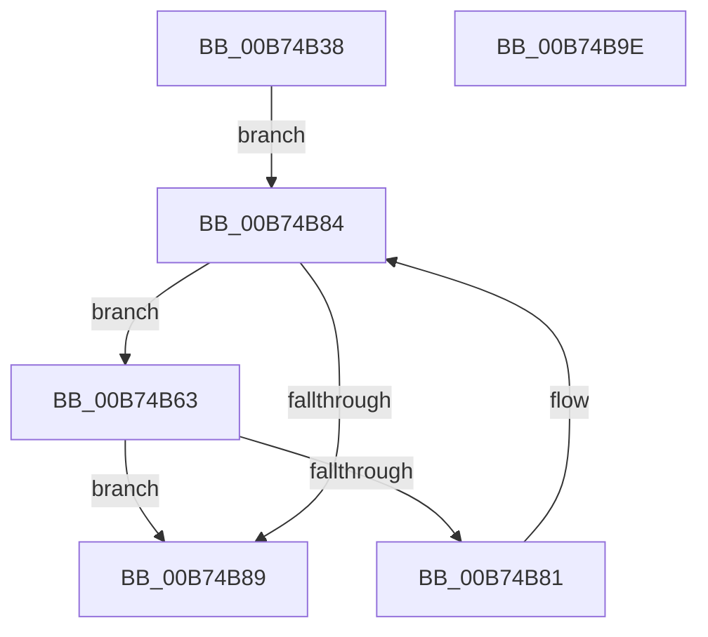

# MiEnumerateBasePatches

- RVA: `0x00B74B38`–`0x00B74B9F` (길이 `103` bytes)
- VA: `0x0000000140B74B38`
- 실행 섹션: `PAGELK`
- PDB 이름 있음: `예`; PDB Function 태그: `아니요`
- unwind 정보 RVA: `0x0005C954`
- 디코드: `29`개 명령, `103/103` bytes 표시
- 미해석 바이트: `0` (있으면 어셈블리에 `.byte`로 보존)

> 이 문서는 커널 이미지의 기계어와 PDB 기호를 분석해 생성했습니다. 4번과 5번은 함수 원형과 자료형을 바이너리 사용 방식에서 추정한 C 해석이며 원본 소스 복구 결과는 아닙니다.

## 1. Dependencies

- 직접 호출 지점: **3**; 고유 호출 대상: **2**
- 직접 호출자로 확인된 함수: **4**
- RIP 상대 이미지 참조: **0**

### Outgoing calls
- `0x00B74B52` → [MiGetBaseLoaderPortion](../../text/4D/MiGetBaseLoaderPortion_function_004D9D34.md) (function, `0x004D9D34`)
- `0x00B74B6A` → [MiGetBaseLoaderPortion](../../text/4D/MiGetBaseLoaderPortion_function_004D9D34.md) (function, `0x004D9D34`)
- `0x00B74B78` → [guard_dispatch_icall](../../text/6B/guard_dispatch_icall_function_006BAAD0.md) (function, `0x006BAAD0`)

### Direct callers
- [MiReapplyImportOptimizationForDriverVerifier](../../text/68/MiReapplyImportOptimizationForDriverVerifier_function_00682268.md) at `0x00682318`
- [MmReplaceImportEntriesForVerifier](../../page/7F/MmReplaceImportEntriesForVerifier_function_007FE040.md) at `0x007FE0A2`
- [MiApplyHotPatchToLoadedDriver](../../page/80/MiApplyHotPatchToLoadedDriver_function_00802078.md) at `0x0080227A`
- [MiMarkHotPatchesForHiberPhase](MiMarkHotPatchesForHiberPhase_function_00B74C10.md) at `0x00B74C7D`

### Static image references
- 디코드된 RIP-relative 메모리 참조가 없습니다.

## 2. Other-region calls and transfers

- 다른 실행 섹션으로 향하는 call: **3**
  - `0x00B74B52` → [MiGetBaseLoaderPortion](../../text/4D/MiGetBaseLoaderPortion_function_004D9D34.md) (`PAGELK` → `.text`)
  - `0x00B74B6A` → [MiGetBaseLoaderPortion](../../text/4D/MiGetBaseLoaderPortion_function_004D9D34.md) (`PAGELK` → `.text`)
  - `0x00B74B78` → [guard_dispatch_icall](../../text/6B/guard_dispatch_icall_function_006BAAD0.md) (`PAGELK` → `.text`)
- 별도 외부 분기/꼬리 이동을 확인하지 못했습니다.

## 3. Assembly (complete function range)

```asm
00B74B38  48 89 5C 24 08                  mov qword ptr [rsp + 8], rbx
00B74B3D  48 89 6C 24 10                  mov qword ptr [rsp + 0x10], rbp
00B74B42  48 89 74 24 18                  mov qword ptr [rsp + 0x18], rsi
00B74B47  57                              push rdi
00B74B48  48 83 EC 20                     sub rsp, 0x20
00B74B4C  49 8B F0                        mov rsi, r8
00B74B4F  48 8B EA                        mov rbp, rdx
00B74B52  E8 DD 51 96 FF                  call 0x1404d9d34
00B74B57  48 8D B8 00 01 00 00            lea rdi, [rax + 0x100]
00B74B5E  48 8B 1F                        mov rbx, qword ptr [rdi]
00B74B61  EB 21                           jmp 0x140b74b84
00B74B63  48 8D 8B 00 FF FF FF            lea rcx, [rbx - 0x100]
00B74B6A  E8 C5 51 96 FF                  call 0x1404d9d34
00B74B6F  48 8B C8                        mov rcx, rax
00B74B72  48 8B D6                        mov rdx, rsi
00B74B75  48 8B C5                        mov rax, rbp
00B74B78  E8 53 5F B4 FF                  call 0x1406baad0
00B74B7D  85 C0                           test eax, eax
00B74B7F  74 08                           je 0x140b74b89
00B74B81  48 8B 1B                        mov rbx, qword ptr [rbx]
00B74B84  48 3B DF                        cmp rbx, rdi
00B74B87  75 DA                           jne 0x140b74b63
00B74B89  48 8B 5C 24 30                  mov rbx, qword ptr [rsp + 0x30]
00B74B8E  48 8B 6C 24 38                  mov rbp, qword ptr [rsp + 0x38]
00B74B93  48 8B 74 24 40                  mov rsi, qword ptr [rsp + 0x40]
00B74B98  48 83 C4 20                     add rsp, 0x20
00B74B9C  5F                              pop rdi
00B74B9D  C3                              ret
00B74B9E  CC                              int3
```

## 4. C-style interpretation (structured pseudocode)

```c
__int64 __fastcall MiEnumerateBasePatches(__int64 a1, __int64 a2, __int64 a3)
{
    __int64 result;
    __int64 v_rsp;
    unsigned __int64 v_stack_p10;
    unsigned __int64 v_stack_p18;
    unsigned __int64 v_stack_p8;

    v_stack_p8 = v_rbx;
    v_stack_p10 = v_rbp;
    v_stack_p18 = v_rsi;
    v_rsp = (v_rsp) - (32);
    result = MiGetBaseLoaderPortion(a1, a2, a3, a4);
    goto loc_00B74B84;
loc_00B74B63:
    result = MiGetBaseLoaderPortion(*(unsigned __int64 *)(result + 256) - 256, a2, a3, a4);
    result = guard_dispatch_icall(result, a3, a3, a4);
    if ((unsigned int)(result) == 0) goto loc_00B74B89;
loc_00B74B84:
    if ((*(unsigned __int64 *)(*(unsigned __int64 *)(result + 256))) != (result + 256)) goto loc_00B74B63;
loc_00B74B89:
    v_rsp = (v_rsp) + (32);
    return result;
}
```

## 5. (Beta) C Style

```c
int64_t MiEnumerateBasePatches(int64_t Arg1, int64_t Arg2, int64_t Arg3)
{
    int64_t result;
    int64_t local_rsp;
    uint64_t v_stack_p10;
    uint64_t v_stack_p18;
    uint64_t v_stack_p8;

    v_stack_p8 = local_rbx;
    v_stack_p10 = local_rbp;
    v_stack_p18 = local_rsi;
    local_rsp = (local_rsp) - (32);
    result = MiGetBaseLoaderPortion(Arg1, Arg2, Arg3, a4);
    goto loc_00B74B84;
loc_00B74B63:
    result = MiGetBaseLoaderPortion(*(uint64_t *)(result + 0x100) - 256, Arg2, Arg3, a4);
    result = guard_dispatch_icall(result, Arg3, Arg3, a4);
    if ((uint32_t)(result) == 0) goto loc_00B74B89;
loc_00B74B84:
    if ((*(uint64_t *)(*(uint64_t *)(result + 0x100))) != (result + 256)) goto loc_00B74B63;
loc_00B74B89:
    local_rsp = (local_rsp) + (32);
    return result;
}
```

## 6. Execution-region graph

[열기: 2D/3D 그래프와 함수 탐색 컨트롤 패널](../../../control-panel.html?section=pagelk&rva=0x00B74B38&view=graph)

- 2D 그래프는 위에서 아래로 흐르고, 3D 그래프는 빈 공간을 드래그해 회전합니다. Shift+드래그는 이동, 휠은 확대·축소, 함수 노드 선택은 대상 보고서 이동입니다.

### Static fallback


