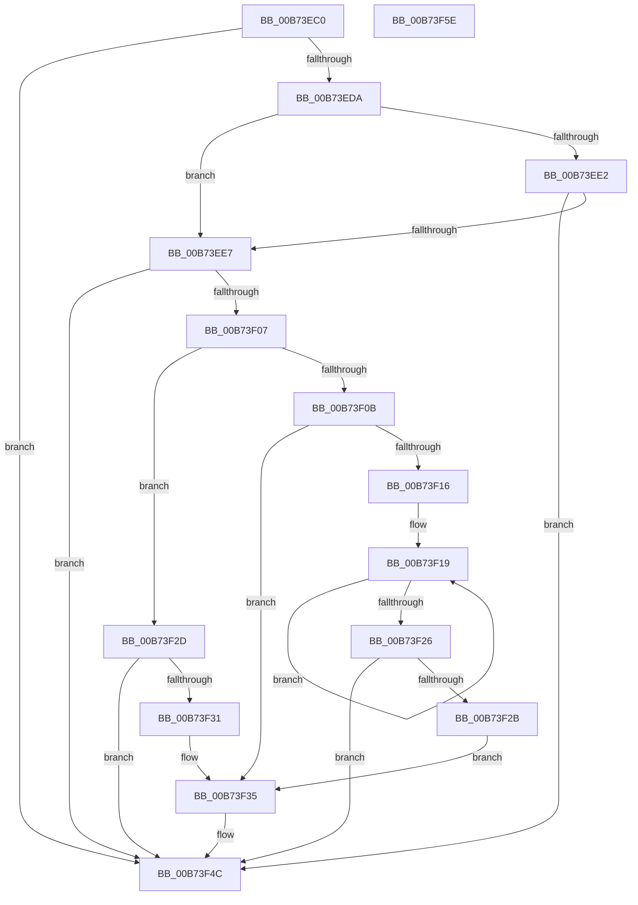

# MiMarkHiberNotCachedPte

- RVA: `0x00B73EC0`–`0x00B73F5F` (길이 `159` bytes)
- VA: `0x0000000140B73EC0`
- 실행 섹션: `PAGELK`
- PDB 이름 있음: `예`; PDB Function 태그: `아니요`
- unwind 정보 RVA: `0x000794E0`
- 디코드: `50`개 명령, `159/159` bytes 표시
- 미해석 바이트: `0` (있으면 어셈블리에 `.byte`로 보존)

> 이 문서는 커널 이미지의 기계어와 PDB 기호를 분석해 생성했습니다. 4번과 5번은 함수 원형과 자료형을 바이너리 사용 방식에서 추정한 C 해석이며 원본 소스 복구 결과는 아닙니다.

## 1. Dependencies

- 직접 호출 지점: **2**; 고유 호출 대상: **2**
- 직접 호출자로 확인된 함수: **0**
- RIP 상대 이미지 참조: **0**

### Outgoing calls
- `0x00B73EFE` → [MiIsPfn](../../text/46/MiIsPfn_function_00462450.md) (function, `0x00462450`)
- `0x00B73F47` → [PoSetHiberRange](../../text/47/PoSetHiberRange_function_0047C580.md) (function, `0x0047C580`)

### Direct callers
- 이 함수 시작 RVA로 연결되는 직접 call은 확인되지 않았습니다. 간접 호출은 완전히 역산할 수 없습니다.

### Static image references
- 디코드된 RIP-relative 메모리 참조가 없습니다.

## 2. Other-region calls and transfers

- 다른 실행 섹션으로 향하는 call: **2**
  - `0x00B73EFE` → [MiIsPfn](../../text/46/MiIsPfn_function_00462450.md) (`PAGELK` → `.text`)
  - `0x00B73F47` → [PoSetHiberRange](../../text/47/PoSetHiberRange_function_0047C580.md) (`PAGELK` → `.text`)
- 별도 외부 분기/꼬리 이동을 확인하지 못했습니다.

## 3. Assembly (complete function range)

```asm
00B73EC0  48 89 5C 24 08                  mov qword ptr [rsp + 8], rbx
00B73EC5  48 89 74 24 10                  mov qword ptr [rsp + 0x10], rsi
00B73ECA  57                              push rdi
00B73ECB  48 83 EC 30                     sub rsp, 0x30
00B73ECF  48 8B 1A                        mov rbx, qword ptr [rdx]
00B73ED2  41 8B F8                        mov edi, r8d
00B73ED5  F6 C3 01                        test bl, 1
00B73ED8  74 72                           je 0x140b73f4c
00B73EDA  8A C3                           mov al, bl
00B73EDC  24 18                           and al, 0x18
00B73EDE  3C 08                           cmp al, 8
00B73EE0  74 05                           je 0x140b73ee7
00B73EE2  F6 C3 10                        test bl, 0x10
00B73EE5  74 65                           je 0x140b73f4c
00B73EE7  48 B8 FF FF FF FF FF 00 00 00   movabs rax, 0xffffffffff
00B73EF1  48 8B F3                        mov rsi, rbx
00B73EF4  48 C1 EE 0C                     shr rsi, 0xc
00B73EF8  48 23 F0                        and rsi, rax
00B73EFB  48 8B CE                        mov rcx, rsi
00B73EFE  E8 4D E5 8E FF                  call 0x140462450
00B73F03  85 C0                           test eax, eax
00B73F05  74 45                           je 0x140b73f4c
00B73F07  84 DB                           test bl, bl
00B73F09  79 22                           jns 0x140b73f2d
00B73F0B  41 B9 00 02 00 00               mov r9d, 0x200
00B73F11  83 FF 01                        cmp edi, 1
00B73F14  7E 1F                           jle 0x140b73f35
00B73F16  8D 4F FF                        lea ecx, [rdi - 1]
00B73F19  49 C1 E1 09                     shl r9, 9
00B73F1D  49 8B C1                        mov rax, r9
00B73F20  48 83 E9 01                     sub rcx, 1
00B73F24  75 F3                           jne 0x140b73f19
00B73F26  48 85 C0                        test rax, rax
00B73F29  74 21                           je 0x140b73f4c
00B73F2B  EB 08                           jmp 0x140b73f35
00B73F2D  85 FF                           test edi, edi
00B73F2F  75 1B                           jne 0x140b73f4c
00B73F31  44 8D 4F 01                     lea r9d, [rdi + 1]
00B73F35  4C 8B C6                        mov r8, rsi
00B73F38  C7 44 24 20 4D 6D 6E 63         mov dword ptr [rsp + 0x20], 0x636e6d4d
00B73F40  BA 00 40 01 00                  mov edx, 0x14000
00B73F45  33 C9                           xor ecx, ecx
00B73F47  E8 34 86 90 FF                  call 0x14047c580
00B73F4C  48 8B 5C 24 40                  mov rbx, qword ptr [rsp + 0x40]
00B73F51  33 C0                           xor eax, eax
00B73F53  48 8B 74 24 48                  mov rsi, qword ptr [rsp + 0x48]
00B73F58  48 83 C4 30                     add rsp, 0x30
00B73F5C  5F                              pop rdi
00B73F5D  C3                              ret
00B73F5E  CC                              int3
```

## 4. C-style interpretation (structured pseudocode)

```c
__int64 __fastcall MiMarkHiberNotCachedPte(__int64 a1, __int64 a2, int a3)
{
    __int64 result;
    __int64 v_rsi;
    __int64 v_rsp;
    unsigned int v_stack_m18;
    unsigned __int64 v_stack_p10;
    unsigned __int64 v_stack_p8;

    v_stack_p8 = v_rbx;
    v_stack_p10 = v_rsi;
    v_rsp = (v_rsp) - (48);
    if ((((unsigned __int8)(*(unsigned __int64 *)(a2))) & (1)) == 0) goto loc_00B73F4C;
    result = (unsigned __int8)(((unsigned __int8)(*(unsigned __int64 *)(a2))) & (24));
    if (((unsigned __int8)(result)) == 8) goto loc_00B73EE7;
    if ((((unsigned __int8)(*(unsigned __int64 *)(a2))) & (16)) == 0) goto loc_00B73F4C;
loc_00B73EE7:
    v_rsi = (*(unsigned __int64 *)(a2)) >> (12);
    v_rsi = (v_rsi) & (result);
    result = MiIsPfn(v_rsi, a2, a3, a4);
    if ((unsigned int)(result) == 0) goto loc_00B73F4C;
    if (!sign_flag) goto loc_00B73F2D;
    if (((unsigned int)((unsigned int)(a3))) <= 1) goto loc_00B73F35;
loc_00B73F19:
    a4 = (512) << (9);
    a1 = ((unsigned int)(a3) - 1) - (1);
    if (condition_is_not_equal) goto loc_00B73F19;
    if (a4 == 0) goto loc_00B73F4C;
    goto loc_00B73F35;
loc_00B73F2D:
    if ((unsigned int)((unsigned int)(a3)) != 0) goto loc_00B73F4C;
loc_00B73F35:
    v_stack_m18 = 0x636E6D4DULL;
    a1 = 0;
    result = PoSetHiberRange(a1, (unsigned int)(0x14000ULL), v_rsi, (unsigned int)(a3) + 1);
loc_00B73F4C:
    result = 0;
    v_rsp = (v_rsp) + (48);
    return result;
}
```

## 5. (Beta) C Style

```c
int64_t MiMarkHiberNotCachedPte(int64_t Arg1, void *Arg2, int32_t Arg3)
{
    uint8_t *arg2 = (uint8_t *)Arg2;

    int64_t result;
    int64_t local_rsi;
    int64_t local_rsp;
    uint32_t v_stack_m18;
    uint64_t v_stack_p10;
    uint64_t v_stack_p8;

    v_stack_p8 = local_rbx;
    v_stack_p10 = local_rsi;
    local_rsp = (local_rsp) - (48);
    if ((((uint8_t)(*(uint64_t *)(arg2))) & (1)) == 0) goto loc_00B73F4C;
    result = (uint8_t)(((uint8_t)(*(uint64_t *)(arg2))) & (24));
    if (((uint8_t)(result)) == 8) goto loc_00B73EE7;
    if ((((uint8_t)(*(uint64_t *)(arg2))) & (16)) == 0) goto loc_00B73F4C;
loc_00B73EE7:
    local_rsi = (*(uint64_t *)(arg2)) >> (12);
    local_rsi = (local_rsi) & (result);
    result = MiIsPfn(local_rsi, Arg2, Arg3, a4);
    if ((uint32_t)(result) == 0) goto loc_00B73F4C;
    if (!sign_flag) goto loc_00B73F2D;
    if (((uint32_t)((uint32_t)(Arg3))) <= 1) goto loc_00B73F35;
loc_00B73F19:
    a4 = (512) << (9);
    Arg1 = ((uint32_t)(Arg3) - 1) - (1);
    if (condition_is_not_equal) goto loc_00B73F19;
    if (a4 == 0) goto loc_00B73F4C;
    goto loc_00B73F35;
loc_00B73F2D:
    if ((uint32_t)((uint32_t)(Arg3)) != 0) goto loc_00B73F4C;
loc_00B73F35:
    v_stack_m18 = 0x636E6D4DULL;
    Arg1 = 0;
    result = PoSetHiberRange(Arg1, (uint32_t)(0x14000ULL), local_rsi, (uint32_t)(Arg3) + 1);
loc_00B73F4C:
    result = 0;
    local_rsp = (local_rsp) + (48);
    return result;
}
```

### 관측된 메모리 오프셋

구조체 형식이 확인되지 않은 접근은 인자 기준의 오프셋으로만 기록했습니다.

| 기준 인자 | 오프셋 표현 | 폭 (bit) | 접근 |
|---|---:|---:|---|
| `Arg2` | `+ 0x0` | `64` | `R` |

## 6. Execution-region graph

[열기: 2D/3D 그래프와 함수 탐색 컨트롤 패널](../../../control-panel.html?section=pagelk&rva=0x00B73EC0&view=graph)

- 2D 그래프는 위에서 아래로 흐르고, 3D 그래프는 빈 공간을 드래그해 회전합니다. Shift+드래그는 이동, 휠은 확대·축소, 함수 노드 선택은 대상 보고서 이동입니다.

### Static fallback


