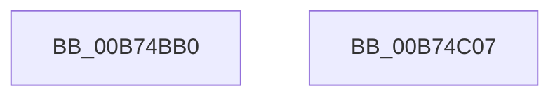

# MiMarkHotPatchForHiberPhase

- RVA: `0x00B74BB0`–`0x00B74C08` (길이 `88` bytes)
- VA: `0x0000000140B74BB0`
- 실행 섹션: `PAGELK`
- PDB 이름 있음: `예`; PDB Function 태그: `아니요`
- unwind 정보 RVA: `0x00068D5C`
- 디코드: `26`개 명령, `88/88` bytes 표시
- 미해석 바이트: `0` (있으면 어셈블리에 `.byte`로 보존)

> 이 문서는 커널 이미지의 기계어와 PDB 기호를 분석해 생성했습니다. 4번과 5번은 함수 원형과 자료형을 바이너리 사용 방식에서 추정한 C 해석이며 원본 소스 복구 결과는 아닙니다.

## 1. Dependencies

- 직접 호출 지점: **3**; 고유 호출 대상: **2**
- 직접 호출자로 확인된 함수: **1**
- RIP 상대 이미지 참조: **0**

### Outgoing calls
- `0x00B74BC7` → [MmGetLoadedModuleImageAdditionalTablesAddress](../../text/3D/MmGetLoadedModuleImageAdditionalTablesAddress_function_003D4CF0.md) (function, `0x003D4CF0`)
- `0x00B74BDE` → [MiMarkNonPagedHiberPhasePages](MiMarkNonPagedHiberPhasePages_function_00B73FEC.md) (function, `0x00B73FEC`)
- `0x00B74BF2` → [MiMarkNonPagedHiberPhasePages](MiMarkNonPagedHiberPhasePages_function_00B73FEC.md) (function, `0x00B73FEC`)

### Direct callers
- [MiMarkHotPatchesForHiberPhase](MiMarkHotPatchesForHiberPhase_function_00B74C10.md) at `0x00B74C94`

### Static image references
- 디코드된 RIP-relative 메모리 참조가 없습니다.

## 2. Other-region calls and transfers

- 다른 실행 섹션으로 향하는 call: **1**
  - `0x00B74BC7` → [MmGetLoadedModuleImageAdditionalTablesAddress](../../text/3D/MmGetLoadedModuleImageAdditionalTablesAddress_function_003D4CF0.md) (`PAGELK` → `.text`)
- 별도 외부 분기/꼬리 이동을 확인하지 못했습니다.

## 3. Assembly (complete function range)

```asm
00B74BB0  48 89 5C 24 10                  mov qword ptr [rsp + 0x10], rbx
00B74BB5  57                              push rdi
00B74BB6  48 83 EC 20                     sub rsp, 0x20
00B74BBA  83 64 24 30 00                  and dword ptr [rsp + 0x30], 0
00B74BBF  48 8D 54 24 30                  lea rdx, [rsp + 0x30]
00B74BC4  48 8B D9                        mov rbx, rcx
00B74BC7  E8 24 01 86 FF                  call 0x1403d4cf0
00B74BCC  8B 53 40                        mov edx, dword ptr [rbx + 0x40]
00B74BCF  45 33 C0                        xor r8d, r8d
00B74BD2  48 8B 4B 30                     mov rcx, qword ptr [rbx + 0x30]
00B74BD6  FF CA                           dec edx
00B74BD8  48 03 D1                        add rdx, rcx
00B74BDB  48 8B F8                        mov rdi, rax
00B74BDE  E8 09 F4 FF FF                  call 0x140b73fec
00B74BE3  8B 54 24 30                     mov edx, dword ptr [rsp + 0x30]
00B74BE7  45 33 C0                        xor r8d, r8d
00B74BEA  FF CA                           dec edx
00B74BEC  48 8B CF                        mov rcx, rdi
00B74BEF  48 03 D7                        add rdx, rdi
00B74BF2  E8 F5 F3 FF FF                  call 0x140b73fec
00B74BF7  48 8B 5C 24 38                  mov rbx, qword ptr [rsp + 0x38]
00B74BFC  B8 01 00 00 00                  mov eax, 1
00B74C01  48 83 C4 20                     add rsp, 0x20
00B74C05  5F                              pop rdi
00B74C06  C3                              ret
00B74C07  CC                              int3
```

## 4. C-style interpretation (structured pseudocode)

```c
__int64 __fastcall MiMarkHotPatchForHiberPhase(__int64 a1, __int64 a2, int a3)
{
    __int64 result;
    __int64 v_rsp;
    unsigned __int64 v_stack_p10;
    unsigned int v_stack_p8;

    v_stack_p10 = v_rbx;
    v_rsp = (v_rsp) - (32);
    result = MmGetLoadedModuleImageAdditionalTablesAddress(a1, v_stack_p8, a3, a4);
    a3 = 0;
    a2 = (unsigned int)(((unsigned int)(*(unsigned int *)(a1 + 64))) - 1);
    a2 = (a2) + (*(unsigned __int64 *)(a1 + 48));
    result = MiMarkNonPagedHiberPhasePages(*(unsigned __int64 *)(a1 + 48), a2, a3, a4);
    a3 = 0;
    a2 = (unsigned int)(((unsigned int)(v_stack_p8)) - 1);
    a2 = (a2) + (result);
    result = MiMarkNonPagedHiberPhasePages(result, a2, a3, a4);
    v_rsp = (v_rsp) + (32);
    return 1;
}
```

## 5. (Beta) C Style

```c
int64_t MiMarkHotPatchForHiberPhase(void *Arg1, int64_t Arg2, int32_t Arg3)
{
    uint8_t *arg1 = (uint8_t *)Arg1;

    int64_t result;
    int64_t local_rsp;
    uint64_t v_stack_p10;
    uint32_t v_stack_p8;

    v_stack_p10 = local_rbx;
    local_rsp = (local_rsp) - (32);
    result = MmGetLoadedModuleImageAdditionalTablesAddress(Arg1, v_stack_p8, Arg3, a4);
    Arg3 = 0;
    Arg2 = (uint32_t)(((uint32_t)(*(uint32_t *)(arg1 + 0x40))) - 1);
    Arg2 = (Arg2) + (*(uint64_t *)(arg1 + 0x30));
    result = MiMarkNonPagedHiberPhasePages(*(uint64_t *)(arg1 + 0x30), Arg2, Arg3, a4);
    Arg3 = 0;
    Arg2 = (uint32_t)(((uint32_t)(v_stack_p8)) - 1);
    Arg2 = (Arg2) + (result);
    result = MiMarkNonPagedHiberPhasePages(result, Arg2, Arg3, a4);
    local_rsp = (local_rsp) + (32);
    return 1;
}
```

### 관측된 메모리 오프셋

구조체 형식이 확인되지 않은 접근은 인자 기준의 오프셋으로만 기록했습니다.

| 기준 인자 | 오프셋 표현 | 폭 (bit) | 접근 |
|---|---:|---:|---|
| `Arg1` | `+ 0x30` | `64` | `R` |
| `Arg1` | `+ 0x40` | `32` | `R` |

## 6. Execution-region graph

[열기: 2D/3D 그래프와 함수 탐색 컨트롤 패널](../../../control-panel.html?section=pagelk&rva=0x00B74BB0&view=graph)

- 2D 그래프는 위에서 아래로 흐르고, 3D 그래프는 빈 공간을 드래그해 회전합니다. Shift+드래그는 이동, 휠은 확대·축소, 함수 노드 선택은 대상 보고서 이동입니다.

### Static fallback


