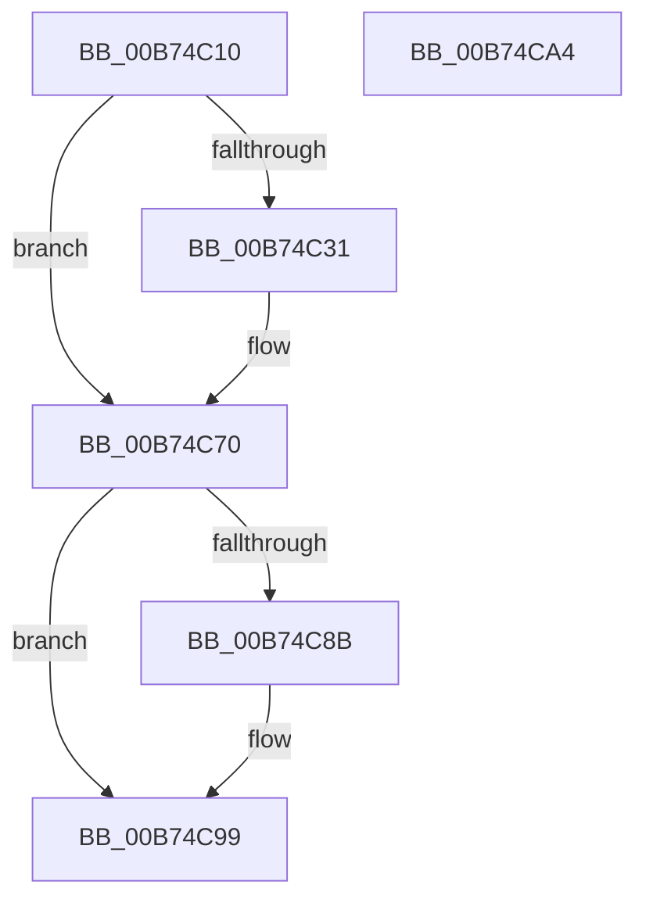

# MiMarkHotPatchesForHiberPhase

- RVA: `0x00B74C10`–`0x00B74CA5` (길이 `149` bytes)
- VA: `0x0000000140B74C10`
- 실행 섹션: `PAGELK`
- PDB 이름 있음: `예`; PDB Function 태그: `아니요`
- unwind 정보 RVA: `0x00068D5C`
- 디코드: `40`개 명령, `149/149` bytes 표시
- 미해석 바이트: `0` (있으면 어셈블리에 `.byte`로 보존)

> 이 문서는 커널 이미지의 기계어와 PDB 기호를 분석해 생성했습니다. 4번과 5번은 함수 원형과 자료형을 바이너리 사용 방식에서 추정한 C 해석이며 원본 소스 복구 결과는 아닙니다.

## 1. Dependencies

- 직접 호출 지점: **6**; 고유 호출 대상: **5**
- 직접 호출자로 확인된 함수: **1**
- RIP 상대 이미지 참조: **3**

### Outgoing calls
- `0x00B74C22` → [MiGetBaseLoaderPortion](../../text/4D/MiGetBaseLoaderPortion_function_004D9D34.md) (function, `0x004D9D34`)
- `0x00B74C40` → [MmGetLoadedModuleImageAdditionalTablesAddress](../../text/3D/MmGetLoadedModuleImageAdditionalTablesAddress_function_003D4CF0.md) (function, `0x003D4CF0`)
- `0x00B74C57` → [MiMarkNonPagedHiberPhasePages](MiMarkNonPagedHiberPhasePages_function_00B73FEC.md) (function, `0x00B73FEC`)
- `0x00B74C6B` → [MiMarkNonPagedHiberPhasePages](MiMarkNonPagedHiberPhasePages_function_00B73FEC.md) (function, `0x00B73FEC`)
- `0x00B74C7D` → [MiEnumerateBasePatches](MiEnumerateBasePatches_function_00B74B38.md) (function, `0x00B74B38`)
- `0x00B74C94` → [MiMarkHotPatchForHiberPhase](MiMarkHotPatchForHiberPhase_function_00B74BB0.md) (function, `0x00B74BB0`)

### Direct callers
- [MmMarkImageForHiberPhase](MmMarkImageForHiberPhase_function_00B748EC.md) at `0x00B74959`

### Static image references
- `0x00B74C73` → RVA `0x00B74BB0` (`MiMarkHotPatchForHiberPhase`; read)
- `0x00B74C82` → RVA `0x00E375A0` (`.data`; read)
- `0x00B74C8B` → RVA `0x00E37598` (`.data`; read)

## 2. Other-region calls and transfers

- 다른 실행 섹션으로 향하는 call: **2**
  - `0x00B74C22` → [MiGetBaseLoaderPortion](../../text/4D/MiGetBaseLoaderPortion_function_004D9D34.md) (`PAGELK` → `.text`)
  - `0x00B74C40` → [MmGetLoadedModuleImageAdditionalTablesAddress](../../text/3D/MmGetLoadedModuleImageAdditionalTablesAddress_function_003D4CF0.md) (`PAGELK` → `.text`)
- 별도 외부 분기/꼬리 이동을 확인하지 못했습니다.

## 3. Assembly (complete function range)

```asm
00B74C10  48 89 5C 24 10                  mov qword ptr [rsp + 0x10], rbx
00B74C15  57                              push rdi
00B74C16  48 83 EC 20                     sub rsp, 0x20
00B74C1A  83 64 24 30 00                  and dword ptr [rsp + 0x30], 0
00B74C1F  48 8B F9                        mov rdi, rcx
00B74C22  E8 0D 51 96 FF                  call 0x1404d9d34
00B74C27  8B 90 B8 00 00 00               mov edx, dword ptr [rax + 0xb8]
00B74C2D  84 D2                           test dl, dl
00B74C2F  79 3F                           jns 0x140b74c70
00B74C31  48 8B B8 F8 00 00 00            mov rdi, qword ptr [rax + 0xf8]
00B74C38  48 8D 54 24 30                  lea rdx, [rsp + 0x30]
00B74C3D  48 8B CF                        mov rcx, rdi
00B74C40  E8 AB 00 86 FF                  call 0x1403d4cf0
00B74C45  8B 57 40                        mov edx, dword ptr [rdi + 0x40]
00B74C48  45 33 C0                        xor r8d, r8d
00B74C4B  48 8B 4F 30                     mov rcx, qword ptr [rdi + 0x30]
00B74C4F  FF CA                           dec edx
00B74C51  48 03 D1                        add rdx, rcx
00B74C54  48 8B D8                        mov rbx, rax
00B74C57  E8 90 F3 FF FF                  call 0x140b73fec
00B74C5C  8B 54 24 30                     mov edx, dword ptr [rsp + 0x30]
00B74C60  45 33 C0                        xor r8d, r8d
00B74C63  FF CA                           dec edx
00B74C65  48 8B CB                        mov rcx, rbx
00B74C68  48 03 D3                        add rdx, rbx
00B74C6B  E8 7C F3 FF FF                  call 0x140b73fec
00B74C70  45 33 C0                        xor r8d, r8d
00B74C73  48 8D 15 36 FF FF FF            lea rdx, [rip - 0xca]
00B74C7A  48 8B CF                        mov rcx, rdi
00B74C7D  E8 B6 FE FF FF                  call 0x140b74b38
00B74C82  48 39 3D 17 29 2C 00            cmp qword ptr [rip + 0x2c2917], rdi
00B74C89  75 0E                           jne 0x140b74c99
00B74C8B  48 8B 0D 06 29 2C 00            mov rcx, qword ptr [rip + 0x2c2906]
00B74C92  33 D2                           xor edx, edx
00B74C94  E8 17 FF FF FF                  call 0x140b74bb0
00B74C99  48 8B 5C 24 38                  mov rbx, qword ptr [rsp + 0x38]
00B74C9E  48 83 C4 20                     add rsp, 0x20
00B74CA2  5F                              pop rdi
00B74CA3  C3                              ret
00B74CA4  CC                              int3
```

## 4. C-style interpretation (structured pseudocode)

```c
__int64 __fastcall MiMarkHotPatchesForHiberPhase(__int64 a1, __int64 a2, int a3)
{
    __int64 result;
    __int64 v_rbx;
    __int64 v_rdi;
    __int64 v_rsp;
    unsigned __int64 v_stack_p10;
    unsigned int v_stack_p8;

    v_stack_p10 = v_rbx;
    v_rsp = (v_rsp) - (32);
    result = MiGetBaseLoaderPortion(a1, a2, a3, a4);
    v_rdi = a1;
    if (sign_flag) {
        v_rdi = *(unsigned __int64 *)(result + 248);
        a2 = v_stack_p8;
        a1 = v_rdi;
        result = MmGetLoadedModuleImageAdditionalTablesAddress(a1, a2, a3, a4);
        a2 = *(unsigned int *)(v_rdi + 64);
        a3 = 0;
        a1 = *(unsigned __int64 *)(v_rdi + 48);
        a2 = (unsigned int)((a2) - 1);
        a2 = (a2) + (a1);
        v_rbx = result;
        result = MiMarkNonPagedHiberPhasePages(a1, a2, a3, a4);
        a2 = v_stack_p8;
        a3 = 0;
        a2 = (unsigned int)((a2) - 1);
        a1 = v_rbx;
        a2 = (a2) + (v_rbx);
        result = MiMarkNonPagedHiberPhasePages(a1, a2, a3, a4);
    }
    a3 = 0;
    result = MiEnumerateBasePatches(v_rdi, v_rip - 202, a3, a4);
    if ((*(unsigned __int64 *)(v_rip + 2894103)) == v_rdi) {
        a1 = *(unsigned __int64 *)(v_rip + 2894086);
        a2 = 0;
        result = MiMarkHotPatchForHiberPhase(a1, a2, a3, a4);
    }
    v_rsp = (v_rsp) + (32);
    return result;
}
```

## 5. (Beta) C Style

```c
int64_t MiMarkHotPatchesForHiberPhase(int64_t Arg1, int64_t Arg2, int32_t Arg3)
{
    int64_t result;
    int64_t local_rbx;
    int64_t local_rdi;
    int64_t local_rsp;
    uint64_t v_stack_p10;
    uint32_t v_stack_p8;

    v_stack_p10 = local_rbx;
    local_rsp = (local_rsp) - (32);
    result = MiGetBaseLoaderPortion(Arg1, Arg2, Arg3, a4);
    local_rdi = Arg1;
    if (sign_flag) {
        local_rdi = *(uint64_t *)(result + 0xF8);
        Arg2 = v_stack_p8;
        Arg1 = local_rdi;
        result = MmGetLoadedModuleImageAdditionalTablesAddress(Arg1, Arg2, Arg3, a4);
        Arg2 = *(uint32_t *)(local_rdi + 0x40);
        Arg3 = 0;
        Arg1 = *(uint64_t *)(local_rdi + 0x30);
        Arg2 = (uint32_t)((Arg2) - 1);
        Arg2 = (Arg2) + (Arg1);
        local_rbx = result;
        result = MiMarkNonPagedHiberPhasePages(Arg1, Arg2, Arg3, a4);
        Arg2 = v_stack_p8;
        Arg3 = 0;
        Arg2 = (uint32_t)((Arg2) - 1);
        Arg1 = local_rbx;
        Arg2 = (Arg2) + (local_rbx);
        result = MiMarkNonPagedHiberPhasePages(Arg1, Arg2, Arg3, a4);
    }
    Arg3 = 0;
    result = MiEnumerateBasePatches(local_rdi, v_rip - 202, Arg3, a4);
    if ((*(uint64_t *)(v_rip + 0x2C2917)) == local_rdi) {
        Arg1 = *(uint64_t *)(v_rip + 0x2C2906);
        Arg2 = 0;
        result = MiMarkHotPatchForHiberPhase(Arg1, Arg2, Arg3, a4);
    }
    local_rsp = (local_rsp) + (32);
    return result;
}
```

## 6. Execution-region graph

[열기: 2D/3D 그래프와 함수 탐색 컨트롤 패널](../../../control-panel.html?section=pagelk&rva=0x00B74C10&view=graph)

- 2D 그래프는 위에서 아래로 흐르고, 3D 그래프는 빈 공간을 드래그해 회전합니다. Shift+드래그는 이동, 휠은 확대·축소, 함수 노드 선택은 대상 보고서 이동입니다.

### Static fallback


