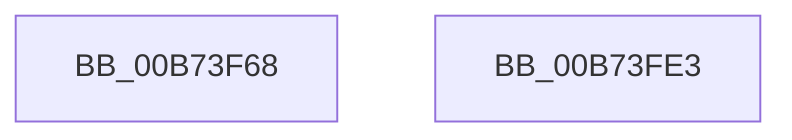

# MiMarkKernelPageTablePages

- RVA: `0x00B73F68`–`0x00B73FE4` (길이 `124` bytes)
- VA: `0x0000000140B73F68`
- 실행 섹션: `PAGELK`
- PDB 이름 있음: `예`; PDB Function 태그: `아니요`
- unwind 정보 RVA: `0x000D7D20`
- 디코드: `24`개 명령, `124/124` bytes 표시
- 미해석 바이트: `0` (있으면 어셈블리에 `.byte`로 보존)

> 이 문서는 커널 이미지의 기계어와 PDB 기호를 분석해 생성했습니다. 4번과 5번은 함수 원형과 자료형을 바이너리 사용 방식에서 추정한 C 해석이며 원본 소스 복구 결과는 아닙니다.

## 1. Dependencies

- 직접 호출 지점: **3**; 고유 호출 대상: **3**
- 직접 호출자로 확인된 함수: **1**
- RIP 상대 이미지 참조: **1**

### Outgoing calls
- `0x00B73F7C` → [memset](../../text/6C/memset_function_006C6C40.md) (function, `0x006C6C40`)
- `0x00B73FAD` → [MiGetAnyMultiplexedVm](../../text/44/MiGetAnyMultiplexedVm_function_00448BD0.md) (function, `0x00448BD0`)
- `0x00B73FD6` → [MiWalkPageTables](../../text/2C/MiWalkPageTables_function_002C2710.md) (function, `0x002C2710`)

### Direct callers
- [MmMarkHiberPhase](MmMarkHiberPhase_function_00B74578.md) at `0x00B74590`

### Static image references
- `0x00B73F9E` → RVA `0x00678B00` (`MiMarkKernelPageTablePte`; read)

## 2. Other-region calls and transfers

- 다른 실행 섹션으로 향하는 call: **3**
  - `0x00B73F7C` → [memset](../../text/6C/memset_function_006C6C40.md) (`PAGELK` → `.text`)
  - `0x00B73FAD` → [MiGetAnyMultiplexedVm](../../text/44/MiGetAnyMultiplexedVm_function_00448BD0.md) (`PAGELK` → `.text`)
  - `0x00B73FD6` → [MiWalkPageTables](../../text/2C/MiWalkPageTables_function_002C2710.md) (`PAGELK` → `.text`)
- 별도 외부 분기/꼬리 이동을 확인하지 못했습니다.

## 3. Assembly (complete function range)

```asm
00B73F68  48 81 EC E8 00 00 00            sub rsp, 0xe8
00B73F6F  33 D2                           xor edx, edx
00B73F71  48 8D 4C 24 20                  lea rcx, [rsp + 0x20]
00B73F76  41 B8 C0 00 00 00               mov r8d, 0xc0
00B73F7C  E8 BF 2C B5 FF                  call 0x1406c6c40
00B73F81  8B 44 24 24                     mov eax, dword ptr [rsp + 0x24]
00B73F85  B9 01 00 00 00                  mov ecx, 1
00B73F8A  25 7F FE FF FF                  and eax, 0xfffffe7f
00B73F8F  C7 44 24 20 01 21 00 00         mov dword ptr [rsp + 0x20], 0x2101
00B73F97  83 C8 40                        or eax, 0x40
00B73F9A  89 44 24 24                     mov dword ptr [rsp + 0x24], eax
00B73F9E  48 8D 05 5B 4B B0 FF            lea rax, [rip - 0x4fb4a5]
00B73FA5  48 89 84 24 C8 00 00 00         mov qword ptr [rsp + 0xc8], rax
00B73FAD  E8 1E 4C 8D FF                  call 0x140448bd0
00B73FB2  48 83 4C 24 50 FF               or qword ptr [rsp + 0x50], 0xffffffffffffffff
00B73FB8  48 8D 4C 24 20                  lea rcx, [rsp + 0x20]
00B73FBD  48 89 44 24 40                  mov qword ptr [rsp + 0x40], rax
00B73FC2  48 B8 00 00 00 00 00 80 FF FF   movabs rax, 0xffff800000000000
00B73FCC  48 89 44 24 48                  mov qword ptr [rsp + 0x48], rax
00B73FD1  C6 44 24 29 11                  mov byte ptr [rsp + 0x29], 0x11
00B73FD6  E8 35 E7 74 FF                  call 0x1402c2710
00B73FDB  48 81 C4 E8 00 00 00            add rsp, 0xe8
00B73FE2  C3                              ret
00B73FE3  CC                              int3
```

## 4. C-style interpretation (structured pseudocode)

```c
__int64 __fastcall MiMarkKernelPageTablePages(__int64 a1, int a2)
{
    __int64 result;
    __int64 v_rsp;
    unsigned __int64 v_stack_m20;
    unsigned __int64 v_stack_m98;
    unsigned __int64 v_stack_mA0;
    unsigned __int64 v_stack_mA8;
    unsigned __int8 v_stack_mBF;
    unsigned int v_stack_mC4;
    unsigned __int64 v_stack_mC8;

    v_rsp = (v_rsp) - (232);
    a2 = 0;
    result = memset(v_stack_mC8, a2, 192, a4);
    result = (unsigned int)(((unsigned int)(v_stack_mC4)) & (0xFFFFFE7FULL));
    v_stack_mC8 = 0x2101ULL;
    result = (unsigned int)((result) | (64));
    v_stack_mC4 = (unsigned int)(result);
    v_stack_m20 = v_rip - 5223589;
    result = MiGetAnyMultiplexedVm(1, a2, 192, a4);
    v_stack_mA8 = result;
    v_stack_mA0 = result;
    v_stack_mBF = 17;
    result = MiWalkPageTables(v_stack_mC8, a2, 192, a4);
    v_rsp = (v_rsp) + (232);
    return result;
}
```

## 5. (Beta) C Style

```c
int64_t MiMarkKernelPageTablePages(int64_t Arg1, int32_t Arg2)
{
    int64_t result;
    int64_t local_rsp;
    uint64_t v_stack_m20;
    uint64_t v_stack_m98;
    uint64_t v_stack_mA0;
    uint64_t v_stack_mA8;
    uint8_t v_stack_mBF;
    uint32_t v_stack_mC4;
    uint64_t v_stack_mC8;

    local_rsp = (local_rsp) - (232);
    Arg2 = 0;
    result = memset(v_stack_mC8, Arg2, 192, a4);
    result = (uint32_t)(((uint32_t)(v_stack_mC4)) & (0xFFFFFE7FULL));
    v_stack_mC8 = 0x2101ULL;
    result = (uint32_t)((result) | (64));
    v_stack_mC4 = (uint32_t)(result);
    v_stack_m20 = v_rip - 5223589;
    result = MiGetAnyMultiplexedVm(1, Arg2, 192, a4);
    v_stack_mA8 = result;
    v_stack_mA0 = result;
    v_stack_mBF = 17;
    result = MiWalkPageTables(v_stack_mC8, Arg2, 192, a4);
    local_rsp = (local_rsp) + (232);
    return result;
}
```

## 6. Execution-region graph

[열기: 2D/3D 그래프와 함수 탐색 컨트롤 패널](../../../control-panel.html?section=pagelk&rva=0x00B73F68&view=graph)

- 2D 그래프는 위에서 아래로 흐르고, 3D 그래프는 빈 공간을 드래그해 회전합니다. Shift+드래그는 이동, 휠은 확대·축소, 함수 노드 선택은 대상 보고서 이동입니다.

### Static fallback


