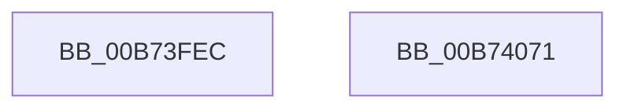

# MiMarkNonPagedHiberPhasePages

- RVA: `0x00B73FEC`–`0x00B74072` (길이 `134` bytes)
- VA: `0x0000000140B73FEC`
- 실행 섹션: `PAGELK`
- PDB 이름 있음: `예`; PDB Function 태그: `아니요`
- unwind 정보 RVA: `0x000D7694`
- 디코드: `31`개 명령, `134/134` bytes 표시
- 미해석 바이트: `0` (있으면 어셈블리에 `.byte`로 보존)

> 이 문서는 커널 이미지의 기계어와 PDB 기호를 분석해 생성했습니다. 4번과 5번은 함수 원형과 자료형을 바이너리 사용 방식에서 추정한 C 해석이며 원본 소스 복구 결과는 아닙니다.

## 1. Dependencies

- 직접 호출 지점: **3**; 고유 호출 대상: **3**
- 직접 호출자로 확인된 함수: **4**
- RIP 상대 이미지 참조: **1**

### Outgoing calls
- `0x00B74014` → [memset](../../text/6C/memset_function_006C6C40.md) (function, `0x006C6C40`)
- `0x00B74039` → [MiGetAnyMultiplexedVm](../../text/44/MiGetAnyMultiplexedVm_function_00448BD0.md) (function, `0x00448BD0`)
- `0x00B74057` → [MiWalkPageTables](../../text/2C/MiWalkPageTables_function_002C2710.md) (function, `0x002C2710`)

### Direct callers
- [MmMarkHiberPhase](MmMarkHiberPhase_function_00B74578.md) at `0x00B745EA`
- [MmMarkHiberPhase](MmMarkHiberPhase_function_00B74578.md) at `0x00B74620`
- [MmMarkHiberPhase](MmMarkHiberPhase_function_00B74578.md) at `0x00B74712`
- [MmMarkImageForHiberPhase](MmMarkImageForHiberPhase_function_00B748EC.md) at `0x00B74938`
- [MmMarkImageForHiberPhase](MmMarkImageForHiberPhase_function_00B748EC.md) at `0x00B74951`
- [MiMarkHotPatchForHiberPhase](MiMarkHotPatchForHiberPhase_function_00B74BB0.md) at `0x00B74BDE`
- [MiMarkHotPatchForHiberPhase](MiMarkHotPatchForHiberPhase_function_00B74BB0.md) at `0x00B74BF2`
- [MiMarkHotPatchesForHiberPhase](MiMarkHotPatchesForHiberPhase_function_00B74C10.md) at `0x00B74C57`
- [MiMarkHotPatchesForHiberPhase](MiMarkHotPatchesForHiberPhase_function_00B74C10.md) at `0x00B74C6B`

### Static image references
- `0x00B7402A` → RVA `0x00B74080` (`MiMarkNonPagedHiberPhasePte`; read)

## 2. Other-region calls and transfers

- 다른 실행 섹션으로 향하는 call: **3**
  - `0x00B74014` → [memset](../../text/6C/memset_function_006C6C40.md) (`PAGELK` → `.text`)
  - `0x00B74039` → [MiGetAnyMultiplexedVm](../../text/44/MiGetAnyMultiplexedVm_function_00448BD0.md) (`PAGELK` → `.text`)
  - `0x00B74057` → [MiWalkPageTables](../../text/2C/MiWalkPageTables_function_002C2710.md) (`PAGELK` → `.text`)
- 별도 외부 분기/꼬리 이동을 확인하지 못했습니다.

## 3. Assembly (complete function range)

```asm
00B73FEC  48 89 5C 24 08                  mov qword ptr [rsp + 8], rbx
00B73FF1  48 89 74 24 10                  mov qword ptr [rsp + 0x10], rsi
00B73FF6  57                              push rdi
00B73FF7  48 81 EC E0 00 00 00            sub rsp, 0xe0
00B73FFE  41 8B D8                        mov ebx, r8d
00B74001  48 8B F2                        mov rsi, rdx
00B74004  48 8B F9                        mov rdi, rcx
00B74007  33 D2                           xor edx, edx
00B74009  41 B8 C0 00 00 00               mov r8d, 0xc0
00B7400F  48 8D 4C 24 20                  lea rcx, [rsp + 0x20]
00B74014  E8 27 2C B5 FF                  call 0x1406c6c40
00B74019  0F B7 C3                        movzx eax, bx
00B7401C  B9 04 00 00 00                  mov ecx, 4
00B74021  0D 01 21 00 00                  or eax, 0x2101
00B74026  89 44 24 20                     mov dword ptr [rsp + 0x20], eax
00B7402A  48 8D 05 4F 00 00 00            lea rax, [rip + 0x4f]
00B74031  48 89 84 24 C8 00 00 00         mov qword ptr [rsp + 0xc8], rax
00B74039  E8 92 4B 8D FF                  call 0x140448bd0
00B7403E  48 8D 4C 24 20                  lea rcx, [rsp + 0x20]
00B74043  48 89 44 24 40                  mov qword ptr [rsp + 0x40], rax
00B74048  C6 44 24 29 11                  mov byte ptr [rsp + 0x29], 0x11
00B7404D  48 89 7C 24 48                  mov qword ptr [rsp + 0x48], rdi
00B74052  48 89 74 24 50                  mov qword ptr [rsp + 0x50], rsi
00B74057  E8 B4 E6 74 FF                  call 0x1402c2710
00B7405C  4C 8D 9C 24 E0 00 00 00         lea r11, [rsp + 0xe0]
00B74064  49 8B 5B 10                     mov rbx, qword ptr [r11 + 0x10]
00B74068  49 8B 73 18                     mov rsi, qword ptr [r11 + 0x18]
00B7406C  49 8B E3                        mov rsp, r11
00B7406F  5F                              pop rdi
00B74070  C3                              ret
00B74071  CC                              int3
```

## 4. C-style interpretation (structured pseudocode)

```c
__int64 __fastcall MiMarkNonPagedHiberPhasePages(__int64 a1, __int64 a2, int a3)
{
    __int64 result;
    __int64 v_rsp;
    unsigned __int64 v_stack_m20;
    unsigned __int64 v_stack_m8;
    unsigned __int64 v_stack_m98;
    unsigned __int64 v_stack_mA0;
    unsigned __int64 v_stack_mA8;
    unsigned __int8 v_stack_mBF;
    unsigned __int64 v_stack_mC8;
    unsigned __int64 v_stack_p10;
    unsigned __int64 v_stack_p8;

    v_stack_p8 = v_rbx;
    v_stack_p10 = v_rsi;
    v_rsp = (v_rsp) - (224);
    a2 = 0;
    result = memset(v_stack_mC8, a2, 192, a4);
    result = (unsigned int)(((unsigned __int16)((unsigned int)(a3))) | (0x2101ULL));
    v_stack_mC8 = (unsigned int)(result);
    v_stack_m20 = v_rip + 79;
    result = MiGetAnyMultiplexedVm(4, a2, 192, a4);
    v_stack_mA8 = result;
    v_stack_mBF = 17;
    v_stack_mA0 = a1;
    v_stack_m98 = 0;
    result = MiWalkPageTables(v_stack_mC8, a2, 192, a4);
    return result;
}
```

## 5. (Beta) C Style

```c
int64_t MiMarkNonPagedHiberPhasePages(int64_t Arg1, int64_t Arg2, int32_t Arg3)
{
    int64_t result;
    int64_t local_rsp;
    uint64_t v_stack_m20;
    uint64_t v_stack_m8;
    uint64_t v_stack_m98;
    uint64_t v_stack_mA0;
    uint64_t v_stack_mA8;
    uint8_t v_stack_mBF;
    uint64_t v_stack_mC8;
    uint64_t v_stack_p10;
    uint64_t v_stack_p8;

    v_stack_p8 = local_rbx;
    v_stack_p10 = local_rsi;
    local_rsp = (local_rsp) - (224);
    Arg2 = 0;
    result = memset(v_stack_mC8, Arg2, 192, a4);
    result = (uint32_t)(((uint16_t)((uint32_t)(Arg3))) | (0x2101ULL));
    v_stack_mC8 = (uint32_t)(result);
    v_stack_m20 = v_rip + 79;
    result = MiGetAnyMultiplexedVm(4, Arg2, 192, a4);
    v_stack_mA8 = result;
    v_stack_mBF = 17;
    v_stack_mA0 = Arg1;
    v_stack_m98 = 0;
    result = MiWalkPageTables(v_stack_mC8, Arg2, 192, a4);
    return result;
}
```

## 6. Execution-region graph

[열기: 2D/3D 그래프와 함수 탐색 컨트롤 패널](../../../control-panel.html?section=pagelk&rva=0x00B73FEC&view=graph)

- 2D 그래프는 위에서 아래로 흐르고, 3D 그래프는 빈 공간을 드래그해 회전합니다. Shift+드래그는 이동, 휠은 확대·축소, 함수 노드 선택은 대상 보고서 이동입니다.

### Static fallback


