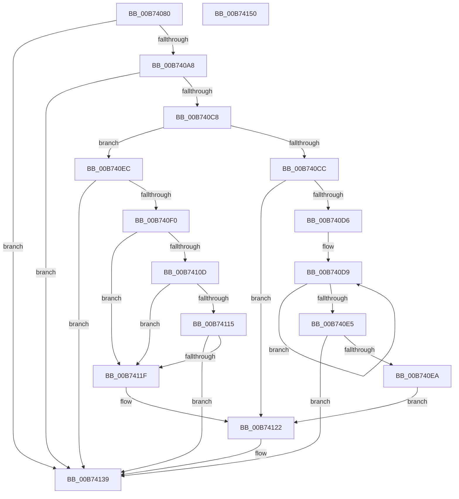

# MiMarkNonPagedHiberPhasePte

- RVA: `0x00B74080`–`0x00B74151` (길이 `209` bytes)
- VA: `0x0000000140B74080`
- 실행 섹션: `PAGELK`
- PDB 이름 있음: `예`; PDB Function 태그: `아니요`
- unwind 정보 RVA: `0x00066400`
- 디코드: `61`개 명령, `209/209` bytes 표시
- 미해석 바이트: `0` (있으면 어셈블리에 `.byte`로 보존)

> 이 문서는 커널 이미지의 기계어와 PDB 기호를 분석해 생성했습니다. 4번과 5번은 함수 원형과 자료형을 바이너리 사용 방식에서 추정한 C 해석이며 원본 소스 복구 결과는 아닙니다.

## 1. Dependencies

- 직접 호출 지점: **2**; 고유 호출 대상: **2**
- 직접 호출자로 확인된 함수: **0**
- RIP 상대 이미지 참조: **0**

### Outgoing calls
- `0x00B740BF` → [MiIsPfn](../../text/46/MiIsPfn_function_00462450.md) (function, `0x00462450`)
- `0x00B74134` → [PoSetHiberRange](../../text/47/PoSetHiberRange_function_0047C580.md) (function, `0x0047C580`)

### Direct callers
- 이 함수 시작 RVA로 연결되는 직접 call은 확인되지 않았습니다. 간접 호출은 완전히 역산할 수 없습니다.

### Static image references
- 디코드된 RIP-relative 메모리 참조가 없습니다.

## 2. Other-region calls and transfers

- 다른 실행 섹션으로 향하는 call: **2**
  - `0x00B740BF` → [MiIsPfn](../../text/46/MiIsPfn_function_00462450.md) (`PAGELK` → `.text`)
  - `0x00B74134` → [PoSetHiberRange](../../text/47/PoSetHiberRange_function_0047C580.md) (`PAGELK` → `.text`)
- 별도 외부 분기/꼬리 이동을 확인하지 못했습니다.

## 3. Assembly (complete function range)

```asm
00B74080  48 89 5C 24 08                  mov qword ptr [rsp + 8], rbx
00B74085  48 89 6C 24 10                  mov qword ptr [rsp + 0x10], rbp
00B7408A  48 89 74 24 18                  mov qword ptr [rsp + 0x18], rsi
00B7408F  57                              push rdi
00B74090  48 83 EC 30                     sub rsp, 0x30
00B74094  48 8B 1A                        mov rbx, qword ptr [rdx]
00B74097  BD 01 00 00 00                  mov ebp, 1
00B7409C  41 8B F8                        mov edi, r8d
00B7409F  40 84 DD                        test bpl, bl
00B740A2  0F 84 91 00 00 00               je 0x140b74139
00B740A8  48 B8 FF FF FF FF FF 00 00 00   movabs rax, 0xffffffffff
00B740B2  48 8B F3                        mov rsi, rbx
00B740B5  48 C1 EE 0C                     shr rsi, 0xc
00B740B9  48 23 F0                        and rsi, rax
00B740BC  48 8B CE                        mov rcx, rsi
00B740BF  E8 8C E3 8E FF                  call 0x140462450
00B740C4  85 C0                           test eax, eax
00B740C6  74 71                           je 0x140b74139
00B740C8  84 DB                           test bl, bl
00B740CA  79 20                           jns 0x140b740ec
00B740CC  41 B9 00 02 00 00               mov r9d, 0x200
00B740D2  3B FD                           cmp edi, ebp
00B740D4  7E 4C                           jle 0x140b74122
00B740D6  8D 4F FF                        lea ecx, [rdi - 1]
00B740D9  49 C1 E1 09                     shl r9, 9
00B740DD  49 8B C1                        mov rax, r9
00B740E0  48 2B CD                        sub rcx, rbp
00B740E3  75 F4                           jne 0x140b740d9
00B740E5  48 85 C0                        test rax, rax
00B740E8  74 4F                           je 0x140b74139
00B740EA  EB 36                           jmp 0x140b74122
00B740EC  85 FF                           test edi, edi
00B740EE  75 49                           jne 0x140b74139
00B740F0  48 8D 0C 76                     lea rcx, [rsi + rsi*2]
00B740F4  48 C1 E1 04                     shl rcx, 4
00B740F8  48 B8 00 00 00 00 00 DE FF FF   movabs rax, 0xffffde0000000000
00B74102  48 03 C8                        add rcx, rax
00B74105  8B 41 20                        mov eax, dword ptr [rcx + 0x20]
00B74108  66 3B C5                        cmp ax, bp
00B7410B  77 12                           ja 0x140b7411f
00B7410D  48 8B 01                        mov rax, qword ptr [rcx]
00B74110  40 84 C5                        test bpl, al
00B74113  74 0A                           je 0x140b7411f
00B74115  8B 41 20                        mov eax, dword ptr [rcx + 0x20]
00B74118  C1 E8 18                        shr eax, 0x18
00B7411B  A8 08                           test al, 8
00B7411D  74 1A                           je 0x140b74139
00B7411F  4C 8B CD                        mov r9, rbp
00B74122  4C 8B C6                        mov r8, rsi
00B74125  C7 44 24 20 4E 70 64 6C         mov dword ptr [rsp + 0x20], 0x6c64704e
00B7412D  BA 00 40 01 00                  mov edx, 0x14000
00B74132  33 C9                           xor ecx, ecx
00B74134  E8 47 84 90 FF                  call 0x14047c580
00B74139  48 8B 5C 24 40                  mov rbx, qword ptr [rsp + 0x40]
00B7413E  33 C0                           xor eax, eax
00B74140  48 8B 6C 24 48                  mov rbp, qword ptr [rsp + 0x48]
00B74145  48 8B 74 24 50                  mov rsi, qword ptr [rsp + 0x50]
00B7414A  48 83 C4 30                     add rsp, 0x30
00B7414E  5F                              pop rdi
00B7414F  C3                              ret
00B74150  CC                              int3
```

## 4. C-style interpretation (structured pseudocode)

```c
__int64 __fastcall MiMarkNonPagedHiberPhasePte(__int64 a1, __int64 a2, int a3)
{
    __int64 result;
    __int64 v_rsi;
    __int64 v_rsp;
    unsigned int v_stack_m18;
    unsigned __int64 v_stack_p10;
    unsigned __int64 v_stack_p18;
    unsigned __int64 v_stack_p8;

    v_stack_p8 = v_rbx;
    v_stack_p10 = v_rbp;
    v_stack_p18 = v_rsi;
    v_rsp = (v_rsp) - (48);
    if (((1) & ((unsigned __int8)(*(unsigned __int64 *)(a2)))) == 0) goto loc_00B74139;
    v_rsi = (*(unsigned __int64 *)(a2)) >> (12);
    v_rsi = (v_rsi) & (result);
    result = MiIsPfn(v_rsi, a2, a3, a4);
    if ((unsigned int)(result) == 0) goto loc_00B74139;
    if (!sign_flag) goto loc_00B740EC;
    if (((unsigned int)((unsigned int)(a3))) <= 1) goto loc_00B74122;
loc_00B740D9:
    a4 = (512) << (9);
    a1 = ((unsigned int)(a3) - 1) - (1);
    if (condition_is_not_equal) goto loc_00B740D9;
    if (a4 == 0) goto loc_00B74139;
    goto loc_00B74122;
loc_00B740EC:
    if ((unsigned int)((unsigned int)(a3)) != 0) goto loc_00B74139;
    a1 = (v_rsi + v_rsi * 2) << (4);
    a1 = (a1) + (a4);
    if (((unsigned __int16)((unsigned int)(*(unsigned int *)(a1 + 32)))) > 1) goto loc_00B7411F;
    if (((1) & ((unsigned __int8)(*(unsigned __int64 *)(a1)))) == 0) goto loc_00B7411F;
    result = (unsigned int)(((unsigned int)(*(unsigned int *)(a1 + 32))) >> (24));
    if ((((unsigned __int8)(result)) & (8)) == 0) goto loc_00B74139;
loc_00B7411F:
loc_00B74122:
    v_stack_m18 = 0x6C64704EULL;
    a1 = 0;
    result = PoSetHiberRange(a1, (unsigned int)(0x14000ULL), v_rsi, 1);
loc_00B74139:
    result = 0;
    v_rsp = (v_rsp) + (48);
    return result;
}
```

## 5. (Beta) C Style

```c
int64_t MiMarkNonPagedHiberPhasePte(int64_t Arg1, void *Arg2, int32_t Arg3)
{
    uint8_t *arg2 = (uint8_t *)Arg2;

    int64_t result;
    int64_t local_rsi;
    int64_t local_rsp;
    uint32_t v_stack_m18;
    uint64_t v_stack_p10;
    uint64_t v_stack_p18;
    uint64_t v_stack_p8;

    v_stack_p8 = local_rbx;
    v_stack_p10 = local_rbp;
    v_stack_p18 = local_rsi;
    local_rsp = (local_rsp) - (48);
    if (((1) & ((uint8_t)(*(uint64_t *)(arg2)))) == 0) goto loc_00B74139;
    local_rsi = (*(uint64_t *)(arg2)) >> (12);
    local_rsi = (local_rsi) & (result);
    result = MiIsPfn(local_rsi, Arg2, Arg3, a4);
    if ((uint32_t)(result) == 0) goto loc_00B74139;
    if (!sign_flag) goto loc_00B740EC;
    if (((uint32_t)((uint32_t)(Arg3))) <= 1) goto loc_00B74122;
loc_00B740D9:
    a4 = (512) << (9);
    Arg1 = ((uint32_t)(Arg3) - 1) - (1);
    if (condition_is_not_equal) goto loc_00B740D9;
    if (a4 == 0) goto loc_00B74139;
    goto loc_00B74122;
loc_00B740EC:
    if ((uint32_t)((uint32_t)(Arg3)) != 0) goto loc_00B74139;
    Arg1 = (local_rsi + local_rsi * 2) << (4);
    Arg1 = (Arg1) + (a4);
    if (((uint16_t)((uint32_t)(*(uint32_t *)(Arg1 + 0x20)))) > 1) goto loc_00B7411F;
    if (((1) & ((uint8_t)(*(uint64_t *)(Arg1)))) == 0) goto loc_00B7411F;
    result = (uint32_t)(((uint32_t)(*(uint32_t *)(Arg1 + 0x20))) >> (24));
    if ((((uint8_t)(result)) & (8)) == 0) goto loc_00B74139;
loc_00B7411F:
loc_00B74122:
    v_stack_m18 = 0x6C64704EULL;
    Arg1 = 0;
    result = PoSetHiberRange(Arg1, (uint32_t)(0x14000ULL), local_rsi, 1);
loc_00B74139:
    result = 0;
    local_rsp = (local_rsp) + (48);
    return result;
}
```

### 관측된 메모리 오프셋

구조체 형식이 확인되지 않은 접근은 인자 기준의 오프셋으로만 기록했습니다.

| 기준 인자 | 오프셋 표현 | 폭 (bit) | 접근 |
|---|---:|---:|---|
| `Arg2` | `+ 0x0` | `64` | `R` |

## 6. Execution-region graph

[열기: 2D/3D 그래프와 함수 탐색 컨트롤 패널](../../../control-panel.html?section=pagelk&rva=0x00B74080&view=graph)

- 2D 그래프는 위에서 아래로 흐르고, 3D 그래프는 빈 공간을 드래그해 회전합니다. Shift+드래그는 이동, 휠은 확대·축소, 함수 노드 선택은 대상 보고서 이동입니다.

### Static fallback


