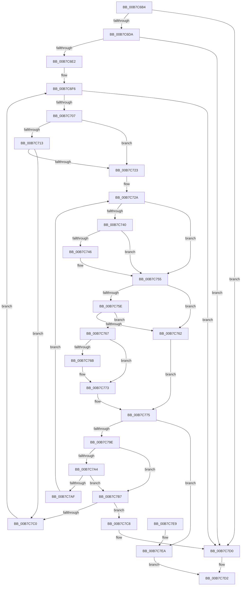

# MiMirrorBrownPhase

- RVA: `0x00B7C6B4`–`0x00B7C7F6` (길이 `322` bytes)
- VA: `0x0000000140B7C6B4`
- 실행 섹션: `PAGELK`
- PDB 이름 있음: `예`; PDB Function 태그: `아니요`
- unwind 정보 RVA: `0x000BC6DC`
- 디코드: `92`개 명령, `322/322` bytes 표시
- 미해석 바이트: `0` (있으면 어셈블리에 `.byte`로 보존)

> 이 문서는 커널 이미지의 기계어와 PDB 기호를 분석해 생성했습니다. 4번과 5번은 함수 원형과 자료형을 바이너리 사용 방식에서 추정한 C 해석이며 원본 소스 복구 결과는 아닙니다.

## 1. Dependencies

- 직접 호출 지점: **7**; 고유 호출 대상: **6**
- 직접 호출자로 확인된 함수: **1**
- RIP 상대 이미지 참조: **3**

### Outgoing calls
- `0x00B7C6F6` → [PsGetNextPartition](../../text/3B/PsGetNextPartition_function_003B9D5C.md) (function, `0x003B9D5C`)
- `0x00B7C736` → [MiActOnMirrorBitmap](../../page/AC/MiActOnMirrorBitmap_function_00AC21D0.md) (function, `0x00AC21D0`)
- `0x00B7C76E` → [MiEmptyAllWorkingSets](../../text/67/MiEmptyAllWorkingSets_function_0067E6C8.md) (function, `0x0067E6C8`)
- `0x00B7C783` → [MiWalkPagesOnLists](../../text/3B/MiWalkPagesOnLists_function_003B6AA4.md) (function, `0x003B6AA4`)
- `0x00B7C793` → [MiMirrorPerformBrownWrites](../../text/45/MiMirrorPerformBrownWrites_function_0045C560.md) (function, `0x0045C560`)
- `0x00B7C7CB` → [PsQuitNextPartition](../../text/5E/PsQuitNextPartition_function_005E4AFC.md) (function, `0x005E4AFC`)
- `0x00B7C7ED` → [PsQuitNextPartition](../../text/5E/PsQuitNextPartition_function_005E4AFC.md) (function, `0x005E4AFC`)

### Direct callers
- [MmDuplicateMemory](MmDuplicateMemory_function_00B74158.md) at `0x00B7436A`

### Static image references
- `0x00B7C713` → RVA `0x00E38D00` (`.data`; read)
- `0x00B7C72F` → RVA `0x00E30190` (`.data`; read)
- `0x00B7C74A` → RVA `0x00E37418` (`.data`; read/write)

## 2. Other-region calls and transfers

- 다른 실행 섹션으로 향하는 call: **7**
  - `0x00B7C6F6` → [PsGetNextPartition](../../text/3B/PsGetNextPartition_function_003B9D5C.md) (`PAGELK` → `.text`)
  - `0x00B7C736` → [MiActOnMirrorBitmap](../../page/AC/MiActOnMirrorBitmap_function_00AC21D0.md) (`PAGELK` → `PAGE`)
  - `0x00B7C76E` → [MiEmptyAllWorkingSets](../../text/67/MiEmptyAllWorkingSets_function_0067E6C8.md) (`PAGELK` → `.text`)
  - `0x00B7C783` → [MiWalkPagesOnLists](../../text/3B/MiWalkPagesOnLists_function_003B6AA4.md) (`PAGELK` → `.text`)
  - `0x00B7C793` → [MiMirrorPerformBrownWrites](../../text/45/MiMirrorPerformBrownWrites_function_0045C560.md) (`PAGELK` → `.text`)
  - `0x00B7C7CB` → [PsQuitNextPartition](../../text/5E/PsQuitNextPartition_function_005E4AFC.md) (`PAGELK` → `.text`)
  - `0x00B7C7ED` → [PsQuitNextPartition](../../text/5E/PsQuitNextPartition_function_005E4AFC.md) (`PAGELK` → `.text`)
- 별도 외부 분기/꼬리 이동을 확인하지 못했습니다.

## 3. Assembly (complete function range)

```asm
00B7C6B4  48 89 5C 24 10                  mov qword ptr [rsp + 0x10], rbx
00B7C6B9  48 89 6C 24 18                  mov qword ptr [rsp + 0x18], rbp
00B7C6BE  56                              push rsi
00B7C6BF  57                              push rdi
00B7C6C0  41 54                           push r12
00B7C6C2  41 56                           push r14
00B7C6C4  41 57                           push r15
00B7C6C6  48 83 EC 30                     sub rsp, 0x30
00B7C6CA  8B 41 08                        mov eax, dword ptr [rcx + 8]
00B7C6CD  48 8B D9                        mov rbx, rcx
00B7C6D0  0F BA E0 0B                     bt eax, 0xb
00B7C6D4  0F 82 F6 00 00 00               jb 0x140b7c7d0
00B7C6DA  A8 C0                           test al, 0xc0
00B7C6DC  0F 85 EE 00 00 00               jne 0x140b7c7d0
00B7C6E2  48 83 64 24 60 00               and qword ptr [rsp + 0x60], 0
00B7C6E8  41 BC 00 00 00 00               mov r12d, 0
00B7C6EE  A8 0A                           test al, 0xa
00B7C6F0  41 0F 94 C4                     sete r12b
00B7C6F4  33 C9                           xor ecx, ecx
00B7C6F6  E8 61 D6 83 FF                  call 0x1403b9d5c
00B7C6FB  48 8B F8                        mov rdi, rax
00B7C6FE  48 85 C0                        test rax, rax
00B7C701  0F 84 C9 00 00 00               je 0x140b7c7d0
00B7C707  F7 43 08 00 01 00 00            test dword ptr [rbx + 8], 0x100
00B7C70E  4C 8B 38                        mov r15, qword ptr [rax]
00B7C711  74 10                           je 0x140b7c723
00B7C713  48 8D 05 E6 C5 2B 00            lea rax, [rip + 0x2bc5e6]
00B7C71A  4C 3B F8                        cmp r15, rax
00B7C71D  0F 85 9D 00 00 00               jne 0x140b7c7c0
00B7C723  45 33 F6                        xor r14d, r14d
00B7C726  48 8D 6B 14                     lea rbp, [rbx + 0x14]
00B7C72A  BA 02 00 00 00                  mov edx, 2
00B7C72F  48 8D 0D 5A 3A 2B 00            lea rcx, [rip + 0x2b3a5a]
00B7C736  E8 95 5A F4 FF                  call 0x140ac21d0
00B7C73B  45 3B F4                        cmp r14d, r12d
00B7C73E  75 15                           jne 0x140b7c755
00B7C740  80 7D 00 00                     cmp byte ptr [rbp], 0
00B7C744  75 0F                           jne 0x140b7c755
00B7C746  C6 45 00 01                     mov byte ptr [rbp], 1
00B7C74A  F0 FF 05 C7 AC 2B 00            lock inc dword ptr [rip + 0x2bacc7]
00B7C751  48 8D 6B 14                     lea rbp, [rbx + 0x14]
00B7C755  8B 43 08                        mov eax, dword ptr [rbx + 8]
00B7C758  0F BA E0 0A                     bt eax, 0xa
00B7C75C  72 04                           jb 0x140b7c762
00B7C75E  A8 04                           test al, 4
00B7C760  74 05                           je 0x140b7c767
00B7C762  8B 43 0C                        mov eax, dword ptr [rbx + 0xc]
00B7C765  EB 0E                           jmp 0x140b7c775
00B7C767  A8 10                           test al, 0x10
00B7C769  75 08                           jne 0x140b7c773
00B7C76B  49 8B CF                        mov rcx, r15
00B7C76E  E8 55 1F B0 FF                  call 0x14067e6c8
00B7C773  33 C0                           xor eax, eax
00B7C775  44 8B 43 10                     mov r8d, dword ptr [rbx + 0x10]
00B7C779  49 8B D7                        mov rdx, r15
00B7C77C  48 8B CB                        mov rcx, rbx
00B7C77F  89 44 24 20                     mov dword ptr [rsp + 0x20], eax
00B7C783  E8 1C A3 83 FF                  call 0x1403b6aa4
00B7C788  8B 53 08                        mov edx, dword ptr [rbx + 8]
00B7C78B  4C 8D 44 24 60                  lea r8, [rsp + 0x60]
00B7C790  48 8B 0B                        mov rcx, qword ptr [rbx]
00B7C793  E8 C8 FD 8D FF                  call 0x14045c560
00B7C798  8B F0                           mov esi, eax
00B7C79A  85 C0                           test eax, eax
00B7C79C  78 4C                           js 0x140b7c7ea
00B7C79E  80 7D 00 00                     cmp byte ptr [rbp], 0
00B7C7A2  75 13                           jne 0x140b7c7b7
00B7C7A4  48 81 7C 24 60 00 04 00 00      cmp qword ptr [rsp + 0x60], 0x400
00B7C7AD  72 08                           jb 0x140b7c7b7
00B7C7AF  41 FF C6                        inc r14d
00B7C7B2  E9 73 FF FF FF                  jmp 0x140b7c72a
00B7C7B7  F7 43 08 00 01 00 00            test dword ptr [rbx + 8], 0x100
00B7C7BE  75 08                           jne 0x140b7c7c8
00B7C7C0  48 8B CF                        mov rcx, rdi
00B7C7C3  E9 2E FF FF FF                  jmp 0x140b7c6f6
00B7C7C8  48 8B CF                        mov rcx, rdi
00B7C7CB  E8 2C 83 A6 FF                  call 0x1405e4afc
00B7C7D0  33 C0                           xor eax, eax
00B7C7D2  48 8B 5C 24 68                  mov rbx, qword ptr [rsp + 0x68]
00B7C7D7  48 8B 6C 24 70                  mov rbp, qword ptr [rsp + 0x70]
00B7C7DC  48 83 C4 30                     add rsp, 0x30
00B7C7E0  41 5F                           pop r15
00B7C7E2  41 5E                           pop r14
00B7C7E4  41 5C                           pop r12
00B7C7E6  5F                              pop rdi
00B7C7E7  5E                              pop rsi
00B7C7E8  C3                              ret
00B7C7E9  CC                              int3
00B7C7EA  48 8B CF                        mov rcx, rdi
00B7C7ED  E8 0A 83 A6 FF                  call 0x1405e4afc
00B7C7F2  8B C6                           mov eax, esi
00B7C7F4  EB DC                           jmp 0x140b7c7d2
```

## 4. C-style interpretation (structured pseudocode)

```c
__int64 __fastcall MiMirrorBrownPhase(__int64 a1)
{
    __int64 result;
    __int64 v_r12;
    __int64 v_r14;
    __int64 v_rbp;
    __int64 v_rsp;
    unsigned int v_stack_m38;
    unsigned __int64 v_stack_p10;
    unsigned __int64 v_stack_p18;
    unsigned __int64 v_stack_p8;

    v_stack_p10 = v_rbx;
    v_stack_p18 = v_rbp;
    v_rsp = (v_rsp) - (48);
    if (condition_is_below) goto loc_00B7C7D0;
    if ((((unsigned __int8)((unsigned int)(*(unsigned int *)(a1 + 8)))) & (192)) != 0) goto loc_00B7C7D0;
    v_r12 = ((((unsigned __int8)((unsigned int)(*(unsigned int *)(a1 + 8)))) & (10)) == 0) ? 1 : 0;
    a1 = 0;
loc_00B7C6F6:
    result = PsGetNextPartition(a1, a2, a3, a4);
    if (result == 0) goto loc_00B7C7D0;
    if (((*(unsigned int *)(a1 + 8)) & (256)) == 0) goto loc_00B7C723;
    if ((*(unsigned __int64 *)(result)) != (v_rip + 2868710)) goto loc_00B7C7C0;
loc_00B7C723:
    v_r14 = 0;
loc_00B7C72A:
    result = MiActOnMirrorBitmap(v_rip + 2832986, 2, a3, a4);
    if (0 != ((unsigned int)(v_r12))) goto loc_00B7C755;
    v_rbp = a1 + 20;
    if ((*(unsigned __int8 *)(a1 + 20)) == 0) {
        *(unsigned __int8 *)(a1 + 20) = 1;
        v_rbp = a1 + 20;
    }
    if ((*(unsigned __int8 *)(a1 + 20)) < 0) goto loc_00B7C762;
    if ((((unsigned __int8)((unsigned int)(*(unsigned int *)(a1 + 8)))) & (4)) == 0) goto loc_00B7C767;
loc_00B7C762:
    goto loc_00B7C775;
loc_00B7C767:
    result = (unsigned int)(*(unsigned int *)(a1 + 12));
    if ((((unsigned __int8)((unsigned int)(*(unsigned int *)(a1 + 12)))) & (16)) == 0) {
        a1 = *(unsigned __int64 *)(result);
        result = MiEmptyAllWorkingSets(a1, 2, a3, a4);
    }
    result = 0;
loc_00B7C775:
    v_stack_m38 = 0;
    result = MiWalkPagesOnLists(a1, *(unsigned __int64 *)(result), (unsigned int)(*(unsigned int *)(a1 + 16)), a4);
    result = MiMirrorPerformBrownWrites(*(unsigned __int64 *)(a1), (unsigned int)(*(unsigned int *)(a1 + 8)), v_stack_p8, a4);
    if (sign_flag) goto loc_00B7C7EA;
    if ((*(unsigned __int8 *)(v_rbp)) != 0) goto loc_00B7C7B7;
    if (v_stack_p8 < 0x400ULL) goto loc_00B7C7B7;
    v_r14 = (unsigned int)((v_r14) + 1);
    goto loc_00B7C72A;
loc_00B7C7B7:
    if (((*(unsigned int *)(a1 + 8)) & (256)) != 0) goto loc_00B7C7C8;
loc_00B7C7C0:
    goto loc_00B7C6F6;
loc_00B7C7C8:
    result = PsQuitNextPartition(result, (unsigned int)(*(unsigned int *)(a1 + 8)), v_stack_p8, a4);
loc_00B7C7D0:
    result = 0;
loc_00B7C7D2:
    v_rsp = (v_rsp) + (48);
    return result;
loc_00B7C7EA:
    result = PsQuitNextPartition(0, (unsigned int)(*(unsigned int *)(a1 + 8)), v_stack_p8, a4);
    goto loc_00B7C7D2;
}
```

## 5. (Beta) C Style

```c
int64_t MiMirrorBrownPhase(void *Arg1)
{
    uint8_t *arg1 = (uint8_t *)Arg1;

    int64_t result;
    int64_t local_r12;
    int64_t local_r14;
    int64_t local_rbp;
    int64_t local_rsp;
    uint32_t v_stack_m38;
    uint64_t v_stack_p10;
    uint64_t v_stack_p18;
    uint64_t v_stack_p8;

    v_stack_p10 = local_rbx;
    v_stack_p18 = local_rbp;
    local_rsp = (local_rsp) - (48);
    if (condition_is_below) goto loc_00B7C7D0;
    if ((((uint8_t)((uint32_t)(*(uint32_t *)(arg1 + 0x8)))) & (192)) != 0) goto loc_00B7C7D0;
    local_r12 = ((((uint8_t)((uint32_t)(*(uint32_t *)(arg1 + 0x8)))) & (10)) == 0) ? 1 : 0;
    Arg1 = 0;
loc_00B7C6F6:
    result = PsGetNextPartition(Arg1, a2, a3, a4);
    if (result == 0) goto loc_00B7C7D0;
    if (((*(uint32_t *)(arg1 + 0x8)) & (256)) == 0) goto loc_00B7C723;
    if ((*(uint64_t *)(result)) != (v_rip + 2868710)) goto loc_00B7C7C0;
loc_00B7C723:
    local_r14 = 0;
loc_00B7C72A:
    result = MiActOnMirrorBitmap(v_rip + 2832986, 2, a3, a4);
    if (0 != ((uint32_t)(local_r12))) goto loc_00B7C755;
    local_rbp = Arg1 + 20;
    if ((*(uint8_t *)(arg1 + 0x14)) == 0) {
        *(uint8_t *)(arg1 + 0x14) = 1;
        local_rbp = Arg1 + 20;
    }
    if ((*(uint8_t *)(arg1 + 0x14)) < 0) goto loc_00B7C762;
    if ((((uint8_t)((uint32_t)(*(uint32_t *)(arg1 + 0x8)))) & (4)) == 0) goto loc_00B7C767;
loc_00B7C762:
    goto loc_00B7C775;
loc_00B7C767:
    result = (uint32_t)(*(uint32_t *)(arg1 + 0xC));
    if ((((uint8_t)((uint32_t)(*(uint32_t *)(arg1 + 0xC)))) & (16)) == 0) {
        Arg1 = *(uint64_t *)(result);
        result = MiEmptyAllWorkingSets(Arg1, 2, a3, a4);
    }
    result = 0;
loc_00B7C775:
    v_stack_m38 = 0;
    result = MiWalkPagesOnLists(Arg1, *(uint64_t *)(result), (uint32_t)(*(uint32_t *)(arg1 + 0x10)), a4);
    result = MiMirrorPerformBrownWrites(*(uint64_t *)(arg1), (uint32_t)(*(uint32_t *)(arg1 + 0x8)), v_stack_p8, a4);
    if (sign_flag) goto loc_00B7C7EA;
    if ((*(uint8_t *)(local_rbp)) != 0) goto loc_00B7C7B7;
    if (v_stack_p8 < 0x400ULL) goto loc_00B7C7B7;
    local_r14 = (uint32_t)((local_r14) + 1);
    goto loc_00B7C72A;
loc_00B7C7B7:
    if (((*(uint32_t *)(arg1 + 0x8)) & (256)) != 0) goto loc_00B7C7C8;
loc_00B7C7C0:
    goto loc_00B7C6F6;
loc_00B7C7C8:
    result = PsQuitNextPartition(result, (uint32_t)(*(uint32_t *)(arg1 + 0x8)), v_stack_p8, a4);
loc_00B7C7D0:
    result = 0;
loc_00B7C7D2:
    local_rsp = (local_rsp) + (48);
    return result;
loc_00B7C7EA:
    result = PsQuitNextPartition(0, (uint32_t)(*(uint32_t *)(arg1 + 0x8)), v_stack_p8, a4);
    goto loc_00B7C7D2;
}
```

### 관측된 메모리 오프셋

구조체 형식이 확인되지 않은 접근은 인자 기준의 오프셋으로만 기록했습니다.

| 기준 인자 | 오프셋 표현 | 폭 (bit) | 접근 |
|---|---:|---:|---|
| `Arg1` | `+ 0x0` | `8` | `R` |
| `Arg1` | `+ 0x0` | `8` | `W` |
| `Arg1` | `+ 0x0` | `64` | `R` |
| `Arg1` | `+ 0x8` | `32` | `R` |
| `Arg1` | `+ 0xC` | `32` | `R` |
| `Arg1` | `+ 0x10` | `32` | `R` |
| `Arg1` | `+ 0x14` | `64` | `R` |

## 6. Execution-region graph

[열기: 2D/3D 그래프와 함수 탐색 컨트롤 패널](../../../control-panel.html?section=pagelk&rva=0x00B7C6B4&view=graph)

- 2D 그래프는 위에서 아래로 흐르고, 3D 그래프는 빈 공간을 드래그해 회전합니다. Shift+드래그는 이동, 휠은 확대·축소, 함수 노드 선택은 대상 보고서 이동입니다.

### Static fallback


